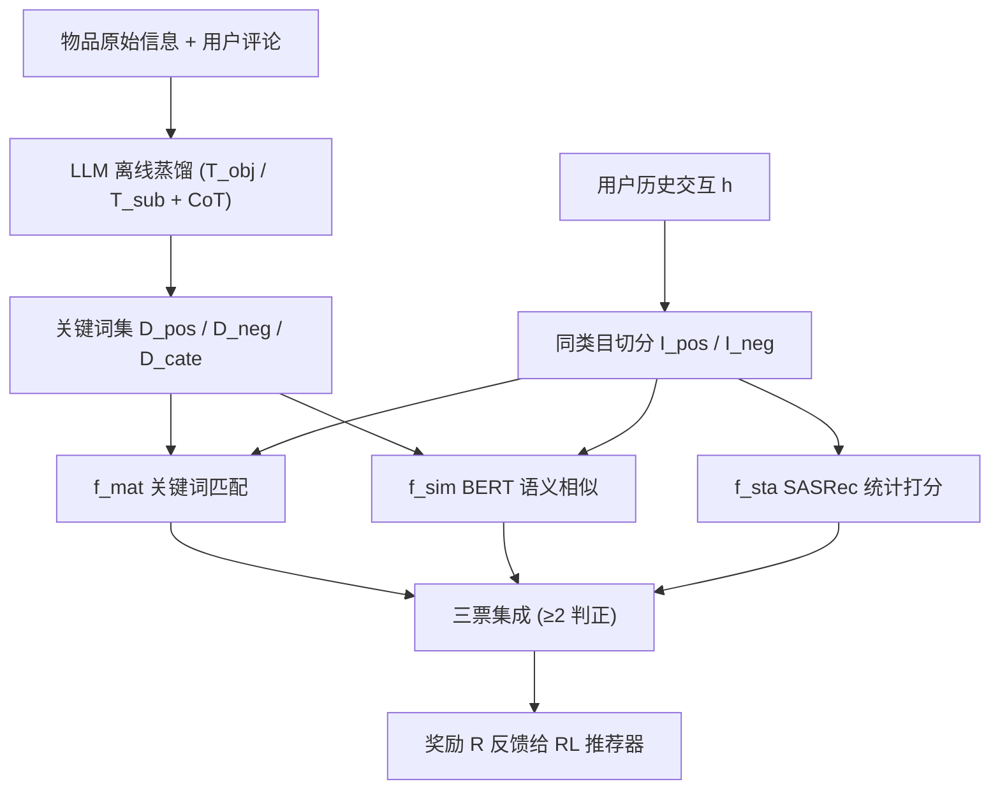
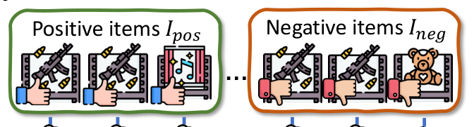

# LLM-Powered User Simulator for Recommender System (基于大语言模型的推荐系统用户模拟器)

- **会议/期刊**: AAAI 2025
- **作者与机构**: Zijian Zhang, Shuchang Liu, Ziru Liu, Rui Zhong, Qingpeng Cai, Xiangyu Zhao, Chunxu Zhang, Qidong Liu, Peng Jiang（吉林大学符号计算与知识工程教育部重点实验室、快手科技、香港城市大学、西安交通大学）
- **推荐链路定位**: 强化学习训练环境（用户模拟器 / 奖励建模）
- **研究方向**: 对话推荐与智能体仿真 / 强化学习与动态探索推荐
- **论文原文**: [https://arxiv.org/abs/2412.16984v1](https://arxiv.org/abs/2412.16984v1)
- **开源代码**: [https://github.com/Applied-Machine-Learning-Lab/LLM_User_Simulator](https://github.com/Applied-Machine-Learning-Lab/LLM_User_Simulator)

## TL;DR (1分钟核心速览)

针对 RL 推荐训练中真实交互数据昂贵、现有用户模拟器（GAN/Transformer/纯 LLM）偏好建模黑箱且缺乏保真度评估的两大痛点，本文提出显式交互逻辑：先用 LLM 离线把物品蒸馏为"优点/缺点关键词集"，再用关键词匹配模型 $f_{mat}$、BERT 语义相似模型$f_{sim}$与 SASRec 统计模型$f_{sta}$ 三票集成推断 like/dislike。在 Yelp、Amazon Music/Games/Movie、Anime 五个数据集上，DQN 在集成模拟器上取得平均奖励 27.56（Yelp），较 KuaiSim 提升 8.7%、较 SUBER 提升 16.1%，AUC 达 0.674，且推理仅 0.76s。

## Background & Motivation (背景与核心矛盾)

- **主流范式**: RL 推荐依赖与环境交互试错，用户模拟器（VirtualTaobao 的 GAN、KuaiSim 的离线 Transformer、SUBER/Agent4Rec 的 LLM 直接推断）被用来低成本生成行为数据。
- **前人局限**: 其一，GAN/Transformer 模拟器的偏好建模完全隐式、不可解释，无法说明"为什么喜欢"；其二，纯 LLM 模拟器每次交互都需调用大模型，计算与时间开销巨大，且幻觉会污染奖励信号；同时领域内缺乏统一的模拟保真度评估协议。
- **核心洞察 (Key Insight)**: 作者将人类决策拆解为两步显式逻辑——先判断"物品是什么"（客观属性/优缺点），再判断"它对我怎么样"（与历史正负偏好及大众口碑的比对），如图 1 所示。这一逻辑可被 LLM 离线蒸馏为关键词，从而把在线推理降级为轻量集合运算。
- **本文切入点**: 用 LLM 只做一次性的离线物品画像，在线阶段用"逻辑模型 + 统计模型"集成替代 LLM 实时调用，兼顾可解释性与低开销。

## Method (核心方法设计)

### 1. 整体框架 (Overall Architecture)

模拟器形式化为 $P(y_c \mid h, i_c)$，其中$h=\{(i_1,y_1),\dots,(i_n,y_n)\}$为历史交互、$y_c\in\{0,1\}$为候选物品$i_c$的 like/dislike。流程分三段：① 离线画像——LLM 通过客观模板$T_{obj}$（基于名称/属性/类目生成 pros/cons 及证据）与主观模板$T_{sub}$（基于真实评论与评分反推情感关键词）为每个物品产出类目$D_{cate}$、优点关键词集$D_{pos}=D^{obj}_{pos}\cup D^{sub}_{pos}$与缺点集$D_{neg}$，并经频次过滤去噪；② 在线推断——将历史交互按候选物品类目切出$h^C$（同类目为空则回退全历史），再分为正物品集$I_{pos}$与负物品集$I_{neg}$，送入三个基模型；③ 集成投票——三模型多数表决生成奖励，驱动 RL 智能体训练。

<figure class="paper-figure" markdown="span">
  <figcaption>图2：用户交互模拟流程。我们使用LLM为物品生成偏好关键词。对于候选物品ic，我们将用户历史交互h划分为正物品集Ipos和负物品集Ineg，并应用三个基础模型，即两个逻辑模型fmat、fsim和一个统计模型fsta，对照历史物品的优缺点来评估ic的优缺点，即Dic pos和Dic neg。我们将三个基础模型的输出集成作为最终的交互推断yc。</figcaption>
</figure>

### 2. 关键设计拆解 (Key Designs)

1. **关键词匹配逻辑模型 $f_{mat}$（显式偏好对齐）**：隐式嵌入无法解释"为何喜欢"，本文直接统计候选物品优缺点关键词与历史同类目正/负物品关键词的集合交集基数：
$\alpha_{pos}=\sum_{i\in I_{pos}}|D^{i_c}_{pos}\cap D^{i}_{pos}|,\quad \alpha_{neg}=\sum_{i\in I_{neg}}|D^{i_c}_{neg}\cap D^{i}_{neg}|$当$\alpha_{pos}>\alpha_{neg}$ 输出 1，相等则随机。直觉是：用户对候选物的"潜在喜欢理由"若与其历史喜欢物品的理由高度重合，则倾向正反馈，规则完全可追溯。

2. **语义相似逻辑模型 $f_{sim}$（缓解关键词稀疏）**：纯字面匹配对同义表述失效，故用 BERT 对关键词集做平均池化得$E_{pos},E_{neg}$，取候选物与历史集的最大余弦相似度：
$\beta_{pos}=\max_{i\in I_{pos}}\phi(E^{i_c}_{pos},E^{i}_{pos}),\quad \beta_{neg}=\max_{i\in I_{neg}}\phi(E^{i_c}_{neg},E^{i}_{neg})$以$\beta$替代$\alpha$ 做同构比较。取 max 而非 mean 是为了捕捉"只要有一个强共鸣理由即可触发偏好"的稀疏激活特性。

3. **统计模型 $f_{sta}$与集成奖励**：逻辑模型对全新类目物品（如案例中$i^c_{t+1}$ 的 Bakeries）会失准，故引入预训练 SASRec 作为协同过滤兜底。最终奖励为三模型多数表决：
$R(s,i_c,s')=\mathbb{I}\left[f_{mat}+f_{sim}+f_{sta}\geq 2\right]$
LLM 仅在离线画像阶段调用，在线训练零 LLM 开销；三模型异质（规则/语义/协同）互补，任一路径失效时其余两票仍可纠偏。

## Experimental Setup & Evaluation Protocol (实验设置与评估协议)

- **数据集与预处理**: 评分二值化（$\geq 3$ 记 1，否则 0），LLM 采用 ChatGLM-6B。

| 数据集 | #Users | #Items | #Interactions | 稀疏度 | 场景说明 |
| :--- | :---: | :---: | :---: | :---: | :--- |
| Yelp | 15,081 | 10,186 | 228,000 | 99.85% | 本地生活（Missouri 州） |
| Amazon Music | 125,627 | 65,019 | 162,261 | 99.99% | 数字音乐 |
| Amazon Games | 30,195 | 23,096 | 165,571 | 99.98% | 视频游戏 |
| Amazon Movie | 24,191 | 49,154 | 972,536 | 99.92% | 电影 |
| Anime | 24,859 | 11,188 | 6,111,860 | 97.80% | 动漫 |

- **数据划分与防穿越 (Splitting Strategy)**: 按用户历史交互序列构造 RL 环境，历史 $h$与候选$i_c$ 严格时序分离；统计模型 SASRec 在训练集预训练后冻结，避免候选物品信息泄漏进模拟器。
- **排名评测协议 (Ranking Protocol)**: 非传统 Top-N 排序评测，而是**模拟保真度协议**——以 RL 智能体（A2C/DQN/PPO/TRPO）在模拟器中训练后的平均奖励、总奖励、Top-10 推荐中 like 物品占比（Liking%）以及模拟器自身推断 AUC 作为量化指标，辅以 case study 定性验证。
- **对比基线与超参设置**: 量化对比 SUBER（LLM 直接推断）与 KuaiSim（Transformer 模拟器）；RL 侧对比四种主流算法，DQN 因离散动作空间建模优势成为最强基线配置。

## Key Experimental Results (实验关键数据)

### 1. 主实验对比 (Main Results)

各 RL 算法在本文模拟器上的表现（节选核心指标）：

| 数据集 | 指标 | PPO | TRPO | A2C | DQN |
| :--- | :--- | :---: | :---: | :---: | :---: |
| Yelp | A. Rwd↑ | 9.97 | 13.45 | 24.15 | **27.56** |
| Yelp | Liking%↑ | 34.59 | 40.07 | 48.35 | **49.43** |
| Amazon Music | A. Rwd↑ | 10.49 | 11.31 | 13.45 | **16.70** |
| Amazon Games | A. Rwd↑ | 18.72 | 21.35 | **27.56** | 26.43 |
| Amazon Movie | A. Rwd↑ | 29.42 | 27.47 | 31.72 | **38.60** |
| Anime | A. Rwd↑ | 14.12 | 14.58 | **21.50** | 18.03 |

模拟器横向对比（Yelp）：

| 模拟器 | A. Rwd↑ | T. Rwd↑ | AUC↑ | 推理时间(s) |
| :--- | :---: | :---: | :---: | :---: |
| SUBER | 23.74 | 297.48 | 0.643 | 2.42 |
| KuaiSim | 25.35 | 316.46 | 0.658 | 0.53 |
| **Ours** | **27.56** | **330.98** | **0.674** | 0.76 |
| Improv. (vs KuaiSim) | +8.7% | +4.6% | +2.4% | — |

### 2. 消融实验 (Ablation Study)

原文未提供标准逐组件消融表，但通过 case study（表 4）给出三模型逐条推断的等价消融证据：

| 候选物品 | $f_{mat}$|$f_{sim}$|$f_{sta}$| 集成奖励$R$ | 说明 |
| :--- | :---: | :---: | :---: | :---: | :--- |
| $i^c_t$ | 0 | 0 | 1 | 0 | 逻辑双模型一致否决，统计模型被多数票压制 |
| $i^c_{t+1}$| 1 | 0 | 1 | 1 | 新类目物品，$f_{mat}$偶然命中，靠$f_{sta}$ 兜底 |
| $i^c_{t+2}$ | 1 | 1 | 1 | 1 | 三模型一致，高置信正反馈 |

### 3. 关键实验发现 (Key Findings)

1. **DQN 在 5 个数据集中的 4 个取得最优平均奖励**（Yelp 27.56、Movie 38.60），验证模拟器能为离散动作空间的 Q-learning 提供稳定一致的奖励信号；而 A2C 在 Games/Anime 反超，说明模拟器对不同算法族保持区分度而非"一视同仁"地饱和。
2. **集成机制是保真度关键**：case study 中 $i^c_t$若仅看$f_{sta}$ 会误判为正，正是逻辑双模型的 0 票将其纠正为负，直接印证"逻辑模型保证透明一致、统计模型补足细粒度"的互补假设。
3. **效率与精度双赢**：相比 SUBER 的 2.42s 推理，本文 0.76s 提速约 3.2 倍且 AUC 更高（0.674 vs 0.643），证明"LLM 离线蒸馏 + 在线轻量集成"路线在成本-保真度权衡上优于 LLM 实时调用。

## Highlights & Limitations (亮点、对比与审稿批判)

- **与代表作对比 (vs. Prior Work)**: 相较 KuaiSim 的端到端 Transformer 黑箱模拟，本文把偏好显式化为可读关键词并支持逐条归因；相较 SUBER/Agent4Rec 的 LLM 实时推断，本文把 LLM 降级为离线画像工具，规避了训练期幻觉与算力瓶颈；相较 VirtualTaobao 的 GAN 分布拟合，本文不依赖大规模对抗训练即可冷启动物品画像。
- **可迁移亮点**: ① "LLM 离线蒸馏结构化标签 + 在线轻量规则/统计集成"的范式可迁移至冷启动物品画像、可解释召回理由生成；② 三模型多数表决的奖励塑形可直接嵌入任何 RL 推荐训练管线作为低成本 reward model。
- **审稿级局限批判**: ① 仅支持二值 like/dislike，未建模评分强度、停留时长、复访等连续信号，模拟粒度偏粗；② 关键词质量强依赖 ChatGLM-6B 的领域知识，跨语种/长尾类目下 $D_{pos}/D_{neg}$ 可能稀疏，且离线画像需为全量物品预生成，冷启动物品仍需在线补算；③ 评估以 RL 奖励与 AUC 为主，缺少与真实线上用户行为的直接分布对齐度量（如 KL 散度或人工 A/B）。

## Rating (四维评分)

- **方法创新性 (Novelty)**: ⭐⭐⭐⭐ （将人类决策拆为"是什么/怎么样"两步显式逻辑并用 LLM 关键词落地，思路清晰但组件本身较常规）
- **评估协议与实验扎实度 (Protocol & Experiments)**: ⭐⭐⭐ （覆盖 5 个跨领域数据集与 4 种 RL 算法，但缺少标准消融表与真实行为分布对齐指标）
- **写作与数学规范度 (Clarity & Rigor)**: ⭐⭐⭐⭐ （公式简洁、prompt 模板完整可复现，逻辑链条交代清楚）
- **工业落地与复现价值 (Industrial & Practical Value)**: ⭐⭐⭐⭐ （LLM 仅离线调用、在线 0.76s 推理，工程友好且已开源，适合作为 RL 推荐训练沙盒）

