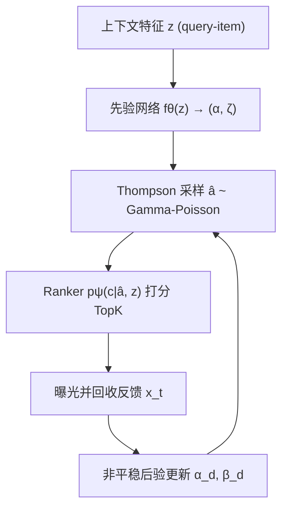
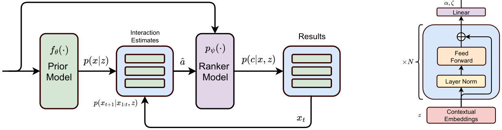

# BayesCNS: A Unified Bayesian Approach to Address Cold Start and Non-Stationarity in Search Systems at Scale (面向大规模搜索系统冷启动与非平稳性的统一贝叶斯方法)

- **会议/期刊**: AAAI 2025
- **作者与机构**: Randy Ardywibowo, Rakesh Sunki, Lucy Kuo, Sankalp Nayak (Apple)
- **推荐链路定位**: 精排（Learning-to-Rank 打分层，外挂于任意 ranker）
- **研究方向**: 冷启动与长尾推荐 / 强化学习与动态探索推荐
- **论文原文**: [论文原文链接](https://arxiv.org/abs/2410.02126v2)
- **开源代码**: 暂未开源

## TL;DR (1分钟核心速览)

LTR 精排高度依赖用户交互特征 $x$，导致新物品冷启动与行为非平稳漂移两大痛点，而现有工作（启发式加权、辅助信息、周期重训）只单独处理其一。BayesCNS 把二者统一为在线学习问题：用神经网络$f_\theta(z)$从上下文特征$z$预测交互特征的 Gamma-Poisson 先验，再以 Thompson 采样在线更新后验并注入 ranker 打分。离线三基准全面领先，线上 A/B 新物品曝光 +10.60%、成功率 +1.05%（$p<0.05$）。

## Background & Motivation (背景与核心矛盾)

- **主流范式**: 搜索/推荐精排用 LTR 模型 $s(d,q)=p_\psi(c|x,z)$，其中$x$为点击/互动等交互特征，$z$ 为类目、关键词等静态上下文特征。
- **前人局限**: ① 冷启动方案靠启发式 boost 排序或辅助信息补交互缺失，但完全不建模行为漂移；② 非平稳问题靠周期重训，成本高且线上数据质量波动导致训练不稳定；③ 纯 bandit 方案可扩展性差，OLTR 只扰动 ranker 参数、不建模交互特征本身的偏差。
- **核心洞察 (Key Insight)**: 冷启动与非平稳本质同源——都是交互特征 $x$ 的动态不确定性。贝叶斯先验恰好能刻画这种不确定性，且后验可随新数据实时更新，无需重训。
- **本文切入点**: 用经验贝叶斯学习 $p(x|z)$ 作为先验，再用 Thompson 采样在非平稳下持续更新后验，把"探索"变成对交互特征估计的采样而非对物品的盲目加权。

## Method (核心方法设计)

### 1. 整体框架 (Overall Architecture)

离线阶段用现有物品的 $(x,z)$训练先验网络$f_\theta(z)$，输出每个交互特征的 Gamma-Poisson 参数$(\alpha,\zeta)$；在线阶段对候选集每个物品从先验采样交互特征估计$\hat{a}_d$，连同上下文$z_d$送入冻结的 ranker$p_\psi(c|\hat{a}_d,z_d)$打分取 TopK 曝光，回收真实反馈$x_t$后按非平稳后验公式更新$(\alpha_d,\beta_d)$，下一轮继续采样。整个闭环中 ranker 不重训，探索由采样方差自然驱动。

<figure class="paper-figure" markdown="span">
  <figcaption>图1：(a) 我们提出的方法的示意图。上下文查询-项目特征 z 用于构建学习到的先验模型 fθ(z)。该模型用于构建用户交互特征 p(x|z) 的先验估计。然后该模型通过 Thompson 采样进行在线学习。通过向排序模型 pψ(·) 提供用户交互特征估计 ˆa，该模型可以在相关上下文信息 z 的引导下探索相关排序 p(c|x, z) 的空间。该模型以用户交互 xt 的形式接收反馈奖励，这些奖励随后用于 u</figcaption>
</figure>

### 2. 关键设计拆解 (Key Designs)

1. **Gamma-Poisson 先验的数值稳定重参数化**：交互计数 $x$天然适合 Gamma-Poisson 混合（共轭、后验闭式），但 rate 参数$\beta$的梯度易数值下溢。作者改写为负二项形式并令$\rho=\frac{\beta}{1+\beta}\triangleq\sigma(\zeta)$，对数似然变为
$$\log p(x|\alpha,\zeta)=\log\Gamma(x+\alpha)-\log\Gamma(\alpha)+\alpha\log\sigma(\zeta)+x\log(1-\sigma(\zeta)),$$
第二行可复用数值稳定的 BCE 实现，第一行对 $\alpha>0$ 稳定，从而可用 SGD 端到端训练先验网络。直觉：把"计数分布"翻译成"分类式 logit"，既保留共轭性又兼容深度学习。

2. **非平稳后验的折扣式更新**：标准共轭后验在分布漂移下会"记住"过时数据。作者引入折扣因子 $\gamma\in[0,1]$：
$$\alpha_t(z)=\sum_{i=1}^{n_t}x_t^i+\gamma\alpha_0(z)+(1-\gamma)\alpha_{t-1},\quad \beta_t(z)=n_t+\gamma\beta_0(z)+(1-\gamma)\beta_{t-1}.$$
无观测时参数指数回缩到先验 $(\alpha_0,\beta_0)$，等价于每步向先验注入不确定性。直觉：$\gamma$ 控制"遗忘速度"，使老物品也能被持续再探索，而非只有新物品受益。

3. **Ranker 引导的 Thompson 采样与训练目标**：动作空间定义为交互特征预测，奖励 $R(a_t,x_t)=\mathbb{I}[a_t=x_t]$，则采样概率退化为后验$p(\hat{a}_t|x_{1:t-1},z)$，即直接从后验采样特征估计交给 ranker。先验网络损失为全库负对数似然
$$\mathcal{L}(\theta)=\mathbb{E}_{(x,z)\sim\mathcal{D}}\Big[-\sum_{d=1}^{|\mathcal{D}|}\sum_{i=1}^{L}\log p\big(x_i^d|\alpha_\theta(z_i^d),\zeta_\theta(z_i^d)\big)\Big].$$
无需负采样；在线推理仅需一次前向 + 每物品一次采样，开销与 ranker 同阶。

## Experimental Setup & Evaluation Protocol (实验设置与评估协议)

- **数据集与预处理**: 三个带辅助信息的冷启动基准（沿用 Heater 设定）：

| 数据集 | #Users | #Items | #Interactions | 稀疏度/密度 | 特征/场景说明 |
| :--- | :---: | :---: | :---: | :---: | :--- |
| CiteULike | 5,551 | 16,980 | 204,986 | 密度 0.22% | 学术文章，user-like-article |
| LastFM | 1,892 | 17,632 | 92,834 | 密度 0.28% | 音乐人，user-listen-artist |
| XING | 106,881 | 20,519 | 4,306,183 | 密度 0.20% | 招聘职位，user-view-job |

- **数据划分与防穿越 (Splitting Strategy)**: 沿用 Heater 的冷启动划分（物品侧辅助信息构造先验，交互用于评估），非时间戳切分。
- **排名评测协议 (Ranking Protocol)**: `Full-Ranking` 风格的全候选排序，报告 Recall@k / Precision@k / NDCG@k，$k\in\{20,50,100\}$。
- **对比基线与超参设置**: KNN、LinMap、NLinMap、DropoutNet、Heater 五个 SOTA 冷启动基线；先验网络为残差前馈网（文本/图像/类别 embedding + FFN），输出 $\log\alpha$与$\zeta$；显著性用配对 t 检验$p<0.05$。

## Key Experimental Results (实验关键数据)

### 1. 主实验对比 (Main Results)

| 方法 | CiteULike R@20 | CiteULike N@20 | LastFM R@20 | LastFM N@20 | XING R@20 | XING N@20 |
| :--- | :---: | :---: | :---: | :---: | :---: | :---: |
| KNN | .2192 | .1500 | .1354 | .3537 | .1222 | .1722 |
| LinMap | .2351 | .2150 | .1152 | .2880 | .2902 | .3933 |
| NLinMap | .2748 | .2641 | .1398 | .3535 | .2966 | .4001 |
| DropoutNet | .3275 | .3089 | .1351 | .3439 | .2417 | .2761 |
| Heater | .3727 | .3731 | .1451 | .3705 | .3074 | .4150 |
| **BayesCNS** | **.3833** | **.3940** | **.1507** | **.3729** | **.3120** | **.4289** |
| Improv.% (vs Heater) | +2.84% | +5.60% | +3.86% | +0.65% | +1.50% | +3.35% |

线上 A/B（1 个月，百万级请求，新物品占原索引 22.81%）：

| Cohort | 新物品占比 | Succ. 提升 | Impression 提升 |
| :--- | :---: | :---: | :---: |
| 1 | 0.96% | +0.01% | +1.57% |
| 2 | 14.04% | +2.45%* | +28.55%* |
| 3 | 15.80% | +0.31% | +2.55%* |
| 4 | 19.37% | +5.17%* | +34.17%* |
| 5 | 24.94% | +2.43%* | +18.43%* |
| **Overall** | 22.81% | **+1.05%*** | **+10.60%*** |

### 2. 消融实验 (Ablation Study)

| 配置 | 场景 | 关键现象 |
| :--- | :--- | :--- |
| Non-behavioral（仅 $z$） | 平稳，低$w$| 低$w$下最优，高$w$ 下被反超 |
| Behavioral（$z$+$x$，无先验） | 平稳，高$w$ | 因历史交互选择偏差而劣化 |
| **BayesCNS** | 平稳，全 $w$区间 | 低/高$w$ 均最优，兼得两者之长 |
| Bayesian Stationary（去非平稳） | 非平稳 | 首 episode 尚可，后续 episode 崩至 Non-behavioral 以下 |
| **BayesCNS（非平稳）** | 非平稳 | 每个 episode 断点后均能恢复，逼近 Oracle 上界 |

### 3. 关键实验发现 (Key Findings)

1. **先验是"抗选择偏差"的关键**：平稳模拟中，纯 Behavioral 在高 $w$下反而输给 Non-behavioral，说明历史交互特征会放大曝光偏差；BayesCNS 通过先验采样注入不确定性，在全$w$ 区间稳定领先（图 2）。
2. **非平稳假设不可省**：去掉折扣更新后，模型在第二个 episode 起 CTR 持续下滑并跌破 Non-behavioral，证明 $\gamma$ 折扣是应对漂移的必要机制而非锦上添花（图 3）。
3. **收益随冷启动压力单调放大**：线上 cohort 1（新物品仅 0.96%）几乎无增益，cohort 4（19.37%）成功率 +5.17%、曝光 +34.17%，说明方法价值集中在冷启动最严重的场景，符合设计预期。

## Highlights & Limitations (亮点、对比与审稿批判)

- **与代表作对比 (vs. Prior Work)**: 相比 Heater/DropoutNet 等仅用辅助信息补交互缺失、不建模时间漂移；相比周期重训方案无法实时适应且不稳定；相比纯 bandit/OLTR 只扰动 ranker 参数、不建模交互特征偏差——BayesCNS 首次把冷启动与非平稳作为同一不确定性问题统一处理，且 ranker 可冻结复用。
- **可迁移亮点**: ① Gamma-Poisson→负二项→sigmoid 重参数化技巧可复用于任何计数型特征的概率建模；② 折扣后验更新是轻量级的"在线去漂移"插件，可挂到任意已有精排模型上。
- **审稿级局限批判**: ① 离线基准仅三个中等规模数据集，且未与近年图/LLM 冷启动方法对比，SOTA 说服力有限；② 每物品每轮需一次采样 + ranker 前向，候选集极大时在线开销与延迟需额外论证；③ 折扣因子 $\gamma$ 与先验网络容量对效果的敏感度分析缺失，线上 cohort 3 增益不显著也提示收益并非处处稳定。

## Rating (四维评分)

- **方法创新性 (Novelty)**: ⭐⭐⭐⭐ （把冷启动与非平稳统一为交互特征先验不确定性，Gamma-Poisson 重参数化 + 折扣后验组合新颖且自洽）
- **评估协议与实验扎实度 (Protocol & Experiments)**: ⭐⭐⭐⭐ （仿真+三基准+大规模线上 A/B 三层验证完整，但离线基线偏旧、缺敏感度分析）
- **写作与数学规范度 (Clarity & Rigor)**: ⭐⭐⭐⭐ （推导链条清晰、算法伪代码完整，部分符号下标在正文与公式间略有跳变）
- **工业落地与复现价值 (Industrial & Practical Value)**: ⭐⭐⭐⭐ （ranker 冻结、在线开销可控、真实系统部署验证，但未开源、复现需自建仿真环境）

