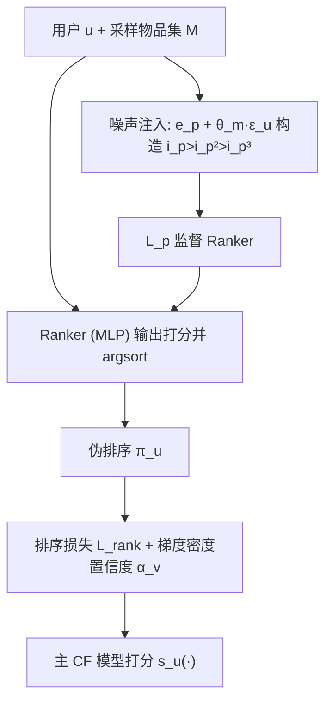
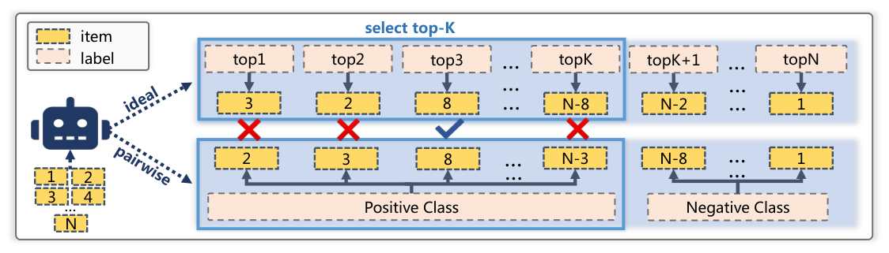

# From Pairwise to Ranking: Climbing the Ladder to Ideal Collaborative Filtering with Pseudo-Ranking (从成对到排序：以伪排序攀登理想协同过滤之梯)

- **会议/期刊**: AAAI 2025
- **作者与机构**: Yuhan Zhao, Rui Chen, Li Chen, Shuang Zhang, Qilong Han, Hongtao Song（哈尔滨工程大学、香港浸会大学）
- **推荐链路定位**: 召回（损失函数与训练范式层面，可插拔于任意 CF 主干）
- **研究方向**: 协同过滤与双塔召回 / 自监督对比学习与交互去噪
- **论文原文**: [https://arxiv.org/abs/2412.18168v1](https://arxiv.org/abs/2412.18168v1)
- **开源代码**: 暂未开源

## TL;DR (1分钟核心速览)

本文指出：理想 CF 应从用户对全库物品的**完整排序**中学习，而 BPR 类成对损失只是其粗糙近似，二者存在本质鸿沟。作者用**多序分类（multiple ordinal classification）**视角形式化该鸿沟，并提出伪排序范式 PRP：用噪声注入机制构造伪排序监督 ranker，再以可微排序损失直接消费排序信息，并配梯度密度置信度抑制错误排序。在 ML-1M/Gowalla/Foursquare/Yelp 四个数据集、Full-Ranking 协议下，NDCG@10 相对 BPR 最高提升 **38.92%**，且可即插即用地提升 MF/LightGCN/NGCF。

## Background & Motivation (背景与核心矛盾)

- **主流范式**: 隐式 CF 几乎全部依赖成对损失（BPR、SRNS、MixGCF、SimpleX、ANS 等），优化目标是最大化 $\prod_{(u,i_p,i_n)\in\mathcal{D}} p(\Theta\mid i_p>_u i_n)$，即只约束"正样本优于负样本"这一局部关系。
- **前人局限**: 其一，成对关系只覆盖 $k=2$的子排序，无法表达$i_1>_u i_2>_u i_3$这类多级偏好；其二，负采样方法（SimpleX 需$\Omega(|U|N^2)$ 量级准确对、ANS/MixGCF 需合成难负样本）虽能隐式恢复部分排序信息，但代价高且仍只考虑特定子排序。
- **核心洞察 (Key Insight)**: 将 CF 视为多序分类问题后可见，理想 CF 要求模型把每个物品分配到 top1…topN 的序数标签上，而成对 CF 只是把 top1…topK 视为正类、其余为负类的"二值化退化"。作者进一步证明 **Theorem 1**：优化理想 CF 是优化 NDCG 的充分非必要条件（构造循环移位排序 $\Psi'_u$ 可保持 DCG 最大但非理想排序），说明理想 CF 严格强于现有排序指标。
- **本文切入点**: 既然数据集中不存在完整排序、且现有损失无法消费排序信息，那就"造排序 + 造损失"——用噪声注入构造伪排序，用多序分类启发的排序损失直接吃排序数据。

## Method (核心方法设计)

### 1. 整体框架 (Overall Architecture)

PRP 由两个耦合组件构成：**Ranker** 与 **排序损失**。对每个用户采样 $k$个物品集合$\mathcal{M}$，Ranker（轻量 MLP）输出$\mathcal{M}$上的打分并 argsort 得到伪排序$\pi_u$；伪排序的监督信号并非来自数据（不存在），而是由噪声注入机制对交互正样本$e_p$施加不同幅度噪声生成$e_p^1,e_p^2,e_p^3$，按噪声幅度递减构造$i_p>_u i_p^2>_u i_p^3$作为排序监督，训练 Ranker。随后排序损失$\mathcal{L}^\alpha_{rank}$以伪排序为输入、以梯度密度置信度$\alpha_v$加权，直接约束主 CF 模型的打分满足序关系；$\mathcal{L}_p$ 与主损失联合端到端优化。

<figure class="paper-figure" markdown="span">
  <figcaption>图1：理想CF与成对CF的比较。</figcaption>
</figure>

### 2. 关键设计拆解 (Key Designs)

1. **用户自适应噪声注入 Ranker（解决"无排序标签"的鸡生蛋问题）**：痛点是无排序监督则 Ranker 无法训练。作者令 $T_{\theta_m}(e_p)=e_p+\theta_m\epsilon_u$，$\theta_1=0$、$\theta_3\gg\theta_2$，直觉是"小噪声仅轻微改变语义→偏好略降，大噪声严重破坏语义→用户难以喜欢"。噪声分布用户相关：$\mu_u=\mathrm{MLP}_1(e_u)$、$\log\sigma_u^2=\mathrm{MLP}_2(\mu_i)$，经重参数化$\epsilon_u=\mu_u+\sigma_u\cdot\eta,\ \eta\sim\mathcal{N}(0,I)$ 采样，从而对偏好稳健的用户自动注入更大噪声。该机制把"无标签"转化为"可控语义退化序"，无需任何人工排序标注。

2. **多序分类启发的排序损失（解决"损失无法消费排序"）**：从分类目标 $\max\sum_v\sum_{w\neq v}\max(z(v)-z(w),0)$出发，注入序数约束$\forall v<w,\ s_u(\pi_u(v))>s_u(\pi_u(w))$，利用传递性只保留相邻对：
$$\mathcal{L}_{rank}\approx\sum_{v=1}^{k-1}\log\left(1+\exp\left(s_u(\pi_u(v+1))-s_u(\pi_u(v))\right)\right)$$
用 softplus 替换不可微的 $\max(\cdot,0)$，并用$v+1$替代$\max_{w\neq v}\{s_u(\pi_u(w))\}$省去额外求最大值开销。**Theorem 2** 证明：$k=2$时退化为 BPR，$k>2$ 时等价于"最长子排序 + 难负采样"的 BPR，故 PRP 是 BPR 的严格推广。

3. **梯度密度置信度与训练目标**：伪排序可能出错，故引入 $\alpha_v$加权$\mathcal{L}^\alpha_{rank}=\sum_{v=1}^{k-1}\alpha_v\log(1+\exp(s_u(\pi_u(v+1))-s_u(\pi_u(v))))$。将绝对梯度$g_v=|\nabla_{\pi_u(v)}\mathcal{L}_{rank}|$按$[0,\max(g_v)]$均分十组，$\alpha_v=N_v/\sum_{y=0}^{10}N_y$——落在稀疏梯度组的子排序被视为离群（疑似错误排序）而降权，等价于统计梯度密度近似。总损失$\mathcal{L}=\mathcal{L}^\alpha_{rank}(u,\pi_u)+\beta\mathcal{L}_p$，$\beta$控制 Ranker 监督强度。负采样方面 PRP 不依赖难负样本挖掘，仅需采样物品集$\mathcal{M}$，推理时主模型打分不变，额外开销仅为训练期 Ranker 前向。

## Experimental Setup & Evaluation Protocol (实验设置与评估协议)

- **数据集与预处理**: 四个公开数据集，均采用 `5-core` 过滤，基于 RecBole v1.1.1 实现：

| 数据集 | #Users | #Items | #Interactions | 稀疏度/密度 | 特征/场景说明 |
| :--- | :---: | :---: | :---: | :---: | :--- |
| ML-1M | ~6.0k | ~3.7k | ~1.0M | 密度较高 | 电影评分，评分即交互 |
| Gowalla | ~29.9k | ~40.98k | ~1.03M | 稀疏 | LBS 签到 |
| Foursquare | ~2.3k | ~1.8k | ~0.1M | 极稀疏 | NYC+Tokyo 约 10 个月签到 |
| Yelp | ~30.9k | ~18.99k | ~1.56M | 中等 | 2018-01-01 后餐厅/酒吧评论 |

- **数据划分与防穿越 (Splitting Strategy)**: 采用 RecBole 默认的 `Leave-One-Out`（每用户最后一条交互为测试、倒数第二条为验证），属逐用户序列切分，需注意其对时间穿越的弱防护。
- **排名评测协议 (Ranking Protocol)**: 无偏 `Full-Ranking`（对全库未交互物品排序），指标为 HR@10/20、Recall@10/20、NDCG@10/20；显著性采用双侧 t 检验 $p<0.05$。
- **对比基线与超参设置**: 基线含 BPR、SRNS、MixGCF、UIB、SimpleX、ANS 六类代表方法；并做 PRP 与 MF/NGCF/LightGCN 的组合实验。排序长度 $k$与监督强度$\beta$为关键超参（$k$建议 3–5，$\beta$ 约 0.5）。

## Key Experimental Results (实验关键数据)

### 1. 主实验对比 (Main Results)

| 数据集 | 方法 | HR@10 | Recall@10 | NDCG@10 | NDCG@20 |
| :--- | :--- | :---: | :---: | :---: | :---: |
| ML-1M | BPR | 0.7419 | 0.1635 | 0.2554 | 0.2619 |
| ML-1M | SimpleX | 0.7586 | 0.1709 | 0.2626 | 0.2675 |
| ML-1M | ANS | 0.7675 | 0.1759 | 0.2624 | 0.2683 |
| ML-1M | **PRP** | **0.7796** | **0.1866** | **0.2822** | **0.2874** |
| ML-1M | Improv. | +5.08% | +14.13% | +10.49% | +9.74% |
| Gowalla | BPR | 0.1989 | 0.0938 | 0.0674 | 0.0804 |
| Gowalla | MixGCF | 0.2401 | 0.1189 | 0.0853 | 0.1008 |
| Gowalla | ANS | 0.2467 | 0.1206 | 0.0869 | 0.1027 |
| Gowalla | **PRP** | **0.2528** | **0.1229** | **0.0884** | **0.1040** |
| Gowalla | Improv. | +27.10% | +31.02% | +31.16% | +29.35% |
| Foursquare | BPR | 0.1717 | 0.0262 | 0.0283 | 0.0328 |
| Foursquare | ANS | 0.1958 | 0.0303 | 0.0321 | 0.0386 |
| Foursquare | **PRP** | **0.2124** | **0.0332** | **0.0367** | **0.0413** |
| Foursquare | Improv. | +23.70% | +26.72% | +29.68% | +25.91% |
| Yelp | BPR | 0.1537 | 0.0427 | 0.0334 | 0.0432 |
| Yelp | MixGCF | 0.1891 | 0.0538 | 0.0424 | 0.0536 |
| Yelp | ANS | 0.1844 | 0.0524 | 0.0414 | 0.0527 |
| Yelp | **PRP** | **0.2000** | **0.0577** | **0.0464** | **0.0581** |
| Yelp | Improv. | +30.12% | +35.13% | +38.92% | +34.49% |

组合实验（表 2）：PRP 对 MF 提升最大（Yelp 平均 +31.78%、Gowalla +29.91%），对 LightGCN 提升 +18.38%/+6.42%，对 NGCF 提升 +14.33%/+17.65%；**BPR-MF + PRP 已可媲美更复杂的 GNN 模型**。

### 2. 消融实验 (Ablation Study)

| 变体 | Foursquare Recall@10 | Foursquare NDCG@10 | Gowalla Recall@10 | Gowalla NDCG@10 |
| :--- | :---: | :---: | :---: | :---: |
| PRP (完整) | 最高 | 最高 | 最高 | 最高 |
| w/o ranker | 下降 | 下降 | 下降 | 下降 |
| w/o $\mathcal{L}_p$ | 下降 | 下降 | 下降 | 下降 |
| w/o confidence | 下降 | 下降 | 下降 | 下降 |

（原文以柱状图呈现，三组件移除均导致一致下降，完整 PRP 最优。）

### 3. 关键实验发现 (Key Findings)

1. **排序长度 $k$存在明显拐点**：$k$从 2 增至 5 时性能上升，$k>5$ 后急剧下降（Foursquare/Gowalla 均如此），说明 Ranker 容量与数据质量限制了可可靠排序的长度，盲目逼近"全排序"反而引入错误排序噪声。
2. **监督强度 $\beta$呈倒 U 型**：$\beta$过小则 Ranker 学不到排序知识，过大则$\mathcal{L}_p$ 优化过于容易、模型注意力偏离推荐主任务，性能回落，验证了"排序质量"与"任务对齐"的权衡。
3. **效率上 PRP 是次优选择**：每 epoch 训练时间 BPR 最快、SimpleX 最慢（海量负样本+过滤），PRP 位居第二且收敛 epoch 更少；结合其 30%+ 的 NDCG 提升，性价比显著优于难负采样路线。

## Highlights & Limitations (亮点、对比与审稿批判)

- **与代表作对比 (vs. Prior Work)**: 与 BPR 的本质区别是从 $k=2$子排序扩展到$k$长子排序并直接优化序关系（Theorem 2 给出严格包含关系）；与 ANS/MixGCF 的区别在于不合成难负样本、不依赖图结构，而是"造排序"；与 SimpleX 的区别在于不靠海量负样本堆砌成对关系，规避$\Omega(|U|N^2)$ 的不可行性。
- **可迁移亮点**: ①"噪声幅度→语义退化→偏好递减"的伪标签构造思路可迁移到序列推荐/多模态推荐的弱监督排序；②梯度密度分组降权是一种通用的伪标签去噪手段，可替代人工调参的样本加权。
- **审稿级局限批判**: ①伪排序质量完全依赖噪声注入的启发式假设（高斯噪声、$\theta_3\gg\theta_2$），缺乏理论保证，且$k$与$\beta$ 需逐数据集调参；②`Leave-One-Out` 划分对时序信息防护较弱，且未报告 Ranker 在推理阶段的额外显存/时延开销与线上 A/B 验证。

## Rating (四维评分)

- **方法创新性 (Novelty)**: ⭐⭐⭐⭐ （多序分类视角统一理想 CF 与成对 CF，Theorem 1/2 给出理论定位，伪排序构造思路新颖）
- **评估协议与实验扎实度 (Protocol & Experiments)**: ⭐⭐⭐⭐ （四数据集 Full-Ranking + 显著性检验 + 组合实验充分，但缺线上验证与更严格时序切分）
- **写作与数学规范度 (Clarity & Rigor)**: ⭐⭐⭐⭐ （从分类损失到排序损失的推导链条清晰，Theorem 证明简洁；噪声分布设计的合理性论证略偏直觉）
- **工业落地与复现价值 (Industrial & Practical Value)**: ⭐⭐⭐⭐ （损失层可插拔、无需改推理结构、效率仅次于 BPR；但代码未开源且 Ranker 训练开销需实测）

