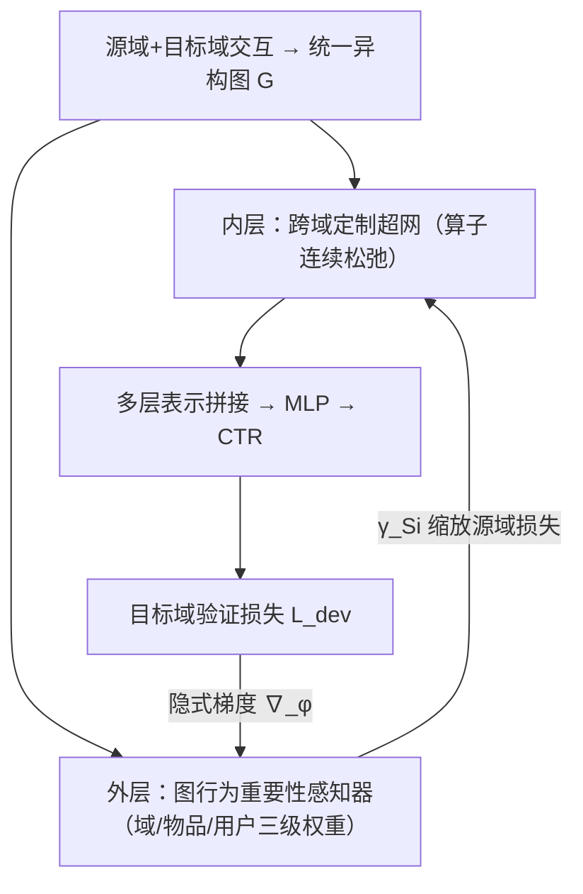
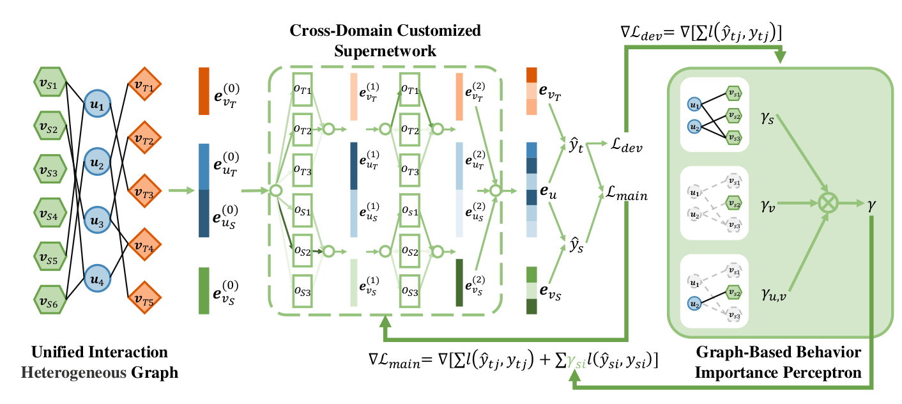

# Behavior Importance-Aware Graph Neural Architecture Search for Cross-Domain Recommendation (行为重要性感知的跨域推荐图神经架构搜索)

- **会议/期刊**: AAAI 2025 (Oral)
- **作者与机构**: Chendi Ge, Xin Wang, Ziwei Zhang, Yijian Qin, Hong Chen, Wenwu Zhu (清华大学) 等；Haiyang Wu, Yang Zhang, Yuekui Yang (腾讯 TEG 机器学习平台部)
- **推荐链路定位**: 精排 (CTR 预估)
- **研究方向**: 跨域与多场景推荐 / 图神经网络推荐
- **论文原文**: [论文原文链接](https://arxiv.org/abs/2504.07102v1)
- **开源代码**: [开源代码仓库链接](https://github.com/gcd19/BiGNAS)

## TL;DR (1分钟核心速览)

跨域推荐 (CDR) 的两大痛点：GNN 架构靠人工设计、跨域迁移易负迁移。本文提出 BiGNAS，把「每域 GNN 架构」与「源域行为重要性」放进同一个双层优化框架联合求解：内层用一次性免重训超网为每个域连续松弛搜索最优消息传递算子，外层用图行为重要性感知器为每条源域交互打三级权重（域/物品/用户），并以隐式梯度更新。在 7 组 Amazon 双域任务与微信广告三域数据上，AUC 相对最强基线 EDDA 最高提升 10.57%（El-Cl）与 4.61%（Discover），且无需架构重训。

## Background & Motivation (背景与核心矛盾)

- **主流范式**: 以 HeroGRAPH、DisenCDR、EDDA 为代表的 GNN-CDR 方法把源域与目标域交互图连成异构图，通过邻居聚合捕获高阶共现，再做解耦或域对齐。
- **前人局限**: 其一，架构固定——所有数据集、所有域共用一套人工设计的聚合/传播算子，跨数据集适应性差且调参昂贵；其二，负迁移——稀疏源域中注意力类机制会放大噪声特征，把无效行为当作有用信号迁移到目标域。
- **核心洞察 (Key Insight)**: 不同域的交互图在度分布、稀疏度、高阶依赖强度上差异显著（如 CD-Cl 密度 0.110% vs Bo-Mo 0.011%），因此「最优算子组合」本应逐域不同；同时源域样本对目标域的贡献天然不均衡，应作为可学习参数而非固定超参。
- **本文切入点**: 首次把图神经架构搜索 (GNAS) 与数据重要性学习耦合进 CDR 的双层优化，内层搜架构、外层学权重，交替训练端到端收敛。

## Method (核心方法设计)

### 1. 整体框架 (Overall Architecture)

输入是把源域与目标域交互拼成的统一异构图 $\mathcal{G}=(\mathcal{U},\mathcal{I},\mathcal{E})$，每条边带域标签$d\in\mathcal{D}$与点击标签$y_e$。内层超网对每层维护候选算子集$\mathcal{O}=\{\text{GCN, GAT, GraphSAGE, LightGCN, Linear}\}$的连续混合权重，前向时按权重加权求和得到节点表示，再拼接 0/1/2 阶邻居表示送入 MLP 输出 CTR；外层感知器读取同一张图，为每条源域边产出重要性系数$\gamma_{S_i}$ 去缩放其 BCE 损失。两层以不同 batch 交替更新：内层用加权主损失做 SGD，外层用目标域验证损失经隐式梯度回传更新感知器参数，全程无需离散化后重训。

<figure class="paper-figure" markdown="span">
  <figcaption>图1：BiGNAS 的框架以双域 CDR 进行说明。来自两个域的用户行为数据被组合成一个统一的异质交互图，作为模型的输入。模型采用双层结构：内层跨域定制超网络遵循一次性、无需重训练的模式，为每个域定制最优的 GNN 架构；外层基于图的行为重要性感知器通过辅助学习动态评估源域用户交互的重要性，指导模型优化。两个模块被训练</figcaption>
</figure>

### 2. 关键设计拆解 (Key Designs)

1. **跨域定制超网（一次性免重训架构搜索）**：痛点是 DARTS 类方法需离散化后重训，验证/测试架构不一致。本文将第 $i$层输出写成算子混合$f^{(i)}(x)=\sum_{o\in\mathcal{O}}p_o^{i}\,o(x)$，架构参数$\{p_o^i\}$与网络权重同步梯度下降，搜索目标为$a^*=\arg\max_{a\in\mathcal{A}}\text{AUC}_{\text{valid}}(a,\mathcal{G},w^*)$。由于保留连续架构、不落地离散子网，训练与推理共享同一超网，既省去重训开销，又避免离散化带来的性能抖动（消融中 DISCRETE 变体确实劣于 MANUAL）。

2. **图行为重要性感知器（三级权重抑制负迁移）**：痛点是源域噪声行为被等权对待。本文为源域边 $e_{S_i}=(u_k,v_{S_l})$ 定义
$$\gamma_{S_i}=\gamma_S\cdot\sigma\!\left(\gamma_{v_{S_l}}\cdot\gamma_{u_k,v_{S_l}}\right),$$
其中 $\gamma_S$为域级标量，$\gamma_{v_{S_l}}$由物品节点表示经 MLP 得到（全局物品重要性），$\gamma_{u_k,v_{S_l}}$ 由 GraphSAGE 编码后的用户-物品表示拼接再过 MLP 得到（用户特定重要性）。三级相乘再归一化，使「该域整体可信度 × 该物品跨域通用度 × 该用户对该物品的偏好强度」共同决定迁移力度，物理上等价于对源域样本做软性样本重加权。

3. **双层优化、隐式梯度与推理开销**：总目标为
$$\phi^*=\arg\min_\phi \mathcal{L}_{dev}(\theta^*(\phi)),\quad \text{s.t.}\ \theta^*(\phi)=\arg\min_\theta \mathcal{L}_{main}(\theta;\phi),$$
主损失 $\mathcal{L}_{main}=\sum_j l(\hat{y}_{T_j},y_{T_j})+\sum_i \gamma_{S_i}l(\hat{y}_{S_i},y_{S_i})$。外层梯度需$\nabla_\phi\theta^*$，用 K 阶 Neumann 级数近似 Hessian 逆：$(\nabla_\theta^2\mathcal{L}_{main})^{-1}\approx\sum_{n=0}^{K}(I-\nabla_\theta^2\mathcal{L}_{main})^n$，再以 VJP 高效计算。训练采用 Uniform 负采样（CTR 场景天然含未点击负例），无额外难负样本挖掘；推理时超网已含全部算子，复杂度为$O(|\mathcal{O}|(|\mathcal{E}|d+|\mathcal{V}|d^2))$，仅相对单 GNN 线性增长。

## Experimental Setup & Evaluation Protocol (实验设置与评估协议)

- **数据集与预处理**: Amazon 5-core 取 7 组双域任务（沿用 BIAO 的域对与划分）；微信广告数据含 Channel/Moments/Discover 三域共享用户，按年龄/性别/地点分组并哈希脱敏。

| 数据集 | #Users | #Items | #Interactions | 密度 | 场景说明 |
| :--- | :---: | :---: | :---: | :---: | :--- |
| Bo-Mo | 37,387 / 236,530 | 49,273 / 945,028 | 792,314 / — | 0.043% / 0.011% | 书→电影，重叠少 |
| Bo-CD | 16,738 / 61,201 | 150,190 / 380,675 | 418,603 / — | 0.017% / 0.037% | 书→CD |
| Bo-El | 28,506 / 52,134 | 203,698 / 364,267 | 735,192 / — | 0.013% / 0.025% | 书→电子 |
| Bo-To | 7,576 / 11,567 | 117,771 / 84,564 | 317,503 / — | 0.036% / 0.096% | 书→玩具 |
| CD-Cl | 1,390 / 8,074 | 17,707 / 12,312 | 27,128 / — | 0.110% / 0.110% | CD→服饰，重叠极少 |
| CD-Ki | 2,809 / 14,274 | 28,253 / 37,559 | 53,995 / — | 0.068% / 0.094% | CD→厨房 |
| El-Cl | 8,235 / 18,703 | 31,484 / 66,470 | 99,594 / — | 0.038% / 0.043% | 电子→服饰 |
| WeChat (3 域) | 47,330 | 150,078–222,336 | 6.54M–6.85M | 0.065%–0.093% | 广告三场景共享用户 |

- **数据划分与防穿越 (Splitting Strategy)**: Amazon 沿用 BIAO 的固定域对与训练/验证/测试切分；外层感知器所用 $G_{dev}$由训练集随机重排复用得到（非目标域额外数据），避免与内层同 batch 导致$\gamma_S$ 塌缩。
- **排名评测协议 (Ranking Protocol)**: 本文定位 CTR 预估而非 Top-N 排序，采用 **AUC 与 LogLoss** 双指标，在测试集全量样本上计算（非采样排序）；以验证集 AUC 最高 checkpoint 报告测试结果，故 AUC 与 LogLoss 提升幅度偶有不一致。
- **对比基线与超参设置**: 单域 BPR-MF / NGCF / LightGCN；跨域 CoNet-B / MiNet-B（BIAO 增强版）、HeroGRAPH、DisenCDR、EDDA。超网 2 层，搜索空间含 GCN/GAT/GraphSAGE/LightGCN/Linear；Adam 优化，最多 100 epoch，双层优化前 10 epoch warm-up，5 个随机种子取均值并做 $p<0.05$ 配对 t 检验。

## Key Experimental Results (实验关键数据)

### 1. 主实验对比 (Main Results)

| 任务 | 指标 | LightGCN | MiNet-B | CoNet-B | DisenCDR | EDDA | **BiGNAS** | RelaImpr |
| :--- | :---: | :---: | :---: | :---: | :---: | :---: | :---: | :---: |
| Bo-Mo | AUC | 0.7347 | 0.7639 | 0.7721 | 0.7653 | 0.7731 | **0.7795*** | +2.34% |
| Bo-CD | AUC | 0.6981 | 0.7145 | 0.7274 | 0.7228 | 0.7291 | **0.7456*** | +7.20% |
| Bo-El | AUC | 0.6645 | 0.6678 | 0.6864 | 0.6913 | 0.6814 | **0.7002*** | +1.29% |
| Bo-To | AUC | 0.6836 | 0.6883 | 0.7048 | 0.7038 | 0.7065 | **0.7268*** | +9.83% |
| CD-Cl | AUC | 0.6562 | 0.6020 | 0.6176 | 0.6832 | 0.6761 | **0.6949*** | +1.71% |
| CD-Ki | AUC | 0.6681 | 0.6212 | 0.6558 | 0.6954 | 0.6974 | **0.7090*** | +5.88% |
| El-Cl | AUC | 0.6193 | 0.6099 | 0.6308 | 0.6388 | 0.6410 | **0.6559*** | +10.57% |
| Channel | AUC | 0.7010 | 0.7547 | 0.7621 | 0.7792 | 0.7906 | **0.8146*** | +3.04% |
| Moments | AUC | 0.6817 | 0.7349 | 0.7596 | 0.7662 | 0.7643 | **0.7862*** | +2.61% |
| Discover | AUC | 0.7324 | 0.7415 | 0.7673 | 0.7517 | 0.7723 | **0.8079*** | +4.61% |

LogLoss 侧同样全面占优（如 CD-Cl 0.4268 vs EDDA 0.4533，+6.21%；Discover 0.4053 vs 0.4264，+5.21%），仅 Bo-To 略逊于 HeroGRAPH（0.4195 vs 0.4166）。

### 2. 消融实验 (Ablation Study)

| 变体 | 含义 | 相对 BiGNAS 表现 |
| :--- | :--- | :--- |
| NO-SOURCE | 去掉源域数据 | 平均 AUC 下降 **5.8%**（最大跌幅） |
| NO-IMPO | 去掉重要性感知器，源域等权 | 平均 AUC 下降 **4.3%** |
| DISCRETE | 离散化架构（DARTS 式） | 劣于 MANUAL，验证/测试架构不一致 |
| MANUAL | 固定最优人工架构 | 优于 DISCRETE，但劣于 MIX 与 BiGNAS |
| MIX | 等权混合全部算子、不搜索 | 优于多数变体，但不及完整 BiGNAS |
| BiGNAS | 完整模型 | 四任务全部最优 |

### 3. 关键实验发现 (Key Findings)

1. **稀疏重叠场景收益最大**：CD-Cl（用户重叠极少、密度 0.110%）与 El-Cl 分别提升 1.71% 与 10.57% 的 AUC，而数据丰富的 Bo-Mo 仅 +2.34%，说明架构自适应 + 行为加权恰好在「基线靠数据量吃老本」的稀疏域补位。
2. **源域信息与加权缺一不可，但前者更关键**：NO-SOURCE 掉 5.8% 高于 NO-IMPO 的 4.3%，表明跨域信号本身是主要增益来源，而重要性感知器是在此基础上的「去噪放大器」；两者叠加才达到完整性能。
3. **连续松弛优于离散搜索**：DISCRETE 甚至不如人工 MANUAL，而 MIX（不搜索、全算子等权）已强于多数变体，说明超网的多算子融合本身带来集成收益，而 BiGNAS 的连续优化进一步把这份收益定向放大到每域最优组合。

## Highlights & Limitations (亮点、对比与审稿批判)

- **与代表作对比 (vs. Prior Work)**: 相比 EDDA 只做嵌入解耦与域对齐、架构固定，BiGNAS 把「架构」也变成可学习变量；相比 HeroGRAPH 的固定异构图聚合，本文用超网逐域定制算子；相比 BIAO 的辅助学习加权，本文的权重是图结构感知的三级乘性形式并经隐式梯度双层优化，而非简单辅助任务。
- **可迁移亮点**: ①「连续超网 + 免重训」可直接搬到多场景推荐（如 STAR/PEPNet 的场景专属网络搜索）；②三级乘性重要性权重是一种轻量的软样本重加权范式，可迁移到跨域序列推荐或知识蒸馏的样本筛选。
- **审稿级局限批判**: ①外层依赖目标域验证集构造 $G_{dev}$，在严格冷启动（目标域无任何标注）时该假设不成立；②搜索空间仅 5 个算子、2 层超网，且隐式梯度的 Neumann 级数截断阶$K$ 与双层交替频率对收敛的影响未做敏感性分析；③评测仅 AUC/LogLoss，缺少 Top-K 排序指标与线上 A/B 的延迟/收益数据，工业落地证据偏弱。

## Rating (四维评分)

- **方法创新性 (Novelty)**: ⭐⭐⭐⭐ （首次将 GNAS 与数据重要性学习耦合进 CDR 双层优化，思路清晰但各组件均为已有技术的组合创新）
- **评估协议与实验扎实度 (Protocol & Experiments)**: ⭐⭐⭐⭐ （7 组 Amazon 双域 + 微信三域工业数据、8 个基线、5 种子 + 显著性检验齐全，但缺 Top-K 指标与超参敏感性分析）
- **写作与数学规范度 (Clarity & Rigor)**: ⭐⭐⭐⭐ （双层优化与隐式梯度推导完整、复杂度分析到位，但部分符号如 $\gamma$ 的多重语义略易混淆）
- **工业落地与复现价值 (Industrial & Practical Value)**: ⭐⭐⭐⭐ （代码开源、免重训特性契合线上快速迭代，复杂度仅线性增长；但双层训练调参成本与验证集依赖是部署门槛）

