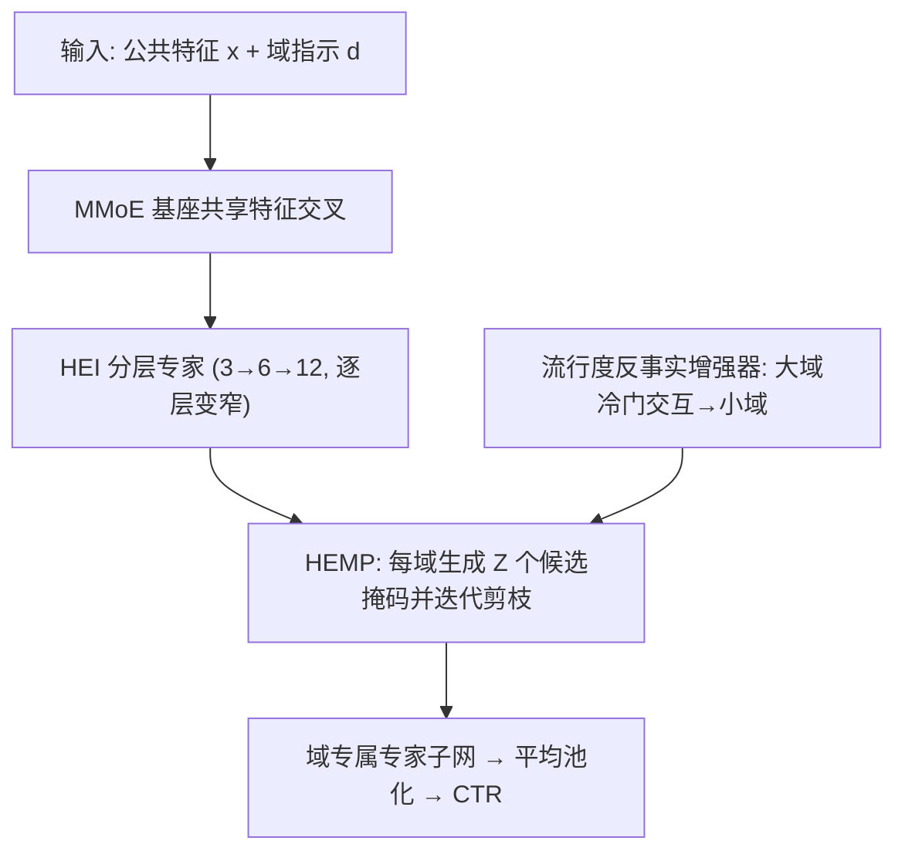
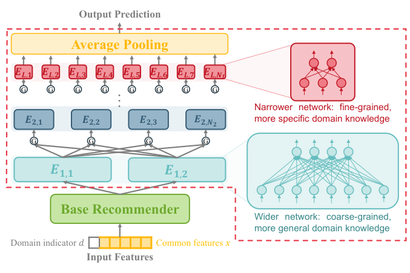

# One for Dozens: Adaptive REcommendation for All Domains with Counterfactual Augmentation (一模型服务数十域：反事实增强的自适应全域推荐)

- **会议/期刊**: AAAI 2025
- **作者与机构**: Huishi Luo, Yiwen Chen, Yiqing Wu, Fuzhen Zhuang, Deqing Wang（北航人工智能学院、中科院计算所、北航 SKLSDE）
- **推荐链路定位**: 精排（多域统一 CTR 预估）
- **研究方向**: 跨域与多场景推荐 / CTR 预估与特征交叉
- **论文原文**: [https://arxiv.org/abs/2412.11905v2](https://arxiv.org/abs/2412.11905v2)
- **开源代码**: [https://github.com/Chrissie-Law/AREAD-Multi-Domain-Recommendation](https://github.com/Chrissie-Law/AREAD-Multi-Domain-Recommendation)

## TL;DR (1分钟核心速览)

真实平台常需同时服务数十乃至上百个域，而传统 MDR 只处理 <5 个域：逐域建塔参数爆炸、共享/专属二元划分无法刻画方向性知识迁移、少数域样本不足被多数域淹没。AREAD 用「分层专家集成（HEI）+ 彩票假设驱动的分层专家掩码剪枝（HEMP）+ 流行度反事实增强」为每域自动学出专属专家子网。在 Amazon（25 域）与 AliCCP（30 域）上，总 AUC 分别提升 6.7‰ / 3‰，DomainAUC 提升 2‰ / 8.4‰，Minor10AUC 提升 3‰ / 5‰（$p<0.01$）。

## Background & Motivation (背景与核心矛盾)

- **主流范式**: MDR 沿用多任务学习思路，共享底层 + 每域独立 Tower（MMoE/PLE/STAR/HiNet），或「预训练+逐域微调」（MAMDR），或先聚类再域内共享（ADL）。
- **前人局限**: ① 域数增至数十时，逐域 Tower 参数量线性膨胀且小域塔欠收敛；② 共享/专属二元划分忽略了知识迁移的**方向性**——A 域有益的知识在 B 域可能有害，聚类又会抹平簇内差异。
- **核心洞察 (Key Insight)**: 图 1 显示 Amazon 25 个域中 12 个少数域样本占比不足 2%，优化被多数域主导；而「用户对冷门物品的正反馈更可能源于真实兴趣而非从众」（对撞偏置 explain-away 效应），故冷门交互可跨域迁移。
- **本文切入点**: 用分层专家网络提供多粒度知识，用可学习的二值掩码替代人工指定共享结构，用反事实增强为小域「造」出可支撑掩码搜索的训练信号。

## Method (核心方法设计)

### 1. 整体框架 (Overall Architecture)

输入为公共特征 $x$（用户行为、上下文）与域指示$d$，先经 MMoE 基座完成共享特征交叉，再送入$L$层专家网络（第 1 层专家少而宽、捕获粗粒度共性；高层专家多而窄、捕获细粒度差异，每层专家数远小于域数$D$）。训练分两阶段：Warm-Up 阶段无掩码预训练；随后对每域生成$Z$个候选掩码并迭代剪枝，选出验证最优者作为该域最终掩码$\mathbf{M}_d$；小域训练数据由流行度反事实增强器补充。推理时仅激活$\mathbf{M}_d$ 选中的专家子网并平均输出。

<figure class="paper-figure" markdown="span">
  <figcaption>图2：分层专家集成（HEI）在基础推荐器之上使用多层专家网络来提取并集成不同粒度的领域知识。</figcaption>
</figure>

### 2. 关键设计拆解 (Key Designs)

1. **HEI 分层专家集成（用层级结构替代 D 个 Tower）**：痛点是小域塔欠收敛且参数随 $D$线性增长。做法是第$l$层第$n$个专家对上一层输出做门控加权聚合：$e_{l,n}=\mathrm{MLP}_{\Theta_{l,n}}\big(\sum_{i=1}^{N_{l-1}} g_{l,n}[i]\,e_{l-1,i}\big)$。直觉：低层宽专家承载跨域共性、高层窄专家承载域特性，总参数量显著低于逐域建塔，同时天然支持多粒度迁移。

2. **HEMP 分层专家掩码剪枝（用彩票假设替代人工共享划分）**：痛点在于「哪些域该一起学」的组合搜索不可行，AESM2 的逐层 top-K 贪心忽略层间耦合。做法是为域 $d$学二值掩码$\mathbf{M}_d^{(l)}\in\{0,1\}^{N_{l-1}\times N_l}$，掩码化门控为
$$\tilde{g}_{l,n}[i]=\frac{M_d^{(l)}[i,n]\,g_{l,n}[i]}{\sum_{i'}M_d^{(l)}[i',n]\,g_{l,n}[i']},$$
候选掩码按门控幅值保留 top-$S_0$并随机翻转部分位初始化，每$k$步剪去$\alpha\%$最小门控直至稀疏度$S$；所有候选均从同一参数快照$\Theta^{(0)}$ 出发以符合彩票假设。直觉：掩码即「该域需要哪些专家」的离散化答案，比连续门控更抗数据不均衡。

3. **流行度反事实增强与训练目标**：因果图 $\text{interest}\to\text{interact}\leftarrow\text{conformity}$构成对撞结构，正反馈下兴趣与从众呈伪负相关，故冷门物品交互近似「纯兴趣」信号；结合「真实兴趣跨域一致」假设得$y(x,d\in\mathcal{D}_a\mid p(i)<\rho)=1\Rightarrow y(x,d'\in\mathcal{D}_b\mid p(i)<\rho)=1$。训练损失对掩码激活的每个输出分别回传（类 Bagging，避免小输出专家欠优化）：$\mathcal{L}=\sum_{j\in K(\mathbf{M}_d)}\mathrm{BCE}(\sigma(e_{L,j}),y)$，推理取均值。无负采样环节（CTR 二分类范式），主要开销在掩码搜索：每域$Z=10$候选 ×$k=5$ 步，但仅周期性触发。

## Experimental Setup & Evaluation Protocol (实验设置与评估协议)

- **数据集与预处理**: 按商品类目定义域，无 5-core 过滤描述；增强比例固定 10%。

| 数据集 | #Samples | #Domains | 最大域占比 | 少数域数(<2%) | 场景说明 |
| :--- | :---: | :---: | :---: | :---: | :--- |
| Amazon | 17,664,862 | 25 | 17% | 12 | 电商多类目，长尾极重 |
| AliCCP | 4,454,814 | 30 | 60.51% | 23 | 阿里展示广告多场景 |

- **数据划分与防穿越 (Splitting Strategy)**: 原文未明确交代划分细节（按 CTR 惯例应为比例划分），此为复现时的信息缺口。
- **排名评测协议 (Ranking Protocol)**: 采用 CTR 二分类 AUC 体系而非 Top-N 排序；除总 AUC 外，用按域样本量加权的 DomainAUC，以及 Major5AUC / Minor10AUC / Minor5AUC 分别度量最大 5 域与最小 10/5 域，直接暴露长尾表现。
- **对比基线与超参设置**: 单域基线 DeepFM/DCN/AutoInt/DCNv2/EPNet-S/Isolated；多域基线 MMoE/PLE/STAR/AdaSparse/HiNet/EPNet/PEPNet/ADL/MAMDR。需预聚类的基线统一 K-Means 聚为 3 簇（AREAD 不需聚类）。Adam，学习率 $\{5e^{-4},\dots,3e^{-3}\}$，batch$\{1024,2048,4096\}$，正则$1e^{-5}$；Warm-Up 100 batch，掩码每 2000 batch 更新，$Z=10$，$k=5$，$S_0=0.7\to S=0.4$，$\alpha=0.05$；5 次运行取均值，$p<0.01$ 显著性检验。

## Key Experimental Results (实验关键数据)

### 1. 主实验对比 (Main Results)

| Method | Amazon AUC | Amazon DomainAUC | Amazon Minor10AUC | AliCCP AUC | AliCCP DomainAUC | AliCCP Minor10AUC |
| :--- | :---: | :---: | :---: | :---: | :---: | :---: |
| DCNv2 | 0.7040 | 0.7114 | 0.7262 | 0.6082 | 0.5939 | 0.5954 |
| Isolated | - | 0.7137 | 0.7229 | - | 0.5851 | 0.5907 |
| MMoE | 0.7038 | 0.7113 | 0.7255 | 0.6091 | 0.5947 | 0.5963 |
| PLE | 0.7025 | 0.7099 | 0.7248 | 0.6090 | 0.5946 | 0.5959 |
| STAR | 0.7032 | 0.7032 | 0.7042 | 0.6075 | 0.6075 | 0.6078 |
| HiNet | 0.7049 | 0.7109 | 0.7247 | 0.6075 | 0.5915 | 0.5928 |
| ADL | 0.7033 | 0.7109 | 0.7240 | 0.6086 | 0.6086 | 0.6087 |
| MAMDR | 0.6898 | 0.7079 | 0.7194 | 0.5957 | 0.5869 | 0.5869 |
| **AREAD** | **0.7120\*** | **0.7131** | **0.7298\*** | **0.6122\*** | **0.6170\*** | **0.6165\*** |
| Improv. | +6.7‰ | +2‰ | +3‰ | +3‰ | +8.4‰ | +5‰ |

### 2. 消融实验 (Ablation Study)

| 配置 | Amazon AUC | Amazon DomainAUC | Amazon Minor10AUC | AliCCP AUC | AliCCP DomainAUC |
| :--- | :---: | :---: | :---: | :---: | :---: |
| MMoE (基座) | 0.7038 | 0.7113 | 0.7255 | 0.6091 | 0.5947 |
| + HEI | 略降 | 略降 | 略降 | 略降 | 略降 |
| + HEI + HEMP | 显著升 | 显著升 | 升 | 升 | 升 |
| + 反事实增强 (全模型) | 最优 | 最优 | 最优 | 最优 | 最优 |

（原文图 6 仅给柱状趋势，未列具体数值。）

### 3. 关键实验发现 (Key Findings)

1. **HEI 单独使用反而掉点**：无掩码约束的分层专家无法自适应迁移模式，说明「结构」必须与「离散选择」耦合才生效；加入 HEMP 后 AUC 与 DomainAUC 同步显著回升，验证掩码是收益主来源。
2. **小域收益远大于整体收益**：AliCCP 上 DomainAUC 提升 8.4‰ 而总 AUC 仅 3‰，Minor10AUC 提升 5‰、Minor5AUC 提升 13‰，说明增益集中在长尾域，符合「掩码隔离多数域干扰 + 反事实补数据」的设计意图。
3. **掩码可解释且与预聚类不一致**：HK 与 Appliances 的掩码重叠率 OR=0.405（随机基线 0.25），HK 与 Movies&TV 仅 0.065；而预聚类阶段 HK 与 AP 常被分到不同簇——证明 AREAD 捕捉到了传统聚类漏掉的功能相似性。此外 AREAD 在 Amazon 上逼近 Isolated（0.7131 vs 0.7137）但训练时间与存储远低于逐域建模（图 5）。

## Highlights & Limitations (亮点、对比与审稿批判)

- **与代表作对比 (vs. Prior Work)**: 相比 MMoE/PLE/STAR 的「共享底层 + 逐域塔」，AREAD 用有限分层专家 + 二值掩码把参数量与域数解耦；相比 ADL 的两阶段聚类，掩码端到端学习且保留簇内差异；相比 MAMDR 的逐域微调，无需为每域维护独立参数副本，在域差异大时更稳（MAMDR 在 AliCCP 上掉到 0.5957）。
- **可迁移亮点**: ① 「统一参数快照 + 多候选掩码 + 迭代剪枝」的搜索范式可迁移到多场景/多任务精排的专家路由；② 用对撞偏置论证「冷门交互≈纯兴趣」并做跨域样本搬运，是极低成本的小域冷启动增强手段。
- **审稿级局限批判**: ① 反事实增强把大域冷门物品直接搬到小域，跨类目语义错配（哲学书→艺术电影）的噪声仅靠 10% 比例硬控，缺少去噪或置信度加权机制；② 掩码搜索需周期性对每域跑 $Z\times k$ 步重训，域数上百时训练开销与收敛稳定性存疑，且论文未报告推理延迟与划分协议细节。

## Rating (四维评分)

- **方法创新性 (Novelty)**: ⭐⭐⭐⭐ （把彩票假设掩码剪枝引入多域专家路由，配合因果对撞论证的小域增强，组合新颖且动机自洽）
- **评估协议与实验扎实度 (Protocol & Experiments)**: ⭐⭐⭐⭐ （25/30 域双数据集 + 分桶 AUC + 5 次运行显著性检验扎实，但划分协议未交代、消融仅给趋势图）
- **写作与数学规范度 (Clarity & Rigor)**: ⭐⭐⭐⭐ （掩码化门控与算法 1 表述清晰，反事实部分为假设驱动、缺形式化误差界）
- **工业落地与复现价值 (Industrial & Practical Value)**: ⭐⭐⭐⭐ （代码开源，参数量与存储远优于逐域建模，但掩码搜索的训练调度成本需工程优化）

