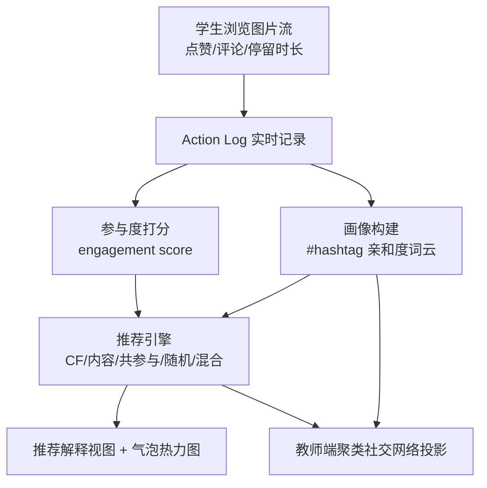

# An XAI Social Media Platform for Teaching K-12 Students AI-Driven Profiling, Clustering, and Engagement-Based Recommending (面向 K-12 学生的 AI 画像、聚类与参与度推荐可解释教学平台)

- **会议/期刊**: AAAI 2025（K-12 AI 教学资源特别 Track）
- **作者与机构**: Nicolas Pope, Juho Kahila, Henriikka Vartiainen, Mohammed Saqr, Sonsoles López-Pernas, Teemu Roos, Jari Laru, Matti Tedre（东芬兰大学、赫尔辛基大学、奥卢大学）
- **推荐链路定位**: 端到端（教学仿真平台，覆盖数据采集→画像→参与度→推荐全链路）
- **研究方向**: 去偏公平、可信隐私与工业架构 / 冷启动与长尾推荐
- **论文原文**: [https://arxiv.org/abs/2412.13554v1](https://arxiv.org/abs/2412.13554v1)
- **开源代码**: 暂未开源

## TL;DR (1分钟核心速览)

本文并非提出新的推荐算法，而是构建了一个名为 **Somekone** 的 Instagram 式可解释 AI（XAI）教学平台，面向 4–9 年级学生，将社交媒体背后的四大数据驱动机制——**数据采集、用户画像、参与度度量、推荐算法**——以实时可视化方式"白盒化"。平台支持双设备协作（一台浏览、一台实时观测画像与推荐解释），并提供教师端课堂投影视图（聚类社交网络、共参与热力图、推荐气泡）。在芬兰 12 所学校、209 名 5/8 年级学生的 12 场两小时实测中，通过潜剖面分析（LPA）识别出 **Browsers / Engagement Enthusiasts / Selective Engagers** 三类使用画像，并用序列分析刻画其行为演化轨迹。

## Background & Motivation (背景与核心矛盾)

- **主流范式**: 现有社交媒体素养教育多聚焦"使用技能"与"风险识别"（假新闻辨识、隐私保护），而 AI 教育工具（如 filter bubble、推荐演示类）多为孤立功能演示。
- **前人局限**: ① 多数工具只讲"用与效果"，不触及平台背后的数据采集与画像机制，学生只能依赖错误的"民间理论 (folk theories)"解释推荐；② 现有工具缺乏把**个体行为 → 个人体验 → 全班/社会影响**串联起来的整体视角，且少有实证课堂研究。
- **核心洞察 (Key Insight)**: 社交媒体是青少年接触 AI 最直接、最可感的场景；把推荐系统的"黑箱"在熟悉的 Instagram 语境中实时拆解，能同时提升**数据能动性 (data agency)** 与 AI 伦理敏感度。
- **本文切入点**: 用一个可协作、可实时解释、可调参的仿真平台，把数据采集、画像、参与度、推荐四环节做成"看得见、摸得着、可实验"的课堂资源。

## Method (核心方法设计)

### 1. 整体框架 (Overall Architecture)

Somekone 为纯浏览器实现（WebRTC 点对点、ES11），默认图库含 727 张由两班八年级学生挑选标注、两位研究者复核的图片。学生成对协作：一台设备无限滚动浏览图片流（点赞、表情反应、评论、关注、分享），另一台设备实时展示该浏览会话的**数据采集视图、画像视图与推荐视图**；教师端在课堂投影上呈现全班社交网络聚类、共参与网络、话题亲和度与推荐热力图。所有交互写入带时间戳的 action log，会话结束自动删除，仅可导出匿名化日志用于研究。

### 2. 关键设计拆解 (Key Designs)

1. **实时 XAI 反馈闭环（Immediacy of XAI Feedback）**：痛点在于推荐解释通常是事后、静态的；本文让配对设备**同步**显示"你刚看了 7.1 秒并点赞 → 参与度 3/10 → 画像词云更新 → 下一条推荐及理由"。核心是把"行为—画像—推荐"三者的因果链在秒级内可视化，使学生直观看到自身行为如何塑造信息流，从而破除民间理论。

2. **可调参推荐算法沙盒（Algorithm Sandbox）**：平台内置协同过滤、基于内容、图片共参与、随机选择及混合策略，学生可实时切换算法与参数，并以**热力图**观察"哪些图会被看到/被错过"（即个人"气泡"）。这一设计直接呼应欧盟《数字服务法》(DSA) 第 27 条对推荐系统主参数透明与用户可修改性的要求，把合规概念转化为可操作实验。

3. **课堂级聚类与共参与可视化**：教师端将全班画像按相似度聚类着色，连线粗细表示相似强度，并展示话题共参与网络（图 6a）与图片共参与网络（图 6b）。其价值在于把"推荐如何造成群体极化/信息茧房"从抽象论述变为全班可见的结构图，支撑后续关于营销、误导信息与极化的课堂讨论。

## Experimental Setup & Evaluation Protocol (实验设置与评估协议)

- **研究性质**: 本文为**教育资源论文 + 案例研究**，非算法基准评测，无传统推荐指标（HR/NDCG）对比。

| 维度 | 设置 |
| :--- | :--- |
| 参与者 | 芬兰 12 所学校、209 名 5/8 年级学生 |
| 干预时长 | 4 小时社媒教育课，其中 2 小时使用 Somekone |
| 数据来源 | 平台 action log（带时间戳的细粒度交互） |
| 聚类方法 | 潜剖面分析 (LPA)，R 包 `mclust`，拟合 10 个模型 |
| 模型选择 | 最低 BIC + 最高熵 + 无 <5% 小簇 |
| 序列分析 | R 包 `TramineR`，按簇绘制分布图 |
| 聚类质量 | 平均后验概率 0.98，熵 0.98 |

- **评估协议说明**: 采用**以人为中心 (person-centered)** 的无监督分群，而非留一/时间切分等推荐评测协议；无负采样、无全库排序指标。研究伦理遵循芬兰国家研究诚信指南，获教育主管部门许可与监护人知情同意，数据匿名化。

## Key Experimental Results (实验关键数据)

### 1. 主实验对比 (Main Results)

本文无算法基线对比，核心"结果"为三簇使用画像的识别：

| 画像簇 | 行为特征 | 交互强度 |
| :--- | :--- | :---: |
| Cluster 1 — Browsers | 仅浏览，极少点赞/评论/分享/关注 | 最低 |
| Cluster 2 — Engagement Enthusiasts | 广泛、高频、均衡地使用各类交互 | 最高 |
| Cluster 3 — Selective Engagers | 总体交互低，偏好评论与偶尔关注，少点赞分享 | 中等（定向） |

### 2. 消融实验 (Ablation Study)

本文为教育工具论文，**未设组件消融实验**；替代性地以序列分布图（图 8）刻画各簇行为随时间的演化，作为"过程性证据"。

### 3. 关键实验发现 (Key Findings)

1. **行为分化显著且可解释**：LPA 以 0.98 的后验概率与熵稳定分出三簇，说明同一课堂干预下学生对同一平台的使用策略高度异质，"一刀切"的 AI 素养教学难以覆盖全部学习者。
2. **演化轨迹呈"先探索后收敛"**：Cluster 1 初期接触多样内容、后期以跳过/浏览为主；Cluster 3 初期密集评论点赞、后期仅保留点赞与跳过，体现选择性消费的强化；Cluster 2 全程多类型高强度参与——这为"信息茧房如何在个体层面逐步形成"提供了微观证据。
3. **平台兼具研究与教学双重价值**：action log 可支撑交互频率、共偏好网络、点击序列与行为转移等多类分析，使课堂仿真器同时成为社媒行为研究的可控实验床。

## Highlights & Limitations (亮点、对比与审稿批判)

- **与代表作对比 (vs. Prior Work)**: 相比 filter bubble 演示工具（Janssen 2021）与推荐演示工具（Tsiakas 2020; Taibi 2021），Somekone 的差异在于**全链路整合**（采集→画像→参与度→推荐）与**课堂级协作可视化**；相比 DiFranzo 等 (2019) 的平台功能教学工具，本文额外提供了 209 人的实证课堂数据与行为序列分析。
- **可迁移亮点**: ① "双设备实时解释"范式可迁移到推荐系统用户端透明度设计（如 DSA 合规的"为什么推荐"面板）；② 可调参 + 热力图气泡的可视化，可作为推荐算法可解释性的人机交互评测原型。
- **审稿级局限批判**: ① 平台刻意高层抽象、简化，作者自承不建模真实平台的复杂度与规模，存在学生将简化误当真实的风险（反而可能催生新的民间理论）；② 缺乏学习成效的对照评估（前测/后测、对照组），当前仅报告使用行为而非学习增益；③ 并发用户建议 ≤30，规模化课堂部署与可视化可读性受限。

## Rating (四维评分)

- **方法创新性 (Novelty)**: ⭐⭐⭐ （非算法创新，但"实时 XAI + 双设备协作 + 课堂级聚类可视化"的教育工具设计颇具新意）
- **评估协议与实验扎实度 (Protocol & Experiments)**: ⭐⭐⭐ （209 人真实课堂数据与规范 LPA/序列分析扎实，但缺学习成效对照与算法级评测）
- **写作与数学规范度 (Clarity & Rigor)**: ⭐⭐⭐⭐ （概念分层清晰、ILO 与 AI 五大理念对齐明确，工具描述详尽；无复杂数学推导）
- **工业落地与复现价值 (Industrial & Practical Value)**: ⭐⭐⭐ （浏览器即用、GDPR 合规、隐私本地化设计利于校园部署；但未开源、规模受限，工业推荐系统直接复用价值有限）

