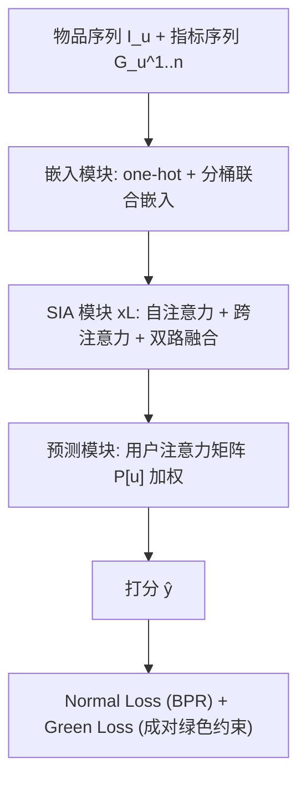
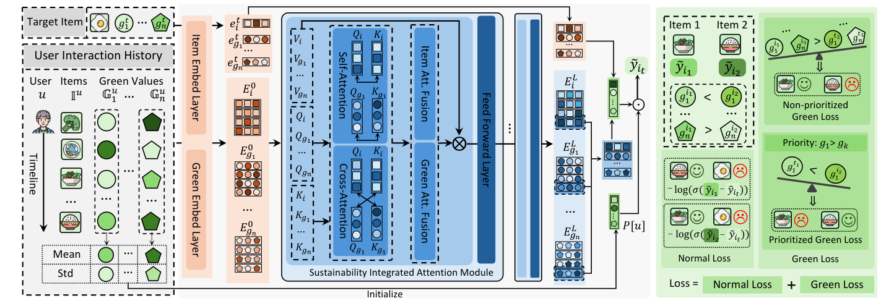

# Bites of Tomorrow: Personalized Recommendations for a Healthier and Greener Plate (明日之食：面向更健康更绿色餐盘的个性化推荐)

- **会议/期刊**: AAAI 2025
- **作者与机构**: Jiazheng Jing, Yinan Zhang, Chunyan Miao（南洋理工大学 CCDS）
- **推荐链路定位**: 精排（序列推荐打分）
- **研究方向**: 去偏公平、可信隐私与工业架构 / 序列与会话推荐
- **论文原文**: [https://arxiv.org/abs/2508.13870v1](https://arxiv.org/abs/2508.13870v1)
- **开源代码**: [https://github.com/JingXiaoyi/GRAPE](https://github.com/JingXiaoyi/GRAPE)

## TL;DR (1分钟核心速览)

现有食品推荐只优化点击/命中精度，忽视食品的环境影响（EIS）、营养（NIS）与健康度（HMI）等可持续属性，而传统"宣传式"绿色引导又过于被动。本文提出 Green Food Recommendation 任务与 GRAPE：用自注意力+跨注意力分别建模用户对物品与各可持续指标的演化偏好，并设计非优先/优先两种 Green Loss 直接对"更绿物品应得更高分"施加成对约束。在 GreenRec 真实数据集上采用 Leave-One-Out + Full-Ranking 协议，HR@20 较最强基线 MSSR 提升 8.01%、NDCG@20 提升 4.89%，同时推荐列表 EIS 更低、NIS/HMI 更高。

## Background & Motivation (背景与核心矛盾)

- **主流范式**: 序列推荐（NOVA/CAFE/FDSA-CL/MSSR）把侧信息（含可持续指标）当作辅助特征注入注意力网络，目标函数仍是 BPR 精度损失；绿色食品方向仅有 FHFRS 这类后处理重排。
- **前人局限**: ① 精度导向的损失完全不区分物品的绿色程度，模型倾向推荐高曝光但高环境代价的食品；② 后处理式绿色重排（FHFRS）与主模型解耦，牺牲精度且无法刻画用户对可持续维度的个体差异与时间演化。
- **核心洞察 (Key Insight)**: 用户历史交互物品的可持续指标序列的**均值**反映其绿色偏好水平、**方差**反映其对更绿选项的接受弹性（图 3 显示不同用户均值差异极大、方差随健康化先升后波动），因此"绿色偏好"本身是可个性化建模的隐变量。
- **本文切入点**: 把绿色引导从"外部宣传/后处理"搬进**训练损失内部**，用成对排序约束让更绿物品在打分上占优，同时用用户注意力矩阵调制各可持续维度的权重。

## Method (核心方法设计)

### 1. 整体框架 (Overall Architecture)

输入为用户交互物品序列 $I_u$及对应的$n=3$条可持续指标序列$G_u^{1..n}$；嵌入模块对物品做 one-hot 嵌入、对连续指标做**分桶离散化联合嵌入**（粒度超参$\Delta$）；随后堆叠$L$层 Sustainability Integrated Attention (SIA) 模块，每层内先做物品自注意力与指标自注意力，再做物品-指标、指标-指标的跨注意力，经 Item/Green 两路注意力融合与 FFN 输出；预测模块用可学习用户注意力矩阵$P[u]$ 把物品表征与各指标表征加权求和得到最终打分；训练时联合优化 Normal Loss 与 Green Loss。

<figure class="paper-figure" markdown="span">
  <figcaption>图1：GRAPE的模型结构。GRAPE由三个主要模块组成：嵌入模块、可持续性集成注意力模块和预测模块。损失函数分为两部分：旨在提升推荐准确性的普通损失，以及旨在提高推荐可持续性的绿色损失。对于物品的可持续性指标，颜色越深表示绿色值越高。</figcaption>
</figure>

### 2. 关键设计拆解 (Key Designs)

1. **可持续集成注意力 SIA（让指标与物品互相"看见"）**：痛点是把指标当独立特征会丢失"买营养食品的人往往也偏好高 HMI"这类跨序列相关性。SIA 在物品与各指标之间构造跨注意力 $A^m_{x,y}=Q^m_{x,y}K^{m\top}_{x,y}$（$x\neq y$），再用可学习权重向量$r_i, r_g$ 做加权求和+门控融合并掩码防泄漏。直觉：指标序列不是旁路特征，而是与物品序列同构的"第二视角"，双向注意力让绿色偏好与口味偏好互相校准。

2. **用户注意力矩阵 $P$ 的统计初始化（个性化绿色接受度）**：不同用户对绿色的接受度差异巨大，全 1 矩阵或随机初始化都无法表达。作者用历史指标序列的均值与方差初始化：
$$P[u]=\big[1,\ \mu(G_u^1)\lambda(G_u^1),\ \dots,\ \mu(G_u^n)\lambda(G_u^n)\big],\quad \textstyle\sum P[u]=1$$
均值刻画"平时吃得多绿"，方差刻画"是否愿意尝试更绿"，二者乘积作为该维度的初始关注度，随后端到端微调。

3. **两种 Green Loss 与训练目标**：总损失 $\mathcal{L}=\alpha\mathcal{L}_n+(1-\alpha)\mathcal{L}_g$，$\mathcal{L}_n$ 为标准 BPR。非优先版对所有指标一视同仁：
$$\mathcal{L}_{ng}=-\sum_{j=1}^{n}\log\sigma\big((g_{i_1}^j-g_{i_2}^j)(\hat{y}_{i_1}-\hat{y}_{i_2})\big)$$
优先版引入人工优先级 $g_1\succ\dots\succ g_n$与阈值$\beta_k$，仅当所有更高优先级指标均越过阈值时才激活当前指标项，权重为$D(j)\in\{0,1\}$。负采样采用同集合内采样（$i_1,i_2$同属$I_u^+$或同属$I_u^-$），避免把"绿但用户不喜欢"误判为成功；推理为单次前向打分，无额外开销。

## Experimental Setup & Evaluation Protocol (实验设置与评估协议)

- **数据集与预处理**: GreenRec 食品数据集，每用户/食谱至少 10 次交互；每条食谱标注 EIS（越低越环保）、NIS（越高越营养）、HMI（越高越健康）。

| 数据集 | #Users | #Items | #Interactions | 稀疏度 | 特征/场景说明 |
| :--- | :---: | :---: | :---: | :---: | :--- |
| GreenRec | 6,290 | 74,324 | 316,116 | 99.93% | 食品序列 + 3 维可持续指标 |

- **数据划分与防穿越**: `Leave-One-Out`（最后一条交互作测试，倒数第二条作验证）。
- **排名评测协议**: `Full-Ranking`（对全库未交互物品排序），指标 HR@$\{5,10,20\}$、NDCG@$\{5,10,20\}$，并额外统计推荐列表的 EIS/NIS/HMI 均值。
- **对比基线与超参**: BPR、KNN、SHT、STOSA、ICLRec、NOVA、CAFE、FDSA-CL、FHFRS、MSSR 共 10 个基线；$d\in\{16,32,64\}$，$\alpha\in[0.5,1]$，$\beta_{EIS}\in[70,120]$、$\beta_{NIS},\beta_{HMI}\in[30,50]$。

## Key Experimental Results (实验关键数据)

### 1. 主实验对比 (Main Results)

| Model | HR@10 | NDCG@10 | HR@20 | NDCG@20 | EIS↓@20 | NIS↑@20 | HMI↑@20 |
| :--- | :---: | :---: | :---: | :---: | :---: | :---: | :---: |
| BPR | 0.0164 | 0.0112 | 0.0269 | 0.0150 | 85.17 | 30.83 | 43.91 |
| ICLRec | 0.0224 | 0.0168 | 0.0343 | 0.0211 | 80.82 | 32.19 | 42.26 |
| NOVA | 0.0243 | 0.0176 | 0.0372 | 0.0222 | 81.89 | 35.27 | 43.19 |
| CAFE | 0.0242 | 0.0181 | 0.0399 | 0.0238 | 70.86 | 33.22 | 42.38 |
| FDSA-CL | 0.0269 | 0.0202 | 0.0426 | 0.0259 | 78.48 | 33.45 | 43.05 |
| FHFRS | 0.0264 | 0.0201 | 0.0390 | 0.0247 | 77.10 | 31.13 | 43.82 |
| MSSR | 0.0275 | 0.0208 | 0.0437 | 0.0266 | 76.98 | 33.48 | 44.36 |
| **GRAPE (Lng)** | **0.0285** | **0.0210** | **0.0472** | **0.0279** | **76.42** | **33.78** | **44.67** |
| Improv.% vs MSSR | +3.64% | +0.96% | +8.01% | +4.89% | -0.73% | +0.90% | +0.70% |

### 2. 消融实验 (Ablation Study)

| 变体 | HR@10 | NDCG@10 | EIS↓ | NIS↑ | HMI↑ |
| :--- | :---: | :---: | :---: | :---: | :---: |
| GRAPE (Lng, 默认) | 0.0285 | 0.0206 | 81.41 | 30.92 | 43.19 |
| Lpg: EIS≻NIS≻HMI | 0.0285 | 0.0210 | **83.08** | 31.28 | 44.26 |
| Lpg: NIS≻EIS≻HMI | **0.0288** | 0.0194 | 79.47 | 30.38 | 42.57 |
| Lpg: HMI≻EIS≻NIS | 0.0276 | 0.0205 | 80.20 | **31.85** | 41.44 |
| 固定 $P_{one}$（全 1） | 显著低于所有变体 | — | — | — | — |
| $P_N$+RandInit（非个性化） | 低于个性化组 | — | — | — | — |
| $P$+RandInit | 低于$P_{GRAPE}$ | — | — | — | — |

### 3. 关键实验发现 (Key Findings)

1. **绿色与精度不冲突、甚至互促**：GRAPE 在 HR@20/NDCG@20 上同时领先 MSSR 8.01%/4.89%，且 EIS@20 从 76.98 降至 76.42、HMI@20 从 44.36 升至 44.67——说明可持续指标作为"第二视角"注意力输入本身提供了额外判别信号，而非纯精度牺牲品。
2. **$\alpha$存在明确拐点**：随$\alpha$增大（绿色损失权重下降），推荐列表三项指标单调变差，而精度在$\alpha=0.9$ 达峰后回落，验证"用户偏好仍是第一约束、绿色引导需适度"的平衡假设。
3. **优先级机制可定向调控**：在 Lpg 中把某指标设为最高优先级，该指标在推荐列表中必获最优值（如 HMI 优先时 HMI@10 达 41.44 的对照最优），且 NIS 与 HMI 因强相关而互相带动；但过度收紧 $\beta$ 会使 NDCG@10 先升后降，暴露"单指标过拟合"风险。

## Highlights & Limitations (亮点、对比与审稿批判)

- **与代表作对比 (vs. Prior Work)**: 相较 MSSR/FDSA-CL 仅把指标当侧信息喂入注意力、目标仍是 BPR，GRAPE 首次把绿色约束写进损失；相较 FHFRS 的后处理重排，GRAPE 是端到端联合优化，避免精度-绿色度二阶段割裂。
- **可迁移亮点**: ① 用"历史属性序列的均值×方差"初始化用户注意力权重，可低成本迁移到任何带多维属性（如价格敏感度、碳足迹）的推荐场景；② 带阈值门控的优先成对损失，为多目标推荐提供了一种无需帕累托搜索的轻量加权方案。
- **审稿级局限批判**: ① 仅在单一 GreenRec 数据集、单一食品域验证，且基线多为通用序列模型，缺少与多目标/公平性推荐方法的直接对比；② 优先损失的优先级顺序与阈值 $\beta$ 需人工设定，对业务先验依赖强，且论文未报告多次运行的方差与显著性检验，提升幅度（NDCG@10 仅 +0.96%）的稳健性存疑。

## Rating (四维评分)

- **方法创新性 (Novelty)**: ⭐⭐⭐⭐ （首次将绿色引导内化为成对排序损失，双 Green Loss 设计有场景针对性，但注意力骨架本身沿用 MSSR 思路）
- **评估协议与实验扎实度 (Protocol & Experiments)**: ⭐⭐⭐ （Full-Ranking + 10 基线较完整，但单数据集、缺显著性检验与方差报告）
- **写作与数学规范度 (Clarity & Rigor)**: ⭐⭐⭐⭐ （公式与符号定义清晰，优先损失的门控逻辑有示例表辅助，复杂度分析略欠）
- **工业落地与复现价值 (Industrial & Practical Value)**: ⭐⭐⭐⭐ （代码开源、推理仅单次前向，绿色损失可即插即用，但阈值调参成本需工程侧承担）

