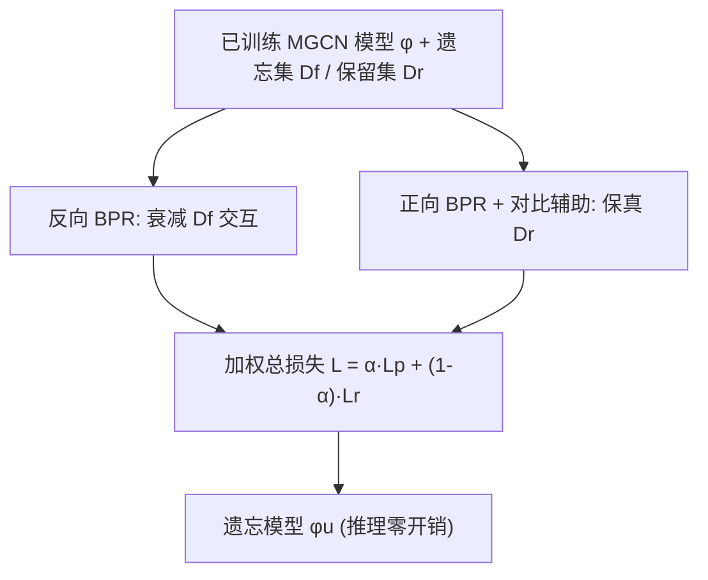
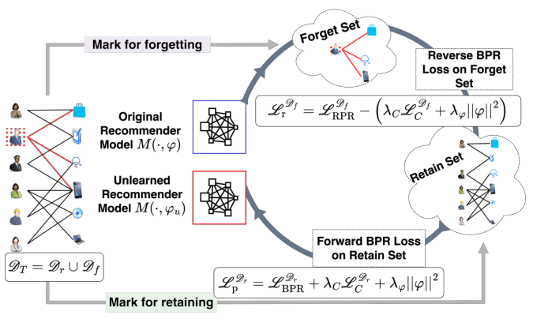

# Multi-Modal Recommendation Unlearning for Legal, Licensing, and Modality Constraints (面向法律、授权与模态约束的多模态推荐遗忘)

- **会议/期刊**: AAAI 2025 (Proceedings of the AAAI Conference on Artificial Intelligence, vol. 39, no. 12, pp. 12541-12549)
- **作者与机构**: Yash Sinha, Murari Mandal, Mohan Kankanhalli (新加坡国立大学计算学院; KIIT 布巴内斯瓦尔 RespAI Lab)
- **推荐链路定位**: 训练后模型维护 / 遗忘（Post-training Unlearning），作用于已训练好的多模态 GCN 召回模型
- **研究方向**: 去偏公平、可信隐私与工业架构 / 多模态推荐
- **论文原文**: [https://arxiv.org/abs/2405.15328v3](https://arxiv.org/abs/2405.15328v3)
- **开源代码**: [https://github.com/MachineUnlearn/MMRecUN](https://github.com/MachineUnlearn/MMRecUN)

## TL;DR (1分钟核心速览)

针对多模态推荐系统（MMRS）中"被遗忘权"与内容授权撤回（如 UMG 撤出 TikTok 曲库）带来的**物品级遗忘**需求，现有单模态遗忘方法因矩阵表示与多模态图不兼容、SISA 分片破坏图结构且聚合开销大而失效。本文提出首个 MMRS 遗忘框架 MMRecUn：以**反向 BPR** 衰减遗忘集交互、**正向 BPR** 保真保留集，并引入负向对比辅助损失削弱模态语义关联。在 Amazon Baby/Sports/Clothing 三数据集上，用户遗忘场景 Recall 较基线最高提升 **49.85%**，且比从头重训的 Gold 模型快 **1.3×**。

## Background & Motivation (背景与核心矛盾)

- **主流范式**: 多模态推荐以 MGCN 为代表，将用户-物品行为图与视觉/文本模态特征联合编码，用 BPR + 自监督对比损失训练。
- **前人局限**: ① 现有推荐遗忘方法（RecEraser/UltraRE 的 SISA 分片、RRL 的 Fisher 矩阵、IFRU 的影响函数）均基于**单模态矩阵表示**，与多模态异构图不兼容；② 分片破坏图结构导致各分片性能下降 10–30%，且跨分片聚合开销随分片数线性增长，最坏情况退化为全量重训；③ 按用户分片后无法再按物品重分片，**物品遗忘与用户-物品同时遗忘不可行**。
- **核心洞察 (Key Insight)**: 遗忘不必重训——只需在参数空间上"反向走一步"：对遗忘集施加**反向 BPR**（压低正样本得分、抬高负样本得分），同时用**正向 BPR** 锚住保留集以防灾难性遗忘；多模态场景下还需额外削弱跨模态语义关联。
- **本文切入点**: 将遗忘建模为"损伤-修复"（impair and repair）的双向 BPR 目标，直接在已训练模型上做少量 epoch 的参数更新，零分片、零聚合开销。

## Method (核心方法设计)

### 1. 整体框架 (Overall Architecture)

输入为已训练的 MGCN 模型参数 $\varphi$、遗忘集$D_f$与保留集$D_r$。MMRecUn 冻结图结构，仅对参数做遗忘微调：对$D_f$中的交互施加反向 BPR 以衰减其影响，对$D_r$施加正向 BPR + 对比辅助损失以保真，二者按权重$\alpha$加权构成总损失，迭代若干 epoch 后输出遗忘模型$\varphi_u$。推理阶段与原始 MGCN 完全一致，无额外结构改动，因此**推理零开销**。

<figure class="paper-figure" markdown="span">
  <figcaption>图1：所提出的MMRECUN方法示意图。将MGCN的架构适配于多模态数据遗忘，同时平衡保留保真度与遗忘特异性。</figcaption>
</figure>

### 2. 关键设计拆解 (Key Designs)

1. **反向 BPR 目标（Reverse BPR）**：痛点在于直接置零交互再重训代价过高。本文将 BPR 的 $\ln\sigma(\cdot)$ 取反，**最小化**遗忘集正样本相对负样本的得分差：

$$\min \mathcal{L}^{D_f}_{RPR} = \sum_{(u,i)\in D_f}\sum_{i\in Y_u^+}\sum_{j\in Y_u^-}\ln\sigma(\hat{y}_{u,i}-\hat{y}_{u,j})$$

直觉上，正向 BPR 最大化 $\sigma(\Delta)$使正样本得分高于负样本，取反后最小化同一项即把$\Delta$ 推向负值，等价于"撤销"该交互带来的参数更新，从而将遗忘集预测概率压到足够小。

2. **多模态语义关联的负向对比损失**：MGCN 通过自监督对比任务把行为特征与融合多模态特征拉近，遗忘时若只做反向 BPR，物品-物品的模态语义关联仍残留。本文引入**取负的对比辅助损失**与 L2 正则：

$$\mathcal{L}^{D_f}_{r} = \mathcal{L}^{D_f}_{RPR} - \left(\lambda_C \mathcal{L}^{D_f}_{C} + \lambda_\varphi\|\varphi\|_2\right)$$

负号使模型主动**远离**遗忘物品的模态不变性表征，削弱其在特征空间的"存在感"；同时保留侧用正向版本 $\mathcal{L}^{D_r}_{p} = \mathcal{L}^{D_r}_{BPR} + \lambda_C\mathcal{L}^{D_r}_{C} + \lambda_\varphi\|\varphi\|_2$ 防止过拟合保留集。

3. **训练目标、负采样与推理效率**：总损失为 $\mathcal{L} = \alpha\cdot\mathcal{L}^{D_r}_{p} + (1-\alpha)\cdot\mathcal{L}^{D_f}_{r}$，$\alpha$平衡保真与遗忘（实验最优$\alpha\in[0.1,0.2]$）。负采样沿用 MGCN 的均匀负采样（每正样本$K$个负样本）。时间复杂度$T=\mathcal{O}(M\cdot d\cdot|E|\cdot d_m + |U||I|K + d^2 + |M|d)$，与一次常规训练 epoch 同阶，但只需少量 epoch 即可收敛，故整体快于重训。

## Experimental Setup & Evaluation Protocol (实验设置与评估协议)

- **数据集与预处理**: 采用 Amazon 三品类，沿用 MMRec 预处理（5-core 过滤），视觉特征 4096 维、文本特征 384 维：

| 数据集 | #Users | #Items | #Interactions | 密度 | 特征/场景说明 |
| :--- | :---: | :---: | :---: | :---: | :--- |
| Baby | 19,445 | 7,050 | 160,792 | 0.117% | 母婴，图文双模态 |
| Sports | 35,598 | 18,357 | 296,337 | 0.045% | 运动户外，图文双模态 |
| Clothing | 39,387 | 23,033 | 278,677 | 0.031% | 服饰鞋饰，图文双模态 |

- **数据划分与防穿越 (Splitting Strategy)**: 每用户交互按 **8:1:1** 比例划分为训练/验证/测试；训练集再切分为遗忘集 $D_f$与保留集$D_r$（$D_r\cup D_f=D_T$，$D_r\cap D_f=\varnothing$）。Gold 模型仅在$D_r$ 上从头重训，作为"理想遗忘"上界参照。
- **排名评测协议 (Ranking Protocol)**: 采用 **Full-Ranking 全库未交互排序**（非采样排序）。用户侧指标取 $K=5,10,20,50$；物品侧指标取$K=500,1000,1500$ 以确保覆盖全部遗忘物品。指标含 Recall、Precision、NDCG、MAP。
- **对比基线与超参设置**: 基线为 MGCN（原始未遗忘模型，遗忘集得分高即"未忘干净"）、GOLD（仅保留集重训，理想下界）、AMUN（图像分类遗忘方法迁移至 MMRS）。嵌入维度 $d=64$，Xavier 初始化，$\lambda_\varphi=10^{-4}$，batch=2048，温度$\tau=0.2$，早停 20 epoch、总 1000 epoch，以验证集 Recall@20 为停止指标；物品遗忘实验 5 次不同种子并报告标准差。

## Key Experimental Results (实验关键数据)

### 1. 主实验对比 (Main Results)

**用户遗忘（5% 用户，Recall@20，越接近 GOLD 越好）**：

| 模型 | Baby Valid | Baby Test | Baby Forget | Sports Valid | Sports Test | Sports Forget | Clothing Valid | Clothing Test | Clothing Forget |
| :--- | :---: | :---: | :---: | :---: | :---: | :---: | :---: | :---: | :---: |
| MGCN | 0.0928 | 0.0941 | 0.5923 | 0.1054 | 0.1074 | 0.4624 | 0.0899 | 0.0898 | 0.8057 |
| GOLD | 0.0929 | 0.0944 | 0.0105 | 0.1059 | 0.1076 | 0.0048 | 0.0895 | 0.0891 | 0.0048 |
| AMUN | 0.0614 | 0.0618 | 0.0101 | 0.0507 | 0.0537 | 0.0028 | 0.0405 | 0.0415 | 0.0052 |
| **MMRecUn** | **0.0889** | **0.0870** | **0.0105** | **0.1035** | **0.1042** | **0.0049** | **0.0716** | **0.0737** | **0.0053** |

MMRecUn 在验证/测试集上较 AMUN 的 Recall 分别提升 **29.6%/26.69%**（Baby）、**49.85%/46.93%**（Sports）、**34.75%/36.13%**（Clothing），遗忘集得分与 GOLD 几乎持平（Baby 0.0105 vs 0.0105）。

**物品遗忘（5% 物品，Recall@K，K 随数据集取 500/1000/1500）**：

| 模型 | Baby Valid | Baby Test | Baby Forget | Sports Valid | Sports Test | Sports Forget | Clothing Valid | Clothing Test | Clothing Forget |
| :--- | :---: | :---: | :---: | :---: | :---: | :---: | :---: | :---: | :---: |
| MGCN | 0.9481 | 0.9073 | 0.8070 | 0.9180 | 0.8621 | 0.7573 | 0.9857 | 0.9690 | 0.8840 |
| GOLD | 0.9481 | 0.9073 | 0.5103 | 0.9180 | 0.8621 | 0.6469 | 0.9857 | 0.9690 | 0.7134 |
| AMUN | 0.9271 | 0.8943 | 0.5639 | 0.9433 | 0.9013 | 0.6471 | 0.9721 | 0.9516 | 0.7605 |
| **MMRecUn** | **0.9481** | **0.9073** | **0.5086** | **0.9373** | **0.9001** | **0.6693** | **0.9761** | **0.9526** | **0.7002** |

物品遗忘场景下 MMRecUn 的遗忘集 Recall 较 AMUN 提升 **10.83%**（Baby）与 **8.45%**（Clothing），Sports 略降 3.43%；验证/测试集与 GOLD 偏差仅 0.41%–2.21%。

**用户+物品同时遗忘（5%+5%）**：用户侧指标与 AMUN 相当（验证/测试/遗忘集偏差约 2.89%/1.83%/0%），物品侧遗忘集 Recall 较 AMUN 最高提升 **41.32%**。

**效率**：Baby 上 MMRecUn 耗时 169.41s vs GOLD 225.73s；Clothing 上 968.96s vs 1294.44s，**节省约 25% 时间（1.3× 加速）**。

### 2. 消融实验 (Ablation Study)

| 配置 | 验证集 Recall | 测试集 Recall | 遗忘集 Recall | 说明 |
| :--- | :---: | :---: | :---: | :--- |
| MGCN（未遗忘） | 0.0928 | 0.0941 | 0.5923 | 遗忘集得分极高，未忘干净 |
| GOLD（仅保留集重训） | 0.0929 | 0.0944 | 0.0105 | 理想上界，但需全量重训 |
| AMUN（图像遗忘迁移） | 0.0614 | 0.0618 | 0.0101 | 保真严重受损 |
| **MMRecUn（完整）** | **0.0889** | **0.0870** | **0.0105** | 遗忘彻底且保真接近 GOLD |
| $\alpha$扫描（0.001→0.9） | 0.0779→0.0775 | 0.0748→0.0809 | 0.0104→0.0102 |$\alpha\in[0.1,0.2]$ 最优 |
| 遗忘比例压力测试（5%→0.1%） | 0.0893→0.0757 | 0.0871→0.0749 | 0.0105→0.0175 | 遗忘比例越小，保真越稳 |

### 3. 关键实验发现 (Key Findings)

1. **反向 BPR 是保真-遗忘平衡的关键**：AMUN 虽能把遗忘集 Recall 压到 0.0101（Baby），但测试集 Recall 从 0.0941 暴跌至 0.0618（-34%），说明单纯"抹除"会灾难性遗忘；MMRecUn 通过正向 BPR 锚定保留集，测试集仅降至 0.0870（-7.5%），遗忘集仍达 0.0105，验证了双向目标的必要性。
2. **物品遗忘比用户遗忘更难，物品侧指标不可或缺**：用户遗忘下 MMRecUn 遗忘集 Recall 与 GOLD 完全一致（0.0105 vs 0.0105），但物品遗忘下 Baby 遗忘集 Recall 为 0.5086 vs GOLD 0.5103，差距虽小却需 $K=500$的物品侧指标才能暴露——传统用户侧$K\le50$ 指标无法捕捉物品级遗忘效果。
3. **$\alpha$存在明确最优区间且遗忘比例影响保真**：$\alpha$从 0.001 增至 0.3 时测试集 Recall 从 0.0748 升至 0.0920，超过 0.3 后回落至 0.0809，最优$\alpha\in[0.1,0.2]$；压力测试显示遗忘 5% 用户时验证集 Recall 0.0893，遗忘 0.1% 时降至 0.0757，说明小比例遗忘请求下模型更易过拟合保留集，需调低$\alpha$。

## Highlights & Limitations (亮点、对比与审稿批判)

- **与代表作对比 (vs. Prior Work)**: 相比 RecEraser/UltraRE 的 SISA 分片（破坏图结构、聚合开销大、无法做物品遗忘），MMRecUn 直接在原图上做参数级遗忘，零分片零聚合；相比 RRL 的反向 BPR + Fisher 矩阵（需计算 Fisher 逆，多模态高维下不可行），本文用负向对比损失替代 Fisher 保真项，规避了高维矩阵求逆；相比 AMUN（图像分类遗忘迁移），本文显式建模多模态语义关联的削弱，保真度显著更优。
- **可迁移亮点**: ① "反向 BPR + 正向 BPR"的损伤-修复范式可直接迁移到 LightGCN 等单模态图推荐的遗忘场景；② 用 **BPR divergence**（基于 MSE 的得分差）替代 KL 散度衡量遗忘前后模型差异，规避了推荐得分非概率化、稀疏高维下 KL 未定义的问题，可作为通用遗忘评估指标。
- **审稿级局限批判**: ① 方法未建模时序动态，对序列推荐场景的遗忘适配性存疑；② 假设待遗忘数据可明确识别，零样本遗忘（zero-shot unlearning）场景下不成立；③ 实验仅在 Amazon 三品类、MGCN 单一基模型上验证，未覆盖音频/视频等更多模态，也未与 RRL、IFRU 等近似遗忘方法直接数值对比（作者称代码不可得或分片不兼容），基线覆盖略显单薄。

## Rating (四维评分)

- **方法创新性 (Novelty)**: ⭐⭐⭐⭐ （首个多模态推荐遗忘框架，反向 BPR + 负向对比的损伤-修复范式简洁有效，并有贝叶斯后验视角的理论解释）
- **评估协议与实验扎实度 (Protocol & Experiments)**: ⭐⭐⭐⭐ （Full-Ranking 协议严谨，用户/物品/联合三类遗忘场景 + 物品侧指标 + 压力测试完整，但基线仅 3 个且缺 RRL/IFRU 直接对比）
- **写作与数学规范度 (Clarity & Rigor)**: ⭐⭐⭐⭐ （BPR divergence 与信息界命题推导清晰，符号表完整，时间复杂度分析到位；部分公式排版在原文中略有错位）
- **工业落地与复现价值 (Industrial & Practical Value)**: ⭐⭐⭐⭐⭐ （推理零开销、比重训快 1.3×、代码开源，直接对应 GDPR 合规与内容授权撤回等真实工业需求，落地价值极高）

