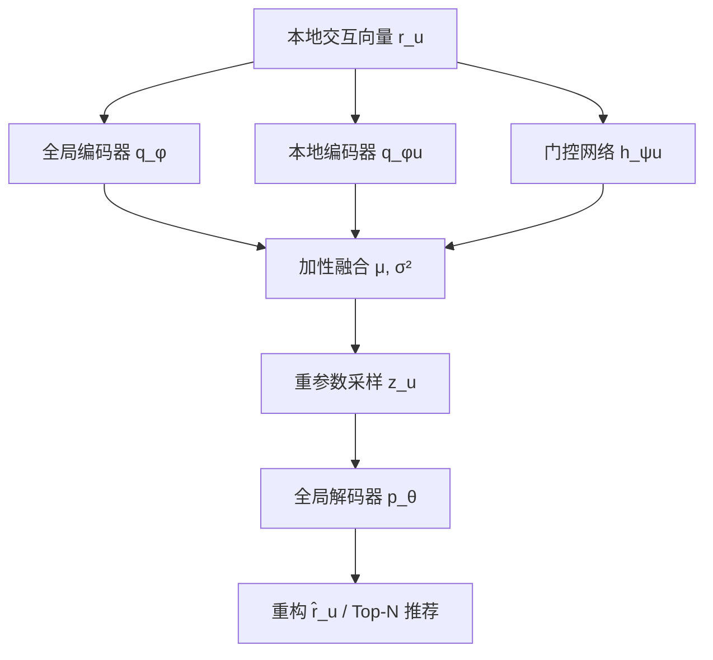
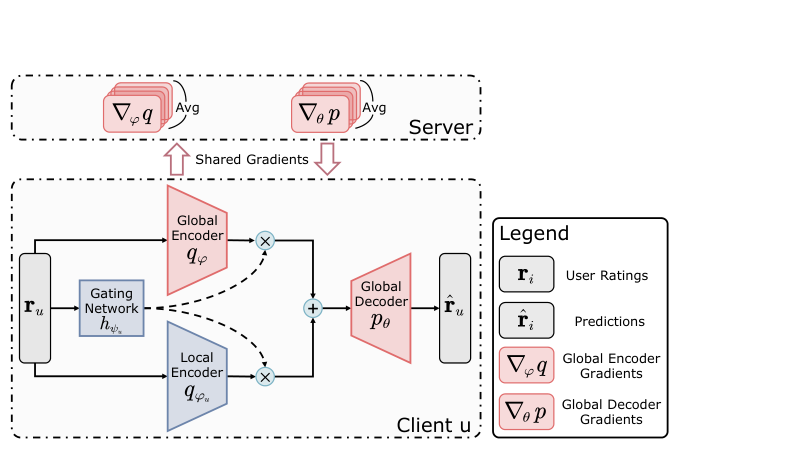

# Personalized Federated Collaborative Filtering: A Variational AutoEncoder Approach (个性化联邦协同过滤：一种变分自编码器方法)

- **会议/期刊**: AAAI 2025
- **作者与机构**: Zhiwei Li, Guodong Long, Tianyi Zhou, Jing Jiang, Chengqi Zhang (UTS AAII / UMD / PolyU)
- **推荐链路定位**: 召回（联邦客户端本地 Top-N 推荐）
- **研究方向**: 去偏公平、可信隐私与工业架构 / 协同过滤
- **论文原文**: [https://arxiv.org/abs/2408.08931v2](https://arxiv.org/abs/2408.08931v2)
- **开源代码**: [https://github.com/mtics/FedDAE](https://github.com/mtics/FedDAE)

## TL;DR (1分钟核心速览)

现有 FedCF 把个性化信息压缩进单个用户嵌入向量，难以承载异构客户端细粒度偏好，且 MF 系方法只能建模线性关系。本文把 FedCF 重构为 VAE 任务，用「全局编码器 + 本地编码器 + 个性化门控」的加性双编码器分离共享与个性化知识，并以多项式似然重构交互向量。在 4 个数据集、Leave-One-Out + 20 负采样协议下，ML-100K 上 HR@20 达 0.1232，较 FedRAP (0.0626) 提升约 97%，逼近集中式 LightGCN。

## Background & Motivation (背景与核心矛盾)

- **主流范式**: FedCF 以 FedAvg 聚合全局物品嵌入/梯度，客户端本地保留用户嵌入；PFedRec、FedRAP 进一步对物品嵌入做双个性化（共享分量 + 个性化分量）。
- **前人局限**: ① 个性化信息被压进单一用户嵌入向量，无法表达异构客户端的细粒度偏好；② 个性化物品嵌入需在客户端长期维护，存储与计算开销大，且过度个性化损害泛化；③ MF 系方法假设用户-物品关系线性，难以刻画复杂非线性交互。
- **核心洞察 (Key Insight)**: 用户知识应同时驻留于「隐变量」与「神经网络」两处——隐空间刻画分布层面的个性化，网络权重刻画函数层面的个性化，二者互补。
- **本文切入点**: 把 FedCF 写成 VAE 的 ELBO 最大化问题，用双编码器分别建模共享/个性化子空间，门控网络按交互数据自适应加权，实现「加性个性化」。

## Method (核心方法设计)

### 1. 整体框架 (Overall Architecture)

每个客户端 $u$将交互向量$\mathbf{r}_u\in\{0,1\}^m$同时送入全局编码器$q_\phi$、本地编码器$q_{\phi_u}$与门控网络$h_{\psi_u}$；门控输出权重$\omega_{u1},\omega_{u2}$对两编码器的高斯参数做加性融合，采样隐变量$\mathbf{z}_u$后经全局解码器$p_\theta$重构$\hat{\mathbf{r}}_u$。训练采用交替更新：全局编码器与解码器的梯度上传服务器 FedAvg 聚合，本地编码器与门控网络仅在本机更新，且客户端不连续两轮参与以保护隐私。

<figure class="paper-figure" markdown="span">
  <figcaption>图1：FedDAE 的框架。</figcaption>
</figure>

### 2. 关键设计拆解 (Key Designs)

1. **加性双编码器（Additive Dual Encoder）**：痛点是个性化信息被单向量瓶颈卡死。本文令变分后验由两个独立高斯加权合成，借助高斯分布可加性（Lemma 1）直接闭式融合：
$\mu_{\Phi_u}(\mathbf{r}_u)=\omega_{u1}\mu_\phi(\mathbf{r}_u)+\omega_{u2}\mu_{\phi_u}(\mathbf{r}_u),\quad \sigma^2_{\Phi_u}(\mathbf{r}_u)=\omega_{u1}^2\sigma^2_\phi(\mathbf{r}_u)+\omega_{u2}^2\sigma^2_{\phi_u}(\mathbf{r}_u)$
直觉上，全局项提供跨客户端可迁移的物品语义，本地项提供用户专属判别方向，二者在隐空间线性叠加而非硬性拼接，避免了个性化物品嵌入的存储开销。

2. **个性化门控网络（Personalized Gating）**：固定权重无法适配异构客户端。门控取 $h_{\psi_u}(\mathbf{r}_u)=\mathrm{softmax}(\mathbf{r}_u\cdot\psi_u)\in\mathbb{R}^2$，满足$\omega_{u1}+\omega_{u2}=1$，权重由用户自身交互模式决定。这样交互稀疏/噪声大的客户端可自动向全局编码器倾斜以借力，交互充分者则放大本地编码器，实现「按数据定权重」的个性化-泛化平衡。

3. **VAE 式训练目标与推理**：以多项式似然建模隐式反馈，最大化 β-ELBO：
$\mathcal{L}_\beta(\mathbf{r}_u;\Phi_u,\theta)=\mathbb{E}_{q_{\Phi_u}(\mathbf{z}_u|\mathbf{r}_u)}[\log p_\theta(\mathbf{r}_u|\mathbf{z}_u)]-\beta\cdot\mathrm{KL}\big(q_{\Phi_u}(\mathbf{z}_u|\mathbf{r}_u)\,\|\,p_\theta(\mathbf{z}_u)\big)$总目标为$\max_{\phi,\{\phi_u\},\{\psi_u\},\theta}\sum_u\alpha_u\mathcal{L}_\beta$，$\alpha_u=1/n$，$\beta$逐步退火至 1。训练负采样为每正样本 4 个负样本；推理时直接取$\hat{\mathbf{r}}_u=\mu_{\Phi_u}(\mathbf{r}_u)$排序，无需负采样打分。复杂度$O(n(2L+L')md)$，与客户端数线性相关。

## Experimental Setup & Evaluation Protocol (实验设置与评估协议)

- **数据集与预处理**: 显式评分 >0 一律二值化为正交互；仅保留交互数 ≥10 的用户。

| 数据集 | #Users | #Items | #Interactions | 稀疏度 | 场景说明 |
| :--- | :---: | :---: | :---: | :---: | :--- |
| ML-100K | 943 | 1,682 | 100,000 | 93.70% | 电影显式评分 |
| ML-1M | 6,040 | 3,706 | 1,000,209 | 95.53% | 电影显式评分 |
| Video | 1,372 | 7,957 | 23,181 | 99.79% | Amazon 视频隐式 |
| QB-article | 24,516 | 7,455 | 266,356 | 99.81% | 文章点击隐式 |

- **数据划分与防穿越 (Splitting Strategy)**: `Leave-One-Out`，每个用户最后一条交互作测试、倒数第二条作验证。
- **排名评测协议 (Ranking Protocol)**: 训练集每正样本随机采 4 个负样本；评测采用 `Sampled Ranking`（1 正 + 99 负候选），报告 HR@20 与 NDCG@20，5 次重复取均值±标准差。
- **对比基线与超参设置**: 集中式 MultiVAE / RecVAE / LightGCN / CentDAE，联邦式 FedVAE / PFedRec / FedRAP；隐维 $k=256$、batch 2048、隐层 3 层、本地 epoch 10、Adam、学习率从$\{10^i\}_{i=-8}^{-1}$ 调优，无预训练。

## Key Experimental Results (实验关键数据)

### 1. 主实验对比 (Main Results)

| 方法 | ML-100K HR@20 | ML-100K NDCG@20 | ML-1M HR@20 | ML-1M NDCG@20 | Video HR@20 | QB-Art HR@20 |
| :--- | :---: | :---: | :---: | :---: | :---: | :---: |
| MultiVAE (Central) | 0.1093 | 0.0436 | 0.0682 | 0.0276 | 0.0689 | 0.0129 |
| RecVAE (Central) | 0.1526 | 0.0590 | 0.1067 | 0.0409 | 0.0693 | 0.0195 |
| LightGCN (Central) | **0.1761** | **0.0953** | **0.1207** | **0.0677** | **0.0761** | **0.0204** |
| FedVAE | 0.1200 | 0.0501 | 0.0639 | 0.0250 | 0.0634 | 0.0116 |
| PFedRec | 0.0541 | 0.0115 | 0.0600 | 0.0231 | 0.0138 | 0.0065 |
| FedRAP | 0.0626 | 0.0122 | 0.0625 | 0.0240 | 0.0142 | 0.0116 |
| **FedDAE** | **0.1232** | **0.0503** | **0.0650** | **0.0261** | **0.0654** | **0.0124** |
| Improv. vs 最佳联邦基线 | +2.67% | +0.40% | +1.72% | +4.40% | +3.16% | +6.90% |

### 2. 消融实验 (Ablation Study)

| 变体 (ML-100K) | HR@20 | NDCG@20 | 相对 FedDAE |
| :--- | :---: | :---: | :---: |
| FedDAE（自适应门控） | **0.1287** | **0.0524** | — |
| FedDAE$_{w=0.25}$（偏本地） | 0.1213 | 0.0506 | −5.75% / −3.44% |
| FedDAE$_{w=0.5}$（均权） | 0.1245 | 0.0513 | −3.26% / −2.10% |
| FedDAE$_{w=0.75}$（偏全局） | 0.1191 | 0.0469 | −7.46% / −10.50% |

### 3. 关键实验发现 (Key Findings)

1. **门控自适应优于任何固定权重**：均权 $w=0.5$已损失 3.26% HR，而偏全局$w=0.75$ 损失 7.46% HR、10.50% NDCG，说明个性化分量是性能主来源，过度依赖全局编码器代价最大，门控的价值在于按客户端数据动态配比。
2. **联邦方法可逼近集中式 VAE**：FedDAE 在 ML-100K 上 HR@20 (0.1232) 已超过集中式 MultiVAE (0.1093) 与 CentDAE (0.1119)，仅落后 LightGCN 约 30%，证明双编码器 + 门控在不上传原始数据的前提下补回了大部分个性化损失。
3. **稀疏度是主要瓶颈**：在稀疏度 99.8% 的 QB-article 上，FedDAE 相对 FedRAP 提升 6.90% HR，但绝对 HR 仅 0.0124，且收敛显著变慢；加入梯度噪声（$\kappa^2$ 从 0.2 升至 1）后 FedDAE 仍全面领先各固定权重变体，说明自适应门控在隐私噪声下具备额外鲁棒性。

## Highlights & Limitations (亮点、对比与审稿批判)

- **与代表作对比 (vs. Prior Work)**: 相比 FedVAE 仅聚合全部参数梯度（个性化信息被平均掉），FedDAE 把本地编码器与门控完全留在客户端；相比 PFedRec/FedRAP 依赖个性化物品嵌入（存储重、泛化差），本文改用隐空间加性分解，参数量与通信量更可控；相比 MultiVAE/RecVAE，本文首次把双编码器门控嵌入 VAE 框架。
- **可迁移亮点**: ① 高斯可加性引理让「双分支隐变量融合」有闭式解，可直接迁移到任何 VAE 式推荐或多模态融合；② 门控权重由交互向量内积生成，是一种极轻量的客户端级元学习式加权，可复用到多场景/多域融合。
- **审稿级局限批判**: ① 评测采用 1 正 99 负的采样排序而非全库 Full-Ranking，且未报告显著性检验，提升幅度（如 ML-1M +1.72%）在标准差量级内，说服力有限；② 每客户端需维护独立本地编码器与门控，客户端规模大时存储与本地计算开销随 $n$ 线性增长，论文未给出通信/时延实测；③ 高稀疏数据集上性能绝对值极低，缺少针对稀疏场景的专门设计。

## Rating (四维评分)

- **方法创新性 (Novelty)**: ⭐⭐⭐⭐ （把 FedCF 重构为 VAE 并用高斯可加性实现双编码器门控融合，思路清晰但组件均为已知模块的组合）
- **评估协议与实验扎实度 (Protocol & Experiments)**: ⭐⭐⭐ （4 数据集 + 5 次重复 + 消融与噪声鲁棒性齐全，但采样排序协议偏弱、缺显著性检验）
- **写作与数学规范度 (Clarity & Rigor)**: ⭐⭐⭐⭐ （ELBO 推导与 Lemma 1 交代清楚，算法伪代码完整，复杂度分析到位）
- **工业落地与复现价值 (Industrial & Practical Value)**: ⭐⭐⭐⭐ （代码开源，仅传全局梯度、天然兼容 DP，但客户端存储随用户数线性增长限制大规模部署）

