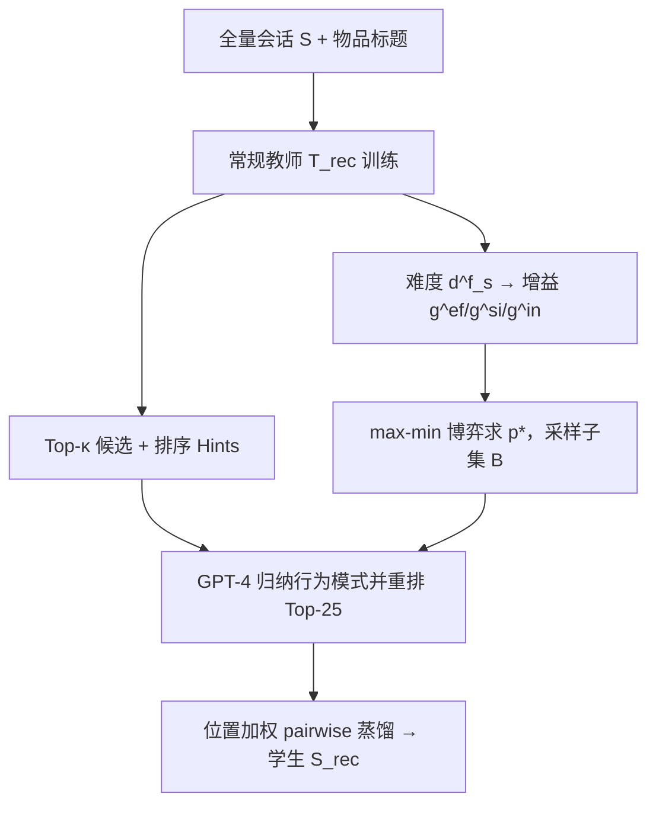
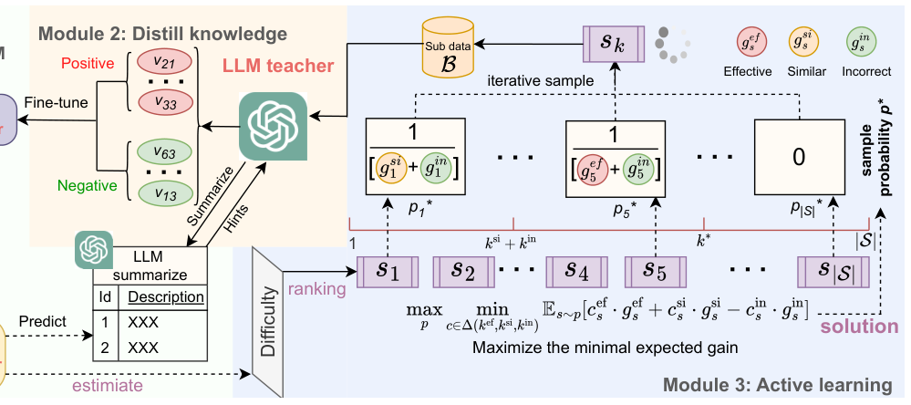

# Active Large Language Model-based Knowledge Distillation for Session-based Recommendation (面向会话推荐的主动式大模型知识蒸馏)

- **会议/期刊**: AAAI 2025
- **作者与机构**: Yingpeng Du, Zhu Sun, Ziyan Wang, Haoyan Chua, Jie Zhang, Yew-Soon Ong (南洋理工大学 / 新加坡科技设计大学 / 延世大学)
- **推荐链路定位**: 精排（轻量学生模型在线服务，LLM 仅离线蒸馏）
- **研究方向**: 大语言模型推荐 / 序列与会话推荐
- **论文原文**: [https://arxiv.org/abs/2502.15685v1](https://arxiv.org/abs/2502.15685v1)
- **开源代码**: 暂未开源（正文称代码在补充材料中）

## TL;DR (1分钟核心速览)

LLM 做会话推荐（SBR）精度高但推理昂贵，传统 KD 需让 LLM 预测**全部**会话，成本不可持续；且 LLM 对"简单实例"给出与常规推荐器雷同的预测（冗余）、对"困难实例"给出错误预测（误导学生）。本文提出 ALKDRec：先用常规教师推荐器的 Top-κ 候选与排序作为 Hints 让 GPT-4 对齐领域知识，再从全量会话中按 **max-min 期望增益**主动采样约 500 条实例做 pairwise 蒸馏。在 Hetrec2011-ML / Amazon-Games 上以 FPMC/STAMP/AttMix 三种骨干做 Leave-One-Out 全库排序，平均相对提升 17.03%/9.81%/12.97%，训练成本从 1782 分钟、347 美元降至 44 分钟、8.6 美元。

## Background & Motivation (背景与核心矛盾)

- **主流范式**: LLM-as-recommender 通过 prompt / 指令微调直接生成推荐列表，精度好但服务期延迟与显存开销巨大；KD 路线则训练轻量学生模仿教师软标签。
- **前人局限一（成本）**: 现有 KD（DE/FTD/HTD/unKD/DSL/DLLM2Rec）默认教师对**所有实例**出预测，而 LLM 单次推理成本远高于常规推荐器，全量蒸馏在工业上不可持续。
- **前人局限二（无效预测）**: LLM 在 SBR 上并非处处优于常规模型——简单会话上二者预测高度相似（信息增益趋零），噪声大的困难会话上 LLM 反而预测错误（负增益、污染学生）。
- **核心洞察 (Key Insight)**: 实例对 KD 的价值应由**难度**（常规教师能否拟合）与**效果**（LLM 预测是有效/相似/错误）联合决定，而这两者在查询 LLM 之前只能部分观测，因此这是一个"未知组合下的选择博弈"。
- **本文切入点**: 只假设已知三类实例的**总数** $(k_{ef},k_{si},k_{in})$，把实例选择建模为 max-min 期望增益博弈，求出闭式最优采样分布$p^*$，从而在有限预算下系统性规避无效实例。

## Method (核心方法设计)

### 1. 整体框架 (Overall Architecture)

三模块闭环：**Module 1** 用全量数据训练常规教师 $T_{rec}$，取其 Top-κ（κ=50）候选与排序作为 Hints，通过 `prompt_smr` 让 GPT-4 归纳领域行为模式，再以 `prompt_dst` 在候选集内输出 Top-25 排序$rank^{llm}_s$；**Module 2** 以位置加权 pairwise 损失把该排序蒸馏进已预训练的低维学生$S_{rec}$；**Module 3** 在查询 LLM 之前，用常规教师估计每个会话的难度与增益，按$p^*$采样出子集$\mathcal{B}$（$|\mathcal{B}|\ll|\mathcal{S}|$）送 LLM 标注，迭代完成蒸馏。

<figure class="paper-figure" markdown="span">
  <figcaption>图1：ALKDRec方法的架构。</figcaption>
</figure>

### 2. 关键设计拆解 (Key Designs)

1. **Hints 增强的 LLM 教师（弥补领域知识缺口）**：LLM 缺乏协同信号，直接 prompt 易给出泛化但不对齐的排序。本文不微调 LLM，而是让其在常规教师给出的 κ 个候选内重排，并把教师排序作为上下文提示，等价于用"候选裁剪 + 行为模式摘要"把开放生成约束到领域分布上，零训练成本实现领域对齐。

2. **难度与三类增益建模（把"值不值得问"量化）**：难度定义为会话表征与其内部物品表征的负一致性 $d^f_s=-\frac{1}{|s|}\sum_{v\in s}\sigma(\text{Encode}(s)^{\top}\mathbf{e}_v)$，越大表示常规教师越抓不住；增益按难度升序排名赋指数衰减$g^{ef}_s=1/[\text{rank}(d^f_s)]^{\mu}$（μ=10），并令$g^{si}_s=g^{in}_s=g^{ef}_s/2$，即有效实例增益最高、相似实例仅提供置信度边际收益、错误实例为负增益且绝对值更小。

3. **Max-Min 期望增益的闭式采样策略**：目标是 $\max_{p}\min_{c\in\Delta(k_{ef},k_{si},k_{in})}\mathbb{E}_{s\sim p}[c^{ef}_s g^{ef}_s+c^{si}_s g^{si}_s-c^{in}_s g^{in}_s]$。作者证明该博弈的上下界在均衡点重合，最优分布为

$$p^*_s=\begin{cases}\frac{1}{H_{k^*}(g^{si}_s+g^{in}_s)}, & 1\le s\le k_{si}+k_{in}\\[2pt] \frac{1}{H_{k^*}(g^{ef}_s+g^{in}_s)}, & k_{si}+k_{in}<s\le k^*\\[2pt] 0, & s>k^*\end{cases}$$

其中 $k^*=\arg\max_s \frac{g^{ef}_s+k_{ef}+k_{si}-|\mathcal{S}|}{H_s}$，$H_k$为对应倒数和。直觉是：**高增益实例被赋予更高采样概率，但概率被$1/(g+g^{in})$形式"压平"**，保证在未知真实类别的最坏组合下仍能拿到恒定下界$\Gamma(k^*)$，从而天然抑制"只挑最难的"（易被 LLM 答错）与"只挑最简单的"（冗余）两种极端。

4. **训练目标与开销**：蒸馏损失为位置加权 pairwise 形式 $\max\sum_{s\in\mathcal{B}}\sum_{v\in rank^{llm}_s}\alpha_v\log\sigma(S_{rec}(s,v)-S_{rec}(s,v'))$，$\alpha_v$在排名 [1,5]/(5,15]/(15,25] 分别取 3/2/1；负样本$v'$ 取自会话未交互物品。教师/学生隐维分别 100/10，学生在线推理与普通 SBR 模型同量级，LLM 仅离线调用约 500 次。

## Experimental Setup & Evaluation Protocol (实验设置与评估协议)

- **数据集与预处理**（按天切会话、过滤长度 <5 的会话）：

| 数据集 | #Sessions | #Items | #Interactions | 说明 |
| :--- | :---: | :---: | :---: | :--- |
| Hetrec2011-ML | 12,323 | 8,475 | 112,034 | MovieLens 电影评分，含标题 |
| Amazon-Games | 20,091 | 26,138 | 132,677 | Amazon Video Game 评论，含标题 |

- **数据划分与防穿越**: 会话级 **6:2:2** 随机划分 train/valid/test，测试阶段采用 **Leave-One-Out**（每会话留最后交互物品作标签）。
- **排名评测协议**: 对每个会话在**全库未交互物品**上排序（Full-Ranking），指标 Recall@{5,10} 与 NDCG@{5,10}，五次运行取均值。
- **对比基线与超参**: 骨干 FPMC / STAMP / AttMix；KD 基线 DE、FTD、HTD、unKD、DSL、DLLM2Rec（为公平性，DLLM2Rec 也只用同量实例并去掉需全物品生成的置信权重）；教师/学生隐维 100/10，Adam，lr=1e-3，batch=1024；显著性用 t-test（$p<0.05$）。

## Key Experimental Results (实验关键数据)

### 1. 主实验对比 (Main Results)

| 数据集 / 骨干 | 指标 | Student | Teacher(10×) | FTD | HTD | DSL | DLLM2Rec | **ALKDRec** | Improv. |
| :--- | :--- | :---: | :---: | :---: | :---: | :---: | :---: | :---: | :---: |
| Hetrec / FPMC | R@10 | 0.01055 | 0.02191 | 0.01866 | 0.01460 | 0.00893 | 0.01623 | **0.02150*** | +15.22% |
| Hetrec / FPMC | N@10 | 0.00415 | 0.01002 | 0.00901 | 0.00723 | 0.00436 | 0.00731 | **0.01019*** | +13.06% |
| Hetrec / STAMP | R@10 | 0.01177 | 0.01907 | 0.01298 | 0.01217 | 0.01298 | 0.01217 | **0.01623*** | +8.11% |
| Hetrec / STAMP | N@10 | 0.00563 | 0.00937 | 0.00616 | 0.00517 | 0.00542 | 0.00575 | **0.00799*** | +9.58% |
| Hetrec / AttMix | N@10 | 0.00180 | 0.00419 | 0.00366 | 0.00351 | 0.00406 | 0.00448 | **0.00547*** | +22.14% |
| Amazon / FPMC | R@10 | 0.05101 | 0.08311 | 0.05126 | 0.05200 | 0.04331 | 0.05126 | **0.05748*** | +10.53% |
| Amazon / STAMP | N@10 | 0.02119 | 0.03104 | 0.02246 | 0.02215 | 0.01905 | 0.02188 | **0.02342*** | +4.26% |
| Amazon / AttMix | R@10 | 0.02264 | 0.05200 | 0.00690 | 0.02140 | 0.00933 | 0.02215 | **0.02936*** | +32.59% |
| Amazon / AttMix | N@10 | 0.00983 | 0.02315 | 0.00323 | 0.00977 | 0.00355 | 0.00987 | **0.01343*** | +36.07% |

### 2. 消融实验 (Ablation Study)

| 变体 (Hetrec / FPMC) | R@10 | N@10 | 变体 (Amazon / AttMix) | R@10 | N@10 |
| :--- | :---: | :---: | :--- | :---: | :---: |
| TR（仅常规教师蒸馏） | 0.01907 | 0.00897 | TR | 0.02264 | 0.01002 |
| Random（随机采样） | 0.01907 | 0.00856 | Random | 0.02538 | 0.01132 |
| Easiest（最易实例） | 0.01623 | 0.00693 | Easiest | 0.01966 | 0.00905 |
| Hardest（最难实例） | 0.01298 | 0.00639 | Hardest | 0.02239 | 0.00997 |
| RAD-BC（二分类主动蒸馏） | 0.01420 | 0.00658 | RAD-BC | 0.02712 | 0.01210 |
| **ALKDRec** | **0.02150** | **0.01019** | **ALKDRec** | **0.02936** | **0.01343** |

### 3. 关键实验发现 (Key Findings)

1. **"最难"策略反而最差**：Hetrec/FPMC 上 Hardest 的 R@10 仅 0.01298，甚至低于 TR 的 0.01907，直接验证了"困难实例易被 LLM 答错、负增益污染学生"的假设；而 Easiest 同样劣于 Random，说明简单实例的蒸馏近乎冗余。
2. **三分类建模优于二分类主动学习**：RAD-BC 只区分正确/错误，Amazon/AttMix 上 N@10 为 0.01210，低于 ALKDRec 的 0.01343；且随 correction rate 变化 ALKDRec 始终占优，证明显式建模"相似实例"这一零增益类别是必要的。
3. **小样本蒸馏可反超 10 倍参数教师**：仅用约 500 条 LLM 标注（Amazon-Games 约 44 分钟 / 8.6 美元，对比全量 1782 分钟 / 347 美元），学生即在多数指标上超过隐维 100 的教师；但实例数超过阈值后性能回落（图 4），说明错误/相似实例的边际污染会累积，500 条是效率-效果的经验拐点。

## Highlights & Limitations (亮点、对比与审稿批判)

- **与代表作对比**: 相比 DLLM2Rec（重要性感知的 LLM 排序蒸馏，但仍需大量 LLM 交互且未处理"相似预测"冗余），本文把选择问题上升为带理论下界的 max-min 博弈；相比 RAD-BC（二分类鲁棒主动蒸馏），本文针对排序任务扩展出 effective/similar/incorrect 三态增益，覆盖了 SBR 中 LLM 与常规模型"英雄所见略同"的特有失效模式。
- **可迁移亮点**: (1) 用常规模型 Top-κ 候选 + 排序作为 Hints 约束 LLM 输出空间，是零训练成本领域对齐的通用技巧；(2) 以 $1/(g+g^{in})$ 形式压平采样分布的 max-min 策略，可直接迁移到任何"昂贵标注器 + 廉价代理模型"的数据选择场景（如人工标注、多模态大模型蒸馏）。
- **审稿级局限批判**: (1) 理论保证依赖"三类实例总数 $(k_{ef},k_{si},k_{in})$ 已知"这一强假设，实际中需网格搜索（文中 1:5:4），跨数据集迁移性存疑；(2) 难度仅由常规教师的会话-物品一致性刻画，对冷启动物品或极短会话可能失真；且增益函数形式（指数衰减、μ=10、相似/错误增益取半）为人工设定，缺少敏感性理论分析。

## Rating (四维评分)

- **方法创新性 (Novelty)**: ⭐⭐⭐⭐ （首次将 LLM-based KD 的实例选择建模为带闭式解的 max-min 增益博弈，三态增益刻画贴合排序任务，理论推导完整）
- **评估协议与实验扎实度 (Protocol & Experiments)**: ⭐⭐⭐⭐ （双数据集 × 三骨干 × 六类 KD 基线，Leave-One-Out 全库排序 + t-test 显著性，消融覆盖 Random/Easiest/Hardest/RAD-BC，但缺少线上延迟实测）
- **写作与数学规范度 (Clarity & Rigor)**: ⭐⭐⭐⭐ （定理-定义-证明链条清晰，$p^*$与$k^*$ 闭式表达完整；但正文证明仅为 sketch，增益超参的经验性偏强）
- **工业落地与复现价值 (Industrial & Practical Value)**: ⭐⭐⭐⭐ （成本从 347 美元降至 8.6 美元、学生模型与普通 SBR 同量级，落地路径清晰；扣分在于代码未正式开源、依赖 GPT-4 API 版本稳定性）

