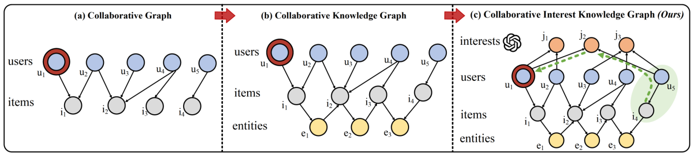
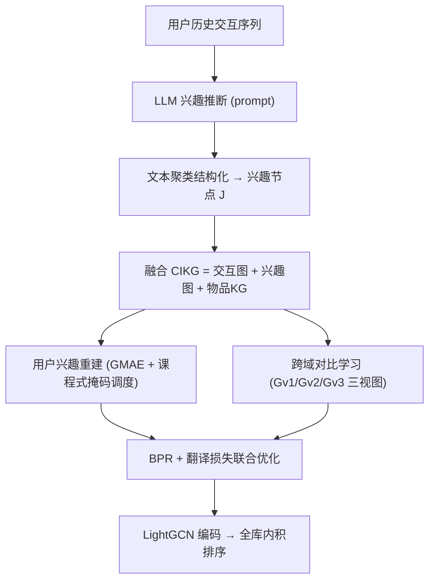
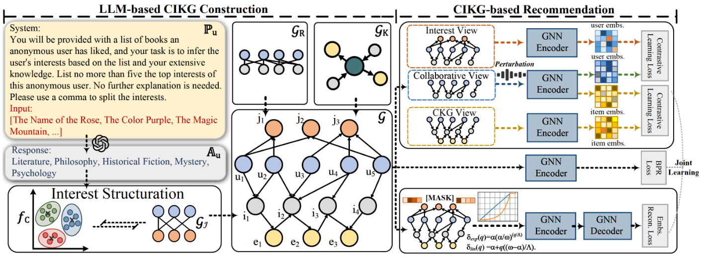

# Bridging the User-side Knowledge Gap in Knowledge-aware Recommendations with Large Language Models (用大语言模型弥合知识感知推荐中的用户侧知识鸿沟)

- **会议/期刊**: AAAI 2025
- **作者与机构**: Zheng Hu, Zhe Li, Ziyun Jiao, Satoshi Nakagawa, Jiawen Deng, Shimin Cai, Tao Zhou, Fuji Ren（电子科技大学、东京大学、电子科技大学深圳高等研究院）
- **推荐链路定位**: 召回（图协同召回）
- **研究方向**: 大语言模型推荐 / 图神经网络与知识图谱推荐
- **论文原文**: [https://arxiv.org/abs/2412.13544v1](https://arxiv.org/abs/2412.13544v1)
- **开源代码**: [https://github.com/laowangzi/CIKGRec](https://github.com/laowangzi/CIKGRec)

## TL;DR (1分钟核心速览)

知识感知推荐长期只把 KG 挂在物品侧，用户侧结构化知识因粒度不当与特征稀缺而缺失。本文用 LLM 从用户历史行为推断显式兴趣，经文本聚类结构化为兴趣节点，与用户-物品交互图、物品 KG 融合成协同兴趣知识图谱 CIKG；再用图掩码自编码器重建兴趣节点以抗 LLM 幻觉噪声，并用跨域对比学习把辅助知识迁移到协同域。在 DBbook2014 / Book-Crossing / MovieLens-1M 上按 7:1:2 划分、全库排序评测，R@100 相对最强基线最高提升 9.31%，稀疏用户组增益尤为显著。

## Background & Motivation (背景与核心矛盾)

- **主流范式**: CKG（协同知识图谱）把物品侧 KG 三元组与用户-物品交互图合并，用 GNN（KGAT/KGIN/KGCL/KGRec）做高阶消息传播，是知识感知推荐的标准做法。
- **前人局限**: 其一，KG 只覆盖物品侧，用户侧仅有性别/年龄等粗粒度元特征，直接入图会因粒度过粗引发过平滑，无法提供判别性知识；其二，用户兴趣本身抽象且无显式反馈，难以结构化。此外，LLM 生成内容存在幻觉噪声，且语义空间与协同空间不对齐，直接拼接反而损害性能。
- **核心洞察 (Key Insight)**: LLM 具备行为理解与开放世界知识，可把"用户读过哪些书"归纳为"自助励志""历史悬疑"这类高层兴趣标签；一旦兴趣被显式化为图节点，共享兴趣的用户之间就产生了传统协同图不存在的高阶通路（图 1 中绿圈用户/物品即传统方法漏掉的部分）。
- **本文切入点**: 把 LLM 兴趣推断 + 文本聚类结构化 + 图掩码重建去噪 + 跨域对比迁移打包成一套"用户侧知识建图—用图"闭环。

<figure class="paper-figure" markdown="span">
  <figcaption>图1：从传统方法到协同兴趣知识图谱进展的玩具示例。u1是提供推荐的目标用户。绿色圆圈表示通过用户侧高阶知识发现但被传统方法忽视的重要用户和物品。</figcaption>
</figure>

## Method (核心方法设计)

### 1. 整体框架 (Overall Architecture)

流程分两阶段。**建图阶段**：对每个用户 $u$构造由其交互物品标题/描述组成的提示$P_u$，调用 gpt-3.5-turbo-0125 生成兴趣文本$A_u=\mathrm{LLM}(P_u,\mathcal{E}_u^+)$；再用 tf-idf/句向量聚类把$\kappa$个簇心作为兴趣节点集合$J$，同一兴趣表述差异被语义合并消解，得到用户兴趣图$G_J=(\mathcal{V}_J,\mathcal{E}_J)$，$\mathcal{V}_J=\mathcal{U}\cup J$。**用图阶段**：将$G_R$（交互）、$G_J$（兴趣）、$G_K$（物品 KG，经投影集$P$对齐）合并为统一图$\mathcal{G}=\{(h,r,t)\mid h,t\in\mathcal{U}\cup\mathcal{V}_E\cup J,\ r\in\mathcal{R}\cup\{\text{Interact},\text{Has Interest}\}\}$，即 CIKG；随后经兴趣重建、跨域对比、BPR 与翻译损失联合训练，推理时用 LightGCN 编码后的用户/物品向量内积全库排序。

<figure class="paper-figure" markdown="span">
  <figcaption>图2：我们方法的整体架构。左半部分展示了基于LLM的用户侧知识构建，右半部分展示了基于CIKG的推荐。</figcaption>
</figure>

### 2. 关键设计拆解 (Key Designs)

1. **课程式动态掩码的兴趣重建 (UIR)**：固定掩码率的 GMAE 在训练早期就把大量兴趣节点遮掉，模型无从学起；本文让掩码率随 epoch 从 $\alpha$递增至$\omega$，提供线性与指数两种调度$\delta_{\text{lin}}(q)=\alpha+\frac{q(\omega-\alpha)}{\Lambda}$、$\delta_{\text{exp}}(q)=\alpha(\frac{\omega}{\alpha})^{q/\Lambda}$，并证明$0<q<\Lambda$时$\delta_{\text{exp}}<\delta_{\text{lin}}$，即指数策略难度爬升更缓。被掩码兴趣节点替换为可学习 token$[M]$，经$l-1$层编码与 1 层解码重建，损失为余弦相似度的$\eta$次幂：$\mathcal{L}_u=\frac{1}{|\tilde{J}|}\sum_{j\in\tilde{J}}\big(1-\frac{\boldsymbol{z}_j^\top\boldsymbol{z}_j'''}{\|\boldsymbol{z}_j\|\cdot\|\boldsymbol{z}_j'''\|}\big)^{\eta}$。直觉是：模型必须从邻居协同信号中"猜回"被遮的兴趣，等价于强迫兴趣节点与真实交互结构对齐，从而压制 LLM 幻觉节点。

2. **跨域对比学习 (CL)**：常规图对比靠扰动结构造视图，会丢信息；本文改为"加知识"造视图——$G_{v1}$为原交互图加表示级扰动（SimGCL 式），$G_{v2}=\mathrm{Merge}(G_R,G_J)$注入用户侧知识，$G_{v3}=\mathrm{Merge}(G_R,\mathcal{M}(G_K,P))$注入物品侧知识，结构本身不被破坏。用户正对取$(z_u^{v1},z_u^{v2})$、物品正对取$(z_i^{v1},z_i^{v3})$，InfoNCE 目标$\mathcal{L}_c$ 最大化辅助域与协同域的互信息，实现知识迁移而非简单拼接。

3. **训练目标、负采样与推理效率**：总损失 $\mathcal{L}=\lambda_1\mathcal{L}_r+\lambda_2\mathcal{L}_u+\lambda_3\mathcal{L}_c$，其中$\mathcal{L}_r$为 BPR（每正样本随机采 1 个均匀负样本），另加翻译式损失$\mathcal{L}_t$约束 KG 三元组$(\boldsymbol{z}_h+\boldsymbol{z}_r)$ 与尾实体距离。LLM 调用为离线一次性开销，线上仅需 LightGCN 前向，推理成本与 LightGCN 同阶。

## Experimental Setup & Evaluation Protocol (实验设置与评估协议)

- **数据集与预处理**: 过滤低频用户（MovieLens 交互数 <10，另两个 <5）：

| 数据集 | #Users | #Items | #Interactions | 密度 | 特征/场景说明 |
| :--- | :---: | :---: | :---: | :---: | :--- |
| DBbook2014 | 5,576 | 2,680 | 65,961 | 0.44% | 13 关系 / 8,762 实体 / 134,223 三元组，物品侧知识丰富 |
| Book-Crossing | 6,616 | 8,853 | 110,662 | 0.19% | 仅 4 关系 / 1,404 实体 / 1,137 三元组，物品侧知识极稀疏 |
| MovieLens-1M | 6,040 | 3,260 | 998,539 | 5.07% | 20 关系 / 14,377 实体 / 415,104 三元组 |

- **数据划分与防穿越 (Splitting Strategy)**: 对每个用户历史行为按 `7:1:2` 随机划分训练/验证/测试，属比例划分（非全局时间戳切分）。
- **排名评测协议 (Ranking Protocol)**: 采用无偏 `Full-Ranking`（对全部未交互物品排序），指标 Recall@{50,100} 与 NDCG@{50,100}；10 次不同随机种子取均值与标准差。
- **对比基线与超参设置**: 三类基线——通用 GNN（LightGCN、SGL、SimGCL）、嵌入式知识感知（CKE、CFKG）、GNN 式物品侧知识感知（KGAT、KGIN、KGCL、MCCLK、KGRec）。统一嵌入维度 $d=64$，学习率搜索 1e-4~5e-3，$\alpha\in[0.05,0.15]$、$\omega\in[0.35,0.95]$、$\Lambda\in\{80,160,320\}$，早停上限 2000 epoch。

## Key Experimental Results (实验关键数据)

### 1. 主实验对比 (Main Results)

| Model | DBbook R@50 | DBbook N@50 | Book R@50 | Book N@50 | ML-1M R@50 | ML-1M N@50 |
| :--- | :---: | :---: | :---: | :---: | :---: | :---: |
| LightGCN | 0.4214 | 0.2230 | 0.1607 | 0.0765 | 0.4086 | 0.3977 |
| SimGCL | 0.4280 | 0.2376 | 0.1653 | 0.0860 | 0.4131 | 0.4048 |
| KGAT | 0.4174 | 0.2110 | 0.1564 | 0.0865 | 0.4059 | 0.3928 |
| KGIN | 0.4147 | 0.2200 | 0.1468 | 0.0681 | 0.4095 | 0.4004 |
| KGCL | 0.4308 | 0.2453 | 0.1562 | 0.0859 | 0.4083 | 0.3996 |
| MCCLK | 0.4376 | 0.2054 | 0.1476 | 0.0656 | 0.4176 | 0.3876 |
| KGRec | 0.4415 | 0.2373 | 0.1473 | 0.0699 | 0.4136 | 0.4072 |
| **CIKGRec** | **0.4642** | **0.2494** | **0.1791** | **0.0889** | **0.4250** | **0.4162** |
| Improv.% | +5.14% | +1.67% | +8.35% | +2.77% | +1.77% | +2.21% |

（R@100/N@100 同向最优，Book-Crossing R@100 提升 9.31%、N@100 提升 3.69% 为全表最大。）

### 2. 消融实验 (Ablation Study)

| 变体 | DBbook R@100 | DBbook N@100 | Book R@100 | Book N@100 | ML-1M R@100 | ML-1M N@100 |
| :--- | :---: | :---: | :---: | :---: | :---: | :---: |
| Ours | **0.5756** | **0.2739** | **0.2455** | **0.1041** | **0.5718** | **0.4609** |
| w/o UIK | 0.5673 | 0.2615 | 0.2330 | 0.0991 | 0.5662 | 0.4527 |
| w/o UIR | 0.5701 | 0.2704 | 0.2081 | 0.0843 | 0.5713 | 0.4601 |
| w/o CL | 0.5732 | 0.2659 | 0.2291 | 0.0917 | 0.5583 | 0.4480 |
| w/o DMR | 0.5712 | 0.2709 | 0.2129 | 0.0853 | 0.5710 | 0.4596 |
| w linear | 0.5733 | 0.2716 | 0.2452 | 0.1036 | 0.5714 | 0.4603 |

### 3. 关键实验发现 (Key Findings)

1. **用户侧知识是稀疏场景的主增益源**：去掉 UIK 后 Book-Crossing N@100 从 0.1041 掉到 0.0991（-4.8%），而该数据集物品侧仅 1,137 条三元组；反观物品知识丰富的 DBbook/ML-1M，知识感知基线（KGAT/KGIN）甚至打不过 LightGCN，说明物品侧 KG 的边际收益已饱和，用户侧才是新增长点。
2. **去噪模块在"知识越稀、噪声占比越高"时越关键**：w/o UIR 在 Book-Crossing 上 R@100 暴跌至 0.2081（-15.2%），远超 DBbook 的 -1.0%，印证 LLM 兴趣节点在弱协同信号下更易成为噪声源，掩码重建的对齐约束在此处不可替代；w/o CL 则在 ML-1M 上损失最大（R@100 -2.4%），说明稠密数据更依赖跨域迁移而非去噪。
3. **课程式掩码优于固定掩码，且"慢升温"更优**：w/o DMR（固定掩码率）在 Book-Crossing N@100 仅 0.0853，线性调度回升至 0.1036，指数调度进一步到 0.1041，验证了由易到难的难度爬升确实改善收敛；超参上 $\alpha\approx0.1$最佳、$\omega$可高至 0.95，而$\lambda_3$过大则性能显著下滑，需与$\lambda_2$ 协同缩放。

## Highlights & Limitations (亮点、对比与审稿批判)

- **与代表作对比 (vs. Prior Work)**: 相比 KGRec/KGCL 这类仅在物品 KG 上做重构或对比的自监督方法，本文首次把"用户兴趣"变成图上的显式节点，使高阶协同通路从物品侧扩展到用户侧；相比 LLM-as-Enhancer 路线（如把 LLM 文本编码为语义向量直接相加），本文用聚类结构化 + 图对齐规避了语义/协同空间错位问题。
- **可迁移亮点**: ①"LLM 生成 → 聚类结构化 → 图节点"的三步范式可低成本迁移到任何需要引入开放世界先验的图推荐；②课程式动态掩码率调度（指数优于线性）可直接替换现有 GMAE 类自监督推荐的固定掩码策略。
- **审稿级局限批判**: ①兴趣质量强依赖 LLM 与提示工程，论文仅用 gpt-3.5-turbo，未报告跨 LLM（如开源小模型）的鲁棒性与 API 成本；②聚类数 $\kappa$与掩码超参$\Lambda$ 需逐数据集调优，且全库排序下未报告推理时延与 CIKG 规模膨胀带来的显存开销。

## Rating (四维评分)

- **方法创新性 (Novelty)**: ⭐⭐⭐⭐ （首次系统性地把 LLM 推断的用户兴趣结构化为图节点并给出完整去噪/迁移方案，但各组件均为已有技术的组合式创新）
- **评估协议与实验扎实度 (Protocol & Experiments)**: ⭐⭐⭐⭐ （三数据集 + 全库排序 + 10 次种子均值 + 稀疏分桶分析齐全，但缺少全局时间切分与显著性检验）
- **写作与数学规范度 (Clarity & Rigor)**: ⭐⭐⭐⭐ （掩码调度给出单调性证明、损失与符号定义清晰，部分模块（如聚类与翻译损失）细节略简）
- **工业落地与复现价值 (Industrial & Practical Value)**: ⭐⭐⭐⭐ （代码开源、线上仅需 LightGCN 前向，但 LLM 离线推断成本与兴趣图规模随用户数线性增长是部署门槛）

