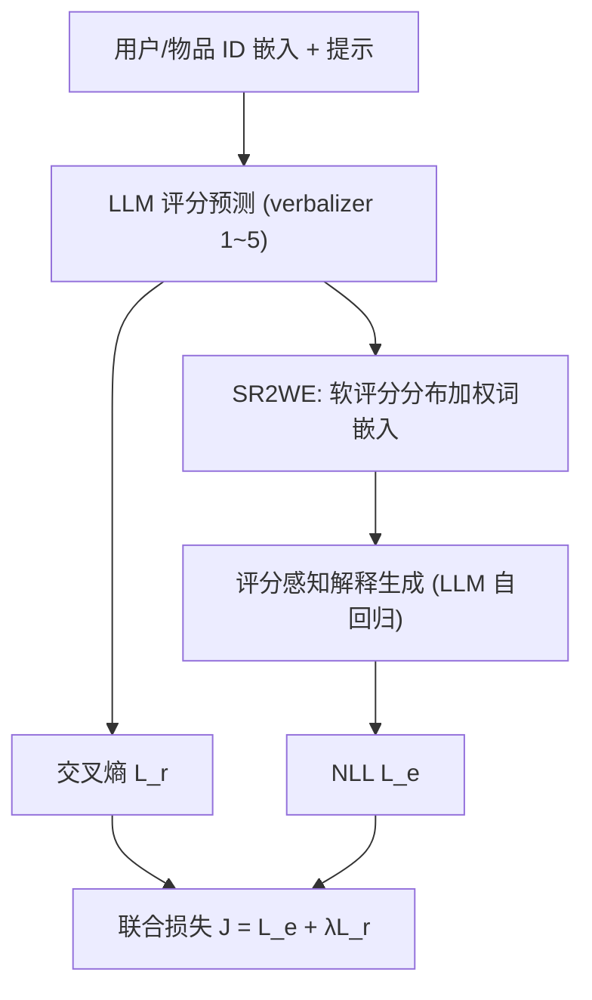
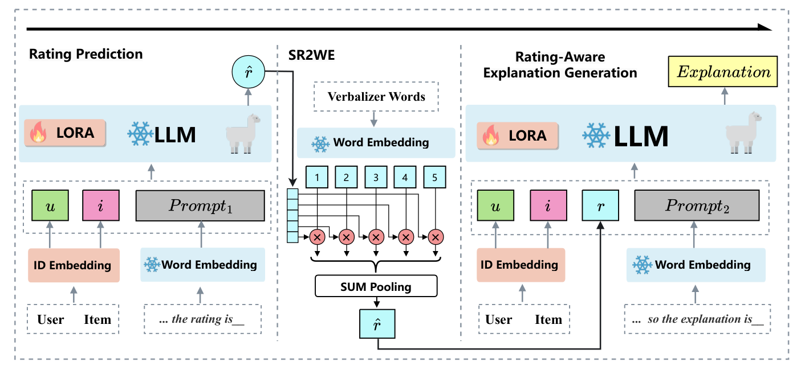

# Coherency Improved Explainable Recommendation via Large Language Model (基于大语言模型的一致性增强可解释推荐)

- **会议/期刊**: AAAI 2025
- **作者与机构**: Shijie Liu, Ruixing Ding, Weihai Lu, Jun Wang, Mo Yu, Xiaoming Shi, Wei Zhang（华东师范大学 / 北京大学 / 腾讯微信 AI）
- **推荐链路定位**: 端到端生成式（评分预测 + 解释文本生成）
- **研究方向**: 大语言模型推荐 / 生成式推荐
- **论文原文**: [https://arxiv.org/abs/2504.05315v1](https://arxiv.org/abs/2504.05315v1)
- **开源代码**: [https://github.com/karrich/CIER](https://github.com/karrich/CIER)

## TL;DR (1分钟核心速览)

可解释推荐长期采用"评分预测 + 解释生成"多任务共享隐层，导致预测评分与生成解释互相矛盾（如打 5 分却生成"浪费时间"）。本文提出 CIER：先用 LLaMA2-7B 预测评分分布，将其加权求和为**软评分词嵌入**注入提示，再以流水线方式生成解释，使解释"看得见"评分；同时用 GPT-4 与情感分类 BERT 实现免人工标注的一致性评测。在 Yelp/Amazon/TripAdvisor 三数据集上，解释一致性较 SOTA 提升 7.3%、文本质量提升 4.4%，评分预测 RMSE 亦全面领先。

## Background & Motivation (背景与核心矛盾)

- **主流范式**: NRT/PETER/CER 等将评分预测与解释生成作为多任务学习，共享隐层表示后各自输出，解释生成阶段并不显式接收评分信息。
- **前人局限**: ① 两任务仅共享隐层，解释与评分可任意组合，出现"高分 + 负面措辞"的语义断裂；② CER 虽用解释反推评分以增强一致性，但依赖小 Transformer 主干与 max-pooling 词向量，句表征贫弱，一致性约束形同虚设。
- **核心洞察 (Key Insight)**: 解码器 LLM 天然支持"下一 token 预测"式的流水线生成——若把评分先解码为 token 再作为上下文喂入解释生成，一致性可由 in-context learning 直接保证，无需额外对齐损失。
- **本文切入点**: 用 LLM 主干替换小模型，并把"硬评分 token"升级为"软评分分布嵌入"，让解释生成感知评分的不确定性。

## Method (核心方法设计)

### 1. 整体框架 (Overall Architecture)

CIER 以 LLaMA2-7B 为唯一主干，LoRA 微调，三模块串行：**(a) 评分预测**——输入用户/物品 ID 嵌入与提示，经 verbalizer 映射到 "1"~"5" 五个词的概率分布；**(b) SR2WE**——将评分分布对五个 verbalizer 词嵌入加权求和，得到软评分向量；**(c) 评分感知解释生成**——把该向量拼入提示序列，自回归解码解释。训练时评分预测用交叉熵、文本生成用 NLL，联合优化；并叠加评分平滑、课程学习、多任务三项技巧。

<figure class="paper-figure" markdown="span">
  <figcaption>图2：CIER 的整体框架。(a) 评分预测：旨在基于 LLM 预测用户对物品的评分。(b) SR2WE：将预测的软评分嵌入 LLM 词嵌入空间。(c) 评分感知解释生成：使用预测评分作为上下文生成与评分相关的解释。</figcaption>
</figure>

### 2. 关键设计拆解 (Key Designs)

1. **软评分到词嵌入 (SR2WE)**：硬评分只取 argmax 对应词向量，丢失偏好不确定性。本文改为对 verbalizer 词嵌入做期望：
$\mathbf{s}_{u,i}=\sum_{x=1}^{|r|}\hat{r}_{u,i,x}\cdot \mathrm{Embedding}_{\mathrm{LLM}}(V^r(x))$
该向量同时编码"评分数值"与"分布置信度"，且天然落在 LLM 词嵌入空间内，无需线性投影即可被解码器理解——消融显示其优于"线性层直插硬评分"。

2. **评分平滑 (Rating Smoothing)**：训练只用 one-hot 真值、推理却用软分布，存在训练-推理失配。本文借鉴 label smoothing 但**只向数值相邻评分** $N^k_{r_{u,i}}$ 分配概率：
$r^{\text{modified}}_{u,i,x}=1-\alpha\ (x=r_{u,i});\quad \alpha/k\ (x\in N^k_{r_{u,i}});\quad 0\ (\text{其他})$
避免全局平滑稀释用户对具体评分的敏感度，同时让相邻情感（4 分与 5 分）在嵌入空间靠近。

3. **课程学习与训练目标**：解释中的关键词（如 lobby）是解释性的核心，但直接生成整句难以捕捉。本文引入关键词生成辅助任务，按批次线性提升解释任务占比 $P(t)=t/T$，每样本以$n\sim U[0,1]$与$P(t)$ 比较决定走关键词还是解释分支，实现"先学关键词、后学成句"的平滑过渡。总损失：
$\mathcal{J}=\min_{\Theta}\ (\mathcal{L}_e+\lambda\mathcal{L}_r),\quad \lambda=0.1$
负采样：无（生成式范式，不做对比学习负采样）；推理为两阶段自回归，开销约为单次 7B 前向的两倍。

## Experimental Setup & Evaluation Protocol (实验设置与评估协议)

- **数据集与预处理**: 沿用 Sentires 提供的公开划分，每条记录含 user/item/1–5 评分/解释句/物品特征（关键词）。

| 数据集 | #Users | #Items | #Interactions | 场景说明 |
| :--- | :---: | :---: | :---: | :--- |
| Yelp | 27,147 | 20,266 | 1,293,247 | 餐厅评论，规模最大 |
| Amazon | 7,506 | 7,360 | 441,783 | 电影电视，关键词 50% 仅出现一次 |
| TripAdvisor | 9,765 | 6,280 | 320,023 | 酒店，最稀疏 |

- **数据划分与防穿越 (Splitting Strategy)**: 随机 **8:1:1 比例划分**，重复 5 次取测试集均值；非时间切分，存在轻度未来信息泄漏风险。
- **排名评测协议 (Ranking Protocol)**: 本文为评分回归 + 文本生成任务，**不涉及 Full-Ranking / Sampled Ranking**；评分用 RMSE/MAE，文本用 BLEU-1/4、ROUGE-1/2/L，解释性用 FMR/FCR/DIV/USR，一致性用 GPT-4（每模型采样 500 条）、情感 BERT（$|y-\hat{y}|\le 1$ 记为一致）与双人人工标注（kappa=0.918）。
- **对比基线与超参设置**: 评分侧对比 SVD++/DeepCoNN/NARRE/NRT/PETER/CER；解释侧对比 NRT/Att2Seq/PETER/CER/PEPLER/ERRA。嵌入维度 $d=1024$，LoRA 学习率$10^{-4}$、其余$10^{-3}$，AdamW，3 epoch，$\lambda=0.1$、$\gamma=0.2$ 网格搜索。

## Key Experimental Results (实验关键数据)

### 1. 主实验对比 (Main Results)

解释质量（节选 Yelp / Amazon，%），B-4 与 FCR 为一致性关键指标：

| 方法 | Yelp FCR↑ | Yelp B-4↑ | Yelp R-L↑ | Amazon FCR↑ | Amazon B-4↑ | Amazon R-L↑ |
| :--- | :---: | :---: | :---: | :---: | :---: | :---: |
| NRT | 11.96 | 0.65 | 10.39 | 5.67 | 0.89 | 11.24 |
| Att2Seq | 14.24 | 0.69 | 10.40 | 8.22 | 0.92 | 11.19 |
| PETER | 13.80 | 0.62 | 10.24 | 9.12 | 1.00 | 11.29 |
| CER | 15.00 | 0.65 | 10.27 | 10.25 | 1.02 | 11.05 |
| PEPLER | 21.04 | 0.67 | 10.41 | 34.07 | 1.03 | 11.31 |
| **CIER** | **53.84** | **0.83** | **10.90** | **51.80** | **1.15** | **11.70** |

评分预测（RMSE↓ / MAE↓）：

| 方法 | Yelp | Amazon | TripAdvisor |
| :--- | :---: | :---: | :---: |
| NRT | 1.016 / 0.796 | 0.954 / 0.706 | **0.791 / 0.605** |
| PETER | 1.013 / 0.783 | 0.953 / 0.709 | 0.806 / 0.623 |
| CER | 1.013 / 0.787 | 0.952 / 0.713 | 0.814 / 0.637 |
| **CIER** | **1.009 / 0.781** | **0.951 / 0.705** | 0.797 / 0.612 |

一致性评测（GPT-4 / 人工，%）：

| 方法 | Yelp GPT-4 | Amazon GPT-4 | TripAdvisor GPT-4 | Yelp 人工 | Amazon 人工 |
| :--- | :---: | :---: | :---: | :---: | :---: |
| PETER | 87.2 | 79.6 | 87.0 | 62.0 | 63.0 |
| CER | 88.8 | 80.0 | 90.4 | 65.6 | 66.0 |
| CIER-M（屏蔽评分） | 87.0 | 81.8 | 88.0 | 69.5 | 60.5 |
| **CIER** | **90.2** | **89.8** | **91.6** | **73.5** | **74.0** |

### 2. 消融实验 (Ablation Study)

| 变体 | Yelp FMR↑ | Yelp R-L↑ | Amazon FMR↑ | Amazon R-L↑ | TripAdvisor FMR↑ | TripAdvisor R-L↑ |
| :--- | :---: | :---: | :---: | :---: | :---: | :---: |
| CIER 完整 | **8.71** | **10.90** | **12.45** | **11.70** | **8.08** | **13.40** |
| w/o RS（评分平滑） | 8.66 | 10.80 | 12.35 | 11.65 | 7.95 | 13.31 |
| w/o SR2WE | 8.67 | 10.86 | 12.40 | 11.68 | 8.03 | 13.37 |
| w/o RA（评分感知） | 8.58 | 10.72 | 12.36 | 11.59 | 7.92 | 13.35 |

### 3. 关键实验发现 (Key Findings)

1. **评分感知是最大贡献项**：去掉 RA 后三数据集 FMR 分别掉 0.13/0.09/0.16、R-L 掉 0.18/0.11/0.05，说明"把评分显式写进提示"比任何后处理对齐都更直接地约束解释语义；CIER-M（屏蔽评分上下文）在 Amazon 人工一致性仅 60.5%，远低于完整版 74.0%，反向印证同一结论。
2. **课程学习优于两阶段训练**：Yelp 上课程学习 FCR 53.84 vs 两阶段 52.46、vanilla 52.19，因大数据集下两阶段易"遗忘"关键词知识；但 Amazon 上 vanilla 的 USR（50.92）反超课程学习（46.99），作者归因于该数据集 50% 关键词仅出现一次，关键词任务本身噪声大。
3. **LLM 主干在稀疏小数据上不占优**：TripAdvisor 上 NRT 的 RMSE 0.791 优于 CIER 的 0.797，说明 7B 模型在 32 万交互的稀疏场景下参数效率不及轻量模型，LLM 的收益主要体现在解释质量与一致性而非评分精度。

## Highlights & Limitations (亮点、对比与审稿批判)

- **与代表作对比 (vs. Prior Work)**: 相较 PETER 的"共享隐层 + 双输出"，CIER 把评分变成解释生成的**输入条件**而非并行任务，从架构上根除不一致；相较 CER 的"解释反推评分 + max-pooling 对齐"，CIER 用软分布嵌入替代池化句向量，且主干从 Tiny Transformer 升级为 7B LLM，一致性与文本质量同时受益。
- **可迁移亮点**: ① "软标签分布 → 词嵌入期望"的 SR2WE 可直接迁移到任何需要把离散预测注入 LLM 提示的生成式推荐；② 用 GPT-4 + 领域情感模型做免标注一致性评测，成本远低于人工，可复用于其他"结构化预测 + 文本生成"任务。
- **审稿级局限批判**: ① 推理需两次 7B 前向（评分 + 解释），线上延迟与显存开销对工业推荐几乎不可接受，论文未给出任何加速或蒸馏方案；② 8:1:1 随机划分而非时间切分，评分预测存在未来信息泄漏，且一致性评测仅采样 500 条、人工仅 100 条/数据集，统计功效有限。

## Rating (四维评分)

- **方法创新性 (Novelty)**: ⭐⭐⭐⭐ （流水线式"先评分后解释"思路朴素但切中一致性痛点，SR2WE 软分布嵌入是干净有效的增量设计）
- **评估协议与实验扎实度 (Protocol & Experiments)**: ⭐⭐⭐ （三数据集 + 人工/GPT-4/BERT 三重一致性验证较完整，但随机划分有泄漏风险、采样评测规模偏小）
- **写作与数学规范度 (Clarity & Rigor)**: ⭐⭐⭐⭐ （公式简洁、模块边界清晰，课程学习的概率化任务分配描述严谨，缺复杂度分析）
- **工业落地与复现价值 (Industrial & Practical Value)**: ⭐⭐⭐ （代码已开源、流程易复现，但 7B 双阶段推理的延迟成本是落地硬伤）

