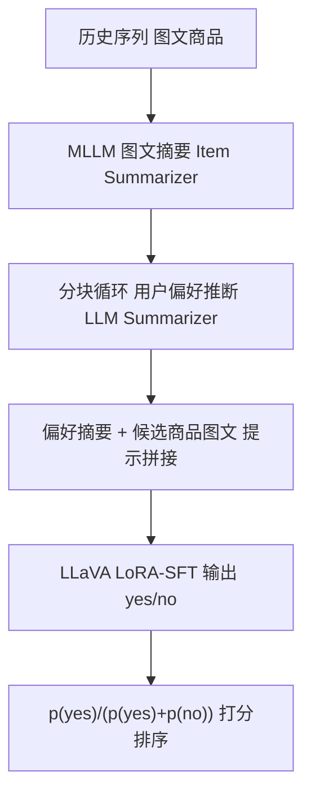
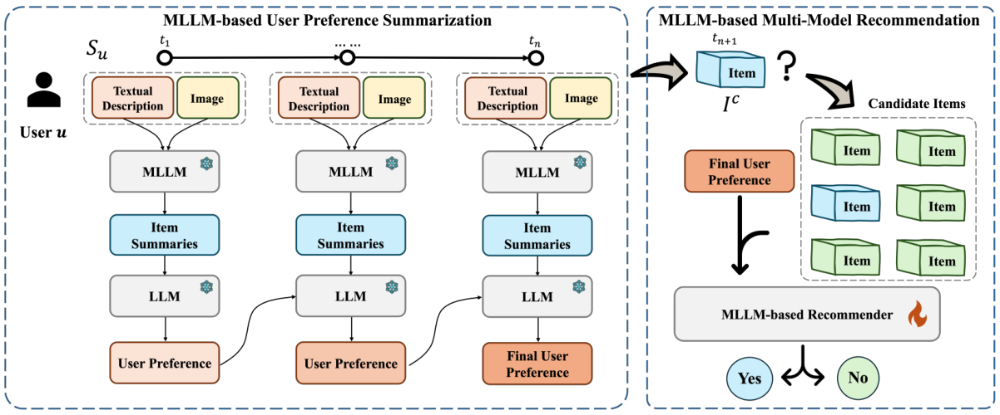

# Harnessing Multimodal Large Language Models for Multimodal Sequential Recommendation (驾驭多模态大模型的多模态序列推荐)

- **会议/期刊**: AAAI 2025
- **作者与机构**: Yuyang Ye, Zhi Zheng, Yishan Shen, Tianshu Wang, Hengruo Zhang, Peijun Zhu, Runlong Yu, Kai Zhang, Hui Xiong（Rutgers / USTC / UPenn / ByteDance / Georgia Tech / Pittsburgh / HKUST）
- **推荐链路定位**: 精排（候选物品打分）
- **研究方向**: 大语言模型推荐 / 多模态推荐
- **论文原文**: [论文原文链接](https://arxiv.org/abs/2408.09698v5)
- **开源代码**: [开源代码仓库链接](https://github.com/YuyangYe/MLLM-MSR)

## TL;DR (1分钟核心速览)

现有多模态序列推荐依赖模态融合网络，而 LLM4Rec 又几乎只吃文本，MLLM 直接喂多张有序图片则受限于上下文长度与序列理解能力。本文提出 MLLM-MSR：先用 MLLM 把每件商品的图文压成统一文本摘要，再用 LLM 以"分块 + 循环更新"的方式推断用户动态偏好，最后用 LoRA-SFT 微调 LLaVA 做 yes/no 打分。在 Microlens、Amazon-Baby、Amazon-Game 三数据集上，AUC 达 83.17/85.69/84.39，相对最强基线 TALLREC 提升约 2.4%–4.3%。

## Background & Motivation (背景与核心矛盾)

- **主流范式**: 多模态序列推荐走"模态融合 + 序列建模"路线（MMGCN、MMSR、SASRecF 等），把图像/文本特征拼接或图卷积后送入序列编码器；LLM4Rec 则把行为日志转成文本提示做 SFT（TALLREC）。
- **前人局限**: ① MLLM 处理**多张有序图片**时上下文爆炸、图文对齐困难，序列一长输出就随机漂移；② 纯文本 LLM 推荐（TALLREC）完全丢弃视觉信号，而纯多模态模型（MMGCN/MGAT）又缺乏序列建模能力，二者难以兼得。
- **核心洞察 (Key Insight)**: 作者用 GRU4Rec 做预实验（表 1）证明——把图片用 LLaVA 摘要成文本再编码，效果与 VGG19 视觉特征**相当甚至更优**（Microlens AUC 0.7281 vs 0.7154），说明"图像→文本摘要"能在保留语义的同时绕开多图输入的工程瓶颈。
- **本文切入点**: 用"文本化多模态 + 循环摘要"把长多模态序列压缩成可解释的偏好叙述，再让 MLLM 在统一文本空间里做推荐。

## Method (核心方法设计)

### 1. 整体框架 (Overall Architecture)

模型分两阶段闭环：**阶段一（偏好推断）** 对序列中每件商品，用 MLLM 分别生成文本摘要与图像描述，再经融合提示合成统一 item summary；随后按会话分块，LLM 以循环方式逐块更新用户偏好摘要 $P_u^{(t)}$。**阶段二（推荐微调）** 将"用户偏好摘要 + 候选商品图文 + 系统指令"拼成提示，输入 LLaVA 让其只输出 yes/no，用 next-token 预测做 LoRA-SFT。推理时以首 token 的 yes/no 概率归一化得到交互概率。

<figure class="paper-figure" markdown="span">
  <figcaption>图1：MLLM-MSR的示意框架</figcaption>
</figure>

### 2. 关键设计拆解 (Key Designs)

1. **多模态商品摘要 (Multimodal Item Summarization)**：痛点是对多图输入 MLLM 会失序、图文错配。做法是用**分离提示**分别处理文本与图像（并校准两者输出长度使模态贡献均衡），再用**融合提示**合成统一描述。直觉：把跨模态对齐的负担从"序列级"下放到"单物品级"，让后续 LLM 只在纯文本空间做时序推理。

2. **循环用户偏好推断 (Recurrent User Preference Inference)**：痛点是长序列提示过长导致输出不稳定。借鉴 RNN 思想，将交互按会话切成块（每块 $k$个物品），第$t$ 块提示同时输入"上一轮偏好摘要 + 当前块 item summaries"，迭代更新：
$$P_u^{(t)} = \mathrm{LLM}\big(P_u^{(t-1)},\ \{s_{i}\}_{i\in \text{block}_t}\big)$$
这样上下文长度被固定，且偏好摘要天然携带时序演化信息，比一次性直推（MLLM-MSR$_\text{R}$）更稳、更可解释。

3. **SFT 训练目标与推理**：交互概率由首 token 概率归一化给出
$$p=\frac{p(\text{'yes'})}{p(\text{'yes'})+p(\text{'no'})}$$
训练损失为标准自回归
$$\mathcal{L}=-\sum_{i=1}^{L}\log P(v_i\mid v_{<i},I)$$
负采样为训练 1:1、评估 1:20；采用 LoRA（rank=8）+ AdamW（lr=2e-5）+ Deepspeed ZeRO-2，块大小 $k=3$、最大 token 512。

## Experimental Setup & Evaluation Protocol (实验设置与评估协议)

- **数据集与预处理**: 过滤低频用户/物品以保证最短序列长度，统计如下：

| 数据集 | #Users | #Items | #Interactions | 稀疏度 | 场景说明 |
| :--- | :---: | :---: | :---: | :---: | :--- |
| Microlens | 25,411 | 20,276 | 223,263 | 99.96% | 微视频，含封面图与简介 |
| Amazon-Baby | 41,081 | 14,393 | 400,876 | 99.93% | 母婴商品图文 |
| Amazon-Game | 38,808 | 13,379 | 352,136 | 99.93% | 游戏商品图文 |

- **数据划分与防穿越**: 采用 **5 折交叉验证**（非时间戳切分），结果报告 95% 置信水平、多随机种子。
- **排名评测协议**: **Sampled Ranking**，评估阶段负采样比 **1:20**，所有基线统一候选集规模；指标为 AUC、HR@5、MRR@5。
- **对比基线与超参**: 基线覆盖基础 SR（GRU4Rec、SASRec）、多模态推荐（MGAT、MMGCN）、多模态增强 SR（GRU4RecF、SASRecF、MMSR、Trans2D）、LLM 推荐（LLaVA w/o SFT、TALLREC）；主干为 Llava-v1.6-mistral-7b（摘要+推荐）与 Llama3-8b-instruct（偏好摘要）。

## Key Experimental Results (实验关键数据)

### 1. 主实验对比 (Main Results)

| 模型 | Microlens AUC | Microlens HR@5 | Video-Games AUC | Video-Games HR@5 | Amazon-Baby AUC | Amazon-Baby HR@5 |
| :--- | :---: | :---: | :---: | :---: | :---: | :---: |
| GRU4Rec | 72.55 | 53.32 | 73.45 | 59.32 | 73.68 | 58.21 |
| SASRec | 74.02 | 58.88 | 71.06 | 43.81 | 80.50 | 70.09 |
| MMGCN | 73.35 | 54.47 | 74.91 | 55.63 | 74.88 | 57.13 |
| SASRecF | 77.69 | 63.03 | 77.51 | 66.64 | 81.94 | 72.08 |
| MMSR | 78.87 | 69.85 | 79.01 | 71.95 | 81.19 | 70.34 |
| LLaVA w/o SFT | 52.75 | 28.21 | 53.57 | 33.24 | 55.86 | 34.82 |
| TALLREC | 81.25 | 71.23 | 81.79 | 72.36 | 82.16 | 74.31 |
| **MLLM-MSR** | **83.17** | **78.23** | **84.39** | **77.42** | **85.69** | **79.58** |
| Improv.% (vs TALLREC) | +2.36% | +9.83% | +3.18% | +7.00% | +4.30% | +7.09% |

### 2. 消融实验 (Ablation Study)

| 变体 | 关键差异 | 性能趋势（三数据集） |
| :--- | :--- | :--- |
| MLLM-MSR$_\text{R}$ | 去掉循环，一次性直推偏好 | 全面下降，验证循环分块必要性 |
| MLLM-MSR$_\text{I}$ | 去掉图像摘要，仅文本推断偏好 | 下降更明显，验证视觉信息不可替代 |
| **MLLM-MSR** | 完整模型 | 三数据集均最优 |

### 3. 关键实验发现 (Key Findings)

1. **多模态 + 序列缺一不可**：纯多模态模型 MMGCN/MGAT（AUC 71–75）显著低于多模态增强序列模型 SASRecF（77.69/81.94），说明融合模块必须与序列建模耦合；本文正是把二者统一进 MLLM 提示。
2. **循环分块是长序列的胜负手**：MLLM-MSR$_\text{R}$直推在长序列上明显掉点，而分块循环（$k=3$ 最优，图 5）既压住提示长度又保留偏好演化，HR@5 相对 TALLREC 提升 7%–10%。
3. **图像摘要贡献大于预期**：去掉图像摘要的 MLLM-MSR$_\text{I}$ 掉点幅度大于去掉循环的变体，印证预实验中"文本化图像≈视觉特征"的结论——视觉语义经摘要后仍被有效保留，且偏好摘要长度超过阈值后性能饱和（图 6），说明 LLM 摘要能力足以覆盖必要信息。

## Highlights & Limitations (亮点、对比与审稿批判)

- **与代表作对比 (vs. Prior Work)**: 相比 TALLREC（纯文本 SFT），本文引入视觉摘要与循环偏好，AUC 提升 2.4%–4.3%；相比 MMSR（图融合 + 序列），本文用 LLM 语义摘要替代稠密特征融合，兼具可解释性；相比 LLaVA 零样本，SFT + 结构化提示带来 30+ AUC 的巨大跃升。
- **可迁移亮点**: ① "图像→文本摘要"作为多图输入的降维技巧，可迁移到任何受上下文限制的多模态序列任务；② 分块循环摘要范式可复用于长行为序列的 LLM 偏好建模。
- **审稿级局限批判**: ① 依赖两次 LLM 调用（摘要 + 偏好）与 7B 级 MLLM 推理，在线延迟与成本远高于 SASRec 类模型，论文未报告推理时延；② 评估为 1:20 采样排序而非 Full-Ranking，且采用 5 折随机划分而非时间切分，存在信息泄漏与指标偏乐观的风险；③ 块大小 $k$、摘要长度等超参敏感（图 5/6），跨域迁移需重新调参。

## Rating (四维评分)

- **方法创新性 (Novelty)**: ⭐⭐⭐⭐ （首次将 MLLM 微调用于多模态序列推荐，"文本化 + 循环摘要"思路清晰且有预实验支撑）
- **评估协议与实验扎实度 (Protocol & Experiments)**: ⭐⭐⭐ （三数据集 + 多基线 + 消融完整，但采样排序与随机划分削弱说服力，缺时延分析）
- **写作与数学规范度 (Clarity & Rigor)**: ⭐⭐⭐⭐ （框架图与提示示例直观，公式简洁；但偏好推断过程缺形式化定义）
- **工业落地与复现价值 (Industrial & Practical Value)**: ⭐⭐⭐ （代码开源、LoRA 高效微调友好，但 7B 模型在线推理成本高，更适合离线蒸馏或召回增强）

