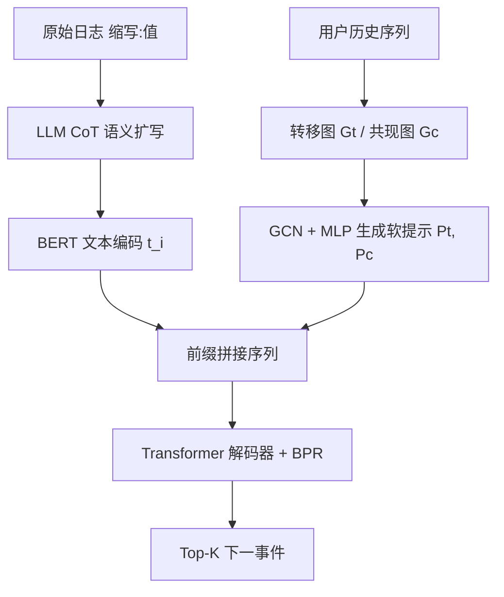
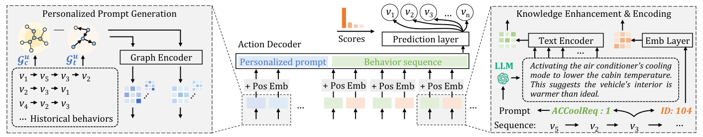

# Predicting User Behavior in Smart Spaces with LLM-Enhanced Logs and Personalized Prompts (基于 LLM 增强日志与个性化提示的智能空间用户行为预测)

- **会议/期刊**: AAAI 2025
- **作者与机构**: Yunpeng Song, Jiawei Li, Yiheng Bian, Zhongmin Cai（西安交通大学 MOE KLINNS Lab）
- **推荐链路定位**: 召回（下一行为 Top-K 候选生成）
- **研究方向**: 大语言模型推荐 / 序列推荐
- **论文原文**: [论文原文链接](https://arxiv.org/abs/2412.12653v2)
- **开源代码**: 暂未开源

## TL;DR (1分钟核心速览)

智能空间（智能车/智能家居）的事件日志极度简写（如 `FLWwClsReq`）且长尾严重，传统 ID 嵌入无法刻画事件语义关联，且单一全局模型忽视个体偏好差异。本文用预训练 LLM 以 CoT 方式把缩写日志扩写成自然语言动作描述，经 BERT 编码为语义事件向量；同时从用户历史构建转移图与共现图，经 GCN+MLP 生成个性化软提示前缀注入 Transformer 解码器。在 2 个智能车工业数据集与 2 个 CASAS 智能家居数据集上，采用按时间 2:1:7 切分、滑窗长度 6 的下一事件预测协议，H@1 相对最强基线提升约 4%–7%，稀有事件（频率<1%）H@1 提升超 40%。

## Background & Motivation (背景与核心矛盾)

- **主流范式**: 智能空间行为预测沿用 RNN/LSTM/CNN 或 Transformer 序列模型，把事件当作 one-hot ID 序列做下一动作分类；序列推荐侧则用 BERT4Rec、DuoRec、RecFormer 等自注意力/对比/文本增强模型。
- **前人局限**: 其一，日志是面向工程师的极简缩写，one-hot ID 把"开冰箱"与"预热烤箱"这类同意图事件割裂为无关符号，长尾事件样本不足导致表征塌陷；其二，智能空间数据集用户数少，既有工作普遍训练单一全局模型，无法区分"入睡"对不同用户意味着拉窗帘关灯还是放轻音乐设闹钟。
- **核心洞察 (Key Insight)**: 事件缩写在 LLM 预训练语料中大量出现（代码/信号命名规范），LLM 的常识与推理足以还原其语义；而用户偏好可由其历史交互图的拓扑结构（转移 vs 共现）无监督地刻画，无需年龄性别等侧信息。
- **本文切入点**: 把"语义"交给 LLM 离线增强、把"个性"交给图生成软提示，二者在 Transformer 解码器前拼接，实现零推理期 LLM 开销的个性化预测。

## Method (核心方法设计)

### 1. 整体框架 (Overall Architecture)

输入是用户 $u$的历史事件序列$S_u=\{v_1,\dots,v_{|S_u|}\}$。离线阶段，LLM（Ernie Bot / Qwen2.5-32B）以"智能车日志分析专家"角色 + CoT 模板，将每个 `缩写:值` 对扩写为完整动作描述（如 `RRDoorSts:1` → "打开右后车门"），BERT 取 `[CLS]` 得文本表征$t_i$。在线阶段，由用户历史分别构建有向转移图$\mathcal{G}^u_t$与无向共现图$\mathcal{G}^u_c$，两层 GCN 消息传递后经两层 MLP 投影为软提示$P^u_t,P^u_c$，作为前缀拼接到事件序列之前送入 Transformer 解码器，输出下一事件打分。训练用 BPR 成对排序损失，推理取 Top-K。

<figure class="paper-figure" markdown="span">
  <figcaption>图1：所提出的智能空间交互预测方法概览。该方法从用户历史序列构建图以建模个体偏好并生成个性化提示，同时利用LLM的常识知识增强事件描述。</figcaption>
</figure>

### 2. 关键设计拆解 (Key Designs)

1. **转移/共现双图判别式构图（把"顺序依赖"与"同时发生"解耦）**：若不分图，GCN 会把"开门→调座椅"的因果链与"开空调+关窗"的并发共现混为一谈。本文用非对称阈值判边：转移边 $e^t_{ij}$存在当$w_{ij}>(1+\lambda)w_{ji}$，共现边$e^c_{ij}$存在当$\max(w_{ij},w_{ji})\le(1+\lambda)\min(w_{ij},w_{ji})$，其中$w_{ij}$为$v_i$后接$v_j$的频次。$\lambda$ 控制两类关系的判别间隔，直觉是"单向显著占优才算转移，双向近似对称才算共现"，从而让两路提示各司其职。

2. **图到软提示的连续投影（免手工设计、免用户画像）**：硬提示需为每用户手写模板，在万级用户下不可行且事件 token 无语义。本文对两图做对称归一化 GCN：$X^{(l+1)}=D^{-\frac{1}{2}}AD^{-\frac{1}{2}}X^{(l)}W^{(l)}$，再经$P=f(X)=W_2\sigma(W_1X+b_1)+b_2$投影为$K$个连续提示向量，前置拼接为$S_u=\{p^u_{t1},p^u_{c1},\dots,v^u_1,\dots\}$。有效性来自：提示以用户级图结构为条件，等价于给共享解码器注入一个可微的"用户编码器"，且完全由交互历史驱动，冷启动新用户只要有少量日志即可构图。

3. **训练目标、负采样与推理效率**：总损失为 BPR：$\mathcal{L}=-\sum_{j=1}^{B}\log\sigma(y^i_m-y^j_m)$，正样本为真实下一事件$v_m$，负样本从"未在$v_{m-1}$ 之后出现"的事件中均匀随机采样（非 in-batch、非难负样本）。关键工程点：LLM 仅在预处理阶段对**唯一信号种类**调用一次并缓存描述，训练与推理完全不调用 LLM；单条长度 10 的序列在 RTX 4090 上推理 <0.1s。

## Experimental Setup & Evaluation Protocol (实验设置与评估协议)

- **数据集与预处理**: 两个智能车工业数据集（同型号 100 辆私家车、90 天、950 万事件、357 传感器/487 类事件，按舒适/娱乐/监控/安全/控制五类划分）与 CASAS 的 Aruba、Milan 两个智能家居公开数据集；未做 k-core 过滤，保留原始长尾分布。

| 数据集 | #Users | #Items(事件类) | #Interactions | 稀疏度/密度 | 特征/场景说明 |
| :--- | :---: | :---: | :---: | :---: | :--- |
| City A (车) | 100 车 | 487 | ~950 万(两城合计) | 长尾极重 | 信号名+值+时间戳，无侧信息 |
| City B (车) | 100 车 | 487 | 同上 | 长尾极重 | 同上，另一城市 |
| Home A (Aruba) | 单户 | 传感器事件 | 中等规模 | 长尾 | CASAS 家居传感器日志 |
| Home B (Milan) | 单户 | 传感器事件 | 中等规模 | 长尾 | CASAS 家居传感器日志 |

- **数据划分与防穿越 (Splitting Strategy)**: **全局时间戳切分**，按时间顺序 2:1:7 划为 train/valid/test；验证与测试集用长度 6 的滑动窗口切非重叠序列，前 5 个事件预测第 6 个。
- **排名评测协议 (Ranking Protocol)**: 采用 **class-wise 全类排序**（对全部事件类打分排序，非采样负例），指标为 class-wise H@K 与 N@K，$K\in\{1,3\}$；理由是 HR/NDCG 会被高频事件主导，且实际交互中给用户 3 个快捷建议已是认知上限。
- **对比基线与超参设置**: 8 个基线，分两类——智能空间活动预测（CasLSTM、DnnLSTM、ConvLMLC、ASGen）与序列推荐（BERT4Rec、DuoRec、CL4SRec、RecFormer）。嵌入维度 256，batch 256，序列长 1–10，学习率 $\{5e^{-3},\dots,5e^{-6}\}$，权重衰减$\{1e^{-3},1e^{-4},1e^{-5}\}$，提示数$K\in[2,10]$，$\lambda$调优；每实验 20 个随机种子，显著性$p<0.05$。

## Key Experimental Results (实验关键数据)

### 1. 主实验对比 (Main Results)

| 数据集 | 指标 | CasLSTM | DnnLSTM | ASGen | BERT4Rec | DuoRec | CL4SRec | RecFormer | **Ours** | Improv.% |
| :--- | :---: | :---: | :---: | :---: | :---: | :---: | :---: | :---: | :---: | :---: |
| City A | H@1 | 0.1987 | 0.1794 | 0.3018 | 0.2715 | 0.3308 | 0.3286 | 0.3191 | **0.3450** | +4.3% |
| City A | H@3 | 0.3413 | 0.3075 | 0.4852 | 0.4356 | 0.5114 | 0.5228 | 0.5159 | **0.5529** | +5.8% |
| City A | N@3 | 0.2817 | 0.2540 | 0.4065 | 0.3629 | 0.4358 | 0.4427 | 0.4324 | **0.4596** | +3.8% |
| City B | H@1 | 0.2188 | 0.2043 | 0.3453 | 0.3044 | 0.3497 | 0.3517 | 0.3230 | **0.3743** | +6.4% |
| City B | H@3 | 0.3808 | 0.3543 | 0.5270 | 0.4567 | 0.5315 | 0.5661 | 0.5387 | **0.5904** | +4.3% |
| City B | N@3 | 0.2974 | 0.2864 | 0.4640 | 0.4256 | 0.4511 | 0.4589 | 0.4389 | **0.4925** | +6.1% |
| Home A | H@1 | 0.2684 | 0.2478 | 0.3598 | 0.3508 | 0.4015 | 0.3691 | 0.4103 | **0.4293** | +4.6% |
| Home A | H@3 | 0.4263 | 0.4094 | 0.5390 | 0.5298 | 0.5634 | 0.5287 | 0.5731 | **0.5974** | +4.2% |
| Home B | H@1 | 0.1842 | 0.1954 | 0.3071 | 0.2878 | 0.3026 | 0.3145 | 0.3118 | **0.3352** | +6.6% |
| Home B | H@3 | 0.3497 | 0.3517 | 0.4715 | 0.4523 | 0.4733 | 0.4842 | 0.4859 | **0.5115** | +5.3% |

（Improv.% 为相对最强基线；所有结果均满足 $p<0.05$ 显著性。）

### 2. 消融实验 (Ablation Study)

| ID 嵌入 | 增强日志(Log Q) | 增强日志(Log E) | 个性化提示 PT | City A H@1 | City B H@1 | City A H@3 | City B H@3 |
| :---: | :---: | :---: | :---: | :---: | :---: | :---: | :---: |
| ✓ | | | | 0.2774 | 0.3056 | 0.4835 | 0.5186 |
| | ✓ | | | 0.3064 | 0.3298 | 0.5125 | 0.5507 |
| | | ✓ | | 0.3097 | 0.3354 | 0.5172 | 0.5551 |
| ✓ | ✓ | | | 0.3140 | 0.3396 | 0.5209 | 0.5584 |
| ✓ | | ✓ | | 0.3176 | 0.3427 | 0.5247 | 0.5623 |
| ✓ | ✓ | | ✓ | 0.3439 | 0.3722 | 0.5495 | 0.5871 |
| ✓ | | ✓ | ✓ | **0.3450** | **0.3743** | **0.5529** | **0.5904** |

### 3. 关键实验发现 (Key Findings)

1. **语义增强是主增益来源，且与提示互补**：仅 ID 嵌入 H@1 为 0.2774/0.3056，换用 LLM 增强文本嵌入升至 0.3176/0.3427（+14.5%/+12.1%）；再叠加个性化提示进一步到 0.3450/0.3743，说明"语义"与"个性"捕捉的是两类正交信息，缺一不可。
2. **LLM 选型不敏感，工程可替换**：Qwen 与 Ernie 增强后的性能差异在千分位（如 City A H@1 0.3439 vs 0.3450），表明增益来自"把缩写还原为自然语言"这一动作本身，而非特定 LLM 的私有知识，开源模型即可落地。
3. **长尾事件收益远超头部**：频率 <1% 的事件上，引入 LLM 增强描述使 H@1 提升超 40%、H@3 提升超 30%；细分到 <0.2% 的极稀有桶，H@1/H@3 绝对提升约 0.1。反观高频事件提升有限——这正验证了"语义近邻可替代样本频次"的核心假设，也解释了为何 class-wise 指标下整体提升看似温和（4%–7%）但长尾价值巨大。

## Highlights & Limitations (亮点、对比与审稿批判)

- **与代表作对比 (vs. Prior Work)**: 相比 ASGen（同为智能空间 Transformer 方案），本文多出 LLM 语义通道与用户级图提示，City B H@1 从 0.3453 提至 0.3743；相比 RecFormer（同样用文本增强物品表征），本文的关键差异是把文本语义与**图结构个性化提示**联合注入，而非仅替换 item 嵌入，Home A H@1 由 0.4103 升至 0.4293；相比 PPR 等软提示推荐工作，本文不依赖年龄性别画像，纯由交互图生成提示，适配无侧信息的智能空间。
- **可迁移亮点**: ①"LLM 离线扩写唯一 token 词表 + 缓存"的模式可零成本迁移到任何 ID 语义贫瘠的工业日志场景（如运维告警、IoT 设备事件）；②用非对称阈值 $\lambda$ 把序列关系拆成"转移/共现"双图再分别生成提示，是一种轻量且可解释的偏好解耦手段。
- **审稿级局限批判**: ①智能车数据仅 100 辆车、单一车型，用户级图在极稀疏新用户上构图质量存疑，论文虽声称支持冷启动但未给出冷启动分桶的定量结果；②负采样为均匀随机，未与难负样本或全库 softmax 对比，BPR 的排序质量上限可能被低估；③LLM 扩写质量无人工评测或一致性校验，若缩写被幻觉误读（如把 `ExCrtLtAutoCfg` 解错），错误会静默固化进嵌入且难以追溯。

## Rating (四维评分)

- **方法创新性 (Novelty)**: ⭐⭐⭐⭐ （LLM 语义增强 + 图软提示的组合在智能空间属首次，但两组件各自均为已有范式的直接移植，缺少理论分析）
- **评估协议与实验扎实度 (Protocol & Experiments)**: ⭐⭐⭐⭐ （四数据集跨两域、时间切分防穿越、20 种子 + 显著性检验、长尾分桶分析到位；扣分在缺冷启动定量与负采样消融）
- **写作与数学规范度 (Clarity & Rigor)**: ⭐⭐⭐⭐ （构图判据与 GCN/MLP 公式清晰，$\lambda$与提示数的敏感性分析完整；但部分符号如$y^i_m$ 定义略简，复杂度分析缺失）
- **工业落地与复现价值 (Industrial & Practical Value)**: ⭐⭐⭐⭐ （LLM 仅离线调用一次、推理 <0.1s/序列，工程友好度极高；但代码未开源、数据为私有工业集，复现门槛偏高）

