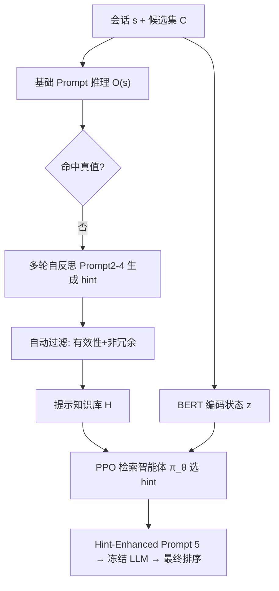
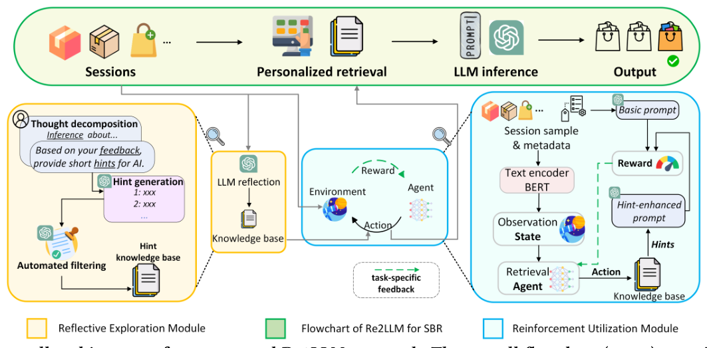

# Re2LLM: Reflective Reinforcement Large Language Model for Session-based Recommendation (反思式强化大语言模型会话推荐)

- **会议/期刊**: AAAI 2025
- **作者与机构**: Ziyan Wang, Yingpeng Du, Zhu Sun, Haoyan Chua, Kaidong Feng, Wenya Wang, Jie Zhang（南洋理工大学、A*STAR、燕山大学）
- **推荐链路定位**: 召回（会话级 Next-Item 候选排序）
- **研究方向**: 大语言模型推荐 / 序列与会话推荐
- **论文原文**: [论文原文链接](https://arxiv.org/abs/2403.16427v4)
- **开源代码**: [开源代码仓库链接](https://anonymous.4open.science/r/Re2LLM-34DC/)

## TL;DR (1分钟核心速览)

会话推荐中，Prompt 式 LLM 缺乏任务反馈、难以写出最优提示，微调式 LLM 又代价高昂且依赖开源主干。Re2LLM 让 LLM 对自身预测错误做多轮自反思，把纠错经验沉淀为自然语言"提示（hint）"知识库，再用 PPO 训练一个轻量检索智能体按会话上下文选提示注入 Prompt，主干全程冻结。在 Movie/Game 两数据集、采样排序协议下，Few-shot 设置相对最强基线平均提升 15.49% 与 5.77%，且逼近甚至超过全量数据训练的深度模型。

## Background & Motivation (背景与核心矛盾)

- **主流范式**: SBR 主流分两支——Prompt 式（LLMRank、NIR 用 in-context learning 直接让 LLM 排序）与微调式（TALLRec、PALR 用 LoRA/全参微调注入领域知识）。
- **前人局限**: Prompt 式缺乏任务特定反馈，手工提示与 LLM 对 SBR 的理解不对齐，易幻觉；微调式算力开销大、灾难性遗忘、且被绑定在开源小主板上，能力弱于 GPT-4 级模型。
- **核心洞察 (Key Insight)**: LLM 最容易理解"自己总结出来的知识"；而提示的效用没有显式标签，但可以用"注入提示后推荐指标的增量"作为奖励信号，把提示选择建模为序贯决策。
- **本文切入点**: 把"领域知识"外置为可检索的提示库，用 DRL 学一个会话感知的提示检索器，从而在不微调主干的前提下获得任务特定反馈。

## Method (核心方法设计)

### 1. 整体框架 (Overall Architecture)

离线阶段：对训练会话用基础 Prompt 让 LLM 输出 Top-10 列表，筛出未命中真值的错误会话，经 Prompt 2→3→4 的链式反思（先无真值发散找错因、再给真值收敛找准确错因、最后脱敏总结为短提示），并用自动过滤（有效性 + 非冗余）维护提示知识库 $\mathcal{H}$。在线阶段：BERT 编码会话为状态$\mathbf{z}$，策略网络选出一条提示注入 Prompt 5，由冻结的 GPT-4 输出最终排序；检索器用 PPO 依据"指标增量"奖励更新。

<figure class="paper-figure" markdown="span">
  <figcaption>图 2：我们提出的 Re2LLM 方法的整体架构。整体流程图（绿色）包含一个反思探索模块（黄色），用于生成会话感知提示作为专门知识；以及一个强化利用模块（蓝色），用于学习检索所获得的专门知识。</figcaption>
</figure>

### 2. 关键设计拆解 (Key Designs)

1. **多轮自反思提示生成（Reflective Exploration）**：痛点在于人工提示与 LLM 语义空间不对齐。做法是先用无真值的 Prompt 2 让 LLM 自由发散错因（保证多样性），再用 Prompt 3 揭示真值收敛到相关错因（保证准确性），最后 Prompt 4 要求"不得泄露目标物品"地压缩为短提示。由于提示由 LLM 自身语言生成，天然落在其可理解分布内，注入后即能激活正确推理路径。

2. **自动过滤构建知识库**：并非所有提示都有用，且大量会话错因重复。有效性判据为 $v^s_{l+1}\in O^*(s)\ \&\ v^s_{l+1}\notin O(s)$，即仅当注入提示后由"未命中"变为"命中"才入库；非冗余判据为$\sum_{h\in\mathcal{H}}\mathrm{LLM}(P_6(h',h))==0$，即候选提示与库内所有提示语义均不同才入库。前者剔除噪声提示、后者控制库规模与检索难度。

3. **PPO 提示检索与训练目标**：状态 $\mathbf{z}=\mathrm{BERT}(s)$，动作$a=\mathrm{softmax}(\mathbf{W}\cdot\mathbf{z})$为$|\mathcal{H}|+1$维（含"不选"），奖励采用**相对式**$r=m(O^*(s))-m(O(s))$，只奖励"因该提示带来的增量"而非绝对表现。目标为
$$\mathcal{L}_{PPO}=\mathbb{E}\left[R(\mathbf{z},a)-\beta\,\mathrm{KL}(\pi_{\theta_{old}},\pi_\theta)\right]$$
配合 $\epsilon=0.05$的$\epsilon$-greedy 探索与回放缓冲。相对奖励避免了"会话本身简单、绝对分高但与提示无关"的虚假信用分配；KL 项约束策略不偏离过远，保证训练稳定。推理时仅需一次 BERT 前向 + 一次 MLP，开销可忽略。

## Experimental Setup & Evaluation Protocol (实验设置与评估协议)

- **数据集与预处理**: 按时间戳将同一用户单日交互切为一个会话，过滤交互数 <3 的会话与物品，评分视为正隐式反馈；沿用数据增广将长度 $|s|$的会话扩展为$|s|-1$ 个训练样本。

| 数据集 | #Sessions | #Items | 平均长度 | 特征/场景说明 |
| :--- | :---: | :---: | :---: | :--- |
| Hetrec2011-Movielens | 468,389 | 8,233 | 10.17 | 标题、类型、演员、年份、国家、导演 |
| Amazon Game | 387,906 | 22,576 | 6.28 | 标题、品类、标签、品牌、描述 |

- **数据划分与防穿越 (Splitting Strategy)**: 会话级 `比例划分` 7:1:2（train/valid/test），会话内以最后一项为目标，属严格时间序内预测，无跨会话信息泄露。
- **排名评测协议 (Ranking Protocol)**: `Sampled Ranking`——从测试集随机抽 2,000 个会话，每个正样本配 49 个随机负样本（1:49），报告 HR@{5,10} 与 NDCG@{5,10}，五次不同随机种子取均值。
- **对比基线与超参设置**: 8 个基线，含 FPMC、GRU4Rec、NARM、SRGNN、GCEGNN、AttenMixer（深度模型，Few-shot 下设 `-attr` 变体融合 BERT 文本属性）与 LLMRank、NIR（LLM 基线）；统一嵌入维度 $d=768$对齐 BERT，Optuna 调 lr/weight decay/batch size；LLM 主干为 `gpt-4` API；候选集$|\mathcal{C}|=50$、知识库$n_h=20$、Few-shot 训练样本$n_e=500$；$t$-test$p<0.05$ 显著性检验。

## Key Experimental Results (实验关键数据)

### 1. 主实验对比 (Main Results)

| Setting | Model | Movie HR@5 | Movie HR@10 | Movie NDCG@10 | Game HR@5 | Game HR@10 | Game NDCG@10 |
| :--- | :--- | :---: | :---: | :---: | :---: | :---: | :---: |
| Full | GCEGNN | 0.3962 | 0.5895 | 0.3281 | 0.4826 | 0.5523 | 0.4332 |
| Full | AttenMixer | 0.3880 | 0.5727 | 0.3472 | 0.4885 | 0.5838 | 0.4226 |
| Full | **Re2LLM** | **0.4126** | **0.5735** | 0.3358 | **0.5664** | **0.7173** | **0.4689** |
| Full | Improv. | +4.14%* | +0.14% | -3.39% | +15.95%* | +22.87%* | +8.24%* |
| Few-shot | AttenMixer-attr | 0.3397 | 0.5056 | 0.2795 | 0.2084 | 0.3121 | 0.1727 |
| Few-shot | LLMRank | 0.3649 | 0.5110 | 0.2784 | 0.4947 | 0.6636 | 0.4531 |
| Few-shot | NIR | 0.3587 | 0.4901 | 0.2648 | 0.5291 | 0.6434 | 0.4346 |
| Few-shot | **Re2LLM** | **0.4126** | **0.5735** | **0.3358** | **0.5664** | **0.7173** | **0.4689** |
| Few-shot | Improv. | +13.07%† | +12.23%† | +20.14%† | +7.05%† | +8.09%† | +3.49%† |

### 2. 消融实验 (Ablation Study)

| 变体 | Movie HR@10 | Movie NDCG@10 | Game HR@10 | Game NDCG@10 |
| :--- | :---: | :---: | :---: | :---: |
| w/o-HE（仅基础 Prompt） | 0.5458 | 0.3198 | 0.6771 | 0.4550 |
| w/o-AF（不过滤全入库） | 0.5592 | 0.3289 | 0.6923 | 0.4602 |
| w/o-DRL(RAN)（随机选提示） | 0.4960 | 0.2908 | 0.6345 | 0.4107 |
| w/o-DRL(ALL)（拼接全部提示） | 0.5434 | 0.3235 | 0.6897 | 0.4592 |
| **Re2LLM** | **0.5735** | **0.3358** | **0.7173** | **0.4689** |

### 3. 关键实验发现 (Key Findings)

1. **提示选择比提示存在更关键**：w/o-DRL(RAN) 在 Movie 上 HR@10 仅 0.4960，甚至低于 w/o-HE 的 0.5458——随机提示会误导 LLM 推理产生负收益；而 w/o-DRL(ALL) 拼接全部提示仅比 w/o-HE 提升约 0.2%，说明"无差别注入"几乎无效，会话感知的选择才是增益来源。
2. **Few-shot 下深度模型崩塌、LLM 方法稳健**：AttenMixer-attr 在 Game 上 HR@10 从全量 0.5838 跌至 0.3121（跌幅近 47%），而 Re2LLM 在 Few-shot 下与全量设置数值完全一致（0.7173），证明其知识来自 LLM 自反思而非样本拟合，天然抗稀疏。
3. **知识库规模与训练样本存在甜点**：知识库增至 20 时指标持续上升，超过后因检索器优化难度上升而轻微回落；检索器训练样本少于 50 时性能甚至低于随机选提示（欠训练），500 后增益饱和，故 $n_h=20$、$n_e=500$ 为效率与效果的平衡点；相对奖励显著优于绝对奖励（Movie HR@10 0.5735 vs. 0.5143）。

## Highlights & Limitations (亮点、对比与审稿批判)

- **与代表作对比 (vs. Prior Work)**: 相比 LLMRank/NIR 的固定手工提示，本文用任务反馈驱动的检索器实现会话级自适应提示；相比 TALLRec/PALR 的微调路线，本文主干冻结、仅训练一个 MLP 策略网络，成本低数个量级且可直接挂载 GPT-4 闭源 API；相比 DRDT 的逐案迭代反思，本文把反思结果沉淀为全局可复用知识库，避免每个会话重复反思的推理开销。
- **可迁移亮点**: ①"用指标增量作相对奖励"的提示选择范式可迁移到任意 LLM 排序/重排场景；②"无真值发散 + 有真值收敛 + 脱敏压缩"的三段式反思链，是低成本构造领域提示库的通用模板。
- **审稿级局限批判**: ①评测采用 1:49 采样排序而非全库 Full-Ranking，且仅抽 2,000 个测试会话，绝对数值可能高估，缺少全库排序与冷启动分桶验证；②提示生成与在线推理均依赖 GPT-4 API，单样本约 0.015 美元、生成 20 条提示需约 50 个样本，成本与延迟对工业实时场景不友好，且知识库需随物品/品类漂移定期重建，论文未讨论维护策略。

## Rating (四维评分)

- **方法创新性 (Novelty)**: ⭐⭐⭐⭐ （将 LLM 自反思与 DRL 提示检索结合，提出"免微调的任务特定反馈"新范式，思路清晰但组件均为已有技术的巧妙拼装）
- **评估协议与实验扎实度 (Protocol & Experiments)**: ⭐⭐⭐ （双数据集、全量/少样本双设置、消融与超参分析完整，但采样排序与 2,000 会话子集削弱了结论强度，缺全库排序与显著性之外的方差报告）
- **写作与数学规范度 (Clarity & Rigor)**: ⭐⭐⭐⭐ （MDP 定义、奖励设计与 PPO 目标交代清楚，Prompt 全文附录完整可复现，公式简洁无冗余）
- **工业落地与复现价值 (Industrial & Practical Value)**: ⭐⭐⭐ （检索器推理开销极小、代码已开源，但依赖闭源 GPT-4 API 且提示库需持续维护，离线可用、在线高并发场景需额外蒸馏或缓存）

