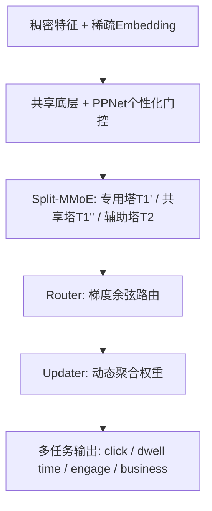

# Direct Routing Gradient (DRGrad): A Personalized Information Surgery for Multi-Task Learning (MTL) Recommendations (面向多任务推荐的个人化直接路由梯度框架)

- **会议/期刊**: AAAI 2025 (Vol. 39, No. 12, pp. 12238-12245)
- **作者与机构**: Yuguang Liu (Whisper Bond Technologies), Yiyun Miao (Independent Researcher), Luyao Xia (Tongji University)
- **推荐链路定位**: 精排 (多任务多目标预估)
- **研究方向**: 多任务学习与列表级重排 / 个性化梯度路由
- **论文原文**: [https://arxiv.org/abs/2510.09643v1](https://arxiv.org/abs/2510.09643v1)
- **开源代码**: 暂未开源

## TL;DR (1分钟核心速览)

针对工业推荐中多任务学习的"跷跷板"与负迁移问题，本文提出 DRGrad：将主任务拆分为专用塔与共享塔（Split-MMoE），用梯度余弦相似度驱动的 Router 网络把辅助任务的协作梯度"路由"进主任务，再用 Updater 动态聚合两塔输出，并以 PPNet 式个性化门控把用户粒度信息注入共享层。在 150 亿样本工业数据上 Click AUC 相对 MMoE 提升 0.0027（+0.35%），Dwell Time 提升 0.0016，线上 CTR 相对提升 1.79%，且推理延迟与 MMoE 持平（113ms）。

## Background & Motivation (背景与核心矛盾)

- **主流范式**: 工业精排普遍采用 MMoE/PLE 等手工结构做多任务共享，或用 PCGrad/CAGrad/Nash-MTL 等梯度手术方法在反向传播时修正冲突梯度。
- **前人局限**: ① 手工结构（AC-MMoE、SNR）虽缓解跷跷板，但计算开销大、难收敛，且共享层内冲突依旧存在；② 梯度手术方法（PCGrad 投影、CAGrad 最小损失加权）把所有任务一视同仁，忽略了"click/dwell time 是主任务、engage/business 是辅助任务"的业务重要性差异，且对高噪声辅助任务缺乏抑制。
- **核心洞察 (Key Insight)**: 作者在工业数据上观察到，基线模型中主任务与各辅助任务的梯度余弦值在正负之间剧烈震荡（图4），梯度尺度差异大且收敛趋势不明显（图5）——即任务间关系是**逐样本动态变化**的，静态权重无法刻画。
- **本文切入点**: 不做梯度旋转（避免信息破坏），而是把辅助任务的梯度作为**附加增量信息**按方向关系"路由"给主任务，并用结构拆分隔离噪声。

## Method (核心方法设计)

### 1. 整体框架 (Overall Architecture)

输入为稠密特征与稀疏 embedding，经共享底层后进入 Split-MMoE 结构：主任务 $T_1$被拆为专用塔$T_1'$（输入专用张量$v_1$）与共享塔$T_1''$（与辅助任务$T_2$共享张量$v_s$）。反向传播时 Router 网络依据$g_1'$、$g_1''$、$g_2$的方向关系生成路由梯度$g_{R,1}'$、$g_{R,1}''$并叠加到原梯度上更新参数；前向传播时 Updater 网络依据路由前后梯度模长累积量输出$\mu_1'$、$\mu_1''$，对两塔输出加权求和得到$T_1$。PPNet 式个性化门控作用于$v_s$，把 userId/itemId 等个性化信息注入共享层，使 Router 获得用户粒度的梯度关系。

### 2. 关键设计拆解 (Key Designs)

1. **Router 网络（梯度方向感知的增量路由）**：痛点是不旋转梯度就无法利用冲突任务中的有效信息。Router 先算两组余弦相似度与模长比权重：
$\xi_1=\frac{g_1'\cdot g_2}{\|g_1'\|_2\|g_2\|_2},\ \lambda_1=\left[\mathrm{clip}\left(\frac{\|g_1'\|_2}{\|g_2\|_2},0,1\right)\right]^\gamma$，$\xi_2$同理定义于$g_1'$与$g_1''$ 之间。路由输出为
$g_{R,1}'=(1-\mathbb{I}\{\xi_1<0\}\xi_1)\lambda_1 g_1''+\mathbb{I}\{\xi_2\geq0\}\lambda_2 g_2$，$g_{R,1}''=-\mathbb{I}\{\xi_1\xi_2<0\}\xi_1\xi_2 g_1''$。
直觉：当辅助梯度与主任务同向（$\xi\geq0$）则全额注入协作信息；反向（$\xi<0$）则按$1-\xi$衰减后注入，相当于"软投影"而非硬旋转，保留原始梯度方向。作者证明该操作是 PCGrad 的超集，且因$\lambda_j\in[0,1]$使总梯度模长有界$|g|\leq|g_1'|+2|g_2|+2|g_1''|$，保证收敛。

2. **Updater 网络（梯度模长驱动的动态聚合）**：痛点在于两塔重要性应随训练动态调整。用路由前后梯度模长累积：$\sigma'(t)=\sigma'(t-1)+\|g_1'+g_{R,1}'\|_2$，$\sigma''(t)$同理，再经 softmax 得$\mu_1'(t),\mu_1''(t)$，最终$T_1=\mu_1'T_1'(v_1)+\mu_1''T_1''(v_s)$。直觉：梯度模长越大说明该塔当前学习信号越强，应获得更高聚合权重，形成自适应的"信息手术"配比。

3. **个性化门控与训练目标**：$v_s=2\cdot v_s\otimes\mathrm{sigmoid}(v_{PPNet}\cdot\omega_{PPNet})$，把用户粒度信息注入共享层，使 Router 看到的$g_2$、$g_1''$从"全体用户期望梯度"变为"用户条件梯度"（图3c），在更细粒度上解冲突。总损失为各任务加权交叉熵$\mathcal{L}=\sum_i\alpha_i\mathcal{L}_i$，无需额外负采样设计（精排 CTR 任务天然用曝光样本），Router/Updater 均为轻量标量运算，推理阶段不参与，故在线延迟不变。

## Experimental Setup & Evaluation Protocol (实验设置与评估协议)

- **数据集与预处理**:

| 数据集 | #Users | #Items | #Interactions | 稀疏度/密度 | 特征/场景说明 |
| :--- | :---: | :---: | :---: | :---: | :--- |
| 工业推荐数据 | 未披露 | 未披露 | 150 亿/天 | 未披露 | click、dwell time 为主任务，另含 4 个 business、3 个 engage 辅助任务 |
| UCI Census-Income | 299,285 条 | - | 299,285 | 40 特征 | 二任务：收入>$50K、是否未婚 |
| 合成数据 | - | - | 110,000 (10万训练/1万测试) | 32 特征(6 稀疏) | 人工控制 $\cos\theta$ 正负构造协作/冲突 |

- **数据划分与防穿越 (Splitting Strategy)**: 工业数据按时间顺序的在线日志流训练/测试切分；Census-income 与合成数据按 10:1 比例划分训练/测试。
- **排名评测协议 (Ranking Protocol)**: 采用各任务 **AUC**（非全库排序，属精排二分类打分评估），工业场景中 Click AUC 提升 0.0010 约对应线上 CTR +0.8%。
- **对比基线与超参设置**: 骨干统一为 MMoE 共享底层，对比 SNR、PLE、AC-MMoE、PCGrad、CAGrad、Nash-MTL、AdaTask、IGBv2，参数量与 DRGrad 对齐；显著性用配对 t 检验 $p\leq0.01$。

## Key Experimental Results (实验关键数据)

### 1. 主实验对比 (Main Results)

| 方法 | Click AUC | Click Gain | Dwell AUC | Dwell Gain | 训练时间 | 延迟 | Census T1 | Census T2 |
| :--- | :---: | :---: | :---: | :---: | :---: | :---: | :---: | :---: |
| MMoE | 0.7624 | - | 0.7477 | - | 389min | 113ms | 0.9387 | 0.9927 |
| Split-MMoE | 0.7626 | 0.0002 | 0.7481 | 0.0004 | 394min | 114ms | 0.9393 | 0.9928 |
| SNR | 0.7636 | 0.0012 | 0.7480 | 0.0003 | 437min | 129ms | 0.9519 | 0.9943 |
| PLE | 0.7635 | 0.0011 | 0.7480 | 0.0003 | 413min | 117ms | 0.9522 | 0.9945 |
| AC-MMoE | 0.7637 | 0.0013 | 0.7483 | 0.0006 | 453min | 122ms | 0.9523 | 0.9945 |
| PCGrad | 0.7634 | 0.0010 | 0.7479 | 0.0002 | 391min | 113ms | 0.9506 | 0.9931 |
| CAGrad | 0.7629 | 0.0005 | 0.7485 | 0.0008 | 402min | 113ms | 0.9521 | 0.9929 |
| Nash-MTL | 0.7635 | 0.0011 | 0.7482 | 0.0005 | 396min | 114ms | 0.9534 | 0.9946 |
| AdaTask | 0.7640 | 0.0016 | 0.7483 | 0.0006 | 390min | 113ms | 0.9532 | 0.9947 |
| IGBv2 | 0.7643 | 0.0019 | 0.7482 | 0.0005 | 426min | 126ms | 0.9529 | 0.9948 |
| **DRGrad** | **0.7651\*** | **0.0027** | **0.7493\*** | **0.0016** | 395min | 113ms | **0.9550\*** | **0.9949\*** |

线上 A/B（vs MMoE）：CTR 相对提升 **1.79%**，全局停留时长提升 **0.5712%**。

### 2. 消融实验 (Ablation Study)

| 变体 | Click AUC | Dwell AUC |
| :--- | :---: | :---: |
| MMoE | 0.7624 | 0.7477 |
| Split-MMoE | 0.7626 | 0.7481 |
| Split-MMoE + Router | 0.7641 | 0.7492 |
| DRGrad w/o PPNet | 0.7645 | 0.7491 |
| **DRGrad (full)** | **0.7651** | **0.7493** |

合成数据上，协作场景 label1 AUC 从 MMoE 0.9521 → DRGrad 0.9710；冲突场景从 0.8735 → 0.9212，冲突场景增益显著更大。

### 3. 关键实验发现 (Key Findings)

1. **Router 是最大贡献源**：Split-MMoE 单独仅带来 +0.0002 Click AUC，叠加 Router 后跃升至 +0.0017，说明结构拆分只是"隔离噪声"，真正的增益来自梯度路由注入的协作信息。
2. **冲突越强收益越大**：合成数据冲突场景下 DRGrad 相对 MMoE 提升 0.0477 AUC，远高于协作场景的 0.0189，验证了"软投影保留信息"相比 PCGrad 硬旋转在强冲突下的优势。
3. **零延迟代价**：Router/Updater 仅在训练期生效，推理延迟 113ms 与 MMoE 完全一致，训练时间仅增 6 分钟（389→395min），远优于 SNR（+48min）与 AC-MMoE（+64min），工业可落地性强。

## Highlights & Limitations (亮点、对比与审稿批判)

- **与代表作对比 (vs. Prior Work)**: 相比 PCGrad 的硬投影旋转（易收敛到 Pareto 集而非最优点），DRGrad 采用增量式软路由且被证明是其超集；相比 CAGrad 只优化最差任务、忽略高噪声任务影响，DRGrad 通过 Split-MMoE 显式隔离噪声；相比 AdaTask 分离累积梯度但丢失交互信息，DRGrad 保留并路由交互梯度。
- **可迁移亮点**: ① "梯度模长累积 + softmax" 的动态聚合权重可直接移植到任意多塔结构；② 用 PPNet 把个性化特征注入共享层以生成"用户条件梯度"的思路，可推广到任何梯度手术方法做细粒度化改造。
- **审稿级局限批判**: ① 工业数据未披露用户/物品规模与稀疏度，Router 中 $\gamma$、clip 边界等超参敏感性分析缺失；② 主任务拆分依赖人工指定"哪个是主任务"，多主任务（如 click 与 dwell 同等重要）场景下 Split-MMoE 的拆分策略与 Router 多路扩展未讨论；③ 仅报告 AUC，缺少 GAUC 等更贴近线上排序的指标。

## Rating (四维评分)

- **方法创新性 (Novelty)**: ⭐⭐⭐⭐ （软路由作为 PCGrad 超集且有模长有界收敛证明，个性化梯度视角有新意，但整体仍是梯度手术框架的工程化改良）
- **评估协议与实验扎实度 (Protocol & Experiments)**: ⭐⭐⭐⭐ （150 亿样本工业数据 + 线上 A/B + 合成数据可控验证冲突/协作，消融完整，但缺 GAUC 与超参敏感性分析）
- **写作与数学规范度 (Clarity & Rigor)**: ⭐⭐⭐ （Router 四象限分析表清晰、收敛性有界证明到位，但 Updater 公式(7)中 softmax 分母符号存在排版错误，部分符号定义散落）
- **工业落地与复现价值 (Industrial & Practical Value)**: ⭐⭐⭐⭐⭐ （推理零延迟、训练仅增 6 分钟、线上 CTR +1.79%，是少见的"低成本高收益"工业级 MTL 方案，可惜未开源）

