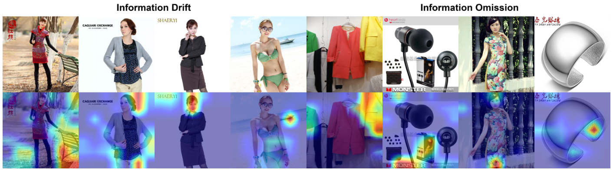
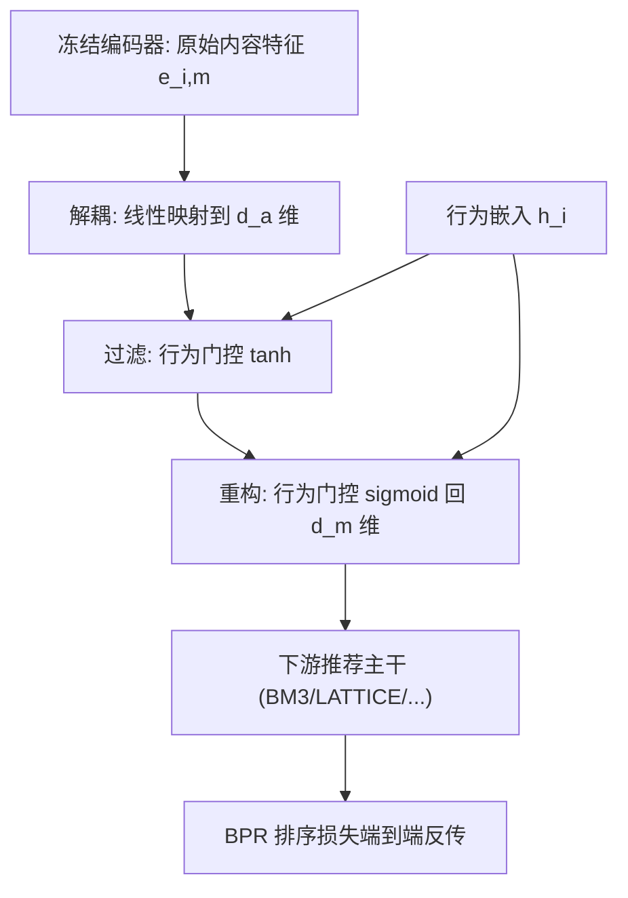

# BeFA: A General Behavior-driven Feature Adapter for Multimedia Recommendation (行为驱动的通用多模态特征适配器)

- **会议/期刊**: AAAI 2025
- **作者与机构**: Qile Fan, Penghang Yu, Zhiyi Tan, Bing-Kun Bao, Guanming Lu（南京邮电大学）
- **推荐链路定位**: 召回（多模态内容特征预处理，可插拔于任意多模态推荐主干）
- **研究方向**: 多模态推荐 / 冷启动与长尾
- **论文原文**: [https://arxiv.org/abs/2406.00323v2](https://arxiv.org/abs/2406.00323v2)
- **开源代码**: [https://github.com/fqldom/BeFA](https://github.com/fqldom/BeFA)

## TL;DR (1分钟核心速览)

多模态推荐普遍直接用预训练编码器（CLIP/ImageBind）抽取整图/整文特征，但多媒体内容信息密度低，编码器会同时吸收大量与偏好无关的细节。本文先用**基于相似度的归因分析**首次可视化证实内容特征存在「信息漂移（关注错区域）」与「信息遗漏（关键细节缺失）」两类缺陷，进而提出即插即用的 **BeFA**：以行为特征为门控，对内容特征做「解耦—过滤—重构」三步适配。在 TMALL/Microlens/H&M 三数据集、全库排序协议下，为 BM3/LATTICE/FREEDOM/MGCN 四种主干带来 Recall@20 平均 **9.07%**、NDCG@20 平均 **11.02%** 的提升，且仅增加约 1–2% 参数量。

## Background & Motivation (背景与核心矛盾)

- **主流范式**: 先用预训练编码器抽取多模态内容特征，再与 ID 行为特征融合（图卷积/对比学习/互信息最大化）建模用户偏好，代表作为 MMGCN、LATTICE、BM3、MGCN、FREEDOM。
- **前人局限**: ① 现有工作默认「编码器抽出的内容特征已足够反映偏好」，只优化融合方式，从未质疑特征本身质量；② 多媒体内容信息密度低，编码器对整幅内容一次性编码，必然混入背景、人脸等偏好无关信息。
- **核心洞察 (Key Insight)**: 作者提出相似度归因分析（用内容特征与行为特征的余弦相似度替代 CAM 的梯度权重），首次可视化发现两类系统性缺陷——**信息漂移**（特征聚焦到错误区域，如买衣服却关注模特脸部）与**信息遗漏**（只捕捉局部细节、丢失整体）。附录进一步在嵌入空间证明：预抽取特征与理想特征夹角 $\theta$越大，有效分量$p=e'_{i,m}\cos\theta$越短甚至反向，直接损害后验$P(r_{ui}|e_{i,m},h_i,h_u)$。
- **本文切入点**: 不改主干、不重训编码器，而是插入一个由行为信息引导的轻量适配器，把内容特征「拉回」到偏好相关子空间。

<figure class="paper-figure" markdown="span">
  <figcaption>图2：在TMALL数据集上进行可视化归因分析的结果。第一行包含原始物品图像，第二行显示对应的热力图。左侧四个样本反映信息漂移，右侧四个样本反映信息遗漏。</figcaption>
</figure>

## Method (核心方法设计)

### 1. 整体框架 (Overall Architecture)

输入为物品图像/文本经冻结编码器得到的原始内容特征 $e_{i,m}$与 ID 行为嵌入$h_i$。BeFA 先将其线性映射到更高维的解耦空间，再用行为嵌入做门控过滤出偏好相关分量，最后用行为门控把过滤后的分量重构回原维度，得到适配特征$\tilde{e}_{i,m}$ 送入下游推荐主干。适配器与推荐系统**共享同一优化目标、端到端联合训练**，编码器保持冻结，因此可无缝挂载到任意多模态推荐模型。

### 2. 关键设计拆解 (Key Designs)

1. **解耦空间映射（Decoupling）**：原始 $d_m$维内容特征容量有限，无法同时容纳「偏好相关」与「偏好无关」两类信息。BeFA 先做$\dot{e}_{i,m}=W_1e_{i,m}+b_1$，把特征升维到$d_a$的解耦空间，为后续分离提供冗余容量。超参分析显示最优$d_a\approx 4d_m$：过小形成信息瓶颈，过大引发维度灾难与噪声。
2. **行为门控过滤与重构（Filter & Merge）**：这是全文核心算子。过滤阶段用行为嵌入逐维门控，抑制无关通道：
$$\ddot{e}_{i,m}=h_i\odot\tanh(W_2\dot{e}_{i,m}+b_2)$$
重构阶段再用行为门控把过滤结果压缩回原维度：
$$\tilde{e}_{i,m}=h_i\odot\sigma(W_3\ddot{e}_{i,m}+b_3)$$
两式形式相近但作用不同：前者是「按行为筛通道」，后者是「按行为重组语义」。直觉上，$h_i$ 携带的是该物品被真实交互所刻画的偏好信号，用它做乘性门控等价于把内容特征投影到「用户实际关注」的子空间，从而同时缓解漂移（压掉错误区域响应）与遗漏（保留并重组被忽略的细节）。层间加 ReLU 与 Dropout 增强非线性与泛化。
3. **训练目标与开销**：总损失即下游主干的推荐损失（BPR/对比辅助损失），BeFA 无额外监督项，靠梯度回传隐式对齐理想特征。无额外负采样设计。开销方面，以 BM3 为例仅增 0.20M 参数（占主干 0.93%–2.09%），单 epoch 训练时间增加约 15%，与 LoRA/Soft-Prompt 同量级。

## Experimental Setup & Evaluation Protocol (实验设置与评估协议)

- **数据集与预处理**: 三个真实数据集均做 `10-core` 过滤：

| 数据集 | #Users | #Items | #Interactions | 密度 | 场景说明 |
| :--- | :---: | :---: | :---: | :---: | :--- |
| TMALL | 13,104 | 7,848 | 151,928 | 0.148% | 电商服饰，背景干扰中等 |
| Microlens | 46,420 | 14,079 | 332,730 | 0.051% | 短视频/图文，背景干扰最强 |
| H&M | 43,543 | 16,915 | 369,945 | 0.050% | 纯商品图，干扰最小、最干净 |

- **数据划分与防穿越**: 沿用 LATTICE/BM3 的 `8:1:1` 比例划分（训练/验证/测试），非时间戳切分。
- **排名评测协议**: 无偏 `Full-Ranking`（全库未交互物品排序），报告 Recall@10/20 与 NDCG@10/20，对全体测试用户取平均。
- **对比基线与超参**: 主干为 LATTICE、BM3、FREEDOM、MGCN；编码器为 CLIP(ViT-B/32) 与 ImageBind；参数高效对比对象为 LoRA 与 Soft-Prompt Tuning。嵌入维度 $d=64$，Xavier 初始化，$\lambda_E=10^{-4}$，batch 2048，早停 patience 10、总 epoch 1000，按验证集 Recall@20 选模；提升经$t$-test 检验$p\le 0.05$ 显著。

## Key Experimental Results (实验关键数据)

### 1. 主实验对比 (Main Results)

CLIP 编码器下各主干 +BeFA 的核心结果（R@20 / N@20）：

| 主干 | TMALL R@20 | +BeFA | Microlens R@20 | +BeFA | H&M R@20 | +BeFA |
| :--- | :---: | :---: | :---: | :---: | :---: | :---: |
| BM3 | 0.0298 | **0.0319** (+7.05%) | 0.0851 | **0.0911** (+7.05%) | 0.0320 | **0.0391** (+22.19%) |
| LATTICE | 0.0356 | **0.0403** (+13.20%) | 0.0886 | **0.0943** (+6.43%) | 0.0427 | **0.0498** (+16.63%) |
| FREEDOM | 0.0340 | **0.0375** (+10.29%) | 0.0774 | **0.0814** (+5.17%) | 0.0526 | **0.0583** (+10.84%) |
| MGCN | 0.0380 | **0.0395** (+3.95%) | 0.0972 | **0.1000** (+2.88%) | 0.0549 | **0.0594** (+8.20%) |

CLIP 下四主干平均提升：R@10 +11.39%、R@20 +8.62%、N@10 +18.71%、N@20 +9.55%；ImageBind 下平均 R@20 +9.09%、N@20 +12.53%。与参数高效方法对比（表 2），BeFA 在多数格子优于 LoRA 与 Soft-Prompt，平均 R@20 +6.08%、N@20 +5.67%（Microlens），H&M 上平均 R@20 +11.11%、N@20 +12.58%。

### 2. 消融实验 (Ablation Study)

原文未设显式 `w/o` 模块消融，但以「适配方式替换」构成等价消融（表 2，BM3 主干，CLIP）：

| 配置 | TMALL R@20 | Microlens R@20 | H&M R@20 | 说明 |
| :--- | :---: | :---: | :---: | :--- |
| BM3（无适配） | 0.0298 | 0.0851 | 0.0320 | 原始内容特征 |
| +LoRA | 0.0333 | 0.0850 | 0.0290 | 低秩微调，H&M 反降 |
| +Soft-Prompt | 0.0298 | 0.0861 | 0.0311 | 提示微调，增益微弱 |
| +BeFA | **0.0319** | **0.0911** | **0.0391** | 行为引导适配 |

### 3. 关键实验发现 (Key Findings)

1. **缺陷是普遍性的，而非个别编码器问题**：即便换成更强的 ImageBind，BeFA 仍带来平均 R@20 +9.09% 的提升，说明「信息漂移/遗漏」源于编码器对整幅内容一次性编码的范式本身，而非某个编码器能力不足。
2. **场景越干净，适配收益越大**：H&M（纯商品图、干扰少）上 BeFA 使 R@20/N@20 分别提升 14.17%/17.34%，而背景最复杂的 Microlens 仅 4.58%/5.19%，说明行为门控的「去噪」在噪声可控时收益被放大，也暗示复杂场景下门控仍有残余噪声。
3. **通用适配方法不适配推荐任务**：LoRA 在 H&M 上甚至使 BM3 的 R@20 从 0.0320 降至 0.0290，Soft-Prompt 增益普遍在 1% 内；热力图显示二者几乎未纠正漂移/遗漏，反证「必须用行为信号而非通用语义信号」做适配。

## Highlights & Limitations (亮点、对比与审稿批判)

- **与代表作对比 (vs. Prior Work)**: 与 BM3/MGCN 这类「在融合阶段做对比学习/互信息最大化」的方法本质不同——它们优化的是内容与行为表征的**对齐损失**，BeFA 直接**改写内容特征本身**，二者正交可叠加；与 LoRA/Soft-Prompt 相比，BeFA 的门控信号来自行为嵌入而非通用语义，因而在推荐任务上优势明显。
- **可迁移亮点**: ① 相似度归因分析（用下游行为特征余弦相似度替代 CAM 梯度权重）是一套低成本、模型无关的特征质量诊断工具，可直接用于审计任何多模态推荐 pipeline 的内容特征；② 「升维解耦—门控过滤—门控重构」的适配范式可迁移到跨域推荐、冷启动物品的内容特征增强。
- **审稿级局限批判**: ① 解耦维度 $d_a$对性能高度敏感（最优约$4d_m$ 但随数据集波动），论文自认这是局限，未做成可学习参数；② 仅在三个电商/短视频数据集、两个视觉编码器上验证，缺少文本模态单独消融与线上 A/B；③ 归因分析依赖人工目视热力图，缺乏定量化的特征质量指标。

## Rating (四维评分)

- **方法创新性 (Novelty)**: ⭐⭐⭐⭐ （首次系统揭示内容特征的信息漂移/遗漏缺陷，并给出嵌入空间理论解释，适配器设计简洁但切中要害）
- **评估协议与实验扎实度 (Protocol & Experiments)**: ⭐⭐⭐⭐ （三数据集 × 四主干 × 两编码器的全库排序矩阵较完整，$t$-test 显著；扣分在缺少显式模块消融与线上验证）
- **写作与数学规范度 (Clarity & Rigor)**: ⭐⭐⭐⭐ （公式简洁、附录给出偏差 $\theta$与有效分量$p$ 的几何推导；但过滤/重构两式形式相近易混淆，需靠文字区分）
- **工业落地与复现价值 (Industrial & Practical Value)**: ⭐⭐⭐⭐⭐ （即插即用、编码器冻结、仅增 1–2% 参数与 15% 训练时间，代码已开源，工程落地门槛极低）

