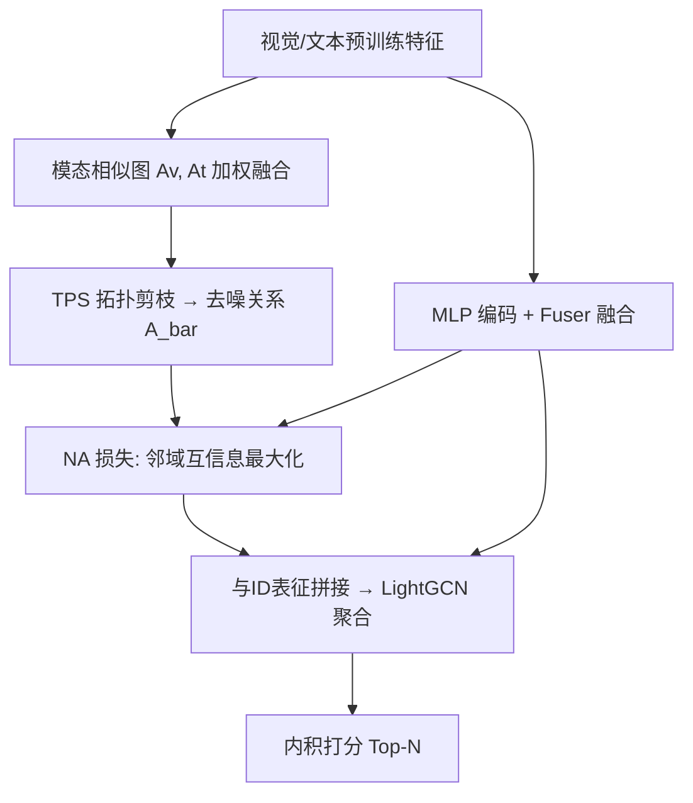
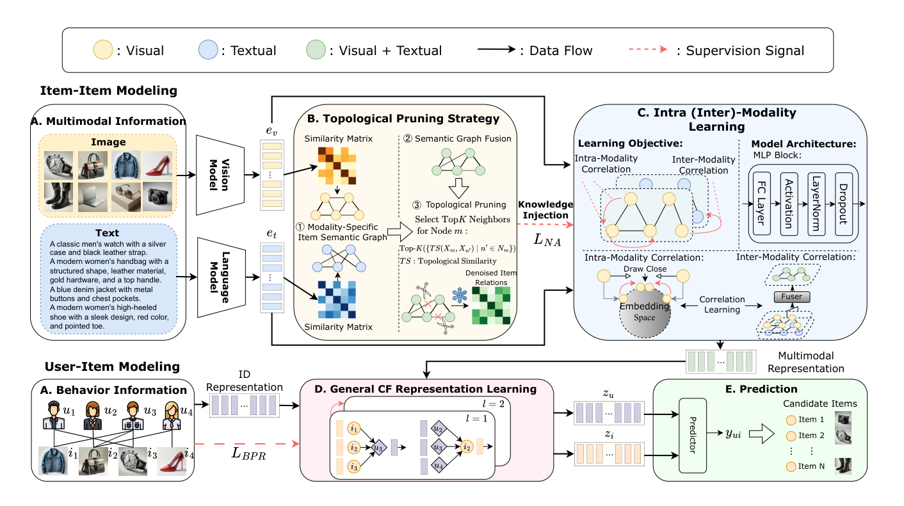

# Beyond Graph Convolution: Multimodal Recommendation with Topology-aware MLPs (超越图卷积：拓扑感知MLP的多模态推荐)

- **会议/期刊**: AAAI 2025
- **作者与机构**: Junjie Huang, Jiarui Qin, Yong Yu, Weinan Zhang (上海交通大学)
- **推荐链路定位**: 召回（多模态物品表征学习 + 用户-物品图聚合）
- **研究方向**: 多模态推荐 / 图神经网络推荐
- **论文原文**: [https://arxiv.org/abs/2412.11747v1](https://arxiv.org/abs/2412.11747v1)
- **开源代码**: [https://github.com/jessicahuang0163/TMLP](https://github.com/jessicahuang0163/TMLP)

## TL;DR (1分钟核心速览)

现有多模态推荐（MMRS）依赖浅层GCN建模物品-物品关系，受过度平滑所限无法随深度扩展容量，且预训练模态特征直接加权融合引入噪声。本文提出TMLP：用MLP替代GCN消息传递，配合拓扑剪枝策略（TPS）去噪物品关系、邻域对齐（NA）损失将拓扑依赖注入MLP。在Amazon Baby/Sports/Electronics三数据集、8:1:1划分、全库排序协议下，Recall@10相对最优基线提升7.53%/5.49%/5.69%，且收敛更快、抗噪更强。

## Background & Motivation (背景与核心矛盾)

- **主流范式**: LATTICE/FREEDOM/MGCN 等先用预训练视觉/文本模型构造模态特定的物品相似图，再用单层或双层GCN在物品-物品图上做消息传递，以显式建模高阶语义关系。
- **前人局限**: 其一，GCN 固有过度平滑使模型只能停留在浅层，图1显示 FREEDOM/MGCN 层数增加时每轮耗时上升而性能单调下降，物品嵌入趋于坍缩（多功能钳与弹弓皮筋、手表与车铃被拉近）；其二，模态图由各模态预训练表征简单加权求和得到，存在模态不兼容，边本身即含噪。
- **核心洞察 (Key Insight)**: 多模态数据维度高、跨模态关联复杂，需要大容量模型；而GCN的容量被消息传递机制锁死。MLP 天然适合高维复杂模式且可自由加深，图1(d)显示TMLP随深度增加仍保持同类相近、异类远离的判别力。
- **本文切入点**: 绕开图卷积——用"拓扑剪枝提供干净监督信号 + 互信息最大化把拓扑注入MLP"来替代显式消息传递。

## Method (核心方法设计)

### 1. 整体框架 (Overall Architecture)

TMLP 分三部分：(i) TPS 在训练前基于模态相似图的拓扑结构做一次性剪枝，得到去噪物品关系 $\bar{A}$；(ii) IML 用 MLP 分别编码视觉/文本特征并经 Fuser 融合，同时以 NA 损失对齐节点与其邻域表征，把$\bar{A}$ 的拓扑信息注入与拓扑无关的 MLP；(iii) 将多模态物品表征与ID表征拼接后，在用户-物品二部图上用 LightGCN 聚合（2层）得到最终用户/物品向量，内积打分做 top-N 推荐。推理阶段只需节点特征，不需要图拓扑。

<figure class="paper-figure" markdown="span">
  <figcaption>图2：TMLP的框架。它利用拓扑剪枝策略和模态内（间）学习，通过MLP（而非先前工作中的GCN）捕获模态相关性。通用CF表示学习指不融合多模态信息的先前工作，如LightGCN。</figcaption>
</figure>

### 2. 关键设计拆解 (Key Designs)

1. **拓扑剪枝策略 TPS（去噪物品关系）**：痛点在于预训练表征的模态不兼容使融合图 $A=\beta_m A_v+(1-\beta_m)A_t$含粗噪边。TPS 借用拓扑相似度：若随机采样点同时落入$m,n$ 邻域的概率高，则二者拓扑相似，用邻域/补集的联合分布构造
$TS(X_m;X_n)=\sum_{x_m}\sum_{x_n}p(x_m,x_n)\log\frac{p(x_m,x_n)}{p(x_m)p(x_n)}$，
再对每个节点仅保留 top-$K$邻居：$\bar{A}_{mn}=A_{mn}\cdot\mathbb{I}\{n\in\text{Top-}K(\{TS\})\}$。直觉是"共同邻居结构"比"特征余弦"更抗模态错配，且该步在训练前完成，零额外开销。

2. **邻域对齐损失 NA（把拓扑注入MLP）**：MLP 对非独立同分布图数据是拓扑盲的。作者最大化节点表征与其上下文邻域的互信息 $I(C(x);Z(x))$，用 MINE 转化为可采样的对比损失：
$\mathcal{L}_{NA}=-\mathbb{E}_{v_m\in V}\left[\log\frac{\sum_{n=1}^{B}\mathbb{I}_{n\neq m}(\bar{A}_{mn})^r\exp(\text{sim}(z_m,z_n)/\tau)}{\sum_{k=1}^{B}\mathbb{I}_{k\neq m}\exp(\text{sim}(z_m,z_k)/\tau)}\right]$，
其中 $r$-跳邻居为正样本、批内其他节点为负样本。它等价于在表征空间复刻GCN的"邻居拉近"效果，却不引入逐层传播，因此不受过度平滑约束。

3. **训练目标、负采样与推理效率**：总损失 $\mathcal{L}=\mathcal{L}_{BPR}+\alpha\mathcal{L}_{NA}+\lambda\|\Theta\|_2$，BPR 采用均匀随机负采样，NA 损失用批内负样本（免额外负采样器）。TPS 离线完成；前向仅 MLP + 2层LightGCN，推理不需图拓扑。表6显示 TMLP 73轮收敛、总训练10.2分钟，优于 FREEDOM（260轮/32.3分钟）与 BM3（264轮/32分钟）。

## Experimental Setup & Evaluation Protocol (实验设置与评估协议)

- **数据集与预处理**: Amazon 三品类，保留 `5-core` 用户与物品；视觉特征4096维、文本特征384维（沿用 BM3 设定）。

| 数据集 | #Users | #Items | #Interactions | 稀疏度 | 特征/场景说明 |
| :--- | :---: | :---: | :---: | :---: | :--- |
| Baby | 19,445 | 7,050 | 160,792 | 99.88% | 母婴，图文 |
| Sports | 35,598 | 18,357 | 296,337 | 99.95% | 运动户外，图文 |
| Electronics | 192,403 | 63,001 | 1,689,188 | 99.99% | 电子产品，图文，规模最大 |

- **数据划分与防穿越 (Splitting Strategy)**: 采用与 BM3 一致的 `8:1:1 比例划分`，验证集选模型（以 Recall@20 为准），测试集报指标。
- **排名评测协议 (Ranking Protocol)**: 无偏 `Full-Ranking`（对全部物品打分排序），报告 Recall@{10,20} 与 NDCG@{10,20}，对全部测试用户取平均。
- **对比基线与超参设置**: 基线含通用CF（BPR、LightGCN）与多模态模型（VBPR、MMGCN、GRCN、DualGNN、BM3、MGCN、FREEDOM）共9个。嵌入维度 $d=64$，MLP隐层512、层数$\{2,3,4\}$、激活 tanh，LightGCN 2层，$\beta_m=0.1$，$K'=10$，$\tau=1$，$r=1$，批大小2048，Adam；5个随机种子，$t$检验$p<0.01$ 显著性。

## Key Experimental Results (实验关键数据)

### 1. 主实验对比 (Main Results)

| 数据集 | 指标 | LightGCN | BM3 | MGCN | FREEDOM | **TMLP** | Improv.↑ |
| :--- | :--- | :---: | :---: | :---: | :---: | :---: | :---: |
| Baby | R@10 | 0.0479 | 0.0534 | 0.0620 | 0.0624 | **0.0671*** | 7.53% |
| Baby | R@20 | 0.0754 | 0.0845 | 0.0964 | 0.0985 | **0.1016*** | 3.15% |
| Baby | N@20 | 0.0328 | 0.0365 | 0.0427 | 0.0416 | **0.0449*** | 5.15% |
| Sports | R@10 | 0.0569 | 0.0625 | 0.0729 | 0.0710 | **0.0769*** | 5.49% |
| Sports | R@20 | 0.0864 | 0.0956 | 0.1106 | 0.1077 | **0.1152*** | 4.16% |
| Sports | N@20 | 0.0387 | 0.0427 | 0.0496 | 0.0476 | **0.0515*** | 3.83% |
| Electronics | R@10 | 0.0363 | 0.0420 | 0.0439 | 0.0382 | **0.0464*** | 5.69% |
| Electronics | R@20 | 0.0540 | 0.0628 | 0.0643 | 0.0588 | **0.0687*** | 6.84% |
| Electronics | N@20 | 0.0250 | 0.0288 | 0.0298 | 0.0262 | **0.0316*** | 6.04% |

### 2. 消融实验 (Ablation Study)

| 变体 | Baby R@20 | Baby N@20 | Sports R@20 | Sports N@20 |
| :--- | :---: | :---: | :---: | :---: |
| TMLP (完整) | **0.1016** | **0.0449** | **0.1152** | **0.0515** |
| TMLP$_T$ (仅文本) | 0.1010 | 0.0445 | 0.1128 | 0.0502 |
| TMLP$_V$ (仅视觉) | 0.0847 | 0.0375 | 0.0981 | 0.0436 |
| Rand Pruning | 0.0993 | 0.0443 | 0.1111 | 0.0497 |
| w/o Pruning | 0.0926 | 0.0406 | 0.0838 | 0.0362 |
| w/o NA Loss | 0.0812 | 0.0356 | 0.0948 | 0.0422 |

### 3. 关键实验发现 (Key Findings)

1. **NA 损失是命门，TPS 在大数据集上不可省**：去掉 NA 损失后 Baby R@20 从 0.1016 跌至 0.0812（−20%），说明纯 MLP 完全无法感知拓扑；去掉剪枝在 Sports 上从 0.1152 跌至 0.0838（−27%），而 Baby 上仅跌至 0.0926，印证大数据集噪声边更多、剪枝收益更大。
2. **随机剪枝已能吃掉部分收益，但 TPS 仍显著领先**：Rand Pruning 在 Sports 得 0.1111，说明"少连边"本身即降噪；TPS 再提升 0.0041，证明拓扑相似度筛选优于随机稀疏化，且 $K=5$（平均度17-18）为最优采样规模。
3. **文本模态贡献远大于视觉，且抗噪性突出**：TMLP$_V$在 Baby 仅 0.0847，TMLP$_T$ 达 0.1010，接近完整模型；在 Sports 注入1%损坏边时 FREEDOM/MGCN 性能骤降甚至落后 LightGCN，而 TMLP 基本持平，验证 TPS 的鲁棒性。

## Highlights & Limitations (亮点、对比与审稿批判)

- **与代表作对比 (vs. Prior Work)**: 与 FREEDOM 相比，后者虽冻结物品图提升效率，但推荐阶段只用ID嵌入、丢弃多模态信息，故在 Electronics 上反被 MGCN 超越；与 MGCN 相比，后者仍依赖GCN+注意力且层数一深即崩；与 LATTICE 相比，本文不构造单一融合图，而是"剪枝+互信息"双管齐下，把拓扑作为监督信号而非传播算子。
- **可迁移亮点**: ①"拓扑相似度剪枝"可零成本前置，直接用于任何以预训练相似图作辅助监督的推荐模型；②用 MINE/NA 损失把图结构蒸馏进 MLP 的范式，可迁移到序列推荐、跨域推荐中替代昂贵的图传播。
- **审稿级局限批判**: ①用户侧仍依赖 LightGCN 在交互图上传播，未验证用户-物品图本身是否也受过度平滑影响，端到端"去GCN化"不彻底；②TPS 的 top-$K$与$\beta_m$ 为固定超参，缺少自适应学习，且相似图构建仍依赖预训练模型质量，跨域泛化性未验证；③仅在 Amazon 三品类离线全库排序评测，无线上A/B或冷启动分桶实验。

## Rating (四维评分)

- **方法创新性 (Novelty)**: ⭐⭐⭐⭐ （首次系统论证MMRS中GCN容量瓶颈，并以"剪枝+互信息"替代消息传递，思路清晰但组件均为已有技术的组合）
- **评估协议与实验扎实度 (Protocol & Experiments)**: ⭐⭐⭐⭐ （三数据集、9基线、全库排序、5种子+$t$检验、消融/超参/效率/抗噪/案例齐全，缺冷启动与线上验证）
- **写作与数学规范度 (Clarity & Rigor)**: ⭐⭐⭐⭐ （动机图1极具说服力，公式定义完整；TPS 的拓扑相似度推导略简，复杂度分析偏薄）
- **工业落地与复现价值 (Industrial & Practical Value)**: ⭐⭐⭐⭐⭐ （代码开源、TPS离线零开销、推理不需图拓扑、收敛快3倍以上，工程部署友好）

