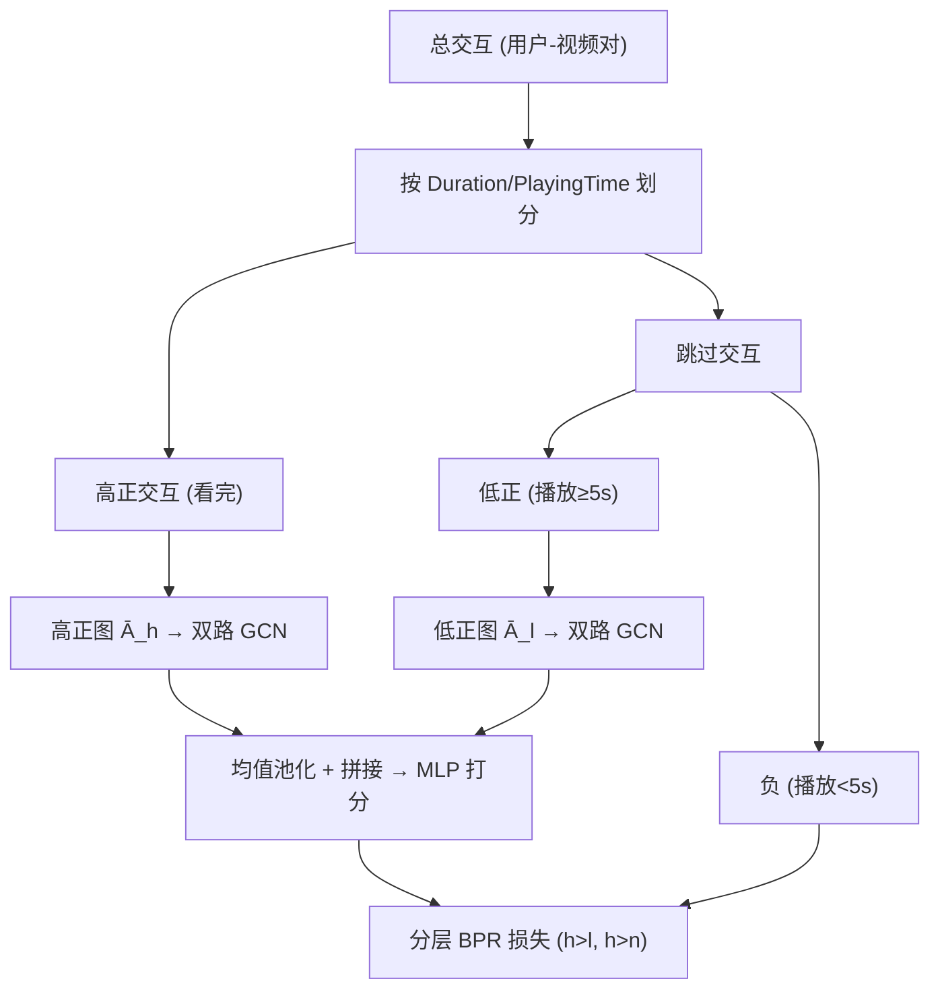

# Exploiting Fine-Grained Skip Behaviors for Micro-Video Recommendation (利用细粒度跳过行为的微视频推荐)

- **会议/期刊**: AAAI 2025
- **作者与机构**: Sanghyuck Lee, Sangkeun Park, Jaesung Lee (中央大学人工智能系, 韩国)
- **推荐链路定位**: 召回 (图卷积表征学习)
- **研究方向**: 多模态推荐 / 图神经网络推荐
- **论文原文**: [https://arxiv.org/abs/2504.03107v1](https://arxiv.org/abs/2504.03107v1)
- **开源代码**: 暂未开源

## TL;DR (1分钟核心速览)

短视频推荐中，传统方法把"是否跳过"二值化为正/负反馈，忽略了"看了几秒才划走"这一关键细粒度信号。本文依据播放时长将交互重构为**高正（看完）、低正（延迟跳过）、负（5 秒内秒划）**三级，构建高正/低正双层用户-视频图做双路 GCN 传播，并设计分层 BPR 损失（高正>低正、高正>负）联合 BCE 训练。在 MVA 与 KuaiRand-Pure 上按 6:2:2 划分、Top-3/5 全指标评测，NDCG@5 相对 FRAME 提升约 3.6% 与 5.5%，八项指标全部显著（$p=0.01$）。

## Background & Motivation (背景与核心矛盾)

- **主流范式**: 微视频推荐分两支——多模态特征融合（MMGCN、BM3）与图卷积交互建模（FRAME 用片段级正负双图），均以"是否完整观看"作为正负标签。
- **前人局限**: ① 二值化把"延迟跳过"与"秒划"混为一谈，丢失了用户"看了几秒才失去兴趣"的弱正信号；② 图构建时把弱正样本直接当负样本或直接丢弃，导致正图稀疏、负样本语义污染。
- **核心洞察 (Key Insight)**: 统计 MVA 与 KuaiRand-Pure 的播放时长分布（图 1）发现，绝大多数跳过集中在**前 5 秒**，而视频时长分布相对均匀——说明 5 秒内秒划是强负信号，5 秒后延迟跳过则代表"初期被吸引、后续流失"的弱正兴趣。
- **本文切入点**: 以 5 秒为阈值把跳过行为再切一刀，将交互分为三级，用两张正图分别承载高正与低正兴趣，负样本只进损失不进图。

## Method (核心方法设计)

### 1. 整体框架 (Overall Architecture)

输入为全部用户-视频交互三元组及视频视觉特征（MVA 用预训练 CNN 抽帧平均得 128 维；KuaiRand-Pure 无特征则用可学习节点嵌入）。首先按 `Duration/PlayingTime ≥ 1.0` 划分高正与跳过行为，再对跳过行为以播放时长 5 秒为界切出低正与负样本；高正、低正分别构建并对称归一化两张邻接矩阵，经两条独立的双层 GCN 路径传播得到用户/视频嵌入，均值池化融合后拼接送入 MLP 预测偏好分；训练端用分层 BPR + BCE 联合优化。

### 2. 关键设计拆解 (Key Designs)

1. **双层正图构建 (Dual-Level Positive Graph)**：痛点是把延迟跳过当负样本会污染负集、又浪费弱正信号。本文为每个用户构造高正视频集 $V_u^h$与低正视频集$V_u^l$，分别生成交互矩阵$R^h_{ij}=\mathbb{I}[v_j\in V_{u_i}^h]$、$R^l_{ij}=\mathbb{I}[v_j\in V_{u_i}^l]$，拼成对称邻接矩阵后做$\tilde{A}=D^{-\frac{1}{2}}AD^{-\frac{1}{2}}$ 归一化。直觉是让两类兴趣在各自子图上独立传播，避免弱正信号被强正邻居淹没。

2. **双路正图学习 (Dual-Path Positive Graph Learning)**：两条路径共享初始视频嵌入 $H_v^{(0)}$但权重独立，一层聚合用户、二层聚合视频：$H_u^h=\sigma((\tilde{R}^h)^\top H_v^{(0)}W_h^{(1)})$，$H_v^h=\sigma((\tilde{R}^h)^\top H_u^h W_h^{(2)})$，低正路径同理。最终$H_u=\mathrm{Mean}(H_u^h,H_u^l)$、$H_v=\mathrm{Mean}(H_v^h,H_v^l)$，再经$\hat{z}_{u,v}=W^{(2)}\sigma(W^{(1)}[h_u,h_v])$ 输出分数。均值池化而非加权，是因为两级正信号同属"正"，无需人为设定强弱权重。

3. **分层排序损失与训练目标**：传统 BPR 只在高正与随机未见负样本间排序，忽略了"秒划"这一真实强负。本文对每个高正样本同时采一个低正与一个负样本，构造两层排序：$\mathcal{L}_{BPR,h,l}=-\sum\ln\sigma_s(\hat{z}_{u,h}-\hat{z}_{u,l})$、$\mathcal{L}_{BPR,h,n}=-\sum\ln\sigma_s(\hat{z}_{u,h}-\hat{z}_{u,n})$，取均值$\mathcal{L}_{BPR}=\frac{1}{2}(\mathcal{L}_{BPR,h,l}+\mathcal{L}_{BPR,h,n})$；再叠加是否跳过的 BCE 监督，总损失$\mathcal{L}_{combined}=\lambda\mathcal{L}_{BPR}+(1-\lambda)\mathcal{L}_{BCE}$，$\lambda=0.5$。负样本来自真实秒划行为而非均匀采样，语义更硬、梯度更有效。

## Experimental Setup & Evaluation Protocol (实验设置与评估协议)

- **数据集与预处理**:

| 数据集 | #Users | #Items | #Interactions | 稀疏度/密度 | 特征/场景说明 |
| :--- | :---: | :---: | :---: | :---: | :--- |
| Micro-video-A (MVA) | 12,739 | 58,291 | 342,694 | 密度约 0.046% | 移动 App 采集，含播放时长/视频时长/多级行为；CNN 抽帧平均得 128 维视觉特征 |
| KuaiRand-Pure | 27,285 | 7,583 | 1,186,059 | 密度约 0.573% | 快手随机策略干预的无偏序列数据；无视频特征，改用可学习节点嵌入 |

- **数据划分与防穿越 (Splitting Strategy)**: 对每个用户按 **6:2:2 比例随机划分**训练/验证/测试集，非时间戳切分；邻接矩阵仅用训练集构建，测试阶段仅在测试交互关联物品上做偏好预测。
- **排名评测协议 (Ranking Protocol)**: 在测试交互关联物品集合内排序（非全库 Full-Ranking，属受限候选集排序），报告 Precision/Recall/MAP/NDCG @ $k\in\{3,5\}$ 共 8 项指标。
- **对比基线与超参设置**: 基线为 FRAME（片段级正负双图 GCN）、LightGT（LightGCN+Transformer 层级位置编码）、BM3（dropout 增广的对比学习）；特征维度 $d=128$，batch size 1024，AdamW（lr 1e-3 余弦退火至 1e-6，weight decay 1e-4），最多 30 epoch、验证集 Recall@3 五轮不升即早停；MVA 重复 10 次、KuaiRand-Pure 重复 7 次，配对 t 检验$p=0.01$。

## Key Experimental Results (实验关键数据)

### 1. 主实验对比 (Main Results)

**MVA 数据集**（均值 ± 标准差，* 表示 $p=0.01$ 显著）:

| Model | P@3 | R@3 | MAP@3 | NDCG@3 | P@5 | R@5 | MAP@5 | NDCG@5 |
| :--- | :---: | :---: | :---: | :---: | :---: | :---: | :---: | :---: |
| **Proposed** | **0.573*** | **0.623*** | **0.739*** | **0.790*** | **0.540*** | **0.882*** | **0.731*** | **0.812*** |
| BM3 | 0.546 | 0.591 | 0.701 | 0.758 | 0.532 | 0.869 | 0.699 | 0.787 |
| FRAME | 0.538 | 0.581 | 0.697 | 0.753 | 0.528 | 0.863 | 0.694 | 0.784 |
| LightGT | 0.506 | 0.563 | 0.660 | 0.720 | 0.505 | 0.856 | 0.664 | 0.760 |
| Improv. (vs FRAME) | +6.5% | +7.2% | +6.0% | +4.9% | +2.3% | +2.2% | +5.3% | +3.6% |

**KuaiRand-Pure 数据集**:

| Model | P@3 | R@3 | MAP@3 | NDCG@3 | P@5 | R@5 | MAP@5 | NDCG@5 |
| :--- | :---: | :---: | :---: | :---: | :---: | :---: | :---: | :---: |
| **Proposed** | **0.279*** | **0.632*** | **0.545*** | **0.591*** | **0.234*** | **0.760*** | **0.565*** | **0.637*** |
| BM3 | 0.214 | 0.497 | 0.386 | 0.433 | 0.198 | 0.646 | 0.417 | 0.495 |
| FRAME | 0.263 | 0.606 | 0.501 | 0.551 | 0.227 | 0.744 | 0.526 | 0.604 |
| LightGT | 0.169 | 0.411 | 0.291 | 0.335 | 0.170 | 0.564 | 0.326 | 0.402 |
| Improv. (vs FRAME) | +6.1% | +4.3% | +8.8% | +7.3% | +3.1% | +2.2% | +7.4% | +5.5% |

### 2. 消融实验 (Ablation Study)

原文以图 4、图 5 呈现（未给数值表），此处按结论整理为定性对照:

| 变体 | 图构建 / 损失策略 | 相对表现 |
| :--- | :--- | :--- |
| Total Interaction | 全部交互视为正，不区分跳过 | 最差，噪声正样本拖累学习 |
| Highly Positive Only | 仅保留看完交互建图 | 次优，正图稀疏、丢失弱正信息 |
| **Proposed Dual-Level** | 高正 + 低正双图 | **最优** |
| BPR w/ Unseen Negative | 随机未见样本作负 | 次优 |
| **Proposed Hierarchical BPR** | 真实秒划作负 + 高正>低正分层 | **最优** |

### 3. 关键实验发现 (Key Findings)

1. **弱正信号确有增量价值**：仅用高正建图明显逊于双层图，说明"延迟跳过"并非噪声而是可用的弱正兴趣；在 KuaiRand-Pure 上 MAP@3 相对 FRAME 提升达 8.8%，弱正样本占比更高的无偏数据受益更大。
2. **真实负样本优于随机负采样**：用秒划行为替代未见交互做负样本后性能稳定提升，验证了"5 秒内划走"是语义明确的强负，比均匀采样提供更硬的排序梯度。
3. **分层排序优于单层排序**：同时约束"高正>低正"与"高正>负"的双层 BPR 优于任一单层，说明级内精细区分与级间粗粒度区分互补，二者缺一都会削弱排序精度。

## Highlights & Limitations (亮点、对比与审稿批判)

- **与代表作对比 (vs. Prior Work)**: FRAME 同样用跳过行为建双图，但仅做正/负二分且以片段级标签建模；本文在其框架上把正信号再拆两级，改动小但收益稳定。LightGT 依赖 Transformer 自注意力但忽略播放时长语义，在 KuaiRand-Pure 上甚至弱于 BM3；BM3 的对比增广与行为信号正交，可叠加使用。
- **可迁移亮点**: ① "阈值切分 + 多级正图"范式可直接迁移到电商停留时长、新闻阅读时长等隐式反馈场景；② 用真实强负行为替代随机负采样的分层 BPR，是低成本提升排序质量的通用技巧。
- **审稿级局限批判**: ① 5 秒阈值硬编码且数据集相关，作者自认 KuaiRec 中大量跳过发生在 10 秒后，跨平台需重新调参，缺乏自适应阈值机制；② 双路 GCN 使参数量与计算量约翻倍，且评测为测试集受限候选排序而非全库 Full-Ranking，绝对性能与线上收益的对应关系尚不明确；③ 仅对比 3 个基线，未与 SGL/MMGCL 等自监督图推荐方法比较，说服力有限。

## Rating (四维评分)

- **方法创新性 (Novelty)**: ⭐⭐⭐ （细粒度三级反馈 + 双层正图思路直观有效，但本质是 FRAME 的增量改造，缺乏理论分析）
- **评估协议与实验扎实度 (Protocol & Experiments)**: ⭐⭐⭐ （两数据集八指标 + 多次重复 + 配对 t 检验较规范，但基线仅 3 个、消融仅以图呈现无具体数值）
- **写作与数学规范度 (Clarity & Rigor)**: ⭐⭐⭐⭐ （公式与符号定义清晰、图 2/图 3 流程完整，但式 (9)(10) 中 $\tilde{R}$与式 (7)(8) 的$\tilde{A}$ 符号衔接略含糊）
- **工业落地与复现价值 (Industrial & Practical Value)**: ⭐⭐⭐ （改动轻量易落地于短视频场景，但阈值需按平台重调、双路 GCN 开销翻倍且未开源）

