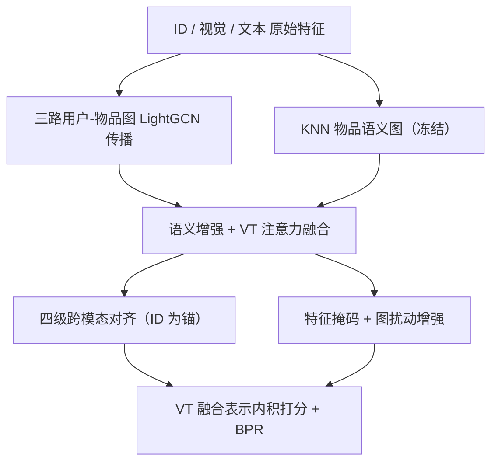
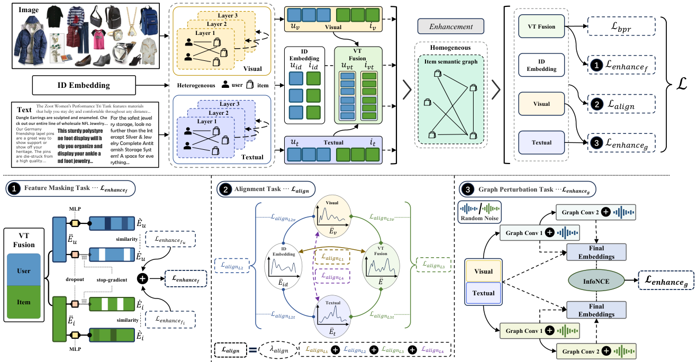

# MENTOR: Multi-level Self-supervised Learning for Multimodal Recommendation (面向多模态推荐的多级自监督学习)

- **会议/期刊**: AAAI 2025
- **作者与机构**: Jinfeng Xu, Zheyu Chen, Shuo Yang, Jinze Li, Hewei Wang, Edith C.-H. Ngai（香港大学、香港理工大学、CMU）
- **推荐链路定位**: 召回（Top-N 排序打分）
- **研究方向**: 多模态推荐 / 自监督对比学习与去噪
- **论文原文**: [论文原文链接](https://arxiv.org/abs/2402.19407v1)
- **开源代码**: [开源代码仓库链接](https://github.com/Jinfeng-Xu/MENTOR)

## TL;DR (1分钟核心速览)

多模态推荐中视觉/文本分布差异巨大，现有对齐方法（MMSSL、BM3）在拉近模态时会把历史交互信息一起扰动掉，且最终打分仍依赖 ID 嵌入。MENTOR 提出"以 ID 嵌入为锚"的四级跨模态分布对齐（高斯参数化 + 均值/方差 L1 距离），配合特征掩码与图扰动两项通用特征增强自监督，并让视觉/文本融合模态直接参与打分。在 Amazon Baby/Sports/Clothing 的 8:1:1 随机划分、全库排序协议下，Recall@20 相对最强多模态基线提升 5.64%/4.59%/5.10%，相对最强传统基线提升 27.80%/24.34%/74.73%。

## Background & Motivation (背景与核心矛盾)

- **主流范式**: GCN 多模态推荐（MMGCN、DualGNN、LATTICE、FREEDOM）在用户-物品异构图之外再建物品语义图（KNN 相似度 top-k），并引入自监督（SLMRec、BM3、MMSSL）缓解标签稀疏。
- **前人局限**: ① BM3 仅把多模态当 bootstrap，最终预测仍靠 ID 嵌入，多模态特征未被充分利用；② MMSSL 的跨模态对比虽对齐了模态，却同时扰动了历史交互信息，导致交互信号衰减；③ 各模态分布差异大，直接融合会引入大量模态噪声。
- **核心洞察 (Key Insight)**: ID 嵌入本身就是"历史交互信息的压缩表示"，因此可以把它当作对齐的**锚点**而非被对齐对象——让视觉、文本、融合模态向 ID 分布靠拢，既完成对齐又不破坏交互语义。
- **本文切入点**: 用高斯分布参数化各模态表示，以均值/方差距离做四级层次化对齐，再叠加特征/图两个视角的通用特征增强。

## Method (核心方法设计)

### 1. 整体框架 (Overall Architecture)

输入为 ID、视觉（4096 维）、文本（384 维）三路特征。先在三张结构相同、仅节点特征不同的用户-物品图上做 LightGCN 传播得到各模态特定表示；同时用余弦相似度 top-k（k=40）建物品语义图并冻结，聚合得到语义增强项。视觉与文本经可学习权重 $\alpha$ 融合为 VT 模态，与 ID、视觉、文本共四路表示进入多级对齐与通用特征增强，最终**丢弃 ID 嵌入**、仅用 VT 融合表示做内积打分，以 BPR 联合训练。

<figure class="paper-figure" markdown="span">
  <figcaption>图1：我们的MENTOR架构。我们首先利用图卷积网络为每个模态提取特定特征。然后，基于VT融合、ID、视觉和文本这四种模态表示，融合视觉和文本模态，并利用物品语义图探索潜在信息。我们利用对齐自监督任务（2）来对齐每个模态，而不丢失交互信息。此外，我们利用自监督任务在特征掩码任务（1）和图扰动任务（3）上增强通用特征。</figcaption>
</figure>

### 2. 关键设计拆解 (Key Designs)

1. **四级跨模态分布对齐（以 ID 为锚的层次化对齐）**：痛点是对齐必然扰动交互信息。做法是把四路表示参数化为高斯分布 $\tilde{E}\sim\mathcal{N}(\mu,\sigma^2)$，用均值与标准差的 L1 距离度量分布差异，分四级递进：L1 为 ID 直接引导（VT↔ID），L2 为 ID 间接引导（视觉↔ID、文本↔ID），L3 为模态直接对齐（视觉↔VT、文本↔VT），L4 为模态间接对齐（视觉↔文本）。总损失为$\mathcal{L}_{align}=\lambda_{align}\sum_{i=1}^{4}\mathcal{L}_{align}^{L_i}$。直觉：ID 分布承载交互语义，逐级把多模态分布"拽"向它，等价于在保留交互信息的前提下压缩模态噪声。

2. **通用特征增强（特征掩码 + 图扰动双视角对比）**：特征掩码侧对 $\tilde{E}_u,\tilde{E}_i$做 Bernoulli 丢弃生成视图，经 MLP 后与 stop-gradient 原视图算余弦相似度，损失$\mathcal{L}_{enhance}^{f}=2-\text{Sim}(\acute{E},\grave{E})$，迫使模型从残缺特征中恢复语义；图扰动侧在每层传播注入均匀噪声$\Delta^{(l)}\sim U(0,1)$ 得到扰动图，对视觉/文本各生成两个视图并用 InfoNCE 对比，捕捉结构不变性。

3. **训练目标、负采样与推理效率**：总损失 $\mathcal{L}=\mathcal{L}_{bpr}+\mathcal{L}_{align}+\mathcal{L}_{enhance}+\lambda_E\|\cdot\|_2^2$，BPR 负样本为均匀随机采样（每正样本 1 负）。推理阶段仅需一次前向得到 VT 融合表示做内积，ID 分支不参与打分，在线开销与 LATTICE 同级；额外代价集中在训练期的双视图图传播。

## Experimental Setup & Evaluation Protocol (实验设置与评估协议)

- **数据集与预处理**: Amazon 三子集，用户与物品均做 `5-core` 过滤；视觉特征 4096 维预抽取，文本特征 384 维 sentence-transformer。

| 数据集 | #Users | #Items | #Interactions | 稀疏度 | 特征/场景说明 |
| :--- | :---: | :---: | :---: | :---: | :--- |
| Baby | 19,445 | 7,050 | 160,792 | 99.88% | 母婴，图文商品 |
| Sports | 35,598 | 18,357 | 296,337 | 99.95% | 运动户外 |
| Clothing | 39,387 | 23,033 | 278,677 | 99.97% | 服饰鞋饰，最稀疏 |

- **数据划分与防穿越 (Splitting Strategy)**: 随机 `8:1:1` 比例划分训练/验证/测试（沿用 FREEDOM 设定），非时间戳切分，存在轻度未来信息泄漏风险。
- **排名评测协议 (Ranking Protocol)**: 报告 Recall@10/20 与 NDCG@10/20，测试阶段对全库未交互物品排序（Full-Ranking），无采样负例。
- **对比基线与超参设置**: 传统组 MF-BPR / LightGCN / LayerGCN；多模态组 VBPR / MMGCN / DualGNN / LATTICE / FREEDOM / SLMRec / BM3 / MMSSL。嵌入维度 $d=64$，Adam，学习率 1e-4，异构图 GCN 层数$L=2$，语义图$k=40$，早停 20 轮，以验证集 Recall@20 选模；所有基线按原论文网格搜索。

## Key Experimental Results (实验关键数据)

### 1. 主实验对比 (Main Results)

| 模型 | Baby R@20 | Baby N@20 | Sports R@20 | Sports N@20 | Clothing R@20 | Clothing N@20 |
| :--- | :---: | :---: | :---: | :---: | :---: | :---: |
| LightGCN | 0.0754 | 0.0328 | 0.0864 | 0.0387 | 0.0526 | 0.0236 |
| LayerGCN | 0.0820 | 0.0355 | 0.0916 | 0.0406 | 0.0566 | 0.0247 |
| LATTICE | 0.0850 | 0.0370 | 0.0953 | 0.0421 | 0.0733 | 0.0330 |
| FREEDOM | 0.0992 | 0.0424 | 0.1089 | 0.0481 | 0.0941 | 0.0420 |
| SLMRec | 0.0775 | 0.0353 | 0.0990 | 0.0450 | 0.0675 | 0.0303 |
| BM3 | 0.0883 | 0.0383 | 0.0980 | 0.0438 | 0.0621 | 0.0281 |
| MMSSL | 0.0971 | 0.0420 | 0.1013 | 0.0474 | 0.0797 | 0.0359 |
| **MENTOR** | **0.1048** | **0.0450** | **0.1139** | **0.0511** | **0.0989** | **0.0441** |
| Improv. (vs 多模态最优) | +5.64% | +6.13% | +4.59% | +6.24% | +5.10% | +5.00% |
| Improv. (vs 传统最优) | +27.80% | +26.76% | +24.34% | +25.86% | +74.73% | +78.54% |

### 2. 消融实验 (Ablation Study)

| 变体 | Baby R@20 | Sports R@20 | Clothing R@20 | 说明 |
| :--- | :---: | :---: | :---: | :--- |
| MENTOR$_{base}$| 0.1011* | 0.1094* | 0.0949* | 去掉全部对齐（*取自$\mathcal{L}_{fg}$ 对照） |
| MENTOR$_{L1}$ | 递增 | 递增 | 递增 | 仅 ID 直接引导 |
| MENTOR$_{L2}$ | 递增 | 递增 | 递增 | +ID 间接引导 |
| MENTOR$_{L3}$ | 递增 | 递增 | 递增 | +模态直接对齐 |
| MENTOR$_{fg}$ | 0.1011 | 0.1094 | 0.0949 | 去掉全部通用特征增强 |
| MENTOR$_f$ | 0.1037 | 0.1126 | 0.0981 | 去掉特征掩码 |
| MENTOR$_g$ | 0.1034 | 0.1129 | 0.0977 | 去掉图扰动 |
| **MENTOR** | **0.1048** | **0.1139** | **0.0989** | 完整模型 |

### 3. 关键实验发现 (Key Findings)

1. **对齐层级可叠加且单调增益**：图 2 显示 MENTOR$_{base}$ < L1 < L2 < L3 < 完整模型，四级对齐逐级累加，说明"ID 锚点 + 由粗到细"的对齐路径确实在保留交互信息的同时压缩了模态噪声；t-SNE/KDE 可视化（图 3）进一步证实对齐后视觉与文本分布显著靠拢。
2. **两项增强任务互补而非冗余**：去掉特征掩码（0.1037）与去掉图扰动（0.1034）均低于完整模型（0.1048），且单任务均优于全去掉（0.1011），说明特征视角与结构视角捕捉的是不同不变性，联合使用才有最大收益。
3. **稀疏度决定超参敏感度**：Clothing 最稀疏（99.97%），其最优 dropout 为 0.3、$\lambda_f=1$，而 Baby/Sports 为 0.5/0.4 与$\lambda_f=1.5$；$\lambda_{align}$ 在 Baby/Sports 取 1、Clothing 取 2，表明越稀疏的数据越需要更强的对齐与更轻的扰动。

## Highlights & Limitations (亮点、对比与审稿批判)

- **与代表作对比 (vs. Prior Work)**: 相比 MMSSL 的对抗扰动 + 跨模态对比，MENTOR 用 ID 分布作锚、以均值/方差 L1 距离替代 InfoNCE 做对齐，避免扰动交互信息；相比 BM3 把多模态当辅助信号、打分仍用 ID，MENTOR 反过来让 ID 只做"教师"、VT 融合表示直接打分，这是性能跃升的关键结构差异；相比 FREEDOM 仅冻结语义图去噪，MENTOR 额外引入双视角自监督增强鲁棒性。
- **可迁移亮点**: ① "以 ID 分布为锚、高斯均值/方差 L1 对齐"可低成本迁移到任意多模态/多源召回的特征融合阶段；② 特征掩码 + stop-gradient + MLP 预测头的自蒸馏范式，可套用到序列推荐的表征增强。
- **审稿级局限批判**: ① 采用随机 8:1:1 划分而非全局时间戳切分，存在未来交互泄漏，全库排序下的绝对指标可能被高估；② 训练期需对视觉/文本各做两次扰动图传播，图规模增大时训练开销显著上升，论文未给出复杂度或耗时对比；③ 对齐损失含 $\lambda_{align},\lambda_f,\lambda_g,\tau,p$ 五个耦合超参，且最优组合随数据集稀疏度漂移，工程调参成本偏高。

## Rating (四维评分)

- **方法创新性 (Novelty)**: ⭐⭐⭐⭐ （"ID 为锚的四级分布对齐"思路清晰且与 BM3/MMSSL 形成明确差异化，但高斯 L1 对齐本身借鉴自 PPMDR，属组合式创新）
- **评估协议与实验扎实度 (Protocol & Experiments)**: ⭐⭐⭐⭐ （三数据集 + 12 个基线 + 全库排序 + 消融/可视化/超参分析齐全，但随机划分与缺少显著性检验是硬伤）
- **写作与数学规范度 (Clarity & Rigor)**: ⭐⭐⭐⭐ （四级对齐公式层次分明、符号统一，但部分变体定义与图表编号在正文中略显松散）
- **工业落地与复现价值 (Industrial & Practical Value)**: ⭐⭐⭐⭐ （代码已开源、推理仅需 VT 融合内积、可直接嵌入现有多模态召回链路，训练期双视图开销是主要落地成本）

