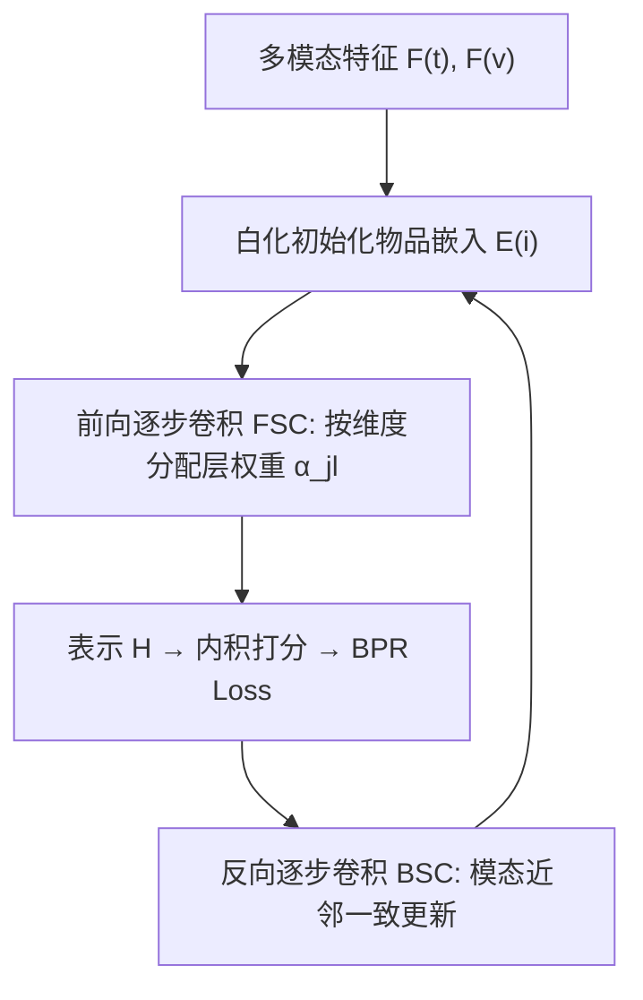
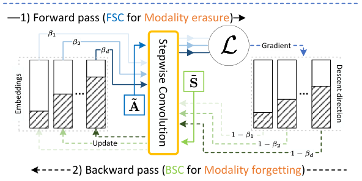

# STAIR: Manipulating Collaborative and Multimodal Information for E-Commerce Recommendation (面向电商推荐的协同与多模态信息协同操控)

- **会议/期刊**: AAAI 2025
- **作者与机构**: Cong Xu, Yunhang He, Jun Wang, Wei Zhang（华东师范大学）
- **推荐链路定位**: 召回（图协同过滤召回）
- **研究方向**: 多模态推荐 / 协同过滤
- **论文原文**: [论文原文链接](https://arxiv.org/abs/2412.11729v1)
- **开源代码**: [开源代码仓库链接](https://github.com/yhhe2004/STAIR)

## TL;DR (1分钟核心速览)

本文首先用香农熵量化证明：电商场景下文本/视觉模态对用户行为的判别力甚至接近高斯噪声，模态只能作为协同信号的补充而非替代。为此提出 STAIR：以白化多模态特征初始化物品嵌入，用**前向逐步图卷积 (FSC)** 沿嵌入维度分配不同层权重，使前段维度保留协同信息、后段维度保留模态信息；再用**反向逐步卷积 (BSC)** 约束同模态近邻物品的梯度更新方向，缓解训练中的模态遗忘。在 Baby/Sports/Electronics 三数据集 Full-Ranking 协议下，Recall@20 相对 FREEDOM 提升 2.5%–5.2%，训练开销仅与 LightGCN 持平。

## Background & Motivation (背景与核心矛盾)

- **主流范式**: 多模态推荐主流做法（MMGCN、LATTICE、BM3、MMSSL）默认模态特征是用户行为的主导驱动，通过模态专属图卷积或跨模态对比学习挖掘模态信号。
- **前人局限**: ① 电商场景中购买决策受价格、品牌、促销等多因素影响，模态并非主导，强行挖掘反而引入噪声（MMGCN 甚至劣于无模态的 MF-BPR）；② 现有方法用双分支（LATTICE/FREEDOM）绕开冲突，但两支路难以取得最优权衡，且可学习相似度矩阵或特殊采样带来显著额外开销。
- **核心洞察 (Key Insight)**: 作者用 K-Means 聚类 + 香农熵度量"模态特定行为不确定性"（图2）：MF-BPR 预训练嵌入不确定性最低（Baby 0.78），文本 1.12、视觉 1.18，随机高斯噪声 1.26——视觉模态几乎与噪声无异。同时发现两个新现象：**模态擦除**（仅 1 层 LightGCN 卷积即快速抹去初始化模态信息，远早于过平滑）与**模态遗忘**（BPR 损失只促进协同信息学习，嵌入与模态初始化的 Pearson 相关系数随 epoch 快速下降，图5）。
- **本文切入点**: 不做"模态 vs 协同"的二选一，而是利用广义 LightGCN 的维度独立性，在**同一嵌入的不同维度上**让两类信息共存，并在反向传播中施加模态一致性约束。

## Method (核心方法设计)

### 1. 整体框架 (Overall Architecture)

STAIR 以多模态特征白化（SVD 取前 $d$个左奇异向量）初始化物品嵌入、以邻居物品均值池化初始化用户嵌入；前向传播用 FSC 得到层间加权融合的表示$\mathbf{H}$，经内积打分与 BPR 损失训练；反向传播时对物品嵌入的下降方向施加基于 kNN 模态相似图的 BSC 变换，使用户嵌入常规更新、物品嵌入受模态一致性约束更新。整个流程无额外可学习参数，仅增加一个 kNN 图构建。

<figure class="paper-figure" markdown="span">
  <figcaption>图1：STAIR 概览。1）前向传播：通过 FSC 在后续维度中保留更多多模态信息。2）反向传播：使用 BSC 增强多模态信息，以缓解模态遗忘问题。</figcaption>
</figure>

### 2. 关键设计拆解 (Key Designs)

1. **前向逐步卷积 FSC（解决模态擦除）**：痛点在于 LightGCN 的均匀层权重对每个维度一视同仁，深层卷积必然抹平模态。FSC 利用维度独立性 $\mathbf{H}_{:,j}=\sum_{l=0}^{L}\alpha_{jl}\tilde{\mathbf{A}}^{l}\mathbf{E}_{:,j}$，为每个维度$j$ 设置随维度递减的传送比：
$$\alpha_{jl}=\frac{1-\beta_j}{1-\beta_j^{L+1}}\beta_j^{l},\quad \beta_j=0.9\cdot\left[1-\left(\frac{j-1}{d}\right)^{\gamma}\right]$$
前段维度 $\beta_j$大、层权重均匀（近似 LightGCN，承载协同信息）；后段维度$\beta_j$小、权重集中于浅层（保留模态信息）。归一化系数保证$\sum_l \alpha_{jl}=1$，各维度量级一致。$\gamma$ 越小则整体越偏向保留模态。

2. **反向逐步卷积 BSC（解决模态遗忘）**：BPR 的下降方向 $\Delta\mathbf{E}_t$只拉近交互对，无机制保护模态。BSC 将更新改写为$\mathbf{E}_t\leftarrow\mathbf{E}_{t-1}-\eta\sum_{j=1}^{d}\sum_{l=0}^{L}\alpha'_{jl}\tilde{\mathbf{S}}^{l}[\Delta\mathbf{E}_t]_{:,j}$，其中$\beta'_j=1-\beta_j$使层权重沿维度反向分配——后段维度获得更强的模态增强。相似图$\mathbf{S}_{ij}=\max(\hat{S}_{ij},\hat{S}_{ji})$，$\hat{S}_{ij}=|\{m: j\in\mathcal{N}_m(i)\}|$，且各模态近邻数$k_m$独立设定（文本$k_t=5$、视觉$k_v=1$），体现"按模态效用分配近邻"的洞察。固定$\beta$时收敛率不劣于$O(1/((1-\max_j\beta_j)^2T))$。

3. **训练目标与效率**：损失为标准 BPR $\mathcal{L}=-\sum_{u}\sum_{i\in\mathcal{N}_u}\sum_{i'\notin\mathcal{N}_u}\log\sigma(\mathbf{h}_u^\top\mathbf{h}_i-\mathbf{h}_u^\top\mathbf{h}_{i'})$，负采样为均匀采样。无对比学习、无数据增广，参数量与 LightGCN 同阶，仅多一个稀疏 kNN 图。

## Experimental Setup & Evaluation Protocol (实验设置与评估协议)

- **数据集与预处理**（Amazon 评论，`5-core` 过滤，视觉 4096 维 CNN 特征、文本 384 维 sentence-transformer 特征）：

| 数据集 | #Users | #Items | #Interactions | 稀疏度 | 特征/场景说明 |
| :--- | :---: | :---: | :---: | :---: | :--- |
| Baby | 19,445 | 7,050 | 160,792 | 99.88% | 母婴电商，图文 |
| Sports | 35,598 | 18,357 | 296,337 | 99.95% | 运动户外，图文 |
| Electronics | 192,403 | 63,001 | 1,689,188 | 99.99% | 电子产品，图文 |

- **数据划分与防穿越**: 沿用 MMRec 标准划分，每个用户最后一次交互为测试集、倒数第二次为验证集（Leave-One-Out 风格）。
- **排名评测协议**: 无偏 `Full-Ranking`（对全库未交互物品排序），指标 Recall@{10,20} 与 NDCG@{10,20}，报告 5 次独立运行的配对 t 检验（$p\le 0.05$）。
- **对比基线与超参**: 基线含 MF-BPR、LightGCN、JGCF（纯协同）与 MMGCN、LATTICE、BM3、FREEDOM、MMSSL（多模态）；统一 $d=64$、$L=3$，AdamW，学习率 1e-3，$\gamma$在$\{0.01,\dots,0.5\}$ 搜索（Baby 0.1 / Sports 0.2 / Electronics 0.4）。

## Key Experimental Results (实验关键数据)

### 1. 主实验对比 (Main Results)

| 模型 | Baby R@20 | Baby N@20 | Sports R@20 | Sports N@20 | Elec. R@20 | Elec. N@20 |
| :--- | :---: | :---: | :---: | :---: | :---: | :---: |
| MF-BPR | 0.0638 | 0.0284 | 0.0885 | 0.0401 | 0.0557 | 0.0256 |
| LightGCN | 0.0851 | 0.0372 | 0.0956 | 0.0432 | 0.0579 | 0.0272 |
| JGCF | 0.0874 | 0.0385 | 0.0999 | 0.0456 | 0.0618 | 0.0294 |
| MMGCN | 0.0580 | 0.0248 | 0.0529 | 0.0230 | 0.0339 | 0.0149 |
| LATTICE | 0.0875 | 0.0388 | 0.1024 | 0.0466 | - | - |
| BM3 | 0.0866 | 0.0385 | 0.0980 | 0.0444 | 0.0631 | 0.0289 |
| FREEDOM | 0.0991 | 0.0434 | 0.1088 | 0.0479 | 0.0647 | 0.0295 |
| MMSSL | 0.0929 | 0.0442 | 0.1001 | 0.0482 | - | - |
| **STAIR** | **0.1042** | **0.0453** | **0.1117** | **0.0503** | **0.0663** | **0.0302** |
| Improv. vs FREEDOM | +5.21% | +4.47% | +2.66% | +5.01% | +2.53% | +2.34% |
| Improv. vs LightGCN | +22.44% | +21.82% | +16.83% | +16.40% | +14.56% | +11.30% |

效率对比（表3）：STAIR 在 Baby 上 1.45s/epoch、490MB 显存，与 LightGCN（1.25s/478MB）几乎持平；而 FREEDOM 为 1.68s/1034MB，MMSSL 高达 27.70s/3048MB，LATTICE 与 MMSSL 在 Electronics 上因显存不足无法运行。

### 2. 消融实验 (Ablation Study)

| 变体 | Baby R@20 | Baby N@20 | Sports R@20 | Sports N@20 |
| :--- | :---: | :---: | :---: | :---: |
| LightGCN（基线） | 0.0851 | 0.0372 | 0.0956 | 0.0432 |
| w/o MI（去模态初始化） | 显著下降 | 显著下降 | 显著下降 | 显著下降 |
| w/o FSC（去前向逐步卷积） | 下降 | 下降 | 下降幅度较小 | 下降幅度较小 |
| w/o BSC（去反向逐步卷积） | 下降 | 下降 | 下降 | 下降 |
| **STAIR 完整版** | **0.1042** | **0.0453** | **0.1117** | **0.0503** |

### 3. 关键实验发现 (Key Findings)

1. **模态初始化是收益基石**：去掉 MI 后性能跌幅最大，且随机种子方差显著增大，说明即便模态判别力弱，其初始化仍远优于随机噪声，为后续卷积提供更优起点。
2. **FSC 的收益与场景模态效用正相关**：Sports 上 FSC 增益小于 Baby，与图2中 Sports 行为不确定性更低（模态擦除问题更轻）的观测一致，验证了"模态越弱越需要 FSC 保护"的机制解释。
3. **BSC 是防遗忘的关键且模态权重应差异化**：去掉 BSC 后嵌入与模态初始化的相关性快速衰减、性能下降；超参分析显示文本近邻 $k_t=5$明显优于视觉$k_v=1$，与文本特征（标题/品牌/类目）噪声更低的结论吻合，也解释了前人给视觉降权的经验做法。

## Highlights & Limitations (亮点、对比与审稿批判)

- **与代表作对比 (vs. Prior Work)**: 相比 LATTICE/FREEDOM 的"双分支解耦"路线，STAIR 用单一嵌入的维度分段实现软融合，避免了两支路权衡失衡与可学习相似图/特殊采样的开销；相比 BM3/MMSSL 的对比学习路线，STAIR 以 kNN 图 + BSC 完成去噪增强，无需数据增广，在 Electronics 上仍可运行。
- **可迁移亮点**: ① "按维度分配层权重"的逐步卷积可直接移植到任何以 LightGCN 为骨干、需保留辅助信号（如知识图谱、社交）的模型；② 反向传播中基于近邻一致性的梯度变换是一种轻量正则化手段，可替代对比学习实现特征保持。
- **审稿级局限批判**: ① 模态效用度量依赖 K-Means 聚类数（10/20 簇结论一致但仍是超参），且仅在电商数据集验证，内容驱动场景（新闻/视频）作者自认不适用；② $\gamma$与$k_m$ 需逐数据集网格搜索，跨数据集最优值差异较大（0.1→0.4），迁移成本未量化；③ 仅报告离线 Full-Ranking，缺少线上 A/B 与冷启动分桶分析。

## Rating (四维评分)

- **方法创新性 (Novelty)**: ⭐⭐⭐⭐ （首次量化电商模态效用弱于协同信号，逐步卷积沿维度软融合的思路简洁且有收敛性分析支撑）
- **评估协议与实验扎实度 (Protocol & Experiments)**: ⭐⭐⭐⭐ （三数据集 Full-Ranking + 5 次运行 t 检验 + 效率对比完整，但缺线上验证与冷启动分桶）
- **写作与数学规范度 (Clarity & Rigor)**: ⭐⭐⭐⭐ （动机图与公式推导清晰，$\alpha_{jl}$ 归一化与 BSC 收敛率交代到位，超参敏感性分析充分）
- **工业落地与复现价值 (Industrial & Practical Value)**: ⭐⭐⭐⭐⭐ （代码开源，开销与 LightGCN 持平，无对比学习/增广，工程部署门槛极低）

