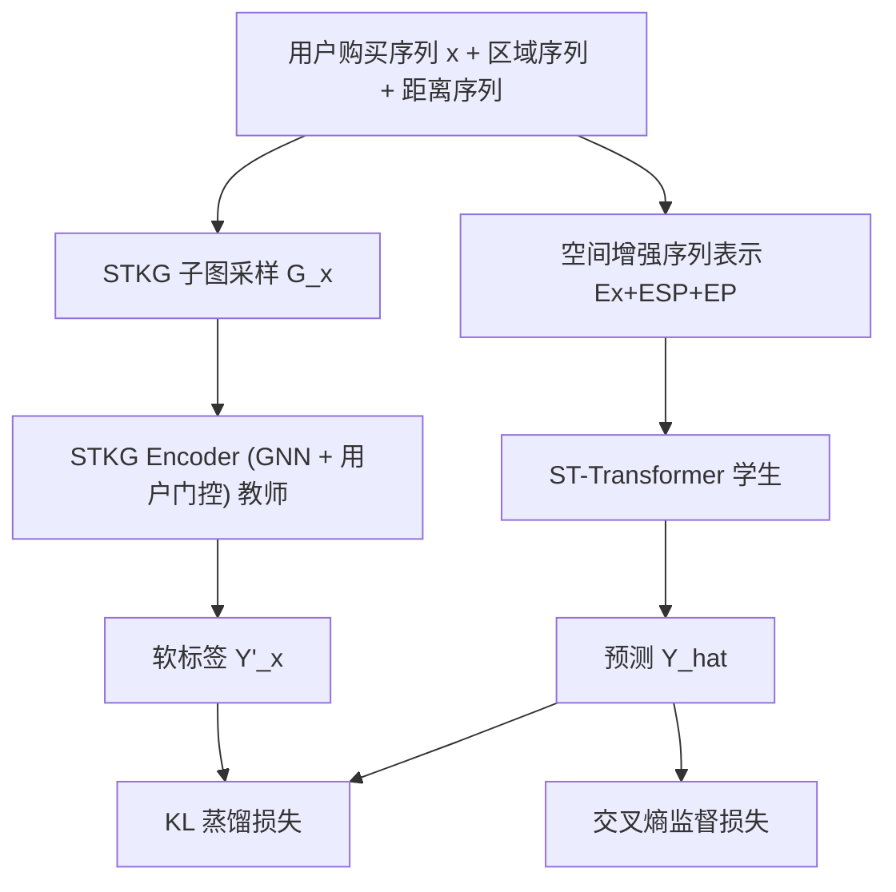
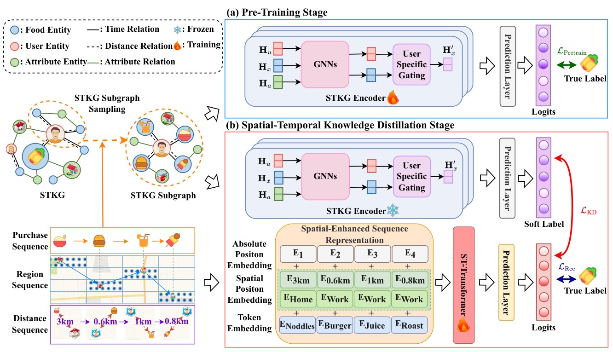

# Spatial-Temporal Knowledge Distillation for Takeaway Recommendation (面向外卖推荐的时空知识蒸馏)

- **会议/期刊**: AAAI 2025
- **作者与机构**: Shuyuan Zhao, Wei Chen, Boyan Shi, Liyong Zhou, Shuohao Lin, Huaiyu Wan（北京交通大学计算机学院；交通数据挖掘与具身智能北京市重点实验室）
- **推荐链路定位**: 召回（Next-Item 序列召回）
- **研究方向**: 时空轨迹与 POI 本地生活推荐 / 序列与会话推荐
- **论文原文**: [https://arxiv.org/abs/2412.16502v2](https://arxiv.org/abs/2412.16502v2)
- **开源代码**: [https://github.com/Zhaoshuyuan0246/STKDRec](https://github.com/Zhaoshuyuan0246/STKDRec)

## TL;DR (1分钟核心速览)

外卖推荐面临两大痛点：用户偏好随「时间 × 当前所处功能区」动态漂移，而现有方法只用 geohash/AOI 粗粒度区域，忽略了「用户-商家球面距离」这类细粒度地理信号；同时 STKG 图规模巨大，GNN 编码开销高、与序列模型异构难融合。本文提出两阶段 STKDRec：先用 STKG 编码器（教师）抽取高阶时空与协同关联，再用 ST-Transformer（学生）以「空间位置编码」建模细粒度地理序列，并通过 KL 蒸馏把图知识迁入学生模型。在三城 Ele.me 数据、采样排序协议下，HR@10 相对最强基线 BSARec 提升 1.2%–2.8%，NDCG@10 提升 1.0%–2.8%。

## Background & Motivation (背景与核心矛盾)

- **主流范式**: 外卖推荐本质是 Next-Item 序列建模，主流用 GRU4Rec/SASRec/BERT4Rec 类序列网络，或引入品牌、类目、AOI 等辅助信息与 KG/GNN（如 KGDPL）缓解序列稀疏。
- **前人局限一**: 现有方法只编码「区域」这一粗粒度空间属性（geohash6、AOI），无法刻画「用户当前所在功能区 → 商家功能区」的球面距离语义。如图 1 所示，用户晚间回到住宅区时，模型会因「就近原则」错推附近快餐，而忽略其真正偏好的远处商业区餐品。
- **前人局限二**: STKG 属非欧结构且规模达数十万实体，GNN 全图编码开销大；而图与序列处于不同向量空间，简单 Add/Concat/Multi 融合会把教师分布当噪声注入，反而破坏学生分布。
- **核心洞察 (Key Insight)**: 用户偏好是「时间 × 功能区 × 距离」的联合函数——同一用户在工作区午间买快餐、在住宅区晚间偏好正餐；而「咖啡-甜甜圈」这类共现协同信号只存在于图结构中，序列本身看不到。
- **本文切入点**: 用「离线图教师 + 在线序列学生」的蒸馏范式，把图侧高阶时空协同知识以软标签形式低成本注入序列模型。

## Method (核心方法设计)

### 1. 整体框架 (Overall Architecture)

STKDRec 采用两阶段训练。**预训练阶段**：以用户购买序列中每个 takeaway 为中心节点，在 STKG 上做 $m$层、每层$s$个邻居的随机子图采样得到$\mathcal{G}_x$，用 GNN 消息传递聚合时空与协同关联，再经用户特定门控注入个性化，输出软标签$Y'_x$。**STKD 阶段**：ST-Transformer 接收「物品嵌入 + 空间位置嵌入 + 绝对位置嵌入」的空间增强序列表示，经掩码自注意力得到上下文表示并打分；同时以 KL 散度对齐教师软标签、以交叉熵对齐真实标签联合训练。推理时只保留轻量学生模型，教师离线冻结。

<figure class="paper-figure" markdown="span">
  <figcaption>图2：STKDRec的整体架构，包括两个阶段：预训练阶段和STKD阶段。</figcaption>
</figure>

### 2. 关键设计拆解 (Key Designs)

1. **STKG 编码器与用户特定门控（教师侧高阶时空聚合）**：痛点是不区分用户的图聚合会抹平个体偏好。在标准 GNN 消息传递（式 1–2）得到子图实体表示 $H_x$后，引入用户门控把用户嵌入$H_u$ 作为条件调制序列表示：
$H'_x = H_x \otimes \sigma(H_x W_1 + W_2 H_u^{\top})$其中$W_1\in\mathbb{R}^{d\times 1}$、$W_2\in\mathbb{R}^{n\times d}$。直觉是让「该用户的历史协同模式」决定哪些邻居消息被放大，从而把全局图知识个性化。随后注意力池化 + Softmax 得到软标签$Y'_x$。

2. **空间位置编码 SPE（把「距离」写进位置语义）**：这是本文相对 SASRec 类绝对位置编码的核心增量。将区域嵌入 $E_{x_c}$与距离嵌入$E_{x_f}$ 相加后线性变换，再与物品、绝对位置嵌入三者求和：
$E_{SP} = W_{SP}(E_{x_c} + E_{x_f}),\quad \hat{E}_x = E_x + E_{SP} + E_P$
这样自注意力在建模「兴趣随时间演化」之外，还能建模「兴趣随功能区/距离迁移」，直接回应图 1 的就近误推问题。

3. **STKD 蒸馏目标与推理效率**：总损失为
$\mathcal{L} = \alpha \cdot \mathrm{KL}\!\left(Y'_x/\tau \,\|\, \hat{Y}_x/\tau\right) + (1-\alpha)\cdot \mathrm{CE}(\hat{Y}_x, Y_x)$取$\alpha=0.2$、$\tau$在$\{1,3,5,7,9\}$中调优。关键设计在于**只在 logits 分布层面对齐**而非对齐中间嵌入，规避了异构向量空间对齐的额外计算；训练负采样为全库 Softmax（式 9 对$E_V$全量打分），推理时教师完全下线，仅保留 2 层 2 头、$d=256$ 的 Transformer。

## Experimental Setup & Evaluation Protocol (实验设置与评估协议)

- **数据集与预处理**: 三个 Ele.me 城市外卖数据集，剔除 geohash6 为空的用户/商家，基于 geohash6 计算球面距离作为距离特征。

| 数据集 | #Users | #Takeaways | #Interactions | #Entities / #Relations | 平均序列长 |
| :--- | :---: | :---: | :---: | :---: | :---: |
| Wuhan | 31,047 | 383,953 | 2,125,761 | 447,033 / 4,906 | 41.27 |
| Sanya | 19,842 | 168,332 | 3,479,272 | 234,307 / 3,795 | 42.02 |
| Taiyuan | 32,412 | 306,344 | 4,442,984 | 396,153 / 3,669 | 39.97 |

- **数据划分与防穿越 (Splitting Strategy)**: 逐用户 `Leave-One-Out`——最后一条为测试、倒数第二条为验证、其余为训练。
- **排名评测协议 (Ranking Protocol)**: `Sampled Ranking`，测试正样本 + 100 个用户未交互随机负样本共同排序，报告 HR@{5,10,20} 与 NDCG@{5,10,20}。
- **对比基线与超参设置**: 9 个基线覆盖 RNN（GRU4Rec）、CNN（Caser）、Transformer（SASRec/BERT4Rec/BSARec）、对比学习（DuoRec/GCL4SR）、特征增强（FEARec）、图掩码自编码（MAERec）。STKG 采样深度 $m=2$、$s\in\{[5,5],\dots,[20,20]\}$；Transformer 2 层 2 头、$d=256$、batch 与最大序列长均为 128、Adam lr=0.001、早停。

## Key Experimental Results (实验关键数据)

### 1. 主实验对比 (Main Results)

| 数据集 | 指标 | GRU4Rec | SASRec | DuoRec | FEARec | GCL4SR | BSARec | **STKDRec** | Improv.% vs BSARec |
| :--- | :---: | :---: | :---: | :---: | :---: | :---: | :---: | :---: | :---: |
| Wuhan | HR@10 | 0.7854 | 0.7796 | 0.7913 | 0.7904 | 0.7938 | 0.7958 | **0.8229** | +3.41% |
| Wuhan | NDCG@10 | 0.6943 | 0.6911 | 0.7292 | 0.7279 | 0.7261 | 0.7318 | **0.7586** | +3.66% |
| Sanya | HR@10 | 0.8715 | 0.8806 | 0.8747 | 0.8769 | 0.8825 | 0.8838 | **0.8940** | +1.15% |
| Sanya | NDCG@10 | 0.8044 | 0.8084 | 0.8133 | 0.8157 | 0.8145 | 0.8259 | **0.8492** | +2.82% |
| Taiyuan | HR@10 | 0.8543 | 0.8583 | 0.8564 | 0.8533 | 0.8637 | 0.8661 | **0.8789** | +1.48% |
| Taiyuan | NDCG@10 | 0.7982 | 0.7860 | 0.7994 | 0.7984 | 0.8099 | 0.8132 | **0.8391** | +3.18% |

### 2. 消融实验 (Ablation Study)

| 变体 | Wuhan H@10 / N@10 | Sanya H@10 / N@10 | Taiyuan H@10 / N@10 |
| :--- | :---: | :---: | :---: |
| -w/o SP+KD（纯 Transformer） | 0.7796 / 0.6911 | 0.8806 / 0.8084 | 0.8583 / 0.7860 |
| -w/o KD（仅 ST-Transformer） | 0.8161 / 0.7509 | 0.8838 / 0.8294 | 0.8684 / 0.8277 |
| -w/o SP（去空间位置编码） | 0.8097 / 0.7456 | 0.8844 / 0.8348 | 0.8669 / 0.8266 |
| -w/o C（仅距离，无区域） | 0.8181 / 0.7518 | 0.8875 / 0.8379 | 0.8685 / 0.8267 |
| -w/o F（仅区域，无距离） | 0.8178 / 0.7535 | 0.8877 / 0.8384 | 0.8688 / 0.8277 |
| **STKDRec** | **0.8229 / 0.7586** | **0.8940 / 0.8492** | **0.8789 / 0.8391** |

### 3. 关键实验发现 (Key Findings)

1. **蒸馏是最大增益源，且与空间编码互补**：去掉 KD 后 Wuhan NDCG@10 从 0.7586 掉到 0.7509（-0.77pt），而同时去掉 SP+KD 则暴跌至 0.6911（-6.75pt），说明图侧协同知识（如「咖啡-甜甜圈」共现）无法由序列自身补足，二者叠加才释放全部收益。
2. **区域与距离缺一不可，但距离更关键**：单独保留距离（-w/o C）在 Wuhan 得 0.7518，单独保留区域（-w/o F）得 0.7535，均低于完整模型，验证「功能区语义 + 球面距离」是互补的两类细粒度信号，而非冗余。
3. **蒸馏优于一切朴素融合且更省时**：图 3 显示 Add/Concat/Multi 三种融合在 NDCG@10 与 Recall@10 上全面落后 STKD，且需额外空间对齐计算导致训练/预测耗时上升；原因是异构分布直接拼接会把教师分布当噪声注入。参数敏感性上，$\tau>7$后性能显著下滑（教师信息被过度平滑），$s$ 在 5–20 间波动很小，模型对采样规模不敏感。

## Highlights & Limitations (亮点、对比与审稿批判)

- **与代表作对比 (vs. Prior Work)**: 相比 BSARec（频域序列模式，无时空/协同）、GCL4SR（用户-物品图对比学习，无时空属性）、MAERec（图掩码自编码，同样缺时空），STKDRec 的差异在于**同时**引入细粒度地理序列编码与图侧高阶时空协同，并用蒸馏而非拼接完成异构融合；相比同赛道 STEN/BASM 只用 geohash/AOI 区域，本文显式建模球面距离。
- **可迁移亮点**: (1)「离线图教师 → 在线序列学生」的 logits 级蒸馏，可低成本把任意大 KG 知识注入轻量序列召回模型；(2) 把「距离」编码为位置嵌入的 SPE 设计，可直接迁移到本地生活、出行、Next-POI 等场景。
- **审稿级局限批判**: (1) 评测采用 100 负样本的 Sampled Ranking，未给 Full-Ranking 结果，且未报告方差/显著性检验，1% 量级的提升（如 Sanya HR@10 +1.15%）说服力偏弱；(2) 教师模型依赖 STKG 子图采样质量，$s$与深度$m$ 的选取按数据集手工调（Sanya 最优 20、Taiyuan 最优 10），跨城市迁移时需重新搜索，且论文未给出教师离线预训练与子图采样的实际耗时对比。

## Rating (四维评分)

- **方法创新性 (Novelty)**: ⭐⭐⭐⭐ （「图教师-序列学生」蒸馏 + 距离感知空间位置编码的组合在 POI 外卖场景属首次系统化，但单点技术均为已有范式的迁移）
- **评估协议与实验扎实度 (Protocol & Experiments)**: ⭐⭐⭐ （三城真实数据 + 9 基线 + 完整消融与案例研究，但仅 Sampled Ranking、无 Full-Ranking 与显著性检验）
- **写作与数学规范度 (Clarity & Rigor)**: ⭐⭐⭐⭐ （两阶段流程与公式定义清晰、符号统一，复杂度分析略欠，未给蒸馏阶段理论加速比）
- **工业落地与复现价值 (Industrial & Practical Value)**: ⭐⭐⭐⭐⭐ （代码已开源，推理仅保留轻量 Transformer、教师完全离线，天然契合外卖平台低延迟召回部署）

