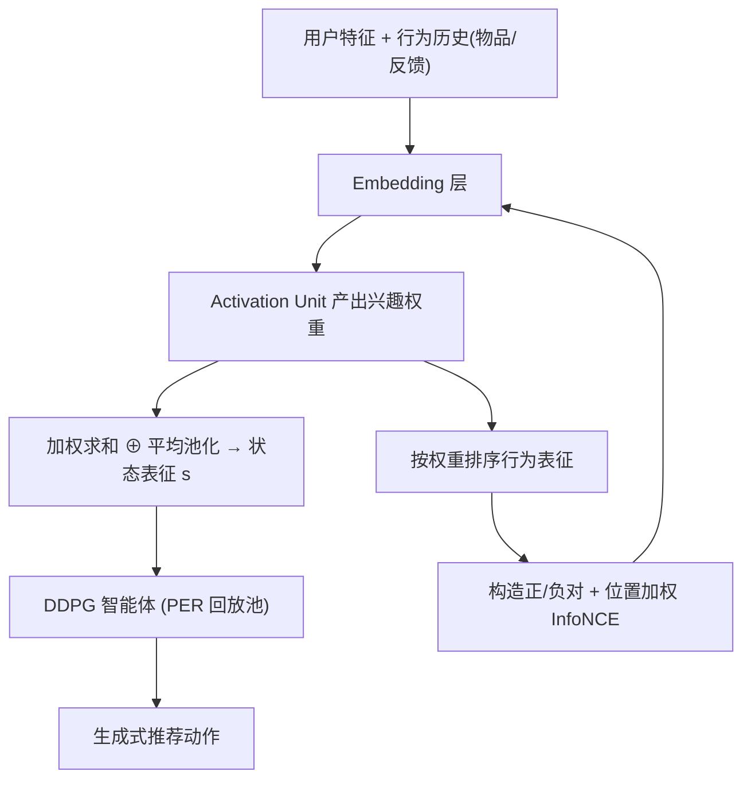

# Contrastive Representation for Interactive Recommendation (交互式推荐的对比表征学习)

- **会议/期刊**: AAAI 2025
- **作者与机构**: Jingyu Li, Zhiyong Feng, Dongxiao He, Hongqi Chen, Qinghang Gao, Guoli Wu（天津大学智能与计算学部）
- **推荐链路定位**: 端到端生成式（DRL 智能体直接生成推荐动作）
- **研究方向**: 强化学习与动态探索推荐 / 自监督对比学习与交互去噪
- **论文原文**: [https://arxiv.org/abs/2412.18396v3](https://arxiv.org/abs/2412.18396v3)
- **开源代码**: 暂未开源

## TL;DR (1分钟核心速览)

交互式推荐（IR）用 DRL 建模用户动态兴趣，但高维用户画像观测 + 大动作空间导致严重样本低效。本文提出 CRIR：一个基于 DIN 加权求和的状态表征网络产出"兴趣权重"，并配套偏好排序对比学习 PRCL——用兴趣权重排序构造正负对、以位置加权 InfoNCE 精炼表征，且完全绕开高维表征与全动作集计算。在 Virtual-Taobao 与 ML-1M 模拟器的全冷启动设置下，CRIR 约 8000 episode 即收敛到最优策略，而基线 20000 episode 仍未达到同等累计奖励。

## Background & Motivation (背景与核心矛盾)

- **主流范式**: IR 被建模为 MDP，用 DDPG/SAC/PPO 等 DRL 智能体在"推荐—反馈"闭环中优化累计奖励，天然兼顾短期点击与长期留存。
- **前人局限**: 其一，IR 必须把用户画像编码为高维观测，DRL 从高维观测学习本就样本低效，在线交互预算内难以收敛；其二，现有改进分三路（改 DRL 组件 / 加奖励信号 / 改状态表征），表征一路多采用前馈池化或 Transformer，未显式注入"用户此刻更偏好哪个历史行为"的语义。
- **核心洞察 (Key Insight)**: 传统推荐中的对比学习依赖静态大数据集与序列/图级表征约束，直接搬到 IR 会撞上三堵墙——交互历史样本不足、对比需遍历大动作集代价高、在线推荐与离线训练并行时对比任务稳定性未知。
- **本文切入点**: 复用状态表征网络已产出的**兴趣权重**作为免费监督信号：权重排序即偏好排序，据此在行为表征层面构造对比对，把对比学习降维到"行为级"而非"动作集级"。

## Method (核心方法设计)

### 1. 整体框架 (Overall Architecture)

CRIR 由状态表征网络与 PRCL 辅助任务构成，二者通过"兴趣权重"耦合。每步交互：用户特征与行为历史（物品特征 + 反馈）分别过 Embedding，经 DIN 式 Activation Unit 产出每个行为的兴趣权重 $\Lambda(u_t,h_\tau)$；权重既用于加权求和构造 RL 状态$s_{u,t}$，又用于对行为表征排序以生成对比正负对；PRCL 以位置加权 InfoNCE 精炼行为表征，主 DRL（DDPG + PER）照常从回放池采样更新策略。训练时 PRCL 与 DRL 并行独立执行，通过混合采样机制保证每条 transition 至少被对比学习覆盖一次。

### 2. 关键设计拆解 (Key Designs)

1. **兴趣权重驱动的状态表征网络**：痛点在于前馈池化丢失"此刻关注哪个行为"的显式强度。本文并行保留平均池化以稳住收敛，再拼接 DIN 加权求和项：
$s_{u,t}=\left(\frac{1}{t}\sum_{\tau=1}^{t}u_t\otimes h_\tau\right)\oplus\left(\sum_{\tau=1}^{t}\Lambda(u_t,h_\tau)\cdot h_\tau\right)$
直觉：平均项保底、加权项聚焦，权重本身还能二次利用为对比学习的排序依据，一鱼两吃。

2. **偏好排序对比学习 PRCL**：把原目标中对全动作集 $|\mathcal{A}_{s_t}|$的求和，用"最具代表性的行为表征"近似替代——取权重最大的行为$h^*=h_i,\ i=\arg\max_{i\le t}w_i$作为锚点，权重排名 2 至$\lfloor n/2\rfloor$的行为随机取一个作正样本，排名后$\lceil n/2\rceil$个作负样本，从而**免去高维表征与全动作集计算**。进一步用排名位置$R_u(h_k)$ 做判别性加权：
$\mathcal{L}_u(t)=-\frac{1}{\sqrt{R_u(h_k)}}\log\frac{\exp(h_k^\top h^*)}{\sum_{n\in\mathcal{N}_{s_t}}\exp(h_n^\top h^*)}$
直觉：排名越靠前的正样本越可信，权重越大，避免"均衡系数"抹平偏好强弱差异。

3. **混合采样与辅助训练机制**：PRCL 用两批数据——一批是下一轮 DRL 将用的 PER 采样批，一批回放池纯随机批，保证每条 transition 至少被对比一次（Mixed Mechanism）；训练上 PRCL 与 DRL 解耦并行（Auxiliary），而非把 $\mathcal{L}_{PRCL}$作为价值函数约束项$\mathcal{L}=\frac{1}{2}\delta^2+\gamma\mathcal{L}_{PRCL}$（Constrained）。实验证明解耦优于耦合，避免对比梯度干扰 TD 学习。

## Experimental Setup & Evaluation Protocol (实验设置与评估协议)

- **数据集与环境**: 传统静态数据集过稀疏无法提供逐步即时反馈，故采用两个模拟器：

| 环境 | 用户/物品规模 | 反馈特性 | 场景说明 |
| :--- | :---: | :---: | :--- |
| Virtual-Taobao | 淘宝真实交互仿真 | 奖励 $\ge 0$ | 连续动作空间，CTR 易饱和 |
| ML-1M-based Simulator | MovieLens-1M 构建 | 奖励 $\in[-1,1]$，正负约各半 | 额外注入兴趣漂移等动态特征 |

- **数据划分与防穿越**: 采用**全冷启动设置**——所有表征参数随机初始化，不加载任何预训练 Embedding，直接检验从零学习的样本效率。
- **排名评测协议**: 因 IR 为生成式决策任务，精度类指标（NDCG@K/HR@K）无法反映决策质量，故改用**逐 episode 累计奖励 $\sum_t r_t$** 与 **CTR（正奖励占比）**，以折线图呈现全训练过程而非静态表。
- **对比基线与超参**: SAC、CRR、PPO、DRR、NICF 五类基线，外加消融 `CRIR w/o CL`；每条曲线重复 5 次并给出 95% 置信区间；PRCL 频率、系数策略、采样/训练机制均做定量研究。

## Key Experimental Results (实验关键数据)

### 1. 主实验对比 (Main Results)

原文以训练曲线呈现，下表汇总冷启动收敛行为的关键定性/定量结论（"收敛 episode"指达到最终性能水平所需交互步）：

| 方法 | Virtual-Taobao 累计奖励 | VT 收敛 episode | ML-1M 累计奖励 | ML-1M 存活情况 |
| :--- | :---: | :---: | :---: | :---: |
| PPO | 低（冷启动学不到正确策略） | >20000 | 失败 | 2000 episode 内崩溃 |
| SAC | 低（CTR 偶有起色） | >20000 | 失败 | 2000 episode 内崩溃 |
| CRR | 低 | >20000 | 失败 | 2000 episode 内崩溃 |
| DRR | 中 | >20000 | 失败 | 2000 episode 内崩溃 |
| NICF | 中（离散动作设计，连续环境不兼容） | >20000 | 中 | 存活 |
| CRIR w/o CL | 中（前期领先，后期停滞） | ~未达最优 | 中（收敛慢于 CRIR） | 存活 |
| **CRIR** | **最高** | **~8000** | **最高** | **存活且最优** |

### 2. 消融实验 (Ablation Study)

| 配置 | 累计奖励 | CTR | 结论 |
| :--- | :---: | :---: | :--- |
| CRIR（完整） | 最优 | 最优 | — |
| w/o PRCL（仅表征网络） | 明显下降 | 下降 | PRCL 是主要增益来源 |
| PRCL 频率 0 → 0.25 → 0.5 → 0.75 → 1.0 | 单调上升、边际递减 | 同趋势但更平缓 | 0.25→0.5 增益远大于 0.5→0.75 |
| 均衡系数 $w\approx0.3183$替代$1/\sqrt{R_u}$ | 约等于频率 0.25 的水平 | 下降 | 判别性系数有效 |
| Divided / Combined 采样 | 均低于 Mixed | 同 | 混合采样最优 |
| Constrained 训练（$\gamma\in\{0,0.5,1.0\}$） | 几乎无提升 | 无提升 | 解耦辅助训练更优 |

### 3. 关键实验发现 (Key Findings)

1. **PRCL 是增益主引擎而非表征网络**：`CRIR w/o CL` 仅比 DRR 略好且后期停滞，而完整 CRIR 在 Virtual-Taobao 约 8000 episode 即达最优、基线 20000 episode 仍未追上，说明对比任务带来的表征精炼才是样本效率跃升的关键。
2. **CTR 会掩盖真实差距**：Virtual-Taobao 奖励非负导致多数基线 CTR 最终都爬到 0.8 附近，但累计奖励差距巨大——高奖励动作数量才是区分度所在，提示 IR 评测不能只看 CTR。
3. **对比频率存在饱和点、耦合训练有害**：频率从 0.25 提到 0.5 的增益显著大于 0.5 到 0.75，且 Constrained 机制下 $\gamma$ 取任何值都几乎无提升，证明"并行解耦 + 适度频率"是稳定训练的必要条件。

## Highlights & Limitations (亮点、对比与审稿批判)

- **与代表作对比 (vs. Prior Work)**: 相比 DRR（前馈状态表征 + DDPG 生成范式）与 NICF（多通道 Transformer 探索策略），CRIR 首次把对比学习引入 IR 的状态表征层；相比 CURL/SPR 等 DRL 视觉对比方法，本文不依赖图像增广，而是用**兴趣权重排序**这一推荐域原生信号构造正负对，规避了大动作集遍历。
- **可迁移亮点**: ①"辅助网络已产出的中间量（如注意力权重）直接复用为自监督排序信号"这一思路可迁移到任何带注意力池化的序列/会话推荐；②混合采样（PER 批 + 随机批）保证对比覆盖率的技巧对在线并行训练场景通用。
- **审稿级局限批判**: ①仅在两个模拟器上验证，Virtual-Taobao 奖励非负导致 CTR 指标饱和、区分度弱，缺乏真实线上 A/B 或公开离线 IR 基准；②PRCL 每步需额外一次前向与对比计算，论文未报告训练 wall-clock 开销与频率-延迟的权衡曲线；③正负对构造依赖"权重排名前 1 即最优偏好"的强假设，对兴趣剧烈漂移或噪声反馈的鲁棒性缺少分桶分析。

## Rating (四维评分)

- **方法创新性 (Novelty)**: ⭐⭐⭐⭐ （首次将对比学习下沉到 IR 状态表征层，兴趣权重复用为排序监督的思路简洁且有推荐域特色）
- **评估协议与实验扎实度 (Protocol & Experiments)**: ⭐⭐⭐ （双模拟器 + 5 次重复 + 95% CI + 频率/系数/采样/训练四组定量研究较完整，但缺真实数据与离线基准）
- **写作与数学规范度 (Clarity & Rigor)**: ⭐⭐⭐⭐ （从全动作集目标到行为级近似的推导链条清晰，公式与图示对应良好，复杂度分析略欠）
- **工业落地与复现价值 (Industrial & Practical Value)**: ⭐⭐⭐ （思路易工程化且与 DDPG/PER 解耦，但未开源、额外对比开销与线上收益待验证）

