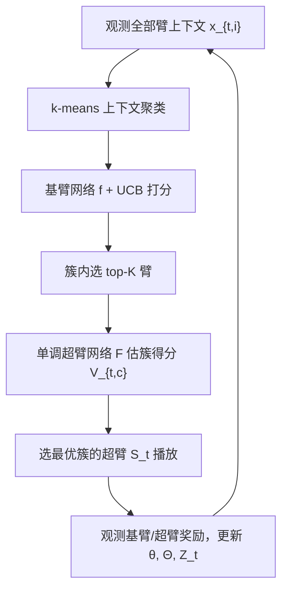
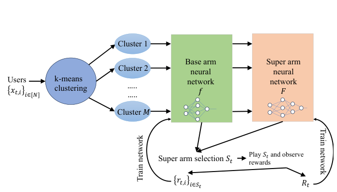

# Neural Combinatorial Clustered Bandits for Recommendation Systems (面向推荐系统的神经组合聚类老虎机)

- **会议/期刊**: AAAI 2025
- **作者与机构**: Baran Atalar, Carlee Joe-Wong (Carnegie Mellon University)
- **推荐链路定位**: 召回（在线探索式多物品组合选择）
- **研究方向**: 强化学习与动态探索推荐 / 冷启动与长尾推荐
- **论文原文**: [https://arxiv.org/abs/2410.14586v1](https://arxiv.org/abs/2410.14586v1)
- **开源代码**: 暂未开源

## TL;DR (1分钟核心速览)

上下文组合老虎机（CC-MAB）在推荐中需一次性选出 $K$个物品（超臂），但现有神经组合老虎机（如 CN-UCB）依赖一个**已知的精确/近似优化 oracle** 来从基臂奖励中挑超臂，而多数组合优化本身是 NP-hard、oracle 难以先验获得。本文提出 NeUClust：用**两个神经网络**分别学习基臂奖励$h$与超臂奖励$u$，并利用推荐场景上下文空间天然的**聚类结构**，先 k-means 聚类、再在簇内选 top-$K$、最后用单调超臂网络挑最优簇，从而**彻底去掉 oracle**。理论上证明达到$\tilde{O}(\tilde{d}\sqrt{T})$ 遗憾；在 MovieLens/Yelp 上累积遗憾 152/157，优于 CN-UCB（168/182）等全部基线。

## Background & Motivation (背景与核心矛盾)

- **主流范式**: CC-MAB 每轮观测全部臂的上下文，选固定大小 $K$ 的超臂，收到半臂反馈（基臂奖励 + 超臂奖励），目标是最小化累积超臂遗憾。近年用神经网络建模奖励以提升表达力（NeuralUCB / CN-UCB 系列）。
- **前人局限**: ① 现有神经/非神经组合老虎机几乎都要求存在**精确或近似 oracle**，给定各基臂估计奖励后输出超臂；但组合问题多为 NP-hard，oracle 往往无法先验导出。② 基于离散化（CC-MAB 超立方体划分）的方法在 $d$ 增大时严重退化（Yelp 171 维直接跑不动）。
- **核心洞察 (Key Insight)**: 推荐场景的上下文空间（用户类型/物品品类）天然具有**簇结构**——相似上下文的臂奖励相近、更可能同属最优超臂；且超臂奖励对基臂奖励**单调**（用户喜欢每个单品则更喜欢整组）。
- **本文切入点**: 用聚类结构 + 单调超臂网络替代 oracle，把"组合优化"降级为"选簇 + 簇内 top-$K$"。

## Method (核心方法设计)

### 1. 整体框架 (Overall Architecture)

每轮观测全部臂上下文 $\{x_{t,i}\}$，先对上下文做 k-means 聚类；基臂网络$f(\cdot;\theta)$输出各臂奖励估计并构造 UCB$v_{t,cj}=f(x_{t,cj};\theta_{t-1})+\gamma_t\|g(x_{t,cj};\theta_{t-1})/\sqrt{m}\|_{Z_{t-1}^{-1}}$；簇内取 UCB 最高的$K$个臂，连同单调超臂网络$F$的输出累加得簇得分$V_{t,c}$，选得分最高簇的超臂$S_t$播放；观测基臂/超臂奖励后更新上下文、$Z_t$与两网络参数。离线变体只在$t=1$ 聚类一次。

<figure class="paper-figure" markdown="span">
  <figcaption>图1：我们的神经上下文组合老虎机公式，以及用于臂选择的在线反馈循环。</figcaption>
</figure>

### 2. 关键设计拆解 (Key Designs)

1. **无 Oracle 的聚类式超臂选择**：痛点是没有 oracle 无法直接最大化超臂奖励 $\to$借助单调性把搜索限制在单簇内，先选簇再取簇内 top-$K$：$c'=\arg\max_c V_{t,c},\ S_t=b_{c'}$，其中$V_{t,c}=\sum_{a\in b_c}\big(v_{t,ca}+F(f(x_{t,b_c}))\big)$。直觉：同簇臂奖励相近，簇内 top-$K$近似全局最优，且把组合搜索复杂度从$\binom{N}{K}$降到$M\cdot N$。
2. **单调超臂网络**：为让理论假设成立且保证"基臂奖励升则超臂奖励不降"，对权重做非负变换 $o^{(k+1)}=\sigma(q(\Theta^{(k)})o^{(k)}+b^{(k)})$（$q$取 sigmoid，输出恒正）。这样$u(S,h)$ 的单调性由网络结构硬保证，无需额外约束。
3. **训练目标、负采样与推理效率**：两网络分别最小化带 $l_2$正则的平方损失$\mathcal{L}(\theta)=\frac12\sum_{t'}\|f(x_{t',S_{t'}};\theta)-r_{t'}\|_2^2+\frac{m\lambda_1}{2}\|\theta-\theta_0\|_2^2$，$\mathcal{L}(\Theta)=\sum_{t'}(F(f(x_{t',S_{t'}});\Theta)-R_{t'})^2+\frac{n\lambda_2}{2}\|\Theta-\Theta_0\|_2^2$；无负采样（bandit 半臂反馈），每轮$J=40$步 SGD。推理开销主要在每轮 k-means（$i_c=300$ 迭代）与两次前向，实测运行时间与 CN-UCB 同量级。

## Experimental Setup & Evaluation Protocol (实验设置与评估协议)

- **数据集与预处理**:

| 数据集 | #Users | #Items | #Interactions | 稀疏度/密度 | 特征/场景说明 |
| :--- | :---: | :---: | :---: | :---: | :--- |
| MovieLens 25M | ~10,000 | ~57,000 | ~5M | 极稀疏 | 仅保留 2015 年后评分、评过 ≥200 部电影的用户；$d=20$ 类型偏好向量 |
| Yelp Open | ~2M | ~50,000 餐厅 | ~7M 评论 | 极稀疏 | tf-idf 品类向量，$d=171$；每轮为来店用户选$K$ 家餐厅 |

- **数据划分与防穿越 (Splitting Strategy)**: 在线 bandit 模拟，$T=1000$ 轮顺序到达，无传统 train/test 划分；上下文随观测奖励在线更新（离线变体不更新）。
- **排名评测协议 (Ranking Protocol)**: 非排名指标，采用**累积超臂遗憾** $R(T)=\sum_t[u(S_t^*,h)-u(S_t,h)]$ 与累积超臂奖励；基臂奖励为"评分≥4.0"二值，超臂奖励为"≥80% 被选用户喜欢"的高度非线性二值函数。
- **对比基线与超参设置**: 基线 CN-UCB（单网络+精确 oracle）、Neural-MAB（双网络逐臂估贡献）、CC-MAB（超立方离散化）、K-LinUCB（线性+oracle）。$K=5$，$\eta_1=\eta_2=0.001$，$\lambda_1=\lambda_2=1$，$\gamma=1$，MovieLens 22 簇 / Yelp 20 簇；MovieLens 取 10 次、Yelp 取 5 次独立运行均值 ± std。

## Key Experimental Results (实验关键数据)

### 1. 主实验对比 (Main Results)

| 算法 | Regret (ML) ↓ | Runtime (ML) s | Regret (Yelp) ↓ | Runtime (Yelp) s |
| :--- | :---: | :---: | :---: | :---: |
| **NeUClust** | **152** | 486 | **157** | 1976 |
| CN-UCB | 168 | 332 | 182 | 1562 |
| Neural-MAB | 227 | 187 | 185 | 1317 |
| CC-MAB | 403 | 141 | — (崩溃) | — |
| K-LinUCB | 207 | 1352 | 282 | 81293 |

NeUClust 相对 CN-UCB 遗憾降低 **9.5% (ML) / 13.7% (Yelp)**；相对 K-LinUCB 降低 26.6% / 44.3%。

### 2. 消融实验 (Ablation Study)

原文未做严格组件消融，但通过簇数 $k$ 敏感性间接验证聚类模块贡献：

| 配置 | Regret (ML) | Regret (Yelp) |
| :--- | :---: | :---: |
| $k$ 过小（如 10 / 15） | 明显偏高 | 明显偏高 |
| **最优 $k$（22 / 20）** | **最低** | **最低** |
| $k$ 过大（如 30） | 上升 | 上升 |

### 3. 关键实验发现 (Key Findings)

1. **维度鲁棒性**：从 $d=20$（ML）到$d=171$（Yelp），NeUClust 遗憾不升反降（152→157 绝对值接近），而 CC-MAB 在 Yelp 上因离散化维度爆炸直接无法运行，说明聚类比离散化更能抗高维。
2. **去掉 oracle 的代价可控**：NeUClust 仅比带精确 oracle 的 CN-UCB 多约 10% 遗憾，却换来对 NP-hard 组合问题的通用性；且运行时间（486s vs 332s）仅小幅增加，远低于 K-LinUCB 的 1352s/81293s。
3. **聚类结构真实存在**：WCSS 肘部图显示 ML 最优簇数 10–20、Yelp 15–30，与遗憾曲线最优 $k$（22/20）一致，定量佐证"上下文空间天然成簇"这一核心假设。

## Highlights & Limitations (亮点、对比与审稿批判)

- **与代表作对比 (vs. Prior Work)**: 与 CN-UCB 的本质区别是**用第二个单调网络 + 聚类替代 oracle**，把超臂选择从"求解组合优化"变为"选簇+簇内 top-$K$"；与 Neural-MAB 的区别是后者逐臂估贡献、忽略组合结构；与 CC-MAB 的区别是用神经+聚类替代超立方离散化，避免维度灾难。
- **可迁移亮点**: ① "单调网络硬约束 + 聚类降搜索空间"可迁移到任何需要组合选择又缺 oracle 的在线推荐/广告分配场景；② 用 WCSS 肘部图先验确定簇数、再以遗憾曲线校准，是 bandit 超参选择的实用套路。
- **审稿级局限批判**: ① 理论遗憾对超臂大小 $K$存在**线性项**（源于去掉 oracle），弱于 CN-UCB 的次线性$K$；② 遗憾界依赖较强的聚类假设（Assumption 5/6：簇可分、均值向量无零元），若真实数据无簇结构或聚类错误会退化为线性遗憾；③ 实验仅在两个静态模拟数据集、$T=1000$上验证，缺乏真实线上 A/B 与更大$K$ 的检验。

## Rating (四维评分)

- **方法创新性 (Novelty)**: ⭐⭐⭐⭐ （首次用双神经网+聚类彻底替代组合老虎机 oracle，单调网络硬约束与 NTK 遗憾分析结合有新意）
- **评估协议与实验扎实度 (Protocol & Experiments)**: ⭐⭐⭐ （在线遗憾协议合理、多次运行带 std，但缺严格组件消融与真实线上验证）
- **写作与数学规范度 (Clarity & Rigor)**: ⭐⭐⭐⭐ （假设、引理、定理链条完整，聚类误差项 $E_t$ 分解清晰，附录证明详尽）
- **工业落地与复现价值 (Industrial & Practical Value)**: ⭐⭐⭐ （无需 oracle 利于落地、运行时间可控，但每轮 k-means + 双网络训练开销与强聚类假设限制大规模部署）

