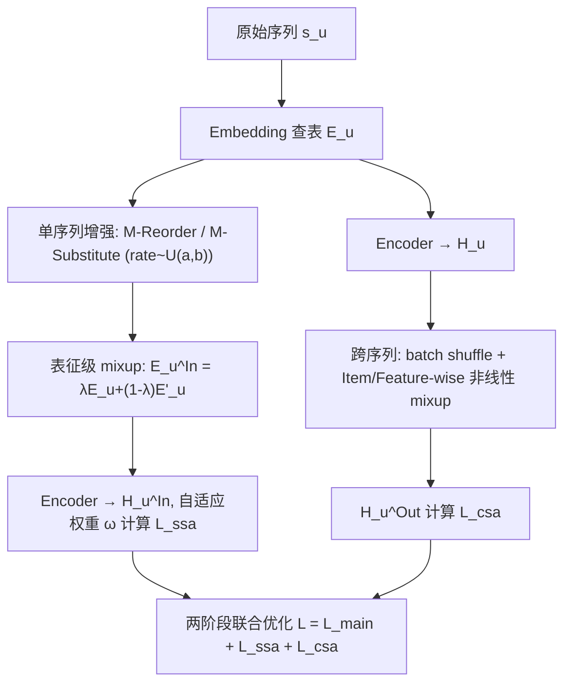

# Augmenting Sequential Recommendation with Balanced Relevance and Diversity (以平衡相关性与多样性的数据增强提升序列推荐)

- **会议/期刊**: AAAI 2025
- **作者与机构**: Yizhou Dang, Jiahui Zhang, Yuting Liu, Enneng Yang, Yuliang Liang, Guibing Guo, Jianzhe Zhao, Xingwei Wang（东北大学软件学院 / 计算机学院）
- **推荐链路定位**: 召回（序列 Next-Item 预测）
- **研究方向**: 序列与会话推荐 / 自监督与去噪
- **论文原文**: [https://arxiv.org/abs/2412.08300v3](https://arxiv.org/abs/2412.08300v3)
- **开源代码**: [https://github.com/KingGugu/BASRec](https://github.com/KingGugu/BASRec)

## TL;DR (1分钟核心速览)

现有序列推荐数据增强只关心"造新样本"，却忽视增强数据的**相关性（relevance）与多样性（diversity）失衡**：启发式算子（crop/mask/substitute）易造成语义漂移，可训练生成器（ASReP/CL4SRec）又过于保守。本文提出即插即用插件 BASRec，用"单序列随机算子 + 表征级 mixup + 自适应损失重加权"和"跨序列非线性 mixup"两条支路在表征空间合成新样本。在 4 个 Amazon/Yelp 数据集、`Leave-One-Out` + `Full-Ranking` 协议下，SASRec 平均提升 33.8%，GRU4Rec 达 72.0%，FMLP-Rec 达 68.5%，且不引入任何额外可学习参数。

## Background & Motivation (背景与核心矛盾)

- **主流范式**: 序列推荐（GRU4Rec/NextItNet/SASRec/FMLP-Rec）受数据稀疏困扰，主流缓解手段是数据增强——启发式算子直接编辑序列，或训练生成器/对比学习构造增强视图。
- **前人局限**: ① 启发式算子以固定 rate 随机替换/裁剪，可能删掉关键交互，造成**语义漂移（弱相关性）**；② 可训练生成器与对比目标把增强样本拉得与原样本过近，产出**过度保守（弱多样性）**的数据，性能增益有限。
- **核心洞察 (Key Insight)**: 相关性（保留原转移模式）与多样性（提供足够变化以探索细粒度偏好）本质冲突；直接在离散 item 层"合并两条增强序列"会破坏序列模式并残留无关/重复 item，因此**融合必须发生在表征空间**。
- **本文切入点**: 用表征级 mixup 把"随机算子带来的多样性"与"原序列表征带来的相关性"在同一向量中调和，并把增强从单用户扩展到跨用户协同语义。

## Method (核心方法设计)

### 1. 整体框架 (Overall Architecture)

输入原始序列 $s_u$经 Embedding 查表得$\mathbf{E}_u$，分两条独立支路：单序列支路用 M-Reorder / M-Substitute 生成$s'_u$并查表得$\mathbf{E}'_u$，再与$\mathbf{E}_u$做 mixup 得$\mathbf{E}^{In}_u$，编码后以自适应权重$\omega$计算$\mathcal{L}_{ssa}$；跨序列支路对 batch 内编码输出$\mathbf{H}_u$做 shuffle 后按 Item-wise / Feature-wise 非线性 mixup 得$\mathbf{H}^{Out}_u$，计算$\mathcal{L}_{csa}$。训练采用两阶段策略：第一阶段仅用$\mathcal{L}_{main}$学出高质量 item 表征，第二阶段联合$\mathcal{L}=\mathcal{L}_{main}+\mathcal{L}_{ssa}+\mathcal{L}_{csa}$；推理时全部增强模块关闭，模型规模与骨干完全一致。

### 2. 关键设计拆解 (Key Designs)

1. **M-Reorder / M-Substitute + 表征级 mixup（单序列支路）**：传统算子用固定 rate 编辑序列，要么改动过少（保守）要么删掉关键交互（漂移）。本文把 rate 改为从均匀分布采样以扩大增强空间，且**不直接使用编辑后的离散序列**，而是与原序列表征做凸组合：
$\mathbf{E}^{In}_u=\lambda\cdot\mathbf{E}_u+(1-\lambda)\cdot\mathbf{E}'_u,\quad \lambda\sim\mathrm{Beta}(\alpha,\alpha),\ \ rate\sim\mathrm{Uniform}(a,b)$直觉上，$\lambda$ 控制"注入多少新信息"，使样本天然落在原序列语义邻域内，从而同时获得变化与相关性。

2. **自适应损失重加权（Adaptive Loss Weighting）**：不同增强样本的"改动幅度"差异巨大，统一权重会让模型无法区分增强与原样本的偏离程度。作者用算子 rate 与 mixup 系数 $\lambda$ 构造权重并做 min-max 归一化：
$\omega^{(1)}=\frac{1}{rate\cdot\lambda},\quad \omega^{(2)}=\frac{\omega^{(1)}-\omega^{(1)}_{\min}}{\omega^{(1)}_{\max}-\omega^{(1)}_{\min}}$
改动越小（rate、λ 越大）权重越高，模型据此自适应地在"信任原偏好"与"探索新偏好"之间切换，提升鲁棒性。

3. **跨序列非线性 mixup（Item-wise / Feature-wise）**：线性 mixup 只能在一对样本的连线上取点，合成空间受限。逐参数赋权（nonlinear mixup）计算开销过大，本文将其分解为沿序列维（$\Lambda^I\in\mathbb{R}^{B\times N}$）与沿特征维（$\Lambda^F\in\mathbb{R}^{B\times D}$）两次 Hadamard 积混合：
$\{\mathbf{H}^{Out}_u\}=\Lambda^I\circ\{\mathbf{H}_u\}+(1-\Lambda^I)\circ\{\mathbf{H}'_u\}$其中$\{\mathbf{H}'_u\}$为 batch 内 shuffle 后的他人序列表征。这样合成的虚拟用户既保留原序列关键语义，又携带跨用户协同偏好，且正负样本同步混合。**训练目标**为$\mathcal{L}=\mathcal{L}_{main}+\mathcal{L}_{ssa}+\mathcal{L}_{csa}$，均为 BCE，负采样沿用骨干的 1 正 1 负随机采样（免额外难负样本挖掘）；由于无新增参数、混合仅为 Hadamard 积，总复杂度由$O((N^2+N)D|U|)$增至$O((N^2+N+Q)D|U|)$，同量级。

## Experimental Setup & Evaluation Protocol (实验设置与评估协议)

- **数据集与预处理**: 四个公开数据集，均过滤交互数 $<5$ 的用户/物品（`5-core`）：

| 数据集 | #Users | #Items | #Interactions | 稀疏度 | 场景说明 |
| :--- | :---: | :---: | :---: | :---: | :--- |
| Beauty | 22,363 | 12,101 | 198,502 | 99.92% | Amazon 美妆评论 |
| Sports | 35,958 | 18,357 | 296,337 | 99.95% | Amazon 运动户外 |
| Yelp | 30,431 | 20,033 | 316,354 | 99.95% | 本地商户（2019-01-01 后交易） |
| Home | 66,519 | 28,237 | 551,682 | 99.97% | Amazon 家居 |

- **数据划分与防穿越**: `Leave-One-Out`，每用户序列最后一项为测试、倒数第二项为验证、其余为训练。
- **排名评测协议**: 无偏 `Full-Ranking`（对全物品集排序，明确拒绝负采样排序以避免 Krichene & Rendle 指出的偏差）；指标 H@K、N@K，$K\in\{10,20\}$。
- **对比基线与超参设置**: 骨干 GRU4Rec / NextItNet / SASRec / FMLP-Rec；启发式基线 Ran、Ran-S、SW、CMR、CMRSI；可训练基线 ASReP、DiffuASR、CL4SRec。Embedding 维 $d=64$，batch 256，最大序列长 50，Adam lr=0.001；$\alpha\in\{0.2,\dots,0.6\}$、$a\in\{0.1,0.2,0.3\}$、$b\in\{0.6,0.7,0.8\}$；5 次运行取均值，配对 t 检验$p\le 0.05$。

## Key Experimental Results (实验关键数据)

### 1. 主实验对比 (Main Results)

BASRec 作为插件挂载于四种骨干（N@10 / H@10，Beauty 与 Sports 为例）：

| 骨干 | 数据集 | N@10 | H@10 | 提升 (N@10) |
| :--- | :--- | :---: | :---: | :---: |
| GRU4Rec | Beauty | 0.0208 → **0.0286** | 0.0412 → **0.0546** | +37.50% |
| GRU4Rec | Sports | 0.0069 → **0.0164** | 0.0146 → **0.0307** | +137.68% |
| NextItNet | Beauty | 0.0163 → **0.0202** | 0.0326 → **0.0365** | +23.93% |
| SASRec | Beauty | 0.0338 → **0.0455** | 0.0639 → **0.0810** | +34.62% |
| SASRec | Sports | 0.0174 → **0.0242** | 0.0320 → **0.0436** | +39.08% |
| SASRec | Home | 0.0078 → **0.0128** | 0.0149 → **0.0223** | +64.10% |
| FMLP-Rec | Beauty | 0.0298 → **0.0441** | 0.0563 → **0.0767** | +47.99% |
| FMLP-Rec | Home | 0.0071 → **0.0147** | 0.0134 → **0.0245** | +107.04% |

与增强类基线对比（SASRec 骨干，Beauty N@10）：Base 0.0338、CMRSI 0.0316、CL4SRec 0.0366、DiffuASR 0.0372、ASReP 0.0351、**BASRec 0.0455**；Yelp 上 BASRec 0.0164 略低于 CL4SRec 0.0176，为少数非最优情形。

### 2. 消融实验 (Ablation Study)

SASRec 骨干，N@10 / H@10：

| 变体 | Beauty | Sports | Yelp | Home |
| :--- | :---: | :---: | :---: | :---: |
| Base | 0.0338/0.0639 | 0.0174/0.0320 | 0.0136/0.0277 | 0.0078/0.0149 |
| w/o SA | 0.0415/0.0734 | 0.0209/0.0374 | 0.0152/0.0295 | 0.0097/0.0184 |
| w/o ALW | 0.0439/0.0778 | 0.0229/0.0415 | 0.0146/0.0297 | 0.0113/0.0201 |
| w/o CA | 0.0397/0.0721 | 0.0193/0.0353 | 0.0145/0.0290 | 0.0098/0.0170 |
| w/o NL | 0.0422/0.0752 | 0.0227/0.0412 | 0.0152/0.0300 | 0.0111/0.0197 |
| w/o Two | 0.0416/0.0742 | 0.0231/0.0411 | 0.0151/0.0304 | 0.0117/0.0207 |
| **BASRec** | **0.0455/0.0810** | **0.0242/0.0436** | **0.0164/0.0326** | **0.0128/0.0223** |

### 3. 关键实验发现 (Key Findings)

1. **跨序列支路贡献最大**：去掉 CA 后 Beauty N@10 从 0.0455 跌至 0.0397（-12.7%），跌幅超过去掉 SA（0.0415）与 ALW（0.0439），说明跨用户协同语义是增益主源；而 w/o NL 仅小幅回落，证明非线性分解是"锦上添花"而非必需。
2. **两阶段训练不可省**：w/o Two 在四个数据集上全面劣于完整模型（Beauty 0.0416 vs 0.0455），印证随机初始化表征在训练初期混合会互相污染、破坏收敛。
3. **相似度定量验证平衡性**：生成样本与原样本的平均余弦相似度上，CMRSI 仅 0.6539（相关性不足）、ASReP 0.9530 与 CL4SRec 0.9599（多样性不足），BASRec 为 0.9126，恰好落在"足够不同但保留语义"的中间带，与性能最优一致。

## Highlights & Limitations (亮点、对比与审稿批判)

- **与代表作对比 (vs. Prior Work)**: 相比 CMRSI/CL4SRec 在离散 item 层编辑序列，BASRec 把增强搬到表征空间，避免破坏序列模式；相比 ASReP/DiffuASR 需训练额外生成器，BASRec 零新增参数、模型无关；相比 ReDA 依赖特定骨干，本文在 RNN/CNN/Transformer/MLP 四类架构上均验证有效。
- **可迁移亮点**: ① "随机 rate + 表征凸组合 + 幅度自适应重加权"三件套可直接移植到图推荐/CTR 的样本增广；② Item-wise/Feature-wise 分解把非线性 mixup 的 $O(ND)$ 逐参数赋权降为两次 Hadamard 积，是低成本近似技巧。
- **审稿级局限批判**: ① 跨序列 mixup 需 batch 内 shuffle，效果对 batch 组成敏感，且第二阶段训练开销随混合次数 $Q$线性增长，论文未给出线上时延实测；② 超参$\alpha,a,b$需逐数据集网格搜索（最优$\alpha$ 在 0.3–0.5 间波动），且 Yelp 上不及 CL4SRec，说明对长序列/商户类分布并非普适占优。

## Rating (四维评分)

- **方法创新性 (Novelty)**: ⭐⭐⭐⭐ （把"相关性-多样性"张力显式建模为表征空间 mixup 的凸组合系数，视角清晰，但 mixup 本身非全新）
- **评估协议与实验扎实度 (Protocol & Experiments)**: ⭐⭐⭐⭐⭐ （四数据集 × 四骨干 × 三类基线，`Full-Ranking` 无偏协议 + 配对 t 检验 + 相似度定量分析，覆盖完整）
- **写作与数学规范度 (Clarity & Rigor)**: ⭐⭐⭐⭐ （公式简洁、复杂度分析到位，但两阶段切换时机与 $Q$ 的取值缺乏敏感性讨论）
- **工业落地与复现价值 (Industrial & Practical Value)**: ⭐⭐⭐⭐⭐ （零新增参数、模型无关插件、代码开源，推理阶段完全关闭增强，落地成本极低）

