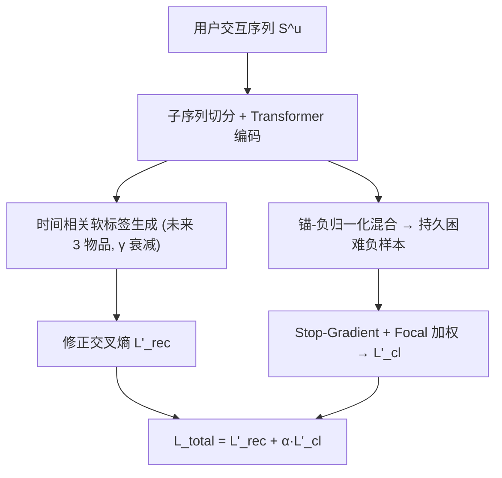
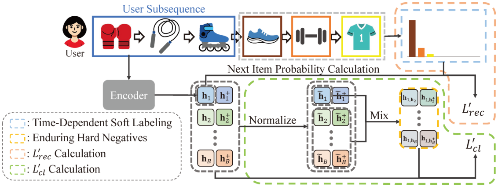

# Future Sight and Tough Fights: Revolutionizing Sequential Recommendation with FENRec (以未来视野与硬仗革新序列推荐)

- **会议/期刊**: AAAI 2025
- **作者与机构**: Yu-Hsuan Huang, Ling Lo, Hongxia Xie, Hong-Han Shuai, Wen-Huang Cheng（阳明交通大学 / 吉林大学 / 台湾大学）
- **推荐链路定位**: 召回（序列编码器 + 对比学习辅助训练）
- **研究方向**: 序列与会话推荐 / 自监督对比学习与交互去噪
- **论文原文**: [https://arxiv.org/abs/2412.11589v4](https://arxiv.org/abs/2412.11589v4)
- **开源代码**: [https://github.com/uikdwnd/FENRec](https://github.com/uikdwnd/FENRec)

## TL;DR (1分钟核心速览)

序列推荐受困于交互稀疏，主流对比学习方案存在两个盲点：交叉熵只用"下一个物品"做二值标签，浪费了序列中本就存在的后续交互；对比损失靠随机批内采样取负，训练后期负样本与锚点相似度持续衰减、不再"够硬"。FENRec 提出**时间相关软标签**（把第 2、3 个未来物品按指数衰减权重纳入监督）与**持久困难负样本**（锚点与负样本归一化混合，并加 stop-gradient 与 focal 式加权）。在 Sports/Beauty/Toys/Yelp 四个基准上采用全库排序评测，HIT 与 NDCG 平均相对提升 6.34% / 5.99%，总平均 6.16%。

## Background & Motivation (背景与核心矛盾)

- **主流范式**: SASRec 类 Transformer 序列编码器 + 对比学习（CL4SRec 掩码/裁剪增广、DuoRec 同下一物品序列作正视图、ICLRec/ICSRec 意图聚类对齐）已成缓解稀疏的标准配方。
- **前人局限一**: 监督信号仍是 one-hot 二值标签，只盯第 $|S^u|+1$ 个物品；而子序列切分后，第 2、3 个后续物品在训练数据中**明明可见**，却被当作全零负类丢弃，标签信息利用率低。
- **前人局限二**: 负样本取自批内随机采样，随训练推进锚点与随机负样本的内积相似度持续下降（图 2 中 epoch 5→50 分布左移），后期梯度信号趋弱，对稀疏用户尤其不利。
- **核心洞察 (Key Insight)**: 稀疏数据的信息量不在"多采"，而在"榨干"——未来交互可作软监督，已有负样本可经混合改造为**始终靠近锚点**的持久困难负样本（附录 Lemma 2 证明混合后与锚点内积严格大于原负样本）。
- **本文切入点**: 不改骨干网络，仅替换交叉熵标签与对比损失两项，即可即插即用地嵌入任意对比学习序列推荐框架。

## Method (核心方法设计)

### 1. 整体框架 (Overall Architecture)

用户序列切分为子序列后经 Transformer 编码为 $\boldsymbol{h}_{u_s}$；上半支依据子序列在原序列中的位置回溯出"未来窗口"（下一物品及其后 2 个），生成时间衰减软标签并计算修正交叉熵$\mathcal{L}'_{rec}$；下半支对批内表示做 L2 归一化，将锚点与负样本按比例$\lambda$混合生成持久困难负样本，配合 stop-gradient 与 tanh 相似度重加权构造$\mathcal{L}'_{cl}$；两损失加权求和端到端训练，推理时仅保留序列编码器与 softmax 全库打分，无额外开销。

<figure class="paper-figure" markdown="span">
  <figcaption>图3：我们方法FENRec的框架：用户序列首先被拆分为子序列并编码为表示，同时基于子序列生成软标签。接下来，生成持久困难负样本并将其纳入对比学习框架。最后，L1</figcaption>
</figure>

### 2. 关键设计拆解 (Key Designs)

1. **时间相关软标签 (Time-Dependent Soft Labeling)**：痛点是把未来 2、3 个物品当负类会制造假负样本。做法是将子序列之后至多 3 个物品按位置距离做指数衰减归一化分配概率，其余物品置零：
$$y'_{u_s,i}=\frac{\gamma^{\,\mathrm{pos}(v_i)-(|S^{u_s}|+1)}}{\sum_{j=|S^{u_s}|+1}^{\min(|S^{u_s}|+3,|S^u|+1)}\gamma^{\,j-(|S^{u_s}|+1)}}$$
其中 $\gamma$ 越小分布越尖锐（越自信），越大越平滑（越承认不确定性）。直觉：把"用户接下来大概率还会碰什么"编码进标签，等价于零成本的标签平滑 + 未来信息蒸馏，且无需任何额外模块或教师模型。

2. **持久困难负样本 (Enduring Hard Negatives)**：痛点是随机负样本后期"不够硬"。做法是先归一化批内表示，再按 $\lambda$ 混合锚点与负样本并缩放回负样本原范数：
$$\boldsymbol{h}^-_{i,n}=\frac{\lambda\tilde{\boldsymbol{h}}_i+(1-\lambda)\tilde{\boldsymbol{n}}}{\|\lambda\tilde{\boldsymbol{h}}_i+(1-\lambda)\tilde{\boldsymbol{n}}\|_2}\cdot\|\boldsymbol{n}\|_2$$
由于混合向量方向被拉向锚点，$\boldsymbol{h}^-_{i,n}\cdot\boldsymbol{h}_i>\boldsymbol{n}\cdot\boldsymbol{h}_i$恒成立（Lemma 2），负样本在整个训练过程中保持高相似度。关键细节：对生成负样本施加$\mathrm{SG}(\cdot)$阻断梯度，否则锚点会被"自己的一部分"错误推开；同时借 focal-infoNCE 思路用$s(a,b)=\tanh(a^\top b/\tau_2)$ 对困难负样本上权，缓解假负样本被过度惩罚。

3. **训练目标、负采样与推理效率**：总损失 $\mathcal{L}_{total}=\mathcal{L}'_{rec}+\alpha\big(\mathcal{L}'_{cl}(\boldsymbol{h}_i,\boldsymbol{h}^+_i)+\mathcal{L}'_{cl}(\boldsymbol{h}^+_i,\boldsymbol{h}_i)\big)$，负样本来自批内（batch size 256）+ 句表示噪声扰动，另叠加混合困难负样本；超参$\tau_1=1,\mu=0.1,m=0.2,\tau_2\in\{8,10\}$，困难负样本在 20 epoch 预热后才注入。推理阶段与 SASRec 完全一致，仅一次前向 + 全库内积，无额外延迟。

## Experimental Setup & Evaluation Protocol (实验设置与评估协议)

- **数据集与预处理**: 三个 Amazon 类目（Sports/Beauty/Toys）+ Yelp（2019-01-01 之后记录），沿用 ICLRec/ICSRec 的 5-core 过滤与序列切分惯例；嵌入维度 $d=64$，最大序列长度 50，短补长截。

| 数据集 | 领域 | 序列长度分布特点 | 说明 |
| :--- | :---: | :---: | :--- |
| Sports | Amazon 体育 | 长序列用户占比高 | 稀疏类目 |
| Beauty | Amazon 美妆 | 含大量短序列（冷启动近似） | 稀疏度最高 |
| Toys | Amazon 玩具 | 中等长度为主 | 稀疏类目 |
| Yelp | 本地商户 | 短序列用户受益更明显 | 2019 年后切片 |

- **数据划分与防穿越 (Splitting Strategy)**: 沿用 SR 标准 `Leave-One-Out` 式序列切分（每用户最后一项测试、倒数第二项验证），子序列由前缀构造，未来窗口严格取自当前子序列之后的位置，无穿越。
- **排名评测协议 (Ranking Protocol)**: 无偏 `Full-Ranking`（对全物品集排序，遵循 Krichene & Rendle 2020 的全库评测建议），指标 HR@{5,10,20} 与 NDCG@{5,10,20}；三次重复取均值并报告标准差，多数指标通过 $p<0.05$ 显著性检验。
- **对比基线与超参设置**: 三类基线——通用序列模型（GRU4Rec、Caser、SASRec、LRURec、BSARec）、自监督/对比学习模型（BERT4Rec、MAERec、CL4SRec、CoSeRec、CBiT、ICLRec、DuoRec、ICSRec）、标签平滑模型（MVS）；FENRec 以 ICSRec 为宿主框架，批大小 256（MVS 因显存降至 64）。

## Key Experimental Results (实验关键数据)

### 1. 主实验对比 (Main Results)

选取 7 个代表性基线（SASRec 骨干、最强对比学习 ICSRec、标签平滑 MVS、近期最强 BSARec 等），核心指标如下：

| 数据集 | 指标 | SASRec | BSARec | ICSRec | MVS | **FENRec** | Improv. |
| :--- | :---: | :---: | :---: | :---: | :---: | :---: | :---: |
| Sports | HIT@20 | 0.0491 | 0.0830 | 0.0767 | 0.0775 | **0.0890** | +7.23% |
| Sports | NDCG@20 | 0.0207 | 0.0401 | 0.0379 | 0.0378 | **0.0429** | +6.98% |
| Beauty | HIT@20 | 0.0905 | 0.1345 | 0.1273 | 0.1305 | **0.1393** | +3.57% |
| Beauty | NDCG@20 | 0.0385 | 0.0682 | 0.0654 | 0.0667 | **0.0702** | +2.93% |
| Toys | HIT@20 | 0.0982 | 0.1405 | 0.1355 | 0.1323 | **0.1462** | +4.06% |
| Toys | NDCG@20 | 0.0468 | 0.0747 | 0.0731 | 0.0710 | **0.0775** | +3.75% |
| Yelp | HIT@20 | 0.0418 | 0.0704 | 0.0700 | 0.0654 | **0.0776** | +10.23% |
| Yelp | NDCG@20 | 0.0166 | 0.0285 | 0.0288 | 0.0271 | **0.0319** | +10.76% |

### 2. 消融实验 (Ablation Study)

| 数据集 | 配置 | HIT@20 | NDCG@20 | 相对完整模型 |
| :--- | :---: | :---: | :---: | :---: |
| Sports | FENRec | 0.0890 | 0.0429 | — |
| Sports | w/o 软标签 (S) | 0.0806 | 0.0396 | −9.4% / −7.7% |
| Sports | w/o 困难负样本 (N) | 0.0869 | 0.0417 | −2.4% / −2.8% |
| Beauty | FENRec | 0.1393 | 0.0702 | — |
| Beauty | w/o S | 0.1317 | 0.0673 | −5.5% / −4.1% |
| Beauty | w/o N | 0.1363 | 0.0687 | −2.2% / −2.1% |
| Yelp | FENRec | 0.0776 | 0.0319 | — |
| Yelp | w/o S | 0.0740 | 0.0304 | −4.6% / −4.7% |
| Yelp | w/o N | 0.0738 | 0.0301 | −4.9% / −5.6% |

### 3. 关键实验发现 (Key Findings)

1. **软标签是主贡献，困难负样本是放大器**：去掉 S 在 Sports 上 HIT@20 掉 9.4%，普遍大于去掉 N 的跌幅；但两者互补——软标签承认兴趣模糊性，恰好抵消困难负样本把"真感兴趣物品"误判为负类的假阴性风险，故单独保留 N 的收益有限、组合后最优。
2. **即插即用性得到验证**：将 FENRec 的两个损失替换进 CL4SRec 与 DuoRec，DuoRec 上平均提升 4–9%（Toys HIT@20 +8.98%），CL4SRec 上提升较小甚至个别指标微降（Beauty NDCG@5 −0.86%），说明增广策略保真度（DuoRec 保意图 vs. CL4SRec 掩码破坏语义）决定收益上限。
3. **长尾与冷启动场景稳健**：按序列长度分桶（<8 / 8–20 / ≥20）后 FENRec 全面领先，Beauty 短序列桶（近似冷启动）同样最优；同时 $\ell_{uniform}$ 与 NDCG@20 呈负相关，FENRec 显著提升物品表示均匀性，证明其学到的是更具判别力的表征而非单纯拟合热门。

## Highlights & Limitations (亮点、对比与审稿批判)

- **与代表作对比 (vs. Prior Work)**: 相比 CL4SRec/DuoRec 依赖数据或模型增广构造正视图，FENRec 不动正样本、只改标签与负样本两侧，正交且可叠加；相比 MVS 需互补教师模型生成软标签，本文软标签零额外参数；相比 ICSRec 的意图聚类对齐，本文直接利用序列内生的未来位置信息，无需聚类超参。
- **可迁移亮点**: ①"未来窗口指数衰减软标签"可直接移植到 CTR 多目标或生成式推荐的监督构造；②"锚-负混合 + stop-gradient + 范数还原"是通用困难负样本增广算子，可迁移至双塔召回与图对比学习。
- **审稿级局限批判**: ①未来窗口固定为 3 个物品、$\gamma/\lambda$需逐数据集网格搜索，缺乏自适应机制，且对噪声大的长序列（如 Yelp 长尾）可能引入无关未来物品；②困难负样本依赖批内混合，批大小 256 下假阴性风险随$\lambda$ 增大而放大，论文仅在附录给出敏感性曲线，未在更大规模工业数据或在线 A/B 上验证收益与训练开销。

## Rating (四维评分)

- **方法创新性 (Novelty)**: ⭐⭐⭐⭐ （两个改动都极简，但"未来交互作软标签"与"混合式持久困难负样本"的组合有 Lemma 2 的理论支撑，属小而准的增量创新）
- **评估协议与实验扎实度 (Protocol & Experiments)**: ⭐⭐⭐⭐ （四数据集全库排序 + 三次重复 + $p<0.05$ 显著性 + 跨框架兼容性实验，消融与分桶分析完整；缺在线验证）
- **写作与数学规范度 (Clarity & Rigor)**: ⭐⭐⭐⭐ （公式与符号定义清晰，附录给出困难负样本内积严格大于原负样本的证明；部分超参敏感性分析被挤到附录）
- **工业落地与复现价值 (Industrial & Practical Value)**: ⭐⭐⭐⭐⭐ （仅替换损失、推理零额外开销、代码开源，可直接嵌入现有 SASRec/ICSRec 训练管线）

