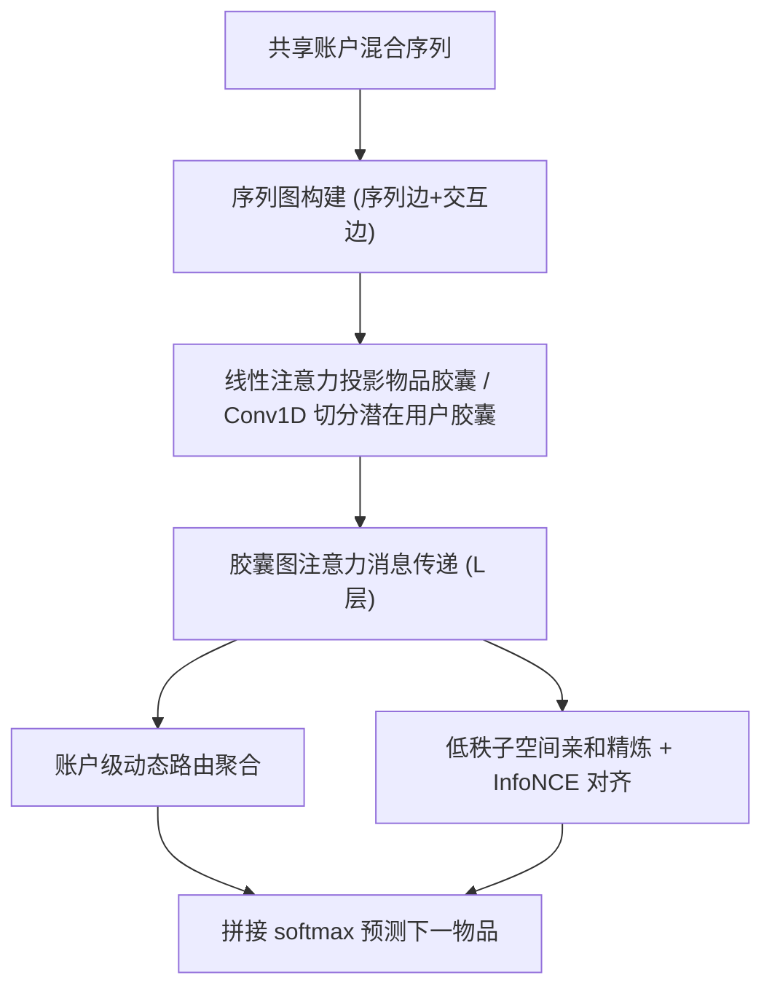
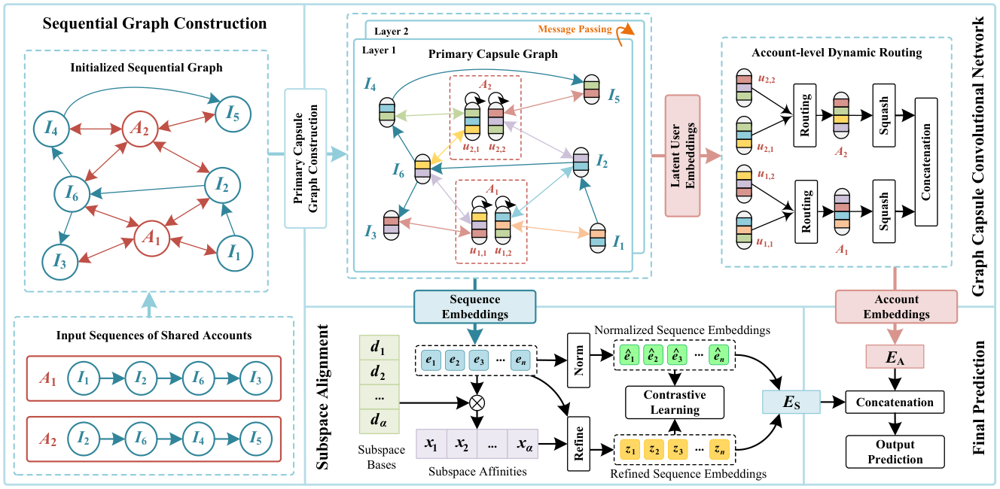

# Lightweight yet Fine-grained: A Graph Capsule Convolutional Network with Subspace Alignment for Shared-account Sequential Recommendation (轻量而细粒度：面向共享账户序列推荐的图胶囊卷积网络与子空间对齐)

- **会议/期刊**: AAAI 2025
- **作者与机构**: Jinyu Zhang, Zhongying Zhao, Chao Li (山东科技大学), Yanwei Yu (中国海洋大学)
- **推荐链路定位**: 召回（下一物品预测）
- **研究方向**: 序列与会话推荐 / 自监督对比学习
- **论文原文**: [https://arxiv.org/abs/2412.13408v1](https://arxiv.org/abs/2412.13408v1)
- **开源代码**: [https://github.com/ZZY-GraphMiningLab/LightGC2N](https://github.com/ZZY-GraphMiningLab/LightGC2N)

## TL;DR (1分钟核心速览)

共享账户的混合序列由多个潜在用户交织产生，现有 SSR 方法（RNN 类梯度消失、GCN+自注意力类二次复杂度）既无法判定"每条交互归属哪个潜在用户"，又难以部署到端侧。本文提出 LightGC$^2$N：用线性注意力把物品投影为胶囊、在胶囊图上做注意力消息传递实现交互-潜在用户的细粒度匹配，再用低秩子空间基+InfoNCE 对齐精炼序列表征。在 4 个真实数据集上，HV-E 的 Recall@5 从 54.11 提升到 61.35（相对 +13.4%），HA-M 的 MRR@5 从 20.91 提升到 41.30（相对 +97.5%），同时参数量与训练耗时均低于所有 SSR 基线。

## Background & Motivation (背景与核心矛盾)

- **主流范式**: SSR 早期用 GRU 过滤账户信息（π-Net、PSJNet），近期转向序列图上的多头自注意力/聚类（DA-GCN、TiDA-GCN）来"模拟"账户内的多兴趣。
- **前人局限**: 其一，这些方法只在账户级序列上做聚类或注意力，**从不显式判定每条交互的归属**，潜在用户表征天然粗粒度；其二，自注意力与自表示矩阵聚类均为 $O(N^2)$ 复杂度，参数量与训练时间难以支撑移动端部署。
- **核心洞察 (Key Insight)**: 共享账户的偏好本质是"少数低秩子空间（每个潜在用户一个）的叠加"，因此既可以用胶囊把交互升维到可分辨的细粒度空间，也可以用低秩子空间基替代昂贵的自表示聚类。
- **本文切入点**: 以"胶囊图消息传递 + 账户级动态路由"完成细粒度归属判定，以"低秩子空间亲和 + 对比对齐"完成序列级精炼，两处均把复杂度压到线性。

## Method (核心方法设计)

### 1. 整体框架 (Overall Architecture)

输入为共享账户的混合序列，先构建含"物品-物品序列边"与"账户-物品交互边"的序列图；GC$^2$N 将物品经线性注意力投影为物品胶囊、账户经 Conv1D 投影并切分为$\alpha$ 个潜在用户胶囊，在胶囊图上做注意力消息传递，再由账户级动态路由聚合出账户表征；SA 分支用 K-means 初始化的低秩子空间基计算亲和度精炼序列嵌入，与归一化序列嵌入做 InfoNCE 对齐；最后拼接序列与账户表征经 softmax 输出下一物品分布。

<figure class="paper-figure" markdown="span">
  <figcaption>图2：LightGC2N 的框架，其中 A1 和 A2 表示两个共享账户，{I1, I2, . . . , I6} 表示构成这些账户混合序列的历史交互。</figcaption>
</figure>

### 2. 关键设计拆解 (Key Designs)

1. **线性注意力胶囊投影（把 $O(N^2)$换成$O(Nd_2)$）**：标准自注意力先算$QK^\top$再乘$V$，复杂度随序列长度平方增长；本文调换计算顺序先算$K^\top V$再乘$Q$，即$C_I^{(0)}=Q\,\mathrm{softmax}\!\left(\frac{K^\top V}{\sqrt{d_1}}\right)W_l+b_l$。直觉上注意力图被压缩为$d_1\times d_2$的全局统计量，既保留全局关联又把长混合序列的开销降为线性。账户侧因账户间无序列关系，改用 kernel=1、stride=1 的 Conv1D 投影为$\alpha$ 个潜在用户胶囊。

2. **胶囊图注意力消息传递 + 账户级动态路由（细粒度归属判定）**：痛点是 GCN 把每条交互当独立节点，无法表达"这条交互属于谁"。本文用潜在用户胶囊与物品胶囊的内积做注意力权重 $a_{I_j}=\frac{\exp(C_{u_{k,h}}\cdot C_{I_j})}{\sum_{I_q\in\mathcal{N}^{A_k}_I}\exp(C_{u_{k,h}}\cdot C_{I_q})}$，消息为$m^{(l)}_{u_{k,h}\leftarrow I_j}=W_1^{(l)}C^{(l-1)}_{I_j}+W_2^{(l)}(a^{(l-1)}_{I_j}C^{(l-1)}_{I_j})$，并保留自连接$W_3^{(l)}C^{(l-1)}_{u_{k,h}}$。随后用$\theta=3$次动态路由，以耦合系数$b_p^{(j)}=b_p^{(j-1)}+W_d\sum_h(E_{u_{k,h}}\odot\tilde{C}^{(j)}_{A_k})$ 迭代更新，经 squash 压缩得到账户胶囊——路由强度即"该潜在用户对账户偏好的贡献度"，天然可解释。

3. **低秩子空间对齐与训练目标**：自表示矩阵聚类需 $O(N^2)$且在高维原空间操作。SA 以 K-means 列空间初始化子空间基$D\in\mathbb{R}^{\alpha\times d_2}$，亲和度$s_{ij}=\frac{|e_i^\top d_j|_F^2+\lambda d_2}{\sum_{j}(|e_i^\top d_j|_F^2+\lambda d_2)}$，精炼$z_i=e_i\cdot s_{ij}$，再以$\mathcal{L}^S_C=-\sum_{\hat{e}_i\in\hat{E}_{S_k}}\log\frac{\exp(\hat{e}_i\odot z_i/\beta)}{\sum_{j\in\mathcal{I}}\exp(\hat{e}_i\odot z_j/\beta)}$对齐。总损失$\mathcal{L}=\mathcal{L}_S+\gamma\mathcal{L}_C$，$\mathcal{L}_S$ 为下一物品交叉熵；**无需负采样**（全库 softmax + 批内对比负例），推理仅需一次前向。

## Experimental Setup & Evaluation Protocol (实验设置与评估协议)

- **数据集与预处理**: 四个 SSR 数据集（HV-E/HV-V 为智能电视教育/影视域，HA-M/HA-B 为 Amazon 电影/图书域，后者由 2–4 个用户合并模拟共享账户，序列按年切分并剔除任域交互少于 5 条的序列）：

| 数据集 | #Accounts | #Items | #Interactions | 训练/测试序列 | 场景说明 |
| :--- | :---: | :---: | :---: | :---: | :--- |
| HV-E | 13,714 | 8,367 | 2,129,500 | 114,197 / 20,152 | 智能电视教育内容 |
| HV-V | 13,714 | 11,404 | 1,893,784 | 114,197 / 20,152 | 智能电视影视内容 |
| HA-M | 13,724 | 67,161 | 2,196,574 | 122,303 / 21,582 | Amazon 电影评论 |
| HA-B | 13,724 | 126,547 | 2,135,995 | 122,303 / 21,582 | Amazon 图书评论 |

- **数据划分与防穿越 (Splitting Strategy)**: 按序列 `80%/20%` 随机划分训练/测试，每条序列**最后一个物品**作为 ground truth（类 Leave-One-Out 的末位预测设定）。
- **排名评测协议 (Ranking Protocol)**: 报告 Recall@{5,20} 与 MRR@{5,20}；原文未显式声明全库排序，从指标口径与基线惯例推断为全候选打分（未采用采样负例排序），对比时需注意该协议细节缺失。
- **对比基线与超参设置**: 9 个基线分三类——传统（NCF、LightGCN）、序列（HRNN、NAIS、TGSRec）、SSR（π-Net、PSJNet、DA-GCN、TiDA-GCN）；所有方法统一 embedding 维度 $d=16$，batch=256，lr=0.005，dropout=0.1，200 epochs，Adam + Xavier 初始化；SSR 基线均按跨域设定（HV-E↔HV-V、HA-M↔HA-B 迁移）报告其最优性能。

## Key Experimental Results (实验关键数据)

### 1. 主实验对比 (Main Results)

| 数据集 | 指标 | NCF | LightGCN | HRNN | TGSRec | π-Net | DA-GCN | TiDA-GCN | **LightGC$^2$N** | Improv.% |
| :--- | :--- | :---: | :---: | :---: | :---: | :---: | :---: | :---: | :---: | :---: |
| HV-E | R@5 | 11.25 | 20.70 | 22.55 | 19.91 | 25.13 | 51.35 | 54.11 | **61.35** | +13.4% |
| HV-E | MRR@5 | 5.77 | 11.55 | 13.76 | 13.95 | 15.36 | 35.63 | 38.66 | **46.24** | +19.6% |
| HV-V | R@5 | 27.21 | 58.45 | 68.00 | 58.91 | 67.00 | 75.39 | 76.37 | **79.29** | +3.8% |
| HV-V | MRR@5 | 22.99 | 54.00 | 60.58 | 50.32 | 60.37 | 59.78 | 63.58 | **66.27** | +4.2% |
| HA-M | R@5 | 7.82 | 15.54 | 16.96 | 14.59 | 18.54 | 22.93 | 23.55 | **46.02** | +95.4% |
| HA-M | MRR@5 | 2.72 | 12.88 | 13.75 | 11.91 | 16.24 | 20.09 | 20.91 | **41.30** | +97.5% |
| HA-B | R@5 | 8.31 | 21.14 | 20.92 | 14.57 | 22.44 | 23.93 | 24.69 | **47.36** | +91.8% |
| HA-B | MRR@5 | 7.92 | 15.58 | 17.04 | 15.74 | 20.38 | 21.35 | 21.88 | **44.40** | +102.9% |

效率侧：HV-E 上模型体积 8.75MB，对比 DA-GCN 14.57MB、π-Net 32.71MB、TiDA-GCN 35.40MB、PSJNet 76.20MB；HV-V 上 11.20MB vs. 89.06MB（PSJNet），训练耗时随数据比例增长亦最平缓。

### 2. 消融实验 (Ablation Study)

| 变体 | HV-E R@5 | HV-E MRR@5 | HV-V R@5 | HV-V MRR@5 |
| :--- | :---: | :---: | :---: | :---: |
| w/o C（胶囊图→普通 GCN） | 53.46 | 35.42 | 73.12 | 61.72 |
| w/o S（去掉 SA） | 57.96 | 40.51 | 75.12 | 62.88 |
| w/o LA（线性注意力→Conv1D） | 58.33 | 39.71 | 76.01 | 63.17 |
| w/o DR（去掉动态路由） | 59.86 | 40.52 | 77.33 | 64.22 |
| w/o CL（去掉对比学习） | 59.96 | 43.51 | 77.02 | 64.85 |
| w/o A（全部移除） | 22.90 | 16.26 | 60.58 | 54.94 |
| **LightGC$^2$N** | **61.35** | **46.24** | **79.29** | **66.27** |

### 3. 关键实验发现 (Key Findings)

1. **胶囊图是最大增益源**：把 GC$^2$N 换成普通 GCN（w/o C）在 HV-E 上 R@5 掉 7.89 个点、MRR@5 掉 10.82 个点，远超去掉 SA（3.39/5.73）与去掉路由（1.49/5.72），说明"交互-潜在用户细粒度归属"而非"序列精炼"才是 SSR 的核心瓶颈。
2. **Amazon 域增益远大于电视域**：HA-M/HA-B 上 MRR@5 相对提升接近 100%，而 HV-V 仅约 4%；合理解释是 Amazon 数据由 2–4 个真实用户人工合并、潜在用户数更接近 $\alpha$的设定且偏好更可分，而电视域家庭共享的偏好重叠更严重，也提示$\alpha$ 固定假设在真实重叠场景下是主要误差来源。
3. **超参敏感但可解释**：$\alpha$在 HV-E 与 HA-M 上的最优值不同（对应不同场景真实共享人数差异），$\beta,\gamma$在 0.8–0.9 时最佳，$L=2$ 后性能下滑（胶囊图上仍存在过平滑），说明轻量化设计与精度之间存在明确的"两层即够"的甜点。

## Highlights & Limitations (亮点、对比与审稿批判)

- **与代表作对比 (vs. Prior Work)**: 相比 π-Net/PSJNet 的 GRU 分流，本文用胶囊+路由显式建模归属而非隐状态过滤；相比 DA-GCN/TiDA-GCN 的账户级多头注意力，本文把注意力下沉到"潜在用户-物品"胶囊对，并把两处 $O(N^2)$ 算子（自注意力、自表示聚类）分别替换为线性注意力与低秩子空间亲和，是"精度与效率同向改进"而非权衡。
- **可迁移亮点**: (1) 用 K-means 列空间初始化低秩子空间基 + InfoNCE 对齐，可作为任意序列推荐器的轻量自监督正则插件；(2) 动态路由的耦合系数天然给出"潜在用户贡献度"，可直接用于共享账户的可解释归因或家庭画像拆分。
- **审稿级局限批判**: (1) 每个账户的潜在用户数 $\alpha$需人工预设且全数据集统一，而真实家庭共享人数各异，作者亦在结论中承认此为未来工作，缺少自适应$\alpha$ 的推断机制；(2) 评测协议未明确声明是否为全库排序，且仅报告 Recall/MRR 而无 NDCG，HA 系列数据由人工合并构造，与真实共享账户分布存在偏差，泛化性证据偏弱。

## Rating (四维评分)

- **方法创新性 (Novelty)**: ⭐⭐⭐⭐ （胶囊图+动态路由做交互归属判定、低秩子空间替代自表示聚类，两处替换均有清晰复杂度动机，但胶囊与子空间对齐本身均为已有组件的组合式创新）
- **评估协议与实验扎实度 (Protocol & Experiments)**: ⭐⭐⭐ （四个数据集、九个基线、六组消融与效率对比较完整，但划分与排序协议描述含糊、缺 NDCG 与显著性检验、HA 数据为合成共享账户）
- **写作与数学规范度 (Clarity & Rigor)**: ⭐⭐⭐⭐ （公式与符号体系完整、附录给出算法伪码与理论动机，复杂度分析明确；部分符号如 $b_p$与$s_{ij}$ 的下标含义需结合附录才能完全对齐）
- **工业落地与复现价值 (Industrial & Practical Value)**: ⭐⭐⭐⭐⭐ （代码已开源，参数量 8.75MB、线性复杂度、无需负采样，直接契合端侧与家庭共享账户场景的部署约束）

