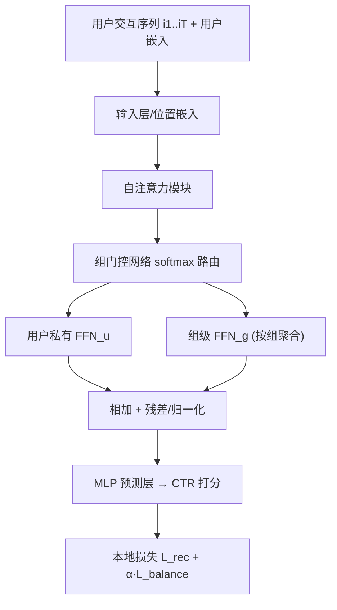
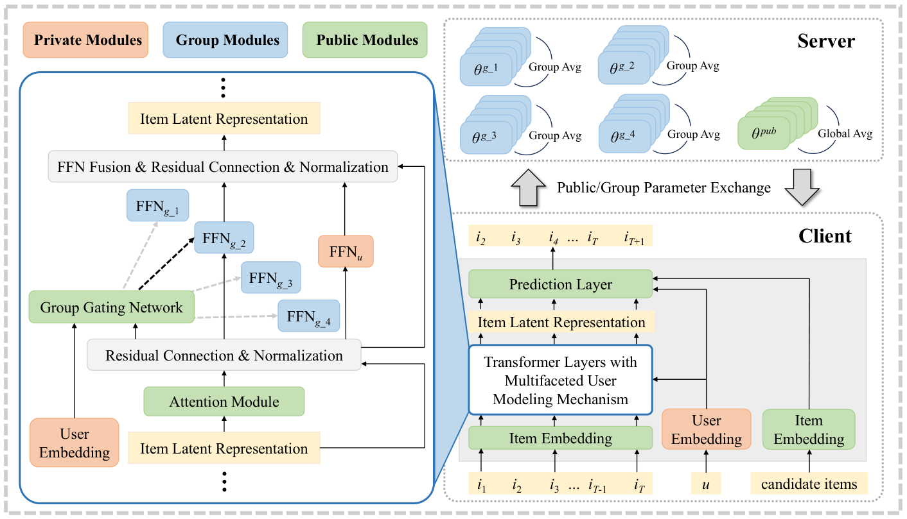

# Multifaceted User Modeling in Recommendation: A Federated Foundation Models Approach (联邦基础模型下的多面向用户建模推荐)

- **会议/期刊**: AAAI 2025 (Regular Paper)
- **作者与机构**: Chunxu Zhang, Guodong Long, Hongkuan Guo, Zhaojie Liu, Guorui Zhou, Zijian Zhang, Yang Liu, Bo Yang（吉林大学、悉尼科技大学 AAII、快手、清华大学 AIR）
- **推荐链路定位**: 精排（CTR 预估）
- **研究方向**: 序列与会话推荐 / 去偏公平、可信隐私与工业架构
- **论文原文**: [https://arxiv.org/abs/2412.16969v1](https://arxiv.org/abs/2412.16969v1)
- **开源代码**: [https://github.com/Zhangcx19/AAAI-25-MRFF](https://github.com/Zhangcx19/AAAI-25-MRFF)

## TL;DR (1分钟核心速览)

联邦基础模型推荐（FFM4Rec）面临两大痛点：一是直接微调大规模预训练模型对端侧设备算力/部署负担过重，二是朴素联邦对所有客户端学同一套参数，与"个性化推荐"目标相悖。本文提出 MRFF：每个客户端从零训练约 60k 参数的轻量 Transformer，并在每层注意力后插入**组门控网络**，将用户分层路由到组级 FFN，与用户私有 FFN 并联前向；服务器按组聚合组级参数、全局聚合公共参数。在 KuaiRand-Pure / KuaiSAR-R / KuaiSAR-S 三个真实数据集上，以 Leave-One-Out 划分、AUC/LogLoss 评估，作为即插模块使 FedSASRec/FedHSTU/FedLLaMA 全面增益，AUC 最高相对提升 1.16%，LogLoss 最高下降 33.75%。

## Background & Motivation (背景与核心矛盾)

- **主流范式**: FM4RecSys 借助 Transformer 自注意力捕捉序列化用户-物品交互，再通过微调或嵌入方式适配推荐任务；FFM 则用联邦学习在分布式私有数据上协同训练基础模型。
- **前人局限**: ① 现有 FFM 普遍从大规模预训练模型出发优化，端侧部署与算力开销巨大；② 朴素联邦把所有客户端一视同仁、学同一模型，无法刻画用户异质性，与个性化推荐直接冲突。
- **核心洞察 (Key Insight)**: 用户既"各不相同"（需私有参数保个性）又"彼此相似"（可借组级参数共享相关性）；且用户兴趣是多面向、分层次的——浅层 Transformer 捕捉通用画像，深层刻画细分行为段。
- **本文切入点**: 用"用户私有 FFN + 组门控路由的组级 FFN"在每层 Transformer 内同时建模个体与群体，并把组级参数放到服务器按组聚合，兼顾个性化与隐私。

## Method (核心方法设计)

### 1. 整体框架 (Overall Architecture)

每个客户端本地持有一个轻量 Transformer 推荐模型（输入层→若干 Transformer Block→MLP 预测层），从零训练而非加载预训练权重。核心改造在 Transformer Block 内部：自注意力输出先经**组门控网络**判定用户所属组，再分别送入该用户的私有 FFN 与对应组级 FFN，二者相加后经残差/归一化继续前向。训练时用户嵌入与私有 FFN 永不上传；组级 FFN 由服务器按组内平均聚合，其余公共参数（注意力、嵌入表等）全局平均聚合。多轮通信后，客户端用本地模型对候选物品打分完成 CTR 预估。

<figure class="paper-figure" markdown="span">
  <figcaption>图1：MRFF 框架。右侧展示了本方法的工作流程。每个客户端使用个人数据训练一个轻量级基础模型。在本地模型的 transformer 层中，我们提出多面向用户建模机制以增强用户个性化，细节总结于左侧。具体而言，我们在注意力模块后引入组门控网络，将用户导向特定 FFN，并与用户特定 FFN 一起用于前向传播。在服务器与客户端之间的迭代优化过程中，客户端维护用户嵌入和用</figcaption>
</figure>

### 2. 关键设计拆解 (Key Designs)

1. **组门控网络与分层路由（Group Gating Network）**：痛点在于单一共享 FFN 无法区分异质用户。本文将门控置于每层注意力之后，以注意力上下文与用户嵌入拼接作为输入，用 MLP+softmax 输出组归属概率：
   $P_u = \mathrm{softmax}\big(\mathrm{MLP}(\mathrm{Concat}(\mathrm{Attention}_{out}, \boldsymbol{u}_{emb}))\big)$
   取 argmax 组索引。由于每层独立门控，形成"浅层粗粒度画像→深层细粒度行为段"的层次化发现，这正是"多面向"的物理直觉来源。

2. **双路 FFN 并联前向（User-specific + Group-level）**：每层前向改为
   $x_{out} = \mathrm{FFN}_u(\mathrm{Attention}(x_{in})) + \mathrm{FFN}_g(\mathrm{Attention}(x_{in}))$
   私有 FFN 吸收个体非线性偏好、组级 FFN 借相似用户共享统计强度，二者相加实现"个性+共性"的协同，而非二选一。

3. **平衡损失与联邦聚合策略**：门控易塌缩到少数组，故约束组分配接近均匀分布：
   $\mathcal{L}_{balance} = N \cdot \sum_{l=1}^{L}\sum_{i=1}^{N} f_i^l \cdot p_i^l$其中$f_i^l$为第$l$层第$i$组实际用户占比、$p_i^l$为预测概率。总损失$\mathcal{L}_u = \mathcal{L}_{rec} + \alpha \cdot \mathcal{L}_{balance}$，$\mathcal{L}_{rec}$ 为 CTR 的二元交叉熵。聚合上：私有 FFN 与用户嵌入留本地，组级 FFN 按组内平均、公共参数全局平均，显著降低上传参数量与通信开销；无需负采样（CTR 逐样本二分类）。

## Experimental Setup & Evaluation Protocol (实验设置与评估协议)

- **数据集与预处理**: 三个真实（工业来源）数据集，CTR 任务：

| 数据集 | 场景说明 | 特点 |
| :--- | :--- | :--- |
| KuaiRand-Pure | 快手纯推荐日志 | 序列化用户行为，含随机曝光 |
| KuaiSAR-R | 快手搜索+推荐统一数据（推荐侧） | 跨场景行为 |
| KuaiSAR-S | 快手搜索+推荐统一数据（搜索侧） | 跨场景行为 |

- **数据划分与防穿越 (Splitting Strategy)**: `Leave-One-Out`（遵循 SASRec 设定），最后一条交互作测试。
- **排名评测协议 (Ranking Protocol)**: CTR 二分类评估，指标为 **AUC**（排序质量）与 **LogLoss**（校准度），非全库排序/采样排序范式。
- **对比基线与超参设置**: 非序列基线 FedNCF、FedPA；Transformer 基线 FedSASRec、FedHSTU、FedLLaMA（分别以 SASRec/HSTU/LLaMA 为骨干）。Transformer 块数统一为 2，通信轮数 500，实验重复 5 次取均值，显著性用双侧 t 检验 $p<0.05$。平衡损失系数$\alpha \in \{0.0001,0.001,0.01,0.1\}$，组数$\beta \in \{2,4,6,8\}$。

## Key Experimental Results (实验关键数据)

### 1. 主实验对比 (Main Results)

| 骨干/方法 | KuaiRand-Pure AUC↑ | LogLoss↓ | KuaiSAR-R AUC↑ | LogLoss↓ | KuaiSAR-S AUC↑ | LogLoss↓ |
| :--- | :---: | :---: | :---: | :---: | :---: | :---: |
| FedNCF | 0.7109 | 0.9793 | 0.6710 | 2.5670 | 0.5357 | 2.6338 |
| FedPA | 0.6842 | 0.5935 | 0.6707 | 0.8055 | 0.5464 | 1.0655 |
| FedSASRec | 0.7297 | 0.5181 | 0.7007 | 0.7105 | 0.5707 | 0.7034 |
| **+ MRFF** | **0.7315** | **0.4953** | **0.7070** | **0.6583** | **0.5755** | **0.5259** |
| Improv. | +0.25% | -4.60% | +0.90% | -7.93% | +0.84% | -33.75% |
| FedHSTU | 0.7304 | 0.5171 | 0.7030 | 0.7338 | 0.5725 | 0.7041 |
| **+ MRFF** | **0.7330** | **0.4949** | **0.7064** | **0.6426** | 0.5735 | 0.5987 |
| Improv. | +0.36% | -4.49% | +0.48% | -14.19% | +0.17% | -17.60% |
| FedLLaMA | 0.7302 | 0.5167 | 0.7003 | 0.7152 | 0.5724 | 0.7024 |
| **+ MRFF** | 0.7311 | **0.4972** | **0.7084** | **0.6554** | **0.5787** | **0.5730** |
| Improv. | +0.12% | -3.92% | +1.16% | -9.12% | +1.10% | -22.58% |

### 2. 消融与敏感性分析 (Ablation & Sensitivity)

| 配置 | 关键结论 |
| :--- | :--- |
| 无 MRFF（骨干原版） | 各骨干基线，AUC 普遍低于 +MRFF 版本 |
| w/ MRFF（完整） | 三骨干、三数据集全面最优或持平 |
| 平衡损失 $\alpha=0$（无约束） | 组分配塌缩，性能下降（图 2 显示无约束时组分布不均） |
| $\alpha$扫描$\{10^{-4},10^{-3},10^{-2},10^{-1}\}$|$\alpha=0.1$ 时三数据集均最优 |
| 组数 $\beta \in \{2,4,6,8\}$|$\beta=2$粒度不足性能下降；$\beta=6$更优但参数膨胀；$\beta=4$ 为性价比拐点 |
| 差分隐私噪声强度 0→0.5 | AUC 仅小幅下降（如 KuaiRand-Pure 0.7315→0.7297），隐私-性能折中良好 |

### 3. 关键实验发现 (Key Findings)

1. **Transformer 序列建模是增益前提**：非序列 FedNCF/FedPA 在 KuaiSAR-S 上 AUC 仅 0.5357/0.5464，而 FedSASRec 达 0.5707，说明 MRFF 的组级个性化建立在序列依赖建模之上，二者互补而非替代。
2. **LogLoss 改善远大于 AUC**：AUC 提升仅 0.12%–1.16%，但 LogLoss 最多下降 33.75%（KuaiSAR-S 上 FedSASRec），表明组级参数共享主要修正了预测校准/置信度分布，而非单纯排序边界，这对 CTR 出价与排序融合极具价值。
3. **平衡损失是组级个性化的"开关"**：图 2 显示训练中两组 Transformer 块的用户分配逐渐收敛到每组约 800 人的均匀分布；去掉该约束则门控塌缩、组级 FFN 退化为少数用户专属，验证了"均匀路由→公平利用用户相关性"的因果链。

## Highlights & Limitations (亮点、对比与审稿批判)

- **与代表作对比 (vs. Prior Work)**: 相较 FedPA（微调大规模预训练基础模型）与 FedNCF（单一共享 DNN），MRFF 的本质区别是"从零训练轻量模型 + 层内组门控双路 FFN"，把个性化从"参数隔离"升级为"层次化群体路由"；相较 MoE 类稀疏门控（Shazeer 2016），本文门控面向用户分组而非 token 专家，并显式加平衡损失防塌缩。
- **可迁移亮点**: ① 组门控+平衡损失的"均匀路由"技巧可直接移植到任何 MoE/多场景推荐的专家分配；② 私有/组级/公共三划分的参数聚合协议，是联邦推荐中兼顾通信效率与个性化的通用模板。
- **审稿级局限批判**: ① 仅在 CTR 二分类、Leave-One-Out 划分下评估，缺少 Top-K 全库排序与冷启动分桶实验，泛化性证据偏窄；② 组数 $\beta$与$\alpha$ 需逐数据集调参，且每层独立门控带来额外前向开销与路由不稳定风险，论文未给出通信轮数-精度的收敛曲线对比。

## Rating (四维评分)

- **方法创新性 (Novelty)**: ⭐⭐⭐⭐ （层内组门控+双路 FFN 的层次化多面向建模思路清晰，但 MoE 式路由本身非全新，创新在"用户分组"语义与联邦聚合的耦合）
- **评估协议与实验扎实度 (Protocol & Experiments)**: ⭐⭐⭐ （三真实数据集+三骨干+5 次重复+t 检验较规范，但仅 CTR/LOO 协议，缺 Top-K 排序与冷启动分桶）
- **写作与数学规范度 (Clarity & Rigor)**: ⭐⭐⭐⭐ （框架图与公式（4)(5)(7) 定义清楚，平衡损失与聚合策略交代完整，复杂度分析略简）
- **工业落地与复现价值 (Industrial & Practical Value)**: ⭐⭐⭐⭐⭐ （约 60k 参数、单次测试 <0.1s、代码开源、含差分隐私实验，端侧部署与隐私合规价值突出）

