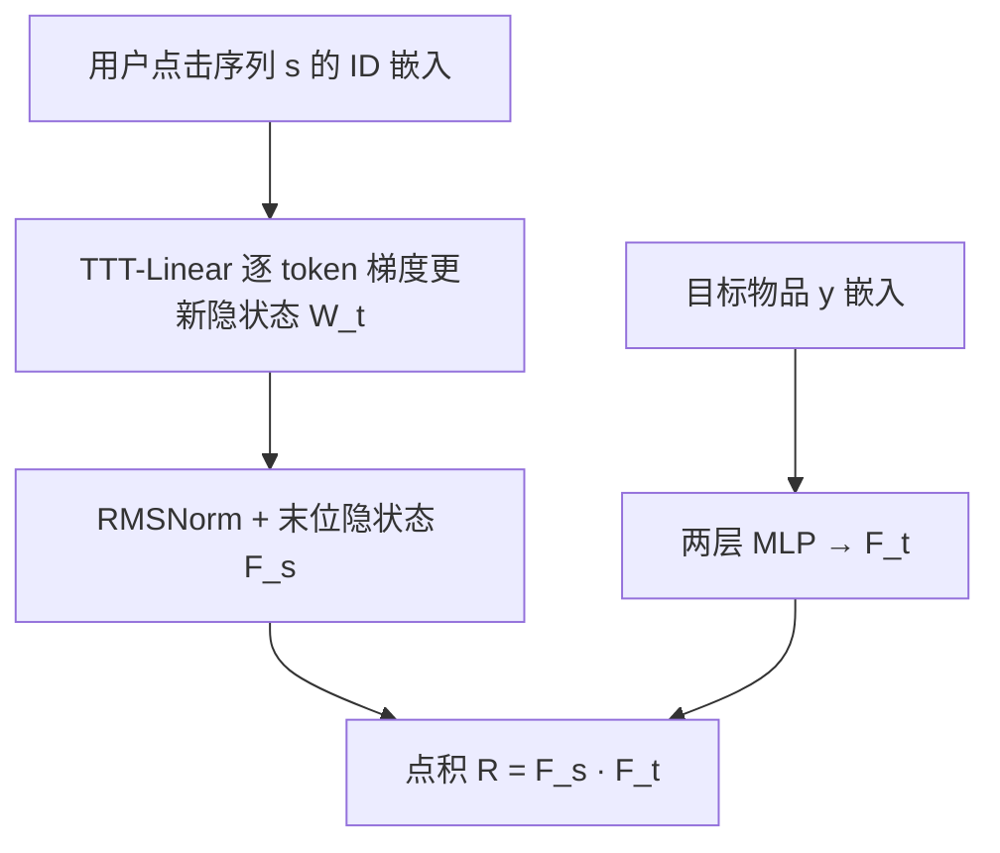
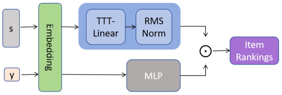

# Preliminary Evaluation of the Test-Time Training Layers in Recommendation System (Student Abstract)（测试时训练层在推荐系统中的初步评估）

- **会议/期刊**: AAAI 2025 (Student Abstract and Poster Program)
- **作者与机构**: Tianyu Zhan, Zheqi Lv, Shengyu Zhang, Jiwei Li（浙江大学）
- **推荐链路定位**: 召回（序列特征编码）
- **研究方向**: 序列与会话推荐 / 自监督与鲁棒表征
- **论文原文**: [https://arxiv.org/abs/2411.15186v1](https://arxiv.org/abs/2411.15186v1)
- **开源代码**: 暂未开源

## TL;DR (1分钟核心速览)

本文针对序列推荐中 Transformer 注意力在短上下文场景下计算冗余、训练收敛慢的痛点，提出 TTT4Rec：用 TTT-Linear 层替换自注意力作为序列特征提取器，把用户点击序列当作无标签数据集，对每个 token 做一步自监督梯度下降来更新隐状态权重。在 Beauty / Electronics / ML-1M 三个数据集、1:99 负采样排序协议下，TTT4Rec 作为 base model 在 NDCG@10 与 HR@5 上追平甚至小幅超越 SASRec 与 ComiRec，且 Beauty 上 1 个 epoch 即达到 ComiRec 需 50 个 epoch 才达到的 NDCG@5 水平。

## Background & Motivation (背景与核心矛盾)

- **主流范式**: 序列推荐以 SASRec/BERT4Rec 的因果自注意力、GRU4Rec 的循环结构、ComiRec 的多兴趣解耦为代表，均依赖"固定参数 + 前向推理"的范式。
- **前人局限**: 其一，自注意力对短序列（推荐场景典型长度 10–50）存在明显的表达冗余与二次复杂度开销；其二，ComiRec 类多兴趣模型虽精度尚可，但收敛极慢（Beauty 上需 50 epoch），工业训练成本高。
- **核心洞察 (Key Insight)**: TTT 层（Sun et al. 2024）把"上下文压缩"重构成"在线学习一个微型模型"，其 TTT-Linear 变体在短上下文下精度与效率均优于 TTT-MLP，恰好匹配推荐序列"短、快、高频"的特性。
- **本文切入点**: 不做新损失、不改召回结构，仅做一次"架构替换"的可行性验证——把 TTT-Linear 当作序列编码器插进标准双塔式打分框架。

## Method (核心方法设计)

### 1. 整体框架 (Overall Architecture)

输入实例为 $X=\{u,v,s\}$，其中$s=\{v_i\}_{i=1}^{N}$为用户点击序列。物品 ID 经嵌入层得到$\mathbf{e}_v\in\mathbb{R}^{K}$，序列嵌入集送入 TTT-Linear 层做逐 token 的隐状态更新与特征提取，输出经 RMSNorm 归一化后取最后一个有效点击位置的隐状态$\mathbf{F}_s$作为序列表征。目标物品$y$复用同一嵌入层得到$\mathbf{e}_y$，经两层 MLP 得$\mathbf{F}_t$，最终以点积$\hat{R}=\mathbf{F}_s\cdot\mathbf{F}_t$ 给出点击概率。整个链路是标准"序列编码 + 目标编码 + 内积"结构，唯一变量是编码器本体。

<figure class="paper-figure" markdown="span">
  <figcaption>图1：推荐系统中TTT-Linear的模型架构</figcaption>
</figure>

### 2. 关键设计拆解 (Key Designs)

1. **TTT-Linear 作为序列编码器（把上下文当数据集在线拟合）**：痛点是自注意力用固定权重处理任意长度上下文，短序列下参数利用率低。TTT 的做法是把历史 $x_1,\dots,x_t$视为无标签数据集、把隐状态$s_t$视为模型权重$W_t$，输出与更新分别为$z_t=f(x_t;W_t)$与$W_t=W_{t-1}-\eta\nabla\ell(W_{t-1};x_t)$。直觉上，序列每来一个 token 就"现场微调"一次线性模型，隐状态本身就是对用户兴趣的压缩模型，而非被动拼接的向量；线性形式使该更新可写成闭式并行扫描，避免二次注意力开销。

2. **目标侧轻量化与共享嵌入**：为节省资源，目标物品不单独建塔，而是复用序列嵌入层取 $\mathbf{e}_y$，再经两层 MLP 升维到与$\mathbf{F}_s$ 同空间。这一设计让模型参数量几乎全部集中在 TTT 层，符合"base model 对照实验"的定位，也避免了双塔不对称带来的额外调参负担。

3. **训练目标、负采样与推理效率**：损失沿用标准 softmax 交叉熵（正样本 + 负采样），训练阶段按 $1{:}4$采样负例，测试阶段按$1{:}99$采样以逼近真实排序分布；学习率固定$0.001$，除 ComiRec 训练 50 epoch 外其余模型均 10 epoch 内收敛。推理时 TTT 层对每条序列独立生成$W_1,\dots,W_T$，属于"测试时也训练"的范式，单条序列开销为$O(T)$步线性更新，短序列下显著低于注意力的$O(T^2)$。

## Experimental Setup & Evaluation Protocol (实验设置与评估协议)

- **数据集与预处理**: 采用三个公开数据集，未报告 5-core 等显式过滤细节与统计量（学生摘要篇幅所限）：

| 数据集 | 领域 | 序列特征 | 说明 |
| :--- | :---: | :---: | :--- |
| Amazon Beauty | 电商 | 短序列 | 稀疏、长尾显著 |
| Amazon Electronics | 电商 | 短序列 | 品类跨度大 |
| MovieLens-1M | 电影 | 中短序列 | 稠密、交互量大 |

- **数据划分与防穿越 (Splitting Strategy)**: 原文未明确说明划分方式（未标注 Leave-One-Out 或时间戳切分），这是本摘要的实验透明度短板。
- **排名评测协议 (Ranking Protocol)**: 采用 `Sampled Ranking`，训练负采样比 $1{:}4$，测试负采样比$1{:}99$；指标为 NDCG@{5,10} 与 HR@{5,10}。
- **对比基线与超参设置**: 基线含 DIN、GRU4Rec、SASRec、ComiRec（ComiSA / ComiDR 两变体）；嵌入维度 $K$与显著性检验未报告；统一学习率$0.001$、10 epoch（ComiRec 50 epoch）。

## Key Experimental Results (实验关键数据)

### 1. 主实验对比 (Main Results)

| 数据集 | 模型 | NDCG@5 | NDCG@10 | HR@5 | HR@10 |
| :--- | :--- | :---: | :---: | :---: | :---: |
| Beauty | SASRec | 0.2512 | 0.2849 | 0.3854 | 0.4893 |
| Beauty | ComiDR | 0.2582 | **0.2925** | 0.3833 | **0.4902** |
| Beauty | **TTT4Rec** | 0.2571 | 0.2890 | **0.3866** | 0.4848 |
| Electronic | GRU4Rec | 0.3450 | 0.3844 | 0.4666 | 0.5882 |
| Electronic | SASRec | 0.3420 | 0.3821 | 0.4641 | 0.5881 |
| Electronic | **TTT4Rec** | **0.3486** | **0.3892** | **0.4712** | **0.5968** |
| ML-1M | SASRec | 0.5217 | 0.5574 | 0.6790 | **0.7919** |
| ML-1M | **TTT4Rec** | **0.5239** | **0.5577** | **0.6834** | 0.7877 |

相对提升：Electronic 上 TTT4Rec 对最强基线 GRU4Rec 的 NDCG@10 提升约 $+1.25\%$、HR@10 提升约$+1.46\%$；ML-1M 上对 SASRec 的 NDCG@5 提升约$+0.42\%$；Beauty 上则略逊于 ComiDR（NDCG@10 低约$1.2\%$），但 HR@5 反超。

### 2. 消融实验 (Ablation Study)

原文未提供组件消融表，仅给出两组超参敏感性分析（Beauty 数据集网格搜索）：

| 配置 | 变化 | NDCG@5 | HR@5 |
| :--- | :--- | :---: | :---: |
| initializer range 过小 | 参数扰动不足 | 下降 | 下降 |
| initializer range 过大 | 参数空间过宽难优化 | 下降 | 下降 |
| mini-batch size = 1 或 10 | 在线/批梯度下降 | **0.2595** | **0.3655** |
| mini-batch size 取中间值 | 跨 token 关联噪声 | 低于上者 | 低于上者 |

### 3. 关键实验发现 (Key Findings)

1. **收敛效率是最大卖点**：Beauty 上 TTT4Rec 第 1 个 epoch 的 NDCG@5 即达到 ComiSA/ComiDR 训练 50 epoch 后的水平（图 2 虚线），意味着同等精度下训练开销可压缩近两个数量级，这对工业高频重训场景价值极高。
2. **精度增益呈"数据集相关"而非普适**：在稀疏电商域（Electronic）TTT4Rec 全面领先，在稠密域（ML-1M）仅微弱领先 SASRec，在 Beauty 上被 ComiDR 反超，说明 TTT 的在线拟合优势主要体现在序列短、噪声大的稀疏场景。
3. **mini-batch 策略存在反直觉最优**：batch size 取 1 或 10 时最优，中间值反而变差——因为跨 token 的批更新会把语义无关的 token 关联进同一权重更新，破坏 TTT"逐 token 压缩"的因果性，这提示 TTT 层在推荐中应尽量保持近在线（online）更新粒度。

## Highlights & Limitations (亮点、对比与审稿批判)

- **与代表作对比 (vs. Prior Work)**: 与 SASRec 的本质区别在于编码器权重是否随序列动态变化——SASRec 用固定注意力权重做加权聚合，TTT4Rec 用梯度下降"现场训练"一个线性模型；与 ComiRec 相比，后者靠多兴趣解耦提升表达力但收敛慢 50 倍，TTT4Rec 以单编码器换取训练效率；与原始 TTT 工作（Sun et al. 2024）相比，本文是首个将其迁移到推荐短上下文场景的实证。
- **可迁移亮点**: 其一，"把用户序列当在线数据集、隐状态当模型权重"的思路可迁移到实时兴趣漂移建模与增量更新召回；其二，mini-batch size 应贴近 1 的结论可直接指导 TTT 类层的工程调参。
- **审稿级局限批判**: 其一，作为 Student Abstract，实验透明度不足——未报告数据集统计量、划分方式、嵌入维度与显著性检验，且测试用 1:99 采样排序而非 Full-Ranking，结论的可靠性受限；其二，Beauty 上未超越 ComiDR，且推理时需为每条序列执行 $T$ 步梯度更新，在线 QPS 与延迟未做任何测量，"效率优势"目前只有训练侧证据、缺少服务侧证据。

## Rating (四维评分)

- **方法创新性 (Novelty)**: ⭐⭐⭐ （架构迁移型工作，TTT 本身非本文提出，创新在于首次验证其在推荐短上下文的有效性，缺乏针对推荐特性的改造）
- **评估协议与实验扎实度 (Protocol & Experiments)**: ⭐⭐ （三数据集覆盖尚可，但划分方式、统计量、显著性检验全缺，采样排序而非全库排序，无标准消融）
- **写作与数学规范度 (Clarity & Rigor)**: ⭐⭐⭐ （TTT 更新规则与打分公式交代清楚，但符号体系简略、复杂度分析缺失，摘要体裁限制明显）
- **工业落地与复现价值 (Industrial & Practical Value)**: ⭐⭐⭐ （1 epoch 收敛的结论对工业重训极具吸引力，但无开源代码、无线上延迟数据，落地前需自行补齐服务侧评估）

