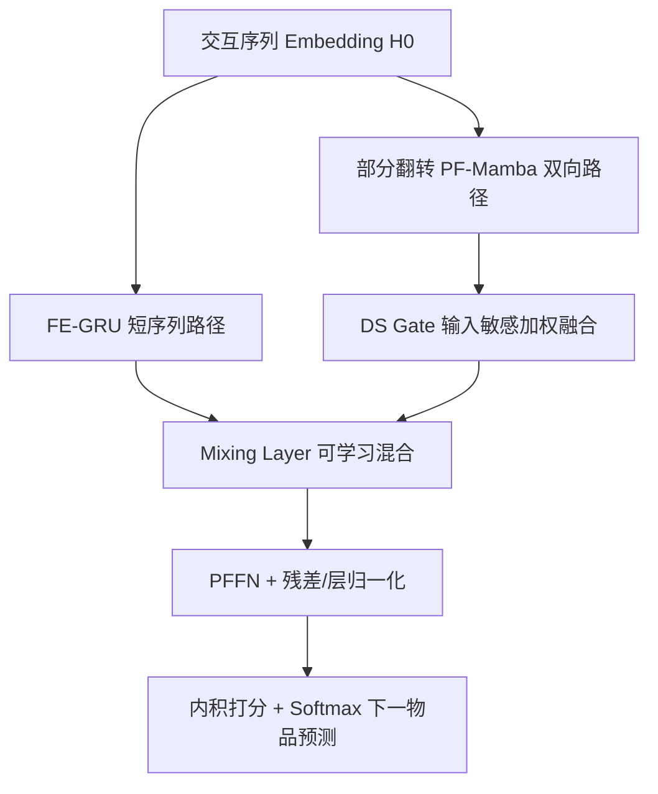
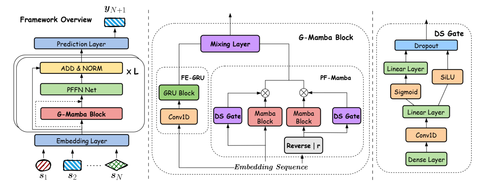

# SIGMA: Selective Gated Mamba for Sequential Recommendation (选择性门控 Mamba 序列推荐)

- **会议/期刊**: AAAI 2025
- **作者与机构**: Ziwei Liu, Qidong Liu, Yejing Wang, Wanyu Wang, Pengyue Jia, Maolin Wang, Zitao Liu, Yi Chang, Xiangyu Zhao（香港城市大学、西安交通大学、暨南大学、吉林大学）
- **推荐链路定位**: 召回（Next-Item 序列建模）
- **研究方向**: 序列与会话推荐 / 生成式与高效序列架构
- **论文原文**: [https://arxiv.org/abs/2408.11451v4](https://arxiv.org/abs/2408.11451v4)
- **开源代码**: [https://github.com/ziwliu-cityu/SIMGA](https://github.com/ziwliu-cityu/SIMGA)

## TL;DR (1分钟核心速览)

Transformer 序列推荐精度高但 $O(N^2)$复杂度难以实时，Mamba 虽线性高效却存在**单向性**（无法利用未来上下文）与**短序列状态估计不稳**（长尾用户更差）两大硬伤。SIGMA 提出部分翻转 Mamba（PF-Mamba）构造"保留近端$r$ 项、翻转远端"的伪双向结构，配输入敏感稠密门控（DS Gate）自适应分配双向权重，并加一条 FE-GRU 支路专攻短序列。在 5 个真实数据集、Leave-One-Out + Full-Ranking 协议下，HR@10 相对最优基线提升 0.68%–8.82%，推理时延与显存均优于 SASRec/FEARec。

## Background & Motivation (背景与核心矛盾)

- **主流范式**: SASRec/BERT4Rec 以自注意力建模序列，精度领先但复杂度随序列长度平方增长；LinRec/MLP 类线性模型效率高却难以刻画长程复杂依赖。
- **前人局限**: ① Mamba4Rec 直接套用原生单向 Mamba，只能看历史、无法利用序列内未来上下文，用户兴趣漂移（如从家居转向运动）时判断失准；② 短序列下 SSM 隐状态转移不稳定，长尾用户（交互 0–5 条）推荐质量显著劣化——图 1 显示 Mamba4Rec 在 Beauty 前三个短序列分组上均不如 SASRec。
- **核心洞察 (Key Insight)**: 全句翻转的双向 Mamba（如 Vision Mamba）虽补足上下文，却把最近邻的短期兴趣信号打散；而长尾用户恰恰最依赖近端短期模式。
- **本文切入点**: 只翻转远端、保留近端 $r$ 项，用门控按输入自适应融合双向，再并联 GRU 支路兜底短序列。

## Method (核心方法设计)

### 1. 整体框架 (Overall Architecture)

输入交互序列经 Embedding 层得到 $\mathbf{H}^0\in\mathbb{R}^{N\times D}$，送入核心 **G-Mamba Block**：一条 PF-Mamba 路径（双向 Mamba + DS Gate 加权融合）负责上下文建模，一条 FE-GRU 路径（Conv1d + GRU）负责短期依赖；两路输出经可学习系数混合（Mixing Layer）后接 PFFN 与残差/层归一化，最后与物品嵌入做内积、Softmax 输出下一物品概率。整个框架可堆叠多层，但实验表明 1 层已接近最优。

<figure class="paper-figure" markdown="span">
  <figcaption>图 2：所提出的 SIGMA 框架。该框架的核心部分是 G-Mamba Block，它能够在将 Mamba 引入 SRS 时直接应对上下文建模和短序列建模的挑战。</figcaption>
</figure>

### 2. 关键设计拆解 (Key Designs)

1. **部分翻转 Mamba（PF-Mamba）**：针对"全翻转破坏短期信号、不翻转丢失上下文"的矛盾，将序列 $\mathbf{H}^0=[\mathbf{h}_1,\dots,\mathbf{h}_n,\mathbf{h}_{n+1},\dots,\mathbf{h}_N]$改写为$\mathbf{H}^{f0}=[\mathbf{h}_n,\dots,\mathbf{h}_1,\mathbf{h}_{n+1},\dots,\mathbf{h}_N]$，即翻转前$n$项、保留末$r=N-n$项原位，再分别过两个 Mamba 块得$\mathbf{M}^0,\mathbf{M}^{f0}$。直觉是：远端历史提供互补上下文，近端$r$ 项维持原始时序因果性，保住兴趣漂移的"最近证据"。

2. **稠密选择性门控（DS Gate）**：固定权重融合双向不合理，故设计输入相关门控。先以 Conv1d 抽取局部序列模式 $\mathbf{G}^0=\mathrm{Conv1d}(\mathbf{H}^0\mathbf{W}_\sigma^{(1)}+\mathbf{b}_\sigma^{(1)})$，再经遗忘门与 SiLU 门组合：
$$\mathbf{G}_1(\mathbf{H}^0)=\mathrm{SiLU}\big(\delta_1(\mathbf{G}^0)\big)+\mathcal{G}_0(\mathbf{G}^0),\quad \hat{\mathbf{M}}^0=\mathbf{G}_1(\mathbf{H}^0)\cdot\mathbf{M}^0+\mathbf{G}_1(\mathbf{H}^{f0})\cdot\mathbf{M}^{f0}$$
门控随输入变化，使模型在"长历史用户偏重双向上下文、短历史用户偏重近端"之间自适应切换。

3. **FE-GRU 与训练目标**：短序列上 SSM 状态不稳，故并联 Conv1d+GRU 支路 $\mathbf{F}^0$，以卷积先混合局部特征、GRU 捕捉短期转移；混合层$\mathbf{Z}^0=a_1\hat{\mathbf{M}}^0+a_2\mathbf{F}^0$中$a_1,a_2$可学习。训练采用全库 Softmax 交叉熵$\mathcal{L}_{\mathrm{CE}}=-\frac{1}{B}\sum_{i=1}^{B}\log P_{i,y_i}$，**不使用负采样**（全物品归一化），推理即一次前向 + 内积检索。复杂度为$O(13ND^2+ND(2k+2))$，$N\gg D$时退化为$O(N)$，显著优于 Transformer 的$O(N^2)$。

## Experimental Setup & Evaluation Protocol (实验设置与评估协议)

- **数据集与预处理**（均按时间排序，ML-1M/Beauty/Games 过滤交互数 $<5$ 的用户与物品，Yelp/Sports 另设长度上界 100/200）：

| 数据集 | #Users | #Items | 稀疏度 | 平均长度 | 场景说明 |
| :--- | :---: | :---: | :---: | :---: | :--- |
| Yelp | 82,900 | 64,210 | 99.98% | 9.68 | 本地生活评论 |
| Sports | 75,185 | 48,567 | 99.98% | 8.07 | Amazon 体育 |
| Beauty | 22,364 | 12,102 | 99.93% | 8.88 | Amazon 美妆 |
| ML-1M | 6,041 | 3,417 | 95.53% | 165.60 | 电影长序列 |
| Games | 55,145 | 17,287 | 99.94% | 9.01 | Amazon 游戏 |

- **数据划分与防穿越**: `Leave-One-Out`（末项为测试、倒数第二项为验证），全库按时间戳排序构造序列。
- **排名评测协议**: 无偏 `Full-Ranking`（对全部未交互物品打分排序），指标 HR@10 / NDCG@10 / MRR@10，5 次独立运行取均值。
- **对比基线与超参**: 基线覆盖 RNN（GRU4Rec）、Transformer（BERT4Rec、SASRec、LinRec、FEARec）、SSM（Mamba4Rec、ECHOMamba4Rec）；统一 $d=64$、Adam、lr=0.001，Amazon/Yelp dropout 0.3、ML-1M 0.2；显著性用单侧 t 检验$p<0.05$。

## Key Experimental Results (实验关键数据)

### 1. 主实验对比 (Main Results)

| 数据集 | 指标 | SASRec | FEARec | Mamba4Rec | ECHO | **SIGMA** | Improv. |
| :--- | :--- | :---: | :---: | :---: | :---: | :---: | :---: |
| Yelp | HR@10 | 0.0551 | 0.0554 | 0.0552 | 0.0578 | **0.0629** | +8.82% |
| Yelp | NDCG@10 | 0.0354 | 0.0391 | 0.0344 | 0.0389 | **0.0412** | +5.37% |
| Sports | HR@10 | 0.0721 | 0.0746 | 0.0676 | 0.0689 | 0.0735 | -1.47% |
| Sports | NDCG@10 | 0.0546 | 0.0575 | 0.0563 | 0.0569 | **0.0590** | +2.62% |
| Beauty | HR@10 | 0.0852 | 0.0967 | 0.0880 | 0.0903 | **0.0986** | +1.96% |
| Beauty | NDCG@10 | 0.0532 | 0.0530 | 0.0540 | 0.0567 | **0.0604** | +6.53% |
| ML-1M | HR@10 | 0.2998 | 0.3283 | 0.3253 | 0.3239 | **0.3308** | +0.76% |
| Games | HR@10 | 0.1592 | 0.1616 | 0.1564 | 0.1578 | **0.1627** | +0.68% |
| Games | NDCG@10 | 0.1002 | 0.1032 | 0.1050 | 0.1044 | **0.1088** | +3.62% |

效率侧（Beauty）：SIGMA 推理 68ms / 2.89G，优于 SASRec（123ms / 7.58G）与 FEARec（129ms / 8.11G），与 Mamba4Rec（72ms / 2.58G）同量级。

### 2. 消融实验 (Ablation Study)

| 变体 (Beauty) | HR@10 | NDCG@10 | MRR@10 |
| :--- | :---: | :---: | :---: |
| Default (SIGMA) | **0.0986** | **0.0604** | **0.0488** |
| w/o partial flipping | 0.0953 | 0.0586 | 0.0473 |
| w/o DS gate | 0.0954 | 0.0571 | 0.0455 |
| w/o FE-GRU | 0.0750 | 0.0470 | 0.0382 |

### 3. 关键实验发现 (Key Findings)

1. **FE-GRU 是短序列场景的命门**：移除后 Beauty HR@10 从 0.0986 暴跌至 0.0750（-23.9%），远超其他两个组件；但在长序列 ML-1M 上移除 FE-GRU 几乎无损（0.3308→0.3304），印证其作用专属于长尾短序列。
2. **部分翻转优于全翻转与不翻转**：$r=5$时最优；$r=N$（不翻转）双向信息不足、$r=0$（全翻转）丢失短期偏好，两端性能均下降，说明"保留近端$r$ 项"是精度关键旋钮。
3. **单层即够用**：1 层 SIGMA 的 HR@10=0.0986 已接近 2 层最优 0.0994，而 4 层降至 0.0963 且推理时延从 66ms 涨到 227ms，堆叠层数收益被过拟合与开销抵消。

## Highlights & Limitations (亮点、对比与审稿批判)

- **与代表作对比 (vs. Prior Work)**: 相比 Mamba4Rec 的单向 SSM，SIGMA 用"部分翻转 + 门控"以近线性代价获得双向上下文；相比 ECHO 的全句双向 + 频域滤波，SIGMA 保留近端时序因果性，在短序列分组上反超 SASRec；相比 SASRec 的 $O(N^2)$自注意力，复杂度降至$O(N)$ 且精度更高。
- **可迁移亮点**: ① "部分翻转"思想可迁移到任何单向序列编码器（如因果卷积、单向 RNN）以低成本补足双向信息；② 输入敏感门控融合多分支（双向/单向、长/短期）是通用且轻量的多视角聚合范式。
- **审稿级局限批判**: ① 部分翻转需额外存储与计算一条反向序列，ML-1M 上显存反而高于 Mamba4Rec（9.89G vs 6.89G），长序列场景开销未完全摊薄；② 翻转范围 $r$为固定超参（Beauty 最优$r=5$），未做按用户序列长度自适应，且仅在 Beauty 上做参数敏感性分析，泛化性证据偏薄。

## Rating (四维评分)

- **方法创新性 (Novelty)**: ⭐⭐⭐⭐ （"部分翻转 + 输入敏感门控"是对 Mamba 单向性的巧妙低成本修补，但本质仍是双向化 + 门控融合的工程组合，理论新意中等）
- **评估协议与实验扎实度 (Protocol & Experiments)**: ⭐⭐⭐⭐ （5 数据集 + Full-Ranking + 显著性检验 + 分组长尾分析 + 效率对比齐全，但 Sports 上 HR@10 未超 FEARec，且超参分析仅限单数据集）
- **写作与数学规范度 (Clarity & Rigor)**: ⭐⭐⭐⭐ （模块公式与复杂度推导清晰，附录含完整复现指南；但部分符号下标（如 $\delta_1$、$\mathcal{G}_0$）定义略紧凑，需对照原文细读）
- **工业落地与复现价值 (Industrial & Practical Value)**: ⭐⭐⭐⭐⭐ （代码开源、基于 RecBole 生态、单卡 L4 可训、推理时延与显存均优于 Transformer 基线，线性复杂度对长序列线上召回极具吸引力）

