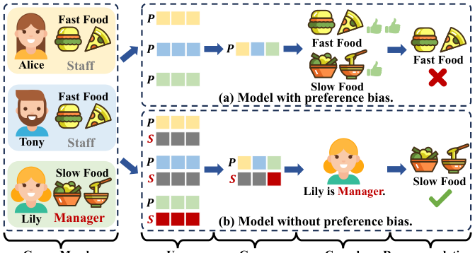
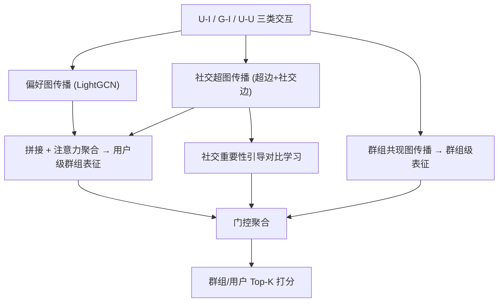

# Disentangled Modeling of Preferences and Social Influence for Group Recommendation (偏好与社会影响解耦建模的群组推荐)

- **会议/期刊**: AAAI 2025 (Oral)
- **作者与机构**: Guangze Ye, Wen Wu, Guoqing Wang, Xi Chen, Hong Zheng, Liang He (华东师范大学 / 上海市长宁区精神卫生中心)
- **推荐链路定位**: 召回 (群组/用户 Top-K 排序)
- **研究方向**: 社交与群组推荐 / 自监督对比学习
- **论文原文**: [https://arxiv.org/abs/2501.11342v1](https://arxiv.org/abs/2501.11342v1)
- **开源代码**: [https://github.com/DisRec/DisRec](https://github.com/DisRec/DisRec)

## TL;DR (1分钟核心速览)

群组推荐 (GR) 现有方法把成员偏好当作群组决策的唯一来源，或将偏好与社会影响捆绑为统一表征，导致模型偏向"多数派偏好"而非群组真实交互项（偏好偏差）；同时其随机删点的自监督增广忽略了成员的社会权重。本文提出 DisRec：用偏好图 + 社交超图双通道解耦传播用户偏好与社会影响，并以"删最重要/最不重要成员"构造正负对的社交对比学习缓解群组稀疏。在 Mafengwo/Yelp 全库排序下，NDCG@10 相对最强基线 ConsRec 提升 5.75%/9.55%（群组任务）。

## Background & Motivation (背景与核心矛盾)

- **主流范式**: 先学成员偏好，再用注意力/超图/超立方体聚合为群组偏好，最后用群组-物品交互优化（AGREE、HCR、CubeRec、ConsRec 等）。
- **前人局限**: ① 只建模个体偏好，忽略社会影响对成员贡献度的量化；即便引入社交（SIGR、CubeRec），也把偏好与社会影响揉进同一表征，模型被"多数派"主导；② 现有 SSL 增广（S²-HHGR、SGGCF）随机删成员节点，而成员贡献本就不等，随机删点会破坏决策过程，对齐目标反而有害。
- **核心洞察 (Key Insight)**: 群组最终决策由**偏好**与**社会影响**两个独立因子共同决定（图 2 因果图）；只有高影响力成员显著改变群组决策，因此"删谁"应依据社会重要性而非随机。
- **本文切入点**: 用两套独立 embedding + 两条独立传播通道实现用户级解耦，并把社会权重注入对比学习的正负样本构造。

<figure class="paper-figure" markdown="span">
  <figcaption>图1：(a)和(b)分别展示了模型在有偏好偏差和无偏好偏差情况下的因果推断过程，其中P和S分别为偏好和社会嵌入。</figcaption>
</figure>

## Method (核心方法设计)

### 1. 整体框架 (Overall Architecture)

输入为 U-I 交互、G-I 交互与 U-U 社交三类数据。左路**用户级解耦网络**：偏好图（U-I 二部图）做 LightGCN 式传播得 $\hat{U}_P,\hat{I}_P$；社交超图（群组为超边 + 好友为普通边）做超图卷积与社交注意力传播得$\hat{U}_S,\hat{I}_S$；二者拼接后经注意力聚合器得到用户级群组表征$\hat{G}_m$。右路**群组级偏好网络**：以群组共现图（超边为节点、Jaccard 权重连边）独立学习群组内在偏好$\hat{G}_t$。两路经门控聚合为最终群组表征，联合 BPR 式 pairwise 损失与社交对比损失训练。

### 2. 关键设计拆解 (Key Designs)

1. **双通道解耦传播（偏好图 vs. 社交超图）**：痛点是把偏好与影响混在一个表征里。本文为每个用户维护 $U_P,U_S$两套 embedding，偏好通道用标准谱卷积$X_P^{(l+1)}=\hat{D}^{-\frac{1}{2}}\hat{A}\hat{D}^{-\frac{1}{2}}X_P^{(l)}$捕获协同信号；社交通道用超图卷积$X_S^{(l+1)}=D^{-1}HWB^{-1}H^{\top}X_S^{(l)}\Psi^{(l)}$先由$H^{\top}X_S$抽取"群内社会影响"，再由$H$回传给个体，随后在好友图上做注意力加权$u_{S,i}^{(l+1)}=u_{S,i}^{(l)}+\sum_{j\in\mathcal{N}(i)}\alpha_j W_1 u_{S,j}^{(l)}$ 刻画"群外社会影响"。直觉：超边天然对应"一次群组决策"，把群组当作社会影响的载体比当作偏好载体更合理。
2. **社交重要性引导的对比学习**：痛点在于随机删点会污染决策语义。本文按注意力权重 $\beta_j$选出群内最重要成员$u'$与最不重要成员$u''$，分别删除得到$\hat{g}'_t,\hat{g}''_t$，令$(\hat{g}_t,\hat{g}'_t)$为正对、$(\hat{g}_t,\hat{g}''_t)$为负对，损失为$\mathcal{L}_{ssl}=-\sum_t[\log\sigma(f(\hat{g}_t,\hat{g}'_t))+\log\sigma(1-f(\hat{g}_t,\hat{g}''_t))]$。直觉：删掉关键人物应造成表征大幅偏移（正对差异大），删掉边缘人物应几乎不变（负对差异小），从而把"谁真正影响决策"这一结构先验注入表征。
3. **训练目标与推理开销**：$\mathcal{L}=\mathcal{L}_{user}+\mathcal{L}_{group}+\delta\mathcal{L}_{ssl}$，其中$\mathcal{L}_{user},\mathcal{L}_{group}$均为 pairwise 平方 hinge$(\hat{r}_{jh}-\hat{r}_{jh'}-1)^2$，每正样本配 10 个负样本（非全库负采样）。推理时群组表征可离线预计算，在线仅需内积打分，开销与 LightGCN 同阶。

## Experimental Setup & Evaluation Protocol (实验设置与评估协议)

- **数据集与预处理**:

| 数据集 | #Users | #Items | #Groups | #U-I | #G-I | 场景说明 |
| :--- | :---: | :---: | :---: | :---: | :---: | :--- |
| Mafengwo | 5,275 | 1,513 | 995 | 39,761 | 3,595 | 旅游结伴群组 |
| Yelp | 34,504 | 22,611 | 24,103 | 482,273 | 26,883 | 美国餐厅签到 |

- **数据划分与防穿越**: 沿用 Cao et al. 2018 / Yin et al. 2019 的公开划分（群组-物品按交互留出测试），未额外引入时间戳切分。
- **排名评测协议**: 无偏 **Full-Ranking**（"All items are considered as candidates for fairness"），指标 HR@{5,10}、NDCG@{5,10}，置换检验 (permutation test) 做显著性，$p<0.05$ 标 `*`。
- **对比基线与超参**: 8 个基线覆盖虚拟用户 (NCF)、社交融合 (SIGR)、互信息 (GroupIM)、超图 (HCR, S²-HHGR, ConsRec)、超立方体 (CubeRec)、双对比 (SGGCF)；$d=64$，batch 512，负样本 10，层数$L=3$，$\delta=0.5$（敏感性分析中最优取到 0.7），学习率$[10^{-4},10^{-3}]$，dropout$[0.1,0.5]$。

## Key Experimental Results (实验关键数据)

### 1. 主实验对比 (Main Results)

群组推荐任务（节选核心指标）：

| 数据集 | 指标 | NCF | GroupIM | S²-HHGR | SGGCF | CubeRec | ConsRec | **DisRec** | Improv. |
| :--- | :--- | :---: | :---: | :---: | :---: | :---: | :---: | :---: | :---: |
| Mafengwo | HR@10 | 0.4365 | 0.6040 | 0.5899 | 0.7005 | 0.7699 | 0.7829 | **0.8101*** | 3.47% |
| Mafengwo | NDCG@10 | 0.3171 | 0.4534 | 0.5473 | 0.5320 | 0.5862 | 0.5969 | **0.6312*** | 5.75% |
| Yelp | HR@10 | 0.3165 | 0.6687 | 0.5965 | 0.6074 | 0.6173 | 0.6606 | **0.7061*** | 5.59% |
| Yelp | NDCG@10 | 0.3198 | 0.5056 | 0.4239 | 0.4867 | 0.4831 | 0.5154 | **0.5646*** | 9.55% |

用户推荐任务上 DisRec 同样全面领先：Yelp HR@10 达 **0.6245**（较 ConsRec 0.5319 提升 13.57%），Mafengwo NDCG@10 达 **0.6115**（提升 4.91%）。

### 2. 消融实验 (Ablation Study)

| 变体 | Mafengwo HR@10 | Mafengwo NDCG@10 | Yelp HR@10 | Yelp NDCG@10 |
| :--- | :---: | :---: | :---: | :---: |
| w/o. S（去社会影响通道） | 0.7698 | 0.5916 | 0.6625 | 0.5267 |
| w/o. P（去偏好通道） | 0.7888 | 0.6125 | 0.6869 | 0.5423 |
| w/o. SSL（去对比学习） | 0.8050 | 0.6214 | 0.6942 | 0.5514 |
| **DisRec** | **0.8101** | **0.6312** | **0.7061** | **0.5646** |

### 3. 关键实验发现 (Key Findings)

1. **解耦通道比 SSL 更关键**：去掉社会影响通道在 Yelp 上 NDCG@10 掉 6.7%（0.5646→0.5267），远大于去掉 SSL 的 2.3%，说明偏好偏差才是主要瓶颈；而 `w/o. S` 又劣于 `w/o. P`，证明"只建模偏好"确实不足。
2. **社交对比优于随机增广**：相较 S²-HHGR/SGGCF 这类随机删点方案，DisRec 在群组任务 NDCG@10 上平均高出约 20.8%，说明按社会重要性构造正负对能提供更干净的监督信号。
3. **合成数据验证去偏能力**：在 719 个测试样本上构造"多数派假物品"，DisRec 的 Rankgap 分布明显右移（ConsRec 峰值集中在 ~400，DisRec 均匀分布于 400–1200），案例 $g_{127}-i_{232}$ 中 DisRec 正确把真实物品排在假物品之前。

## Highlights & Limitations (亮点、对比与审稿批判)

- **与代表作对比**: 相比 HCR/ConsRec 仅把超边当"群组偏好容器"，DisRec 把超边重新解释为"社会影响载体"并额外引入好友图刻画群外影响；相比 S²-HHGR/SGGCF 的随机删点增广，本文用注意力权重决定删谁，把因果先验写进对比目标。
- **可迁移亮点**: ① "按重要性删节点构造正负对"的对比范式可直接迁移到会话推荐、序列去噪等需要成员级归因的场景；② 双 embedding + 双通道传播的解耦骨架可复用到"兴趣 vs. 从众"（DICE 类）或"同质 vs. 影响"（DISGCN 类）的社交推荐。
- **审稿级局限批判**: ① 群组共现图与社交超图均需离线构图，Yelp 上 2.4 万群组的超边规模会带来显著预处理与显存开销，论文未给出复杂度/时延实测；② 评估仅两个数据集、且未做时间切分，Full-Ranking 虽公平但缺少对冷启动群组与在线 A/B 的验证，$\delta$ 最优值在 0.5–0.7 间漂移也提示超参较敏感。

## Rating (四维评分)

- **方法创新性 (Novelty)**: ⭐⭐⭐⭐ （首次显式指出 GR 的偏好偏差并给出因果图，双通道解耦 + 社会重要性引导对比的组合有新意）
- **评估协议与实验扎实度 (Protocol & Experiments)**: ⭐⭐⭐⭐ （Full-Ranking + 置换检验 + 消融 + 合成数据案例较完整，但仅两数据集、无时间切分）
- **写作与数学规范度 (Clarity & Rigor)**: ⭐⭐⭐⭐ （公式与符号定义清晰，因果图与案例图辅助到位，复杂度分析略缺）
- **工业落地与复现价值 (Industrial & Practical Value)**: ⭐⭐⭐⭐ （代码已开源，群组表征可离线预计算，但超图构图开销需工程优化）

