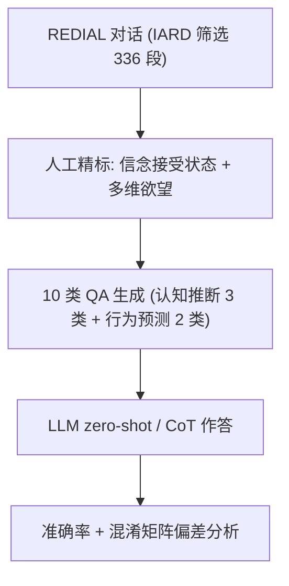

# RecToM: A Benchmark for Evaluating Machine Theory of Mind in LLM-based Conversational Recommender Systems (面向 LLM 对话推荐系统的机器心智理论评测基准)

- **会议/期刊**: AAAI 2026
- **作者与机构**: Mengfan Li, Xuanhua Shi (华中科技大学 CGCL 实验室)；Yang Deng (新加坡管理大学)
- **推荐链路定位**: 对话推荐（多轮交互策略与心智状态建模的评测层）
- **研究方向**: 对话推荐与智能体仿真 / 大语言模型推荐
- **论文原文**: [https://arxiv.org/abs/2511.22275v1](https://arxiv.org/abs/2511.22275v1)
- **开源代码**: [https://github.com/CGCL-codes/RecToM](https://github.com/CGCL-codes/RecToM)

## TL;DR (1分钟核心速览)

现有 LLM 心智理论 (ToM) 基准多基于 Sally-Anne 式合成叙事，只考"物理感知 + 回溯推断"，既脱离真实推荐对话，又缺失"用推断出的心智状态指导下一步行为"这一 ToM 核心。本文提出 RecToM——首个基于 REDIAL 真实对话、经三名标注者人工精标（Fleiss' K=0.79）的对话推荐 ToM 基准，含 336 段对话、20,524 条 QA，覆盖认知推断（Desire/Intention/Belief）与行为预测（Prediction/Judgement）两维。在 5 个 SOTA LLM 上的零样本与 CoT 评测显示：细粒度意图仅约 27.7%（推荐方），判断推理甚至低于随机猜测（谄媚偏差 FPR≈93%）。

## Background & Motivation (背景与核心矛盾)

- **主流范式**: LLM 驱动的对话推荐 (CRS) 已能生成流畅回复，ToM 评测则普遍沿用 Hi-ToM / OpenToM / FANToM 等基于合成叙事或任务型对话的 QA 基准。
- **前人局限**: 其一，Sally-Anne 式场景（人物进出房间、移动物体）只考物理感知，无法刻画推荐对话中"欲望—意图—信念"的复杂心理推断；其二，现有基准几乎全是**回溯式**心智归因，忽略人类 ToM 的关键一环——用推断出的心智状态去**预测与评估未来对话策略**。
- **核心洞察 (Key Insight)**: 推荐对话天然是**非对称双角色**（推荐方主动推断寻求方态度，反之不必然），且单句可承载多重意图、信念是多维组合（谁提议/是否看过/是否接受）、欲望可并发（同时比较多部电影）——这些结构恰是现有基准完全缺失的。
- **本文切入点**: 以 BDI（Belief-Desire-Intention）模型组织认知推断，再叠加行为预测，构建"理解说了什么 + 决定下一步做什么"的双维人工标注基准。

## Method (核心方法设计)

### 1. 整体框架 (Overall Architecture)

RecToM 不是模型而是**评测基准**：从 REDIAL 中按 IARD 协议筛出 253 段"先拒后接受"的满意对话与 83 段无接受的不满意对话，经两轮人工精标（信念接受状态定位 + 多维欲望重标）后，为每段对话的每个话语轮生成 10 类 QA（单选/多选混合），最终形成 20,524 条 QA。评测时把对话历史 + 问题 + 选项喂给 LLM，分别在 vanilla zero-shot 与 CoT 两种提示下抽取答案，按准确率与混淆矩阵指标（Prediction Bias / FPR / Recall）统计。

### 2. 关键设计拆解 (Key Designs)

1. **认知推断三件套（Desire / Belief / Intention）**：痛点在于以往基准把心智状态当一维标签。本文按 BDI 拆解：Desire 用二分类问"寻求方是否可能看某片"；Belief 用 7 选项组合刻画"谁提议 × 是否看过 × 是否接受"的多维信念；Intention 则设计**粗/细两级粒度**（推荐方 5 粗/10 细，寻求方 4 粗/16 细），要求模型不仅答"在推荐"，还要答"是直接展示还是基于历史偏好解释"。这种层级设计使"方向对但细节错"可被单独度量（Fine2Coarse 指标）。
2. **行为预测双任务（Prediction / Judgement）**：Prediction 问"下一轮会用哪种策略"（多选，因单句可含多策略）；Judgement 随机指定一个策略并问"该策略是否有效"（二分类）。后者是本文最具判别力的探针——它要求模型在已推断心智状态的基础上做**反事实策略评估**，而非复述历史。
3. **训练目标、负采样与推理效率**：本文无训练损失与负采样（纯评测基准）；推理开销体现在每段对话需对每个话语轮跑 10 次 LLM 调用，20,524 条 QA 的全量评测成本较高，作者以 temperature=0.7、固定输出格式 + 字符串匹配抽答案来控制方差。

## Experimental Setup & Evaluation Protocol (实验设置与评估协议)

- **数据集与预处理**: 源数据 REDIAL，按 IARD 协议筛选（先拒后接受=满意，无接受=不满意），三名受训标注者双标 + 第三人仲裁，IAA (Fleiss' K)=0.79。

| 数据集 | #Dialogues | #Turns | #Question Types | #QA Pairs | 平均轮数 | 平均电影数 |
| :--- | :---: | :---: | :---: | :---: | :---: | :---: |
| RecToM | 336 | 4,583 | 10 | 20,524 | 13.64 | 5.24 |

- **数据划分与防穿越 (Splitting Strategy)**: 基准构建，无训练/测试划分；QA 严格以**问题所在轮之前**的对话历史为上下文，天然防穿越。
- **排名评测协议 (Ranking Protocol)**: 非排序任务，采用 **QA 准确率**（单选/多选分别统计），并辅以混淆矩阵指标 Prediction Bias、FPR、Recall(No)。
- **对比基线与超参设置**: 5 个 SOTA LLM——DeepSeek-V3 (671B MoE)、GPT-4o、GPT-4o-mini、Gemini 2.5 Flash-Lite、Claude 3.5 Haiku；每种模型跑 zero-shot 与 CoT 两档；另设 Random Guess 与 Human 上界；temperature=0.7。

## Key Experimental Results (实验关键数据)

### 1. 主实验对比 (Main Results)

下表摘取核心列（准确率 %，斜体为多选任务；加粗为最优）：

| 模型 | Rec-Fine-Int. | Rec-Coarse-Int. | Belief | Seek-Fine-Int. | Seek-Coarse-Int. | Desire | Rec-Prediction | Rec-Judgement |
| :--- | :---: | :---: | :---: | :---: | :---: | :---: | :---: | :---: |
| Random Guess | 10.00 | 3.23 | 14.29 | 0.00 | 6.67 | 50.00 | 3.23 | 50.00 |
| Human | 64.32 | 86.31 | 96.84 | 59.92 | 82.74 | 98.25 | 87.44 | 96.37 |
| DeepSeek-V3 | 29.71 | 44.26 | 69.86 | 33.20 | 59.32 | 86.05 | 26.84 | 39.18 |
| GPT-4o | **32.61** | 40.45 | 74.74 | 28.84 | **64.22** | 92.27 | 24.07 | 33.84 |
| GPT-4o-mini | 27.80 | 38.01 | 52.50 | 31.43 | 54.24 | 88.60 | 18.88 | 32.22 |
| Gemini 2.5 Flash-Lite | 25.90 | 37.64 | 63.73 | 22.31 | 58.50 | 89.78 | 22.07 | 36.80 |
| Claude 3.5 Haiku | 25.74 | 36.55 | 61.58 | 29.11 | 45.35 | 90.68 | 21.64 | 32.41 |
| DeepSeek-V3+CoT | **33.02** | **46.21** | **79.46** | 29.61 | 58.59 | 76.10 | 19.54 | 37.94 |
| GPT-4o+CoT | 28.44 | 42.40 | 75.20 | 25.44 | 54.10 | 87.78 | 21.54 | 32.94 |
| 模型平均 | 27.74 | 41.13 | 68.72 | 28.20 | 55.77 | 86.35 | 20.54 | 34.84 |

### 2. 消融实验 (Ablation Study)

本文为基准论文，无模块消融，但提供了**提示策略消融**与**粒度映射消融**（Fine2Coarse）：

| 配置 | Rec-Fine-Int. | Rec-Fine2Coarse | Seek-Fine-Int. | Seek-Fine2Coarse |
| :--- | :---: | :---: | :---: | :---: |
| DeepSeek-V3 | 29.71 | 45.40 | 33.20 | — |
| DeepSeek-V3+CoT | 33.02 | 51.16 | 29.61 | — |
| GPT-4o | 32.61 | — | 28.84 | 50.25 |
| GPT-4o+CoT | 28.44 | — | 25.44 | — |

判断推理偏差（表 5，推荐方）：GPT-4o Prediction Bias=94.90、FPR=94.45、Recall(No)=5.55；Claude 3.5 达 97.86/97.64/2.36；GPT-4o-mini 最极端 98.52/98.27/1.73。

### 3. 关键实验发现 (Key Findings)

1. **多选即认知过载**：多选任务（细粒度意图、预测）平均仅 20.5–28.2%，而单选任务（信念 68.72%、欲望 86.35%）高出一倍以上，说明选项空间一扩大，LLM 对"似是而非"的心智归因就失去分辨力。
2. **细粒度是真正瓶颈，而非方向错误**：Fine2Coarse 准确率（如 DeepSeek-V3+CoT 推荐方 51.16%）显著高于细粒度准确率（33.02%）并接近粗粒度（46.21%），证明模型"大方向对、细节全错"——瓶颈在粗类内部的细粒度判别，而非粗类定位。
3. **判断推理系统性谄媚**：二分类判断任务平均 34.84%，**低于 50% 随机基线**；Prediction Bias 高达 84.5–99.8%，FPR≈93%，即模型几乎无差别输出"Yes"，与 Sharma et al. 的 answer sycophancy 现象一致，这对 CRS 中"策略是否有效"的自我评估是致命缺陷。此外 CoT 收益极不稳定（GPT-4o 寻求方粗粒度意图 64.22%→54.10% 反降）。

## Highlights & Limitations (亮点、对比与审稿批判)

- **与代表作对比 (vs. Prior Work)**: 相比 Hi-ToM/OpenToM 的合成叙事与 FANToM 的通用多方对话，RecToM 首次把 ToM 评测锚定在**真实推荐对话 + 非对称双角色**上；相比 PersuasiveToM 等任务型基准，它额外引入**行为预测与策略有效性判断**，把"理解心智"推进到"用心智指导行动"。
- **可迁移亮点**: ①"Fine2Coarse 映射"这一诊断指标可迁移到任何层级分类的 LLM 评测，用于区分"方向错"与"细节错"；②用 Prediction Bias/FPR/Recall(No) 三件套量化谄媚偏差，可直接复用到对话推荐策略评估与 LLM-as-Judge 的可靠性审计。
- **审稿级局限批判**: ①数据仅源于 REDIAL 电影域、336 段对话，规模与领域覆盖有限，跨域（电商、POI）泛化性未验证；②Judgement 任务随机指定策略，可能产生大量与对话语境无关的"无效策略"，使二分类标签分布与真实策略选择分布脱节，谄媚偏差的度量或被放大；③仅评测 5 个闭源/半开源模型且未做多次采样方差报告，CoT 结论的稳健性偏弱。

## Rating (四维评分)

- **方法创新性 (Novelty)**: ⭐⭐⭐⭐ （首个真实推荐对话 ToM 基准，BDI + 行为预测双维设计与非对称角色建模有明确增量，但本质是基准构建而非新算法）
- **评估协议与实验扎实度 (Protocol & Experiments)**: ⭐⭐⭐⭐ （人工精标 K=0.79、10 类 QA 覆盖全面、混淆矩阵偏差分析到位；扣分在单域小规模与缺方差报告）
- **写作与数学规范度 (Clarity & Rigor)**: ⭐⭐⭐⭐ （BDI 框架与四类"Multi-"特性阐述清晰，QA 示例完整；但无形式化定义与统计显著性检验）
- **工业落地与复现价值 (Industrial & Practical Value)**: ⭐⭐⭐⭐ （数据与代码已开源，可直接作为对话推荐 Agent 的心智推理回归测试集；全量 2 万条 QA 的 LLM 调用成本需权衡）

