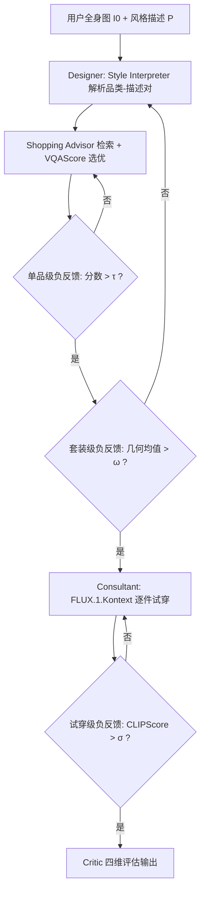
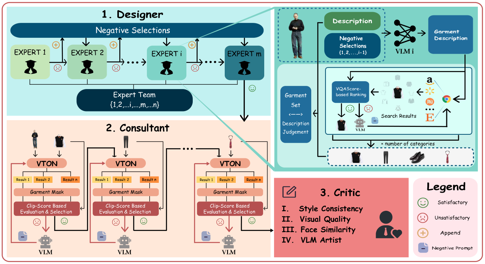

# StyleTailor: Towards Personalized Fashion Styling via Hierarchical Negative Feedback (基于分层负反馈的个性化时尚造型)

- **会议/期刊**: AAAI 2026 (Proceedings of the AAAI Conference on Artificial Intelligence, 40(35):29591-29599)
- **作者与机构**: Hongbo Ma, Fei Shen, Hongbin Xu, Xiaoce Wang, Gang Xu, Jinkai Zheng, Liangqiong Qu, Ming Li (清华大学 / 新加坡国立大学 / 字节跳动 Seed / 光明实验室 / 杭州电子科技大学 / 香港大学)
- **推荐链路定位**: 端到端生成式（设计→检索→试穿→评估全链路）
- **研究方向**: 对话推荐与智能体仿真 / 多模态推荐
- **论文原文**: [https://arxiv.org/abs/2508.06555v2](https://arxiv.org/abs/2508.06555v2)
- **开源代码**: 暂未开源（文中仅引用 IQA-PyTorch 评测工具箱）

## TL;DR (1分钟核心速览)

个性化时尚造型需要同时完成"理解模糊偏好→检索合身单品→组合成套→虚拟试穿→可信评估"，现有 VLM 智能体因幻觉与推理不足难以胜任，且主流 agent 框架仅靠重复采样或随机精修，算力开销大而收益有限。StyleTailor 提出首个协作式智能体框架，用 **单品级 / 套装级 / 试穿级三级分层负反馈** 将失败样本聚合成负向提示，形成闭环迭代。在自建 64 样本 LookBook 基准上，Style Consistency 从基线 0.650 提升至 0.906（+39.4%），Face Similarity 从 0.362 提升至 0.544（+50.3%）。

## Background & Motivation (背景与核心矛盾)

- **主流范式**: 多模态智能体已在图表生成、论文转代码、科学仿真等任务上展现通用性；时尚侧则分别有基于扩散模型的虚拟试穿（VITON、TryOnDiffusion、FLUX.1.Kontext）与基于 VLM 的服装检索两条独立技术线。
- **前人局限**: 其一，现有 VLM 存在持续幻觉与推理能力不足，异构 VLM 间训练分布与架构差异导致输出高度依赖领域、可靠性差；其二，主流 agent 框架依赖"重复选择 / 随机精修"，计算成本高但定性提升有限，缺乏将反馈有效注入生成的原则性机制。
- **核心洞察 (Key Insight)**: 时尚造型的失败是**分层**的——单品不匹配、套装不协调、试穿失真，三者需要不同粒度的纠错信号；而"什么不该要"（负样本）比"什么该要"（正样本）对 VLM 更具可操作性，因为反例可被抽象为可复用的负向提示。
- **本文切入点**: 把负反馈做成贯穿检索与生成的三级闭环，让每个阶段的失败样本成为下一轮迭代的显式负向上下文。

## Method (核心方法设计)

### 1. 整体框架 (Overall Architecture)

输入为全身参考图 $I_0$与自然语言风格描述$P$，输出试穿图$I_K$、服装图$\{G_i\}_{i=1}^K$与购物链接$\{L_i\}_{i=1}^K$。**Designer** 由 Style Interpreter（VLM 将模糊偏好解析为"品类-描述"对$\{c_i,d_i\}$）与 Shopping Advisor（Google Custom Search 检索 + VQAScore 选优）构成，内部嵌单品级与套装级两层负反馈；**Consultant** 以 FLUX.1.Kontext 按区域面积降序逐件替换完成试穿，嵌试穿级负反馈；**Critic** 用四维指标定量评估。全流程 training-free，靠推理期反馈闭环逐步收敛。

<figure class="paper-figure" markdown="span">
  <figcaption>图 2：我们的智能体框架 StyleTailor 概览。Designer 模块分析用户提供的图像和风格偏好，生成服装规格并检索合适的服装图像。Designer 中的两种分层负反馈机制在单品和套装层面细化检索。Consultant 模块生成虚拟试穿结果，并应用更高层级的反馈以进一步贴合用户需求。Critic 定量评估最终输出。这种多阶段反馈确保系统逐步优化推荐。</figcaption>
</figure>

### 2. 关键设计拆解 (Key Designs)

1. **单品级负反馈（Item-level）**：检索图与描述不符时，用 VLM 对比 $g_0$与$d$的差异，抽象为"正向/负向提示对"（如 `high resolution` vs `low resolution`），把负向词注入下一轮搜索。核心是选优算子$g_0=\arg\max_{1\le i\le M}\text{VQAScore}(g_i,d)$，若$\text{VQAScore}(g_0,d)\le\tau$ 则触发重检索。直觉：把"错在哪"抽象成可泛化的检索约束，比盲目换关键词更精准。

2. **套装级负反馈（Outfit-level）**：单品合格不代表成套协调。对每件服装算归一化分数 $s'_i=\min(s_i/\tau_i,1)$，按分量独立假设取几何平均$s_0=\left(\prod_{i=1}^{K}s'_i\right)^{1/K}$，若$s_0\le\omega$ 则激活专家池中下一个更强 VLM（claude-sonnet-4 → gemini-2.5-pro → llama-4-maverick → qwen-vl-max），并把失败套装作为负例上下文。几何平均对短板极度敏感，天然惩罚"一件拉胯毁全套"。

3. **试穿级负反馈与训练目标**：Consultant 每件服装生成 $l$个候选，用 OpenPose + HumanParsing 掩码目标区域后取$O^0=\arg\max_{1\le i\le l}\text{CLIPScore}(\text{mask}_{c_i}(O_i),G_i)$；若低于$\sigma$则 VLM 诊断不一致并生成负向提示重生成。全流程无参数训练，总"目标"即三级阈值门控的迭代收敛：$\mathcal{L}\equiv\mathbb{I}[s_0>\omega]\cdot\mathbb{I}[\text{CLIPScore}>\sigma]$，无负采样、无梯度更新，单次推理约 13.36 分钟、成本约 \$0.064。

## Experimental Setup & Evaluation Protocol (实验设置与评估协议)

- **数据集与预处理**: 自建基准，图像取自 LookBook 开放数据集，文本提示由 LLM few-shot 生成并人工校验：

| 数据集 | #Users | #Items | #Interactions | 稀疏度/密度 | 特征/场景说明 |
| :--- | :---: | :---: | :---: | :---: | :--- |
| LookBook-StyleTailor | 64 (32男/32女) | 8 类服装品类 | 64 条图文请求 | — | 人脸可见/隐藏 1:1；全身/半身 3:1；提示分 specific / referential / vague 三类 |

- **数据划分与防穿越 (Splitting Strategy)**: 无训练集，纯推理期评测（training-free），不存在穿越问题；按性别与人脸/身体状态分层构造以覆盖多样性。
- **排名评测协议 (Ranking Protocol)**: 非传统 Top-N 排序，而是生成质量四维评测——Style Consistency（VQAScore）、Visual Quality（IQAScore）、Face Similarity（InsightFace 余弦相似度）、VLM Artist（qwen-vl-max 对 design/fit/coherence/mood 四项 1–10 打分取均值）。
- **对比基线与超参设置**: 唯一基线为"移除全部负反馈"的同构工作流（保证功能完整性的强基线）；阈值 $\tau=[0.7,0.7,0.7,0.6,\dots]^\top$、$\omega=0.65$、$\sigma=[0.7,0.7,0.7,0.5,\dots]^\top$；试穿每步生成 3 张候选。

## Key Experimental Results (实验关键数据)

### 1. 主实验对比 (Main Results)

| Models | Style Consistency | Visual Quality | Face Similarity | VLM Artist |
| :--- | :---: | :---: | :---: | :---: |
| Baseline (无负反馈) | 0.650 | 0.699 | 0.362 | 7.35 |
| w/o Item-level NF | 0.697 | 0.767 | 0.484 | 8.41 |
| w/o Outfit-level NF | 0.688 | 0.758 | 0.532 | 8.16 |
| w/o Try-on-level NF | 0.781 | 0.708 | 0.351 | 8.22 |
| **Ours (Full)** | **0.906** | **0.764** | **0.544** | **8.60** |
| Improv. vs Baseline | **+39.4%** | **+9.3%** | **+50.3%** | **+17.0%** |

### 2. 消融实验 (Ablation Study)

| 配置 | Style Cons. | Visual Quality | Face Sim. | VLM Artist | 关键退化维度 |
| :--- | :---: | :---: | :---: | :---: | :--- |
| Full | **0.906** | **0.764** | **0.544** | **8.60** | — |
| w/o Item-level | 0.697 (−0.209) | 0.767 | 0.484 | 8.41 | 风格一致性 |
| w/o Outfit-level | 0.688 (−0.218) | 0.758 | 0.532 | 8.16 | 套装协调性 |
| w/o Try-on-level | 0.781 (−0.125) | 0.708 (−0.056) | 0.351 (−0.193) | 8.22 | 试穿保真与身份保持 |

### 3. 关键实验发现 (Key Findings)

1. **单品级与套装级负反馈是风格一致性的双支柱**：分别移除后 Style Consistency 从 0.906 跌至 0.697 / 0.688，跌幅均超 0.2，说明"检索对齐"与"成套协调"不可互相替代，几何平均聚合有效惩罚了短板单品。
2. **试穿级负反馈专攻身份保持**：移除后 Face Similarity 从 0.544 骤降至 0.351（−35.5%），Visual Quality 同步下滑，证明高层反馈直接监督生成模型，是抑制面部畸变与姿态漂移的唯一有效环节。
3. **负反馈随迭代单调增益**：图 5 显示三级反馈激活的分数随迭代次数持续上升，验证闭环机制并非一次性调参，而是可累积的推理期优化；定性对比（图 3）中基线出现鞋款与文本错配、裤色不一致等明显失败，本文均修正。

## Highlights & Limitations (亮点、对比与审稿批判)

- **与代表作对比 (vs. Prior Work)**: 相比 TryOnDiffusion / FLUX.1.Kontext 等纯试穿模型，本文把"选衣"与"试衣"串成闭环而非单点生成；相比 AutoAct 等通用 agent 的随机精修策略，本文用分层负反馈把失败样本结构化复用，避免无效重复采样；相比纯 VLM 检索方案，本文引入套装级几何平均聚合解决全局协调问题。
- **可迁移亮点**: 其一，"失败样本→抽象负向提示对"的范式可迁移到对话推荐的多轮纠错与 LLM 重排；其二，几何平均聚合短板惩罚机制适用于任何多组件组合质量评估（如多模态融合、多任务打分）。
- **审稿级局限批判**: 其一，评测集仅 64 样本、单一基线（无负反馈版本），缺乏与独立 SOTA 试穿/检索系统的横向对比，统计显著性未报告；其二，全流程 training-free 导致单次推理约 13.36 分钟、依赖 4 个商用 VLM API 与 Google 搜索，线上部署的延迟与成本（约 \$0.064/次）难以支撑实时交互，且性能天花板受限于底层 VLM 能力。

## Rating (四维评分)

- **方法创新性 (Novelty)**: ⭐⭐⭐⭐ （首个统一设计-推荐-试穿-评估的协作 agent 框架，三级分层负反馈闭环机制新颖，但各模块均为现成模型编排，缺乏理论分析）
- **评估协议与实验扎实度 (Protocol & Experiments)**: ⭐⭐⭐ （四维评测体系设计合理且含 VLM Artist 细粒度打分，但仅 64 样本、单基线、无显著性检验，说服力有限）
- **写作与数学规范度 (Clarity & Rigor)**: ⭐⭐⭐⭐ （公式简洁、流程与阈值定义清晰，附录含完整 prompt 与效率/成本推导，但核心算子多为工程组合而非理论推导）
- **工业落地与复现价值 (Industrial & Practical Value)**: ⭐⭐⭐ （流程可复现且成本已量化，但 13 分钟级延迟与多 API 依赖限制实时电商场景，代码未开源降低复现便利性）

