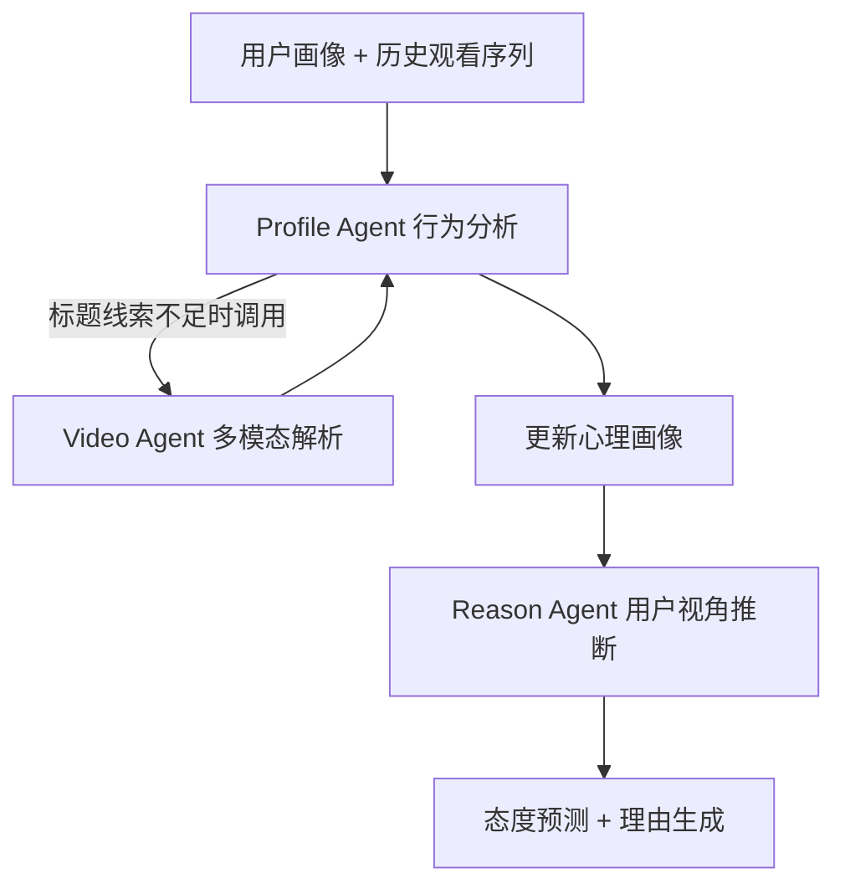
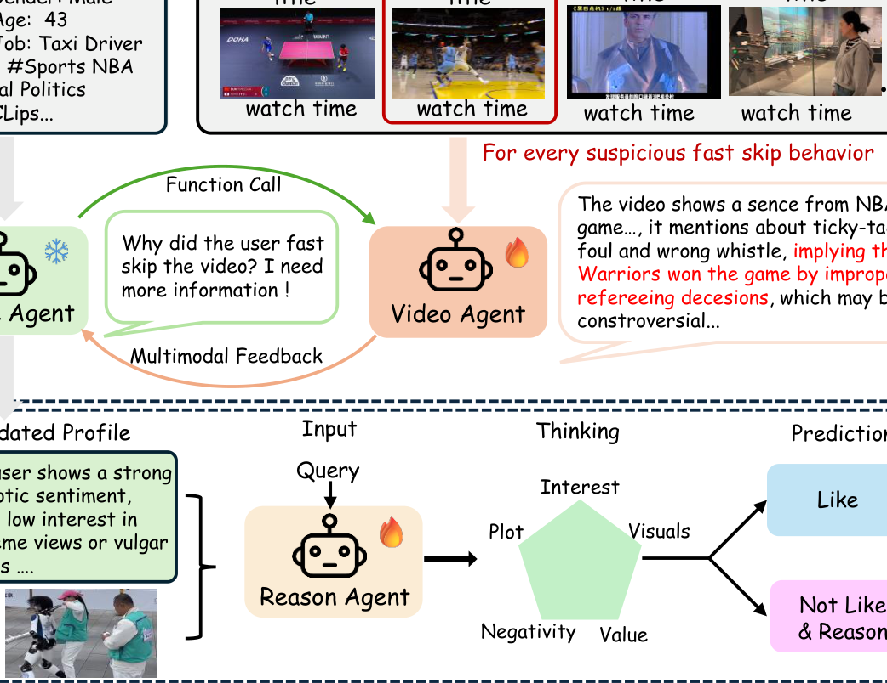

# When Top-ranked Recommendations Fail: Modeling Multi-Granular Negative Feedback for Explainable and Robust Video Recommendation (当头部推荐失效：面向可解释鲁棒视频推荐的多粒度负反馈建模)

- **会议/期刊**: AAAI 2026
- **作者与机构**: Siran Chen, Boyu Chen, Chenyun Yu, Yi Ouyang, Lei Cheng, Chengxiang Zhuo, Zang Li, Yali Wang（中科院深圳先进院、腾讯、中山大学深圳校区）
- **推荐链路定位**: 重排（对候选视频做负反馈预测与过滤）
- **研究方向**: 对话推荐与智能体仿真 / 大语言模型推荐
- **论文原文**: [https://arxiv.org/abs/2511.18700v1](https://arxiv.org/abs/2511.18700v1)
- **开源代码**: 暂未开源

## TL;DR (1分钟核心速览)

传统 ID 嵌入协同过滤无法理解视频深层语义，且对"误点、快滑"等有偏行为建模不足，导致头部推荐频繁触发负反馈却说不清原因。本文构建 TVNF 基准（约 1 万用户、2 万视频、32 万交互，含约 1k 条真实负反馈理由标注），提出三智能体 ENF 框架（Profile/Video/Reason Agent）与 S-GRPO 渐进奖励强化微调。在显式负反馈识别上 Recall 达 0.808、F1 达 0.750，理由分类较 GPT-4o 提升 8.6%；腾讯新闻线上平均观看时长 +6.2%、快滑率 -9.4%。

## Background & Motivation (背景与核心矛盾)

- **主流范式**: 视频推荐以 ID 嵌入映射 + 协同过滤为主，辅以多模态特征融合；负反馈处理则多将各类负反馈信号聚类成"厌恶特征"后压制相似物品。
- **前人局限**: 其一，显式负反馈（点踩、评论）仅占交互约 0.3%，极度稀疏；隐式信号（观看时长、快滑）虽丰富但噪声大、信息量低。其二，现有方法只学"物品相关性"而不探究"为何厌恶"，导致跨场景泛化差——用户厌恶某条美食视频，不代表应压制全部美食内容。
- **核心洞察 (Key Insight)**: 负反馈的根因高度个性化且依赖多模态内容（如"烤兔肉"画面触发动物爱好者的生理不适），必须从用户心理画像与视频语义两侧联合归因，而非仅靠嵌入相似度。
- **本文切入点**: 用 MLLM 智能体模拟"用户视角"，先由行为反推心理画像，再结合多模态视频解析，最终预测态度并生成可解释理由。

## Method (核心方法设计)

### 1. 整体框架 (Overall Architecture)

输入为用户基础画像（年龄/性别/职业/兴趣标签）与历史观看序列（标题 + 播放率），以及候选视频的标题与 16 帧均匀采样画面。Profile Agent 聚焦播放率低于 0.3 的可疑快滑行为，必要时动态调用 Video Agent 获取多模态线索，迭代更新出心理画像（价值取向、负面内容容忍度等）；Video Agent 对单视频做内容描述与争议元素识别；Reason Agent 融合更新后画像，从兴趣匹配、剧情吸引力、负面事件、视觉不适四个维度推断用户态度并输出理由。训练采用 SFT 冷启动 + S-GRPO 强化微调两阶段。

<figure class="paper-figure" markdown="span">
  <figcaption>图2：基于Agent的ENF框架概览。三个Agent协同工作：Profile Agent分析用户行为以获得更全面的用户画像，Video Agent辅助提供多模态洞察，Reason Agent利用更新后的画像预测用户是否喜欢推荐视频并提供可解释的原因。</figcaption>
</figure>

### 2. 关键设计拆解 (Key Designs)

1. **三智能体分层协同（Profile → Video → Reason）**：痛点在于传统系统仅用兴趣标签嵌入，丢失"偶像粉丝拒斥批评叙事"这类深层心理倾向。Profile Agent 以低播放率行为为锚点归纳心理标签，Video Agent 提供跨模态验证，Reason Agent 在四维框架下做用户视角推理。其有效性直觉是：将"客观内容分析"与"主观心理建模"解耦后再融合，避免单一模型在主观任务上的幻觉。

2. **S-GRPO 渐进式奖励（Step Group Relative Policy Optimization）**：单一奖励无法评估"判断—分类—解释"三级递进任务。本文设计三级阶梯奖励 $R_i^S$：第一步二分类判断正确得固定奖励（如 0.5），错误则立即终止；第二步负反馈类型选择正确再加奖励（如 1.0）；第三步仅在两步均正确时触发，以 `<think>` 内推理与真实理由的 ROUGE-1/2/L 均值作为解释奖励。组内优势为：

$$A_i = \frac{R_i - \mathrm{mean}(\{R_j\})}{\mathrm{std}(\{R_j\})}$$

目标函数在标准 GRPO 裁剪目标上叠加 KL 约束 $-\beta D_{\mathrm{KL}}(\pi_\theta \| \pi_{\mathrm{ref}})$。直觉上，"答对才解锁下一关"的课程式奖励让模型由易到难习得人类观看模式，且分类错误但判断正确的响应仍能得分，缓解稀疏奖励问题。

3. **训练目标、负采样与推理效率**：Video Agent 在显式负反馈数据上用 3 步奖励训练，Reason Agent 因隐式数据缺乏真实理由而用 2 步奖励。基座为 Qwen2.5-VL-7B，全参数微调，组大小 $G=8$，学习率 1e-6，4×A100 80G 训练。线上部署采用 FP16 量化与异步调用，15 分钟可分析 1000 用户（约 1 QPS）。

## Experimental Setup & Evaluation Protocol (实验设置与评估协议)

- **数据集与预处理**: TVNF 取自腾讯新闻真实日志，连续 7 天，过滤播放率 >5 的异常、观看 <0.5 秒的误触、观看次数 <10 的视频，并要求用户至少 15 条观看记录；播放率 <0.3 视为隐式负反馈，由 GPT-4o 初标 + 人工校验归类。

| 数据集 | #Users | #Items | #Interactions | 稀疏度/密度 | 特征/场景说明 |
| :--- | :---: | :---: | :---: | :---: | :--- |
| TVNF | ~10,000 | 20,539 | ~320,000 | 极稀疏 | 短视频，含 16 帧画面、约 1k 条真实厌恶理由 |
| MovieLens-1M | — | — | — | — | 泛化验证，纯文本 |
| Steam | — | — | — | — | 泛化验证，纯文本 |

- **数据划分与防穿越 (Splitting Strategy)**: 序列任务取 1000 条用户-物品实例为测试集，其余为训练集；每个用户前半段观看历史作输入上下文，后半段行为作快滑真值标签（时间序切分，无穿越）。
- **排名评测协议 (Ranking Protocol)**: 非全库排序，而是**二分类判别协议**——显式任务将负反馈视频与正常视频按约 1:4 混合，判别是否含争议内容；隐式任务对候选视频逐条预测用户是否快滑。指标为 Accuracy / Precision / Recall / F1 及理由分类准确率；解释质量由 GPT-4o 打 0–1 相关性分。
- **对比基线与超参设置**: 基线含 GPT-4o、DeepSeek、LLaMA-70B、Qwen2.5-VL-7B、Qwen3-32B、Video-R1、VideoChat-R1、SASRec、MLLM-MSR；基座 Qwen2.5-VL-7B，$G=8$，lr=1e-6。

## Key Experimental Results (实验关键数据)

### 1. 主实验对比 (Main Results)

显式负反馈（视频争议内容识别）：

| 模型 | Size | Acc | Precision | Recall | F1 | Class Acc | Reasoning |
| :--- | :---: | :---: | :---: | :---: | :---: | :---: | :---: |
| GPT-4o | — | **0.882** | 0.895 | 0.630 | 0.739 | 0.568 | 0.402 |
| DeepSeek | — | 0.849 | 0.917 | 0.440 | 0.594 | 0.352 | 0.266 |
| Qwen3 | 32b | 0.845 | 0.833 | 0.464 | 0.596 | 0.346 | 0.238 |
| Video-R1 | 7b | 0.835 | 0.789 | 0.540 | 0.667 | 0.432 | 0.318 |
| VideoChat-R1 | 7b | 0.842 | 0.850 | 0.654 | 0.739 | 0.500 | 0.383 |
| **ENF Video Agent** | 7b | 0.861 | 0.706 | **0.808** | **0.750** | **0.654** | **0.537** |

隐式负反馈（用户快滑行为模拟）：

| 模型 | Size | Acc | Precision | Recall | F1 | Class Acc |
| :--- | :---: | :---: | :---: | :---: | :---: | :---: |
| GPT-4o | — | 0.575 | 0.396 | **0.796** | 0.521 | 0.502 |
| SASRec | — | 0.448 | 0.230 | 0.358 | 0.279 | — |
| Video-R1 | 7b | 0.573 | 0.390 | 0.748 | 0.513 | 0.494 |
| VideoChat-R1 | 7b | 0.561 | 0.384 | 0.775 | 0.516 | 0.512 |
| **ENF** | 7b | **0.612** | **0.404** | 0.782 | **0.533** | **0.543** |

### 2. 消融实验 (Ablation Study)

Video Agent（SFT / RL / S-GRPO 三组件）：

| SFT | RL | S-GRPO | Acc | F1 | Class Acc | Reasoning |
| :---: | :---: | :---: | :---: | :---: | :---: | :---: |
| ✗ | ✗ | ✗ | 0.815 | 0.423 | 0.296 | 0.229 |
| ✗ | ✓ | ✗ | 0.830 | 0.686 | 0.592 | 0.492 |
| ✓ | ✗ | ✗ | 0.851 | 0.615 | 0.346 | 0.312 |
| ✓ | ✓ | ✗ | 0.845 | 0.667 | 0.412 | 0.339 |
| ✓ | ✓ | ✓ | **0.861** | **0.750** | **0.654** | **0.537** |

Reason Agent（Profile / Video / S-GRPO 三组件）：

| Profile | Video | S-GRPO | Acc | F1 | Class Acc |
| :---: | :---: | :---: | :---: | :---: | :---: |
| ✗ | ✗ | ✗ | 0.528 | 0.482 | 0.435 |
| ✗ | ✓ | ✗ | 0.596 | 0.518 | 0.508 |
| ✓ | ✗ | ✗ | 0.573 | 0.513 | 0.504 |
| ✓ | ✓ | ✗ | 0.535 | 0.488 | 0.522 |
| ✓ | ✓ | ✓ | **0.612** | **0.533** | **0.543** |

### 3. 关键实验发现 (Key Findings)

1. **召回优先的取舍成立**：ENF 显式任务 Recall 0.808 显著高于 GPT-4o 的 0.630（+28.3%），代价是 Precision 从 0.895 降至 0.706；在"漏判争议视频代价远高于误判"的推荐过滤场景中，这一权衡方向正确，F1 仍以 0.750 领先。
2. **S-GRPO 是解释能力的主要来源**：去掉 S-GRPO（仅 SFT+RL）后 Video Agent 理由分类从 0.654 跌至 0.412、解释分从 0.537 跌至 0.339，说明单一奖励下模型只学会二分类判断而丧失细粒度归因能力；而仅 SFT 时 Class Acc 仅 0.346，证明冷启动不足以支撑多粒度任务。
3. **隐式任务存在性能天花板**：隐式预测最高 Acc 仅 0.612、Precision 普遍低于 0.41，作者归因于真实行为受多因素噪声影响具内在随机性；但线上过滤仍带来平均观看时长 47.6%→53.8%（+13.0%）、快滑率 23.7%→14.3%（-39.7%）、点踩率 0.61%→0.35%（-42.6%）的显著收益，说明"高召回低精度"的过滤策略在工程上有效。

## Highlights & Limitations (亮点、对比与审稿批判)

- **与代表作对比 (vs. Prior Work)**: 相比 DFN/CDR/SINE 等仅将负反馈聚类为特征做压制的方法，本文首次显式建模"厌恶原因"并生成自然语言解释，具备跨物品泛化能力；相比 Agent4Rec、LLM Simulator 等冻结 LLM 提示式用户模拟，本文通过 RL 对齐真实反馈，在 MovieLens/Steam 上 Acc 0.815/0.803 均超过 SimUSER 的 0.791/0.791，缓解了幻觉问题。
- **可迁移亮点**: ①"判断→分类→解释"三级阶梯奖励可迁移至任意需要多粒度输出的 LLM 推荐任务（如可解释 CTR、评论生成）；②用低播放率行为作为画像更新的锚点信号，是一种低成本的心理特征挖掘范式。
- **审稿级局限批判**: ①隐式任务 Precision 仅 0.404，过滤策略可能误杀大量正常视频，论文未报告过滤比例与召回损失曲线；②三智能体串行调用 + 16 帧图像输入导致单条推理成本高，1 QPS 的吞吐难以支撑全量候选重排，仅适合小流量精筛；③TVNF 仅来自腾讯新闻单一平台，且约 1k 条人工理由标注规模偏小，跨平台泛化性存疑。

## Rating (四维评分)

- **方法创新性 (Novelty)**: ⭐⭐⭐⭐ （首次将负反馈"归因"而非"压制"作为建模目标，S-GRPO 阶梯奖励设计新颖，但三智能体架构本身属工程组合创新）
- **评估协议与实验扎实度 (Protocol & Experiments)**: ⭐⭐⭐⭐ （显式/隐式双粒度评估 + 消融 + 跨域泛化 + 线上 A/B 四重验证完整，但隐式任务缺乏全库排序协议与显著性检验细节）
- **写作与数学规范度 (Clarity & Rigor)**: ⭐⭐⭐⭐ （S-GRPO 公式与奖励定义清晰，但部分符号如 $R_i^S$与$r_{\text{judge}}$ 的对应关系在正文中略跳跃）
- **工业落地与复现价值 (Industrial & Practical Value)**: ⭐⭐⭐⭐ （线上三项指标全面提升且给出量化部署方案，但代码未开源、1 QPS 吞吐限制了大规模落地）
