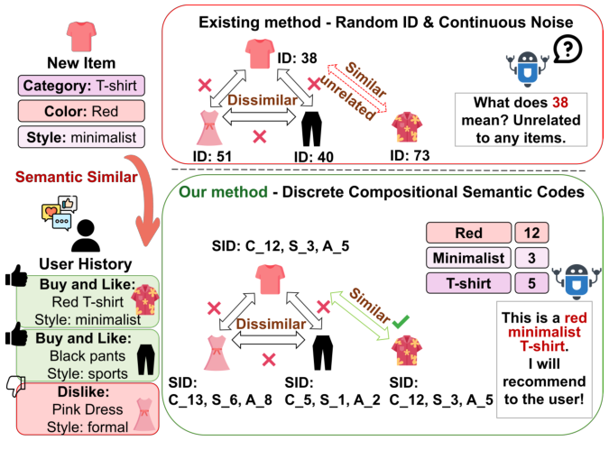
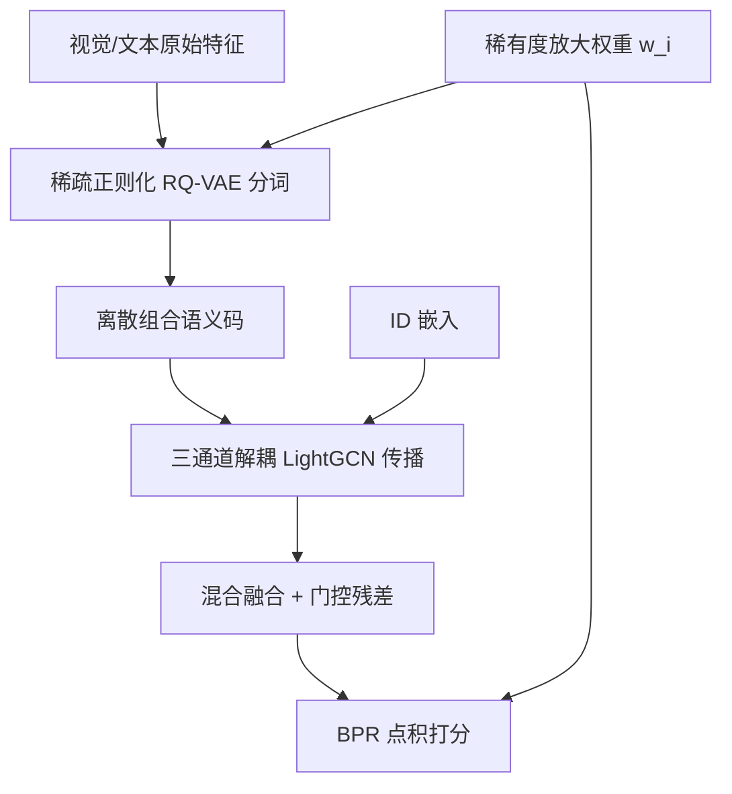

# MoToRec: Sparse-Regularized Multimodal Tokenization for Cold-Start Recommendation (稀疏正则化多模态分词用于冷启动推荐)

- **会议/期刊**: AAAI 2026 (Main Track)
- **作者与机构**: Jialin Liu, Zhaorui Zhang, Ray C.C. Cheung (City University of Hong Kong / The Hong Kong Polytechnic University)
- **推荐链路定位**: 召回（表征学习）
- **研究方向**: 冷启动与长尾推荐 / 多模态推荐
- **论文原文**: [https://arxiv.org/abs/2602.11062v2](https://arxiv.org/abs/2602.11062v2)
- **开源代码**: 暂未开源

## TL;DR (1分钟核心速览)

现有多模态推荐在连续高维空间做特征对齐，冷启动物品因交互稀疏而陷入"语义雾"（对齐噪声 + 表征纠缠 + OOD）。MoToRec 将多模态推荐重构为**离散语义分词**任务：用稀疏正则化 RQ-VAE 把视觉/文本特征编码为可组合的离散 token 序列，再以稀有度放大加权与分层多源图编码融合协同信号。在 Baby/Sports/Clothing 三个 Amazon 数据集、8:1:1 划分 + 全库排序协议下，整体 N@20 较最强多模态基线提升 8.57%–10.00%，冷启动物品集上最高提升 12.58%。

## Background & Motivation (背景与核心矛盾)

- **主流范式**: 以 FREEDOM、BM3、LGMRec、LPIC 为代表的图多模态推荐，在连续空间中用跨模态对比学习对齐视觉/文本/ID 表征，再经 LightGCN 传播融合。
- **前人局限**: ① 连续空间对齐对噪声极度敏感——"红色 T 恤"的像素向量与文本向量映射到同一高维点本身就是一个病态任务，稀疏数据下更甚；② 冷启动物品缺乏交互锚点，连续对齐产生的表征严重偏离分布（OOD），ID 嵌入则完全无信息量。
- **核心洞察 (Key Insight)**: 离散码本天然具备噪声鲁棒性与组合泛化性——新物品可被表示为若干"已知语义原语"的组合（如 `[颜色:红]+[风格:极简]+[品类:T恤]`），从而绕开连续对齐的模糊性。
- **本文切入点**: 把多模态推荐从"连续特征融合"改写为"离散语义分词"，用 RQ-VAE 生成组合语义码，并针对长尾分布设计稀有度感知优化。

<figure class="paper-figure" markdown="span">
  <figcaption>图1：从连续对齐到离散组合编码。上：现有方法难以应对噪声对齐和无信息ID。下：MoToRec生成鲁棒且可解释的编码，用于有效的冷启动推荐。</figcaption>
</figure>

## Method (核心方法设计)

### 1. 整体框架 (Overall Architecture)

MoToRec 分三阶段闭环：① **分词阶段**——视觉特征（BEiT）与文本特征（BGE）分别经模态专属 MLP 编码器投影后，由 $N_q$级残差量化器逐级量化，得到组合语义码；② **图编码阶段**——在用户-物品图上维护视觉、文本、ID 三条解耦传播通道，各自跑 LightGCN，再经混合融合与门控残差合成最终嵌入；③ **优化阶段**——BPR 排序损失 + InfoNCE 对比损失 + 加权 RQ-VAE 重建损失联合端到端训练，其中 RQ-VAE 损失按物品稀有度$w_i$ 放大。推理时以最终嵌入点积打分。

### 2. 关键设计拆解 (Key Designs)

1. **稀疏正则化 RQ-VAE 分词（核心创新）**：痛点在于学到的码本易退化为纠缠表征、丧失可解释性。本文在标准 RQ-VAE 的重建项与承诺项之外，对码本使用率的批内平均激活概率 $\hat{\rho}_j$施加 KL 惩罚，驱使其逼近稀疏先验$\mathrm{Bernoulli}(\rho)$：
$$\mathcal{L}_{\text{sparse}}=\sum_{j=1}^{K}\Big(\rho\log\frac{\rho}{\hat{\rho}_j}+(1-\rho)\log\frac{1-\rho}{1-\hat{\rho}_j}\Big)$$
该惩罚等价于最小化码字激活间的互信息（非线性 ICA 的离散类比），迫使每个物品仅激活少量专用码字，从而得到解耦、可组合的语义原语——这正是冷启动物品"用已知概念拼装新概念"的前提。

2. **自适应稀有度放大（Adaptive Rarity Amplification）**：痛点在于流行度偏置使模型忽视稀有物品，而它们恰是冷启动的主体。本文以度数阈值 $\tau$划分冷/热物品，对$d_i<\tau$且$d_i>0$ 的物品赋权：
$$w_i=\big(\log_2(d_i+2)\big)^{-1},\quad c_i=\mathbb{I}(d_i<\tau)$$
逆对数形式压缩度数动态范围、$+2$ 偏移稳定小度数取值；该权重同时乘入 RQ-VAE 损失与整体目标，使分词精度与表征学习向冷启动物品倾斜。

3. **分层多源图编码与融合**：为避免内容信号过早污染纯协同信号，视觉、文本、ID 三通道在 $\mathcal{G}_{ui}$上独立传播$L$层（式$\mathbf{E}^{(l+1)}=(\mathbf{D}^{-1/2}\tilde{\mathbf{A}}\mathbf{D}^{-1/2})\mathbf{E}^{(l)}$），得到$(\mathbf{u}^v,\mathbf{i}^v)$、$(\mathbf{u}^t,\mathbf{i}^t)$、$(\mathbf{u}^{id},\mathbf{i}^{id})$。跨源融合采用静态拼接与注意力动态重加权的混合策略$\mathbf{e}^m_i=\alpha\cdot\text{CONCAT}(\mathbf{i}^v,\mathbf{i}^t)+(1-\alpha)\cdot\text{Attention}(\mathbf{i}^v,\mathbf{i}^t)$，再与 ID 嵌入做门控残差连接。

4. **训练目标与开销**：总损失 $\mathcal{L}=\mathcal{L}_{\text{BPR}}+\lambda_{cl}\mathcal{L}_{\text{CL}}+\lambda_{rq}\frac{1}{|\mathcal{B}|}\sum_{i\in\mathcal{B}}w_i\mathcal{L}^{\text{RQ-VAE}}_i+\lambda_{reg}\|\Theta\|_2^2$，负采样沿用 BPR 的均匀负采样，对比损失用批内负样本。图传播阶段保持 LightGCN 原有效率，额外开销仅来自分词器：Sports 上每轮训练 11.33s（FREEDOM 12.2s、LGMRec 12.0s、LightGCN 6.5s），每批测试 3.8s，与高性能基线持平。

## Experimental Setup & Evaluation Protocol (实验设置与评估协议)

- **数据集与预处理**: 三个 Amazon 评论数据集，沿用 FREEDOM/BM3 的过滤与特征设置（BEiT 视觉特征 + BGE 文本特征）：

| 数据集 | #Users | #Items | #Interactions | 稀疏度 | 特征/场景说明 |
| :--- | :---: | :---: | :---: | :---: | :--- |
| Baby | 19,445 | 7,050 | 160,792 | 99.88% | 母婴，视觉/文本双模态 |
| Sports | 35,598 | 18,357 | 296,337 | 99.95% | 运动户外，视觉丰富 |
| Clothing | 39,387 | 23,033 | 278,677 | 99.97% | 服饰，细粒度属性强 |

- **数据划分与防穿越 (Splitting Strategy)**: 交互按 **8:1:1 比例划分** 训练/验证/测试；测试集进一步切分为 overall 与 cold-start 两组，冷启动物品定义为训练集中交互数 $<10$的测试物品（$\tau=10$）。
- **排名评测协议 (Ranking Protocol)**: 采用 **Full-Ranking 全库未交互排序**（MMRec 框架标准协议），指标为 R@10/R@20/N@10/N@20，对所有测试用户取平均。
- **对比基线与超参设置**: 传统组 MF-BPR、LightGCN、SimGCL、LayerGCN；多模态组 VBPR、MMGCN、DualGNN、SLMRec、LATTICE、FREEDOM、BM3、LGMRec、LPIC。嵌入维度 $d=64$，Adam 优化器，GCN 层数$L=2$；RQ-VAE 网格搜索$N_q\in\{4,6,8\}$、$K\in\{256,512,1024\}$、$\gamma\in\{0.01,0.05,0.1,0.2\}$、$\lambda_{rq}\in\{0.1,0.5,1,2\}$、$\lambda_{cl}\in\{0.01,0.05,0.1\}$；早停 patience=20，监控验证集 R@20；$t$检验$p\le 0.05$。

## Key Experimental Results (实验关键数据)

### 1. 主实验对比 (Main Results)

| 模型 | Baby R@20 | Baby N@20 | Sports R@20 | Sports N@20 | Clothing R@20 | Clothing N@20 |
| :--- | :---: | :---: | :---: | :---: | :---: | :---: |
| LightGCN | 0.0754 | 0.0328 | 0.0864 | 0.0387 | 0.0526 | 0.0236 |
| SimGCL | 0.0804 | 0.0350 | 0.0919 | 0.0414 | 0.0549 | 0.0244 |
| LATTICE | 0.0850 | 0.0370 | 0.0953 | 0.0421 | 0.0733 | 0.0330 |
| FREEDOM | 0.0992 | 0.0424 | 0.1089 | 0.0481 | 0.0941 | 0.0420 |
| BM3 | 0.0883 | 0.0383 | 0.0980 | 0.0438 | 0.0621 | 0.0281 |
| LGMRec | 0.0989 | 0.0430 | 0.1068 | 0.0477 | 0.0828 | 0.0371 |
| LPIC | 0.0977 | 0.0422 | 0.1113 | 0.0485 | 0.0928 | 0.0405 |
| **MoToRec** | **0.1077** | **0.0473** | **0.1163** | **0.0529** | **0.1014** | **0.0456** |
| Improv. (vs 最强基线) | +8.57% | +10.00% | +4.49% | +9.07% | +7.76% | +8.57% |

相对 ID-only 模型（MF-BPR/LightGCN）提升最高达 88%（Clothing N@10），相对最强多模态基线提升 4.49%–11.57%。

### 2. 消融实验 (Ablation Study)

| 变体 | Baby N@20 (Overall / Cold) | Sports N@20 (Overall / Cold) | Clothing N@20 (Overall / Cold) |
| :--- | :---: | :---: | :---: |
| MoToRec 完整 | **0.0473 / 0.0147** | **0.0529 / 0.0183** | **0.0456 / 0.0170** |
| w/o RQ-VAE | 0.0398 / 0.0092 | 0.0422 / 0.0115 | 0.0362 / 0.0097 |
| w/o ARA | 0.0437 / 0.0111 | 0.0466 / 0.0139 | 0.0397 / 0.0118 |
| w/o Sparsity | 0.0430 / 0.0109 | 0.0455 / 0.0137 | 0.0389 / 0.0116 |
| w/o CL | 0.0455 / 0.0118 | 0.0515 / 0.0153 | 0.0438 / 0.0129 |
| w/o HF | 0.0449 / 0.0120 | 0.0468 / 0.0150 | 0.0401 / 0.0127 |
| w/o HGE | 0.0438 / 0.0117 | 0.0489 / 0.0146 | 0.0407 / 0.0124 |

### 3. 关键实验发现 (Key Findings)

1. **离散分词是冷启动增益的主引擎**：移除整个 RQ-VAE 后冷启动 N@20 从 0.0147 跌至 0.0092（Baby，−37%）、0.0183 跌至 0.0115（Sports，−37%），跌幅远超其他组件，直接验证"离散组合码优于连续对齐"的核心论点。
2. **稀疏正则化对冷启动的边际价值高于整体性能**：w/o Sparsity 在 Baby 整体 N@20 仅降 9.1%（0.0473→0.0430），但冷启动降 25.9%（0.0147→0.0109），说明解耦语义原语主要服务于新物品的组合泛化；超参分析进一步显示冷启动结果对 $\gamma$ 偏离高度敏感，需精确校准分词器。
3. **稀有度放大与融合策略互补**：w/o ARA 冷启动 N@20 在三个数据集上分别降 24.5%/24.0%/30.6%，与 w/o HF（−18.4%/−18.0%/−25.3%）量级相当，表明"信号放大"与"信号融合"两条路径缺一不可；t-SNE 可视化显示完整模型的冷启动物品（红点）不再孤立，而是嵌入语义邻域内。

## Highlights & Limitations (亮点、对比与审稿批判)

- **与代表作对比 (vs. Prior Work)**: 相较 FREEDOM/BM3 的跨模态对比对齐，本文根本性地把战场从连续空间搬到离散码本，用组合语义码替代噪声敏感的点对点对齐；相较 VQ-Rec 等将 VQ 用于序列生成或嵌入压缩的工作，本文首次将离散分词用于多模态内容的解耦表征学习以攻克冷启动；相较 MeLU 等元学习少样本方案，本文面向严格零交互场景。
- **可迁移亮点**: ① 稀疏 KL 正则（Bernoulli 先验）作为码本解耦的通用正则项，可迁移至任何 RQ-VAE/VQ 表征学习任务；② 逆对数稀有度加权 $w_i$ 实现简单、无需额外前向，可直接插入任意长尾推荐训练目标。
- **审稿级局限批判**: ① 冷启动定义依赖训练集交互数 $<10$的阈值，未做严格零交互（strict zero-shot）划分，与真实上新场景仍有距离；② 分词器带来约 74% 的训练时间开销，且$N_q$、$K$、$\gamma$在三个数据集上最优值不一致（Baby 偏好$\gamma=0.05,K=512$，Clothing 偏好$\gamma=0.01,K=1024$），跨域部署需重新调参；③ 未与 LLM 特征提取类方法做直接对比，对"语义雾"的批判缺少同赛道实证。

## Rating (四维评分)

- **方法创新性 (Novelty)**: ⭐⭐⭐⭐ （将多模态推荐重构为离散语义分词，稀疏 KL 正则具备互信息最小化的理论支撑，视角新颖）
- **评估协议与实验扎实度 (Protocol & Experiments)**: ⭐⭐⭐⭐ （三数据集 + 13 个基线 + 整体/冷启动双场景 + 完整消融与效率分析，但冷启动划分未达 strict zero-shot）
- **写作与数学规范度 (Clarity & Rigor)**: ⭐⭐⭐⭐ （公式与符号定义清晰，RQ-VAE 与稀疏正则推导完整，超参敏感性分析充分）
- **工业落地与复现价值 (Industrial & Practical Value)**: ⭐⭐⭐⭐ （图传播零额外开销、推理 3.8s/batch 与基线持平，但代码未开源且分词器训练开销需权衡）

