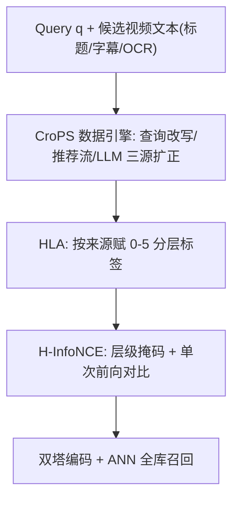
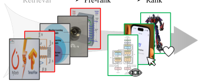

# CroPS: Improving Dense Retrieval with Cross-Perspective Positive Samples in Short-Video Search (跨视角正样本增强的短视频稠密检索)

- **会议/期刊**: AAAI 2026 (Oral)
- **作者与机构**: Ao Xie, Jiahui Chen, Quanzhi Zhu, Xiaoze Jiang, Zhiheng Qin, Enyun Yu, Han Li（快手科技）
- **推荐链路定位**: 召回（双塔稠密检索）
- **研究方向**: 协同过滤与双塔召回 / 大语言模型推荐
- **论文原文**: [https://arxiv.org/abs/2511.15443v1](https://arxiv.org/abs/2511.15443v1)
- **开源代码**: 暂未开源（数据集因隐私不公开，仅提供样例）

## TL;DR (1分钟核心速览)

工业双塔检索长期依赖"历史曝光交互"做自增强监督，未曝光但语义相关的内容被误标为负例，形成**过滤气泡 (filter bubble)**，检索趋于保守。CroPS 反其道而行，从**查询改写行为、推荐流跨系统行为、LLM 世界知识**三个视角扩充正样本，并用**分层标签分配 (HLA) + H-InfoNCE** 做细粒度对比学习。在快手 CPSQA（5 亿训练样本、10 亿候选池）上，CT 集 Recall@100 达 69.1%（较 TriSampler +9.3%），QR 集 40.1%（+6.9%）；线上 A/B 稠密模型 CTR +0.869%、改写率 RQR -0.646%。

## Background & Motivation (背景与核心矛盾)

- **主流范式**: 工业双塔检索用生产系统历史曝光/点击日志构造正例，从粗排-精排过滤掉的或未曝光视频采样硬负例，形成"数据积累→模型迭代"的自增强闭环。
- **前人局限**: ① 仅历史曝光内容可作正例，语义相关但未曝光的视频被系统性排除甚至误标为负例（如 query "transformer" 下电力变压器视频被埋没）；② 现有改进集中在**负采样策略**（ANCE/TriSampler）或**架构创新**（ColBERT/Poly-encoder），均未跳出自增强闭环，且 Poly-encoder 类后交互结构难以接入 ANN 检索。
- **核心洞察 (Key Insight)**: 破局点不在"更好的负例"，而在**被长期忽视的正样本侧**——引入历史曝光空间之外的相关内容，即可直接拓宽相关性表征的覆盖边界。
- **本文切入点**: 构建一个**架构无关、零推理开销**的正样本数据引擎，把三类异构正信号统一进分层监督框架。

## Method (核心方法设计)

### 1. 整体框架 (Overall Architecture)

CroPS 由三部分组成：**数据引擎**从四个视角汇聚样本集 $\mathcal{S}=\mathcal{P}_0\cup\mathcal{P}_1\cup\mathcal{P}_2\cup\mathcal{P}_3\cup\mathcal{N}$（在线搜索点击$\mathcal{P}_0$、查询级$\mathcal{P}_1$、系统级$\mathcal{P}_2$、世界知识$\mathcal{P}_3$及负例集$\mathcal{N}$）；**HLA** 按来源可靠性为每个样本赋 0–5 离散标签；**H-InfoNCE** 以标签为掩码构造分层对比损失，单次前向完成全部层级对比。训练后双塔结构与标准 InfoNCE 完全一致，线上仅替换 embedding，无额外延迟。

<figure class="paper-figure" markdown="span">
  <figcaption>图 2：CroPS 的整体框架，其中“+”（“-”）表示正例（负例）。它由三个组件组成：CroPS 数据引擎、分层标签分配（HLA）和 H-InfoNCE 优化。CroPS 数据引擎从以下方面扩展正样本：（1）查询级增强，（2）系统级扩展，（3）世界知识丰富。</figcaption>
</figure>

### 2. 关键设计拆解 (Key Designs)

1. **三源正样本扩充（数据引擎）**：痛点是不曝光即负例。查询级：同一用户 90 秒内改写查询后消费的视频，经轻量 6 层 Transformer 判别器 $\theta(\cdot)$打分，超过阈值$\alpha=0.6$即纳入$\mathcal{P}_1=\bigcup_{q_i\in\mathcal{Q}}\{d_{ij}\in\mathcal{D}_i\mid\theta(q,d_{ij})>\alpha\}$；系统级：取发过该 query 的用户在推荐流中时间窗内交互的至多 100 条视频，同阈值过滤得$\mathcal{P}_2$；知识级：Qwen2.5-14B 以 one-shot 提示作"伪检索器"，按 query 合成视频元数据（ocr_cover/caption/click_query/keywords），共产出 3500 万条$\mathcal{P}_3$。直觉：改写行为编码"用户真正想要什么"，推荐流提供时效性强的个性化信号，LLM 补足平台库存之外的世界语义。

2. **分层标签分配 HLA**：异构正例可靠性差异大，等权对待会稀释监督。HLA 赋离散标签：查询级正例 5（最真实意图）、系统级/知识级/精排点击 4、曝光未点击 3、未曝光 2、粗排-精排间过滤 1、in-batch 负例 0。直觉：把"相关性强度"从二值升级为有序分级，使模型学到与系统目标一致的细粒度排序偏好（如高标查询级正例可降低用户改写率）。

3. **H-InfoNCE 与训练效率**：标准 InfoNCE 假设二值相关，无法承载分级监督；Softmax-CE 又会把高标签样本误当低层负例。H-InfoNCE 规定：对标签为 $l_i$的正例，仅标签严格更低的样本作负例，同 query 中标签$\ge l_i$ 者被掩码：

$$\mathcal{L}=-\sum_{d_i\in\mathcal{S}}\log\frac{\exp(\mathrm{sim}(q,d_i)/\tau)}{\sum_{d_j\in\{d_i\}\cup\{d_k\in\mathcal{S}\mid l_i>l_k\}}\exp(\mathrm{sim}(q,d_j)/\tau)}$$

实现上用标签索引数据结构 + 掩码矩阵，单次前向算完全部层级损失，训练速度与标准 InfoNCE 持平（88h vs 178h）。负例为 in-batch 负例 + 未曝光/粗排过滤硬负例，**免额外负采样**；$\tau$ 设为可学习参数（初值 0.05，收敛至约 0.03，自动由粗到细加大对比难度）。

## Experimental Setup & Evaluation Protocol (实验设置与评估协议)

- **数据集与预处理**: 自建 CPSQA（快手真实日志，因隐私不公开，仅给样例）：

| 数据集 | #Users | #Items | #Interactions | 稀疏度/密度 | 特征/场景说明 |
| :--- | :---: | :---: | :---: | :---: | :--- |
| CPSQA-Train | 工业级 | ~10 亿候选池 | 5 亿样本 | 极稀疏 | 2025-06-11 日志，含改写序列与跨系统消费 |
| CPSQA-CT | — | 同上 | 1 万 query | — | 点击视频为正例，测即时偏好 |
| CPSQA-QR | — | 同上 | 1 万 query | — | 改写后消费视频为正例，测泛化/破气泡 |
| CPSQA-Anno | — | 同上 | 0.5K query | — | 人工标注，评 NDCG@4 |

- **数据划分与防穿越 (Splitting Strategy)**: **全局时间戳切分**——6/11 日志训练、6/13 日志测试，严格防穿越。
- **排名评测协议 (Ranking Protocol)**: 主指标为 **Full-Ranking 全库 Recall@100**（10 亿候选池），辅以人工标注集 NDCG@4 作参考监控；无采样负例排序。
- **对比基线与超参设置**: BM25、NCE、DPR、ANCE、ADORE+STAR、TriSampler、FS-LR；双塔均以 Qwen2.5-0.5B 初始化，序列长 128，Adam lr=2e-5、weight decay=1e-4。

## Key Experimental Results (实验关键数据)

### 1. 主实验对比 (Main Results)

| 方法 | Recall@100 (CT%) | Recall@100 (QR%) | NDCG@4 (%) |
| :--- | :---: | :---: | :---: |
| BM25 | 42.9 | 22.5 | 64.8 |
| NCE | 53.6 | 27.5 | 65.4 |
| DPR | 56.0 | 30.7 | 66.5 |
| ANCE | 56.9 | 31.3 | 67.1 |
| ADORE+STAR | 59.4 | 31.9 | **67.4** |
| TriSampler | 59.8 | 32.2 | 66.9 |
| FS-LR | 59.6 | 33.0 | 66.0 |
| **CroPS (Ours)** | **69.1** | **40.1** | 67.0 |
| Improv. | +9.3% | +7.1% | 持平 |

### 2. 消融实验 (Ablation Study)

| 配置 | Recall@100 (CT%) | Recall@100 (QR%) | NDCG@4 (%) |
| :--- | :---: | :---: | :---: |
| Baseline（仅在线搜索） | 59.6 | 33.0 | 66.0 |
| + 查询级扩充 | 63.3 | 36.1 | 66.5 |
| + 系统级扩充 | 65.7 | 37.4 | 66.7 |
| + 世界知识扩充（完整） | **69.1** | **40.1** | **67.0** |
| CroPS†（二值标签 + InfoNCE） | 59.9 | 32.1 | 66.7 |
| CroPS‡（查询级标签降为 4） | 67.1 | 38.4 | 66.8 |

| 损失函数 | Recall@100 (CT%) | Recall@100 (QR%) | 训练耗时 |
| :--- | :---: | :---: | :---: |
| InfoNCE | 67.8 | 38.9 | 178h |
| Softmax-CE | 65.3 | 37.8 | 89h |
| **H-InfoNCE** | **69.1** | **40.1** | **88h** |

### 3. 关键实验发现 (Key Findings)

1. **三源增益可加且互补**：查询级在 QR 上单策略增益最大（+3.1%），系统级在 CT 上增益更大（+2.4%），LLM 知识级再补 +3.4% CT / +2.7% QR，说明三者分别缓解"意图漂移""曝光偏差""库存边界"三个不同维度的气泡。
2. **标签粒度是性能命门**：退化为二值标签后 CT Recall 暴跌 9.2%（69.1→59.9），远超任何单一数据源增益；把查询级正例从 5 降到 4 也损失 2.0%，验证"改写行为是最强意图信号"这一先验。
3. **H-InfoNCE 兼顾精度与效率**：相比 InfoNCE 训练耗时减半（178h→88h）且指标全面更优；Softmax-CE 虽快但把高标签样本误作低层负例，CT 掉 3.8%。线上稠密模型 Ratioshow 从 32.5% 升至 44.3%，稀疏模型同样一致提升，证明架构无关性。

## Highlights & Limitations (亮点、对比与审稿批判)

- **与代表作对比 (vs. Prior Work)**: 相比 ANCE/TriSampler 聚焦负采样、FS-LR 引入多级负标签，CroPS 首次系统性地把"正样本侧"作为破气泡主战场；相比 ColBERT/Poly-encoder 的后交互架构，CroPS 不改双塔结构、零推理开销，可直接接入现有 ANN 系统。
- **可迁移亮点**: ① "查询改写后消费视频作正例"是几乎零成本的意图延续信号，可迁移到电商/内容搜索；② 标签索引 + 掩码矩阵的单次前向分层对比实现，可复用于任何多级相关性监督场景。
- **审稿级局限批判**: ① 数据集因隐私不公开，仅给样例，复现性受限；② 三源扩充均依赖阈值 $\alpha=0.6$ 与判别器质量，LLM 合成样本虽人工评测 95.8% 相关，但 4.2% 噪声与生成成本（3500 万条）在冷启动平台难以复制；③ 线上收益为相对提升（CTR +0.869%），绝对量级与长期多样性影响未充分讨论。

## Rating (四维评分)

- **方法创新性 (Novelty)**: ⭐⭐⭐⭐ （从正样本侧破过滤气泡的视角新颖，HLA+H-InfoNCE 将分级监督落地为高效算子，但单点技术门槛不高）
- **评估协议与实验扎实度 (Protocol & Experiments)**: ⭐⭐⭐⭐⭐ （10 亿候选池 Full-Ranking、时间切分防穿越、离线+线上 A/B+双模型类型验证，工业级扎实度罕见）
- **写作与数学规范度 (Clarity & Rigor)**: ⭐⭐⭐⭐ （H-InfoNCE 公式与掩码流程清晰，附录给算法示例；但部分符号与图表编号在正文中略显松散）
- **工业落地与复现价值 (Industrial & Practical Value)**: ⭐⭐⭐⭐ （已全量部署服务数亿用户、零推理开销、架构无关；扣分在数据不公开与 LLM 合成成本）

