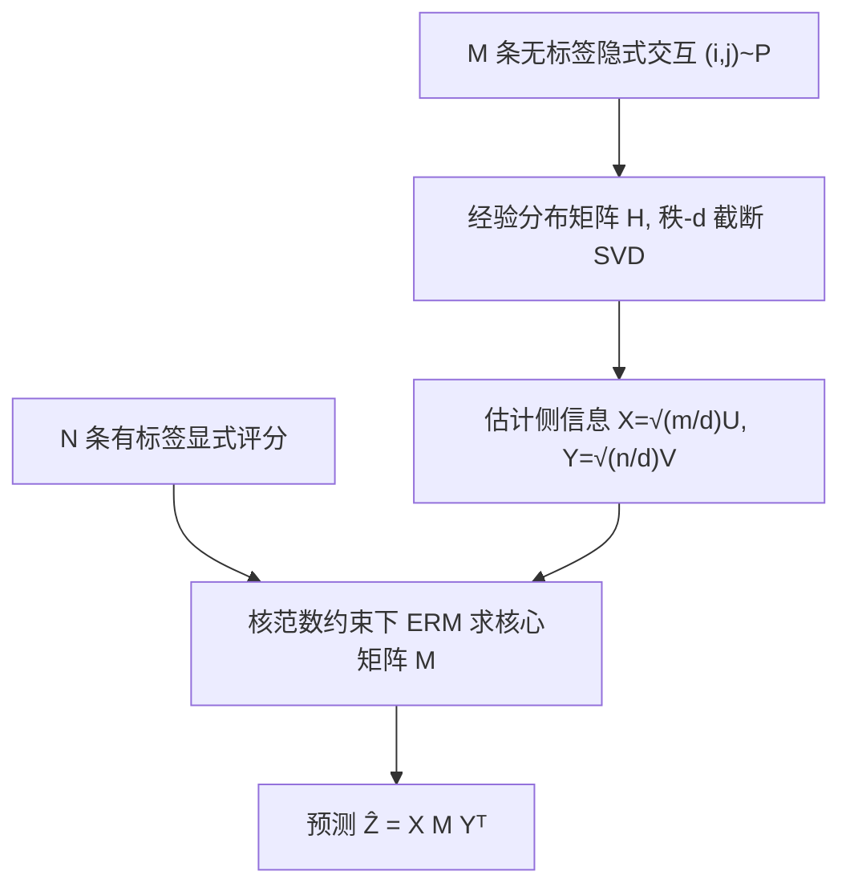

# Generalization Bounds for Semi-supervised Matrix Completion with Distributional Side Information (带分布侧信息的半监督矩阵完成泛化界)

- **会议/期刊**: AAAI 2026
- **作者与机构**: Antoine Ledent, Mun Chong Soo, Nong Minh Hieu (Singapore Management University; Binance)
- **推荐链路定位**: 召回（矩阵分解式隐式/显式反馈联合建模）
- **研究方向**: 协同过滤与双塔召回 / 冷启动与长尾推荐
- **论文原文**: [https://arxiv.org/abs/2511.13049v2](https://arxiv.org/abs/2511.13049v2)
- **开源代码**: 暂未开源

## TL;DR (1分钟核心速览)

现有矩阵完成理论几乎全部假设"所有观测样本都带标签"，而真实推荐场景中隐式反馈（点击/购买）海量、显式评分（1–5 星）稀疏。本文提出半监督矩阵完成新范式：**采样分布 $P$与真值矩阵$G$均为低秩且共享同一行列子空间**，用$M$条无标签隐式交互估计子空间、$N$条有标签评分估计核心矩阵，证明泛化误差可**加性解耦**为$\widetilde{O}(\sqrt{[m+n]r/M})+\widetilde{O}(\sqrt{dr/N})$。在 ML-100K/Douban/Yelp 上，当 90%–95% 评分标签被抹除时，DAMC 的 RMSE 仍显著优于仅用显式反馈的 SoftImpute/IGMC。

## Background & Motivation (背景与核心矛盾)

- **主流范式**: 矩阵完成（MC）在 i.i.d. 回归设定下研究"近似恢复"，代表工作 Foygel et al. 2011、Shamir & Shalev-Shwartz 2014 给出 $\widetilde{O}(nr)$的样本复杂度；归纳矩阵完成（IMC, Xu et al. 2013; Chiang et al. 2018; Ledent et al. 2021）进一步引入已知侧信息$X,Y$使$G=XMY^\top$。
- **前人局限**: 其一，**所有 MC 理论结果都假设样本全部带标签**，无法刻画"隐式反馈远多于显式评分"这一推荐系统基本事实；其二，IMC 假设侧信息矩阵 $X,Y$**先验已知**且真值列空间严格包含于$X$ 的列空间，而现实中用户/物品表征必须从其他数据中估计。
- **核心洞察 (Key Insight)**: 隐式反馈的采样分布 $P$本身是低秩的（用户-物品交互存在群体结构），且**与评分矩阵$G$ 共享行列子空间**——即"谁和谁交互"与"谁给谁打几分"由同一组潜在因子驱动。因此无标签数据可用于估计子空间，把 IMC 的"已知侧信息"替换为"从无标签数据学到的侧信息"。
- **本文切入点**: 用矩阵扰动理论（Wedin sin 定理）界定子空间估计误差，再将其传播进经典 IMC 泛化界，证明两项误差**可加而不相乘**。

## Method (核心方法设计)

### 1. 整体框架 (Overall Architecture)

学习设定：每个带标签样本为 $(\xi,\tilde{G})$，其中$\xi=(i,j)\sim P$为条目、$\tilde{G}$为含噪评分；另有$M$条仅含条目$(i,j)\sim P$的无标签样本。算法 DAMC 分两步：**Step 1** 用无标签数据构造经验分布矩阵$H=\frac{1}{M}\sum_{o=1}^{M}\mathbf{1}_{\xi_o}$，做秩$d$截断 SVD 得$H=U\Sigma V^\top$，令$X=\sqrt{m/d}\,U$、$Y=\sqrt{n/d}\,V$作为估计出的侧信息；**Step 2** 在核范数约束$\|M\|_*\le\mathcal{M}$下用$N$ 条有标签数据做经验风险最小化求解核心矩阵。理论上证明该两步流程的总体超额风险可分解为子空间估计项与矩阵恢复项之和。

### 2. 关键设计拆解 (Key Designs)

1. **共享子空间假设（Assumption 2）**：这是全文的理论基石。设 $P=U^*\Sigma^*[V^*]^\top$秩为$d$，且$G=U^*M^*[V^*]^\top$，即$G$的行列空间是$P$的行列空间的（可能真）子空间。归一化后写作$G=X^*M^*[Y^*]^\top$，其中$X^*=\sqrt{m/d}\,U^*$、$Y^*=\sqrt{n/d}\,V^*$。直觉上，$d$是"群体维度"（如用户类型/电影类型），而$G$的真实秩$r$可远小于$d$——这正是"隐式反馈信息量大于显式评分"的数学表达。

2. **子空间扰动界（Proposition 1）**：用 Wedin sin 定理把 $H$的谱扰动传递到子空间距离上，得到当$M\ge 470\log(\frac{4[m+n]}{\delta})\kappa_*^2P_*^2[m+n]$时，以$1-\delta$ 概率有
$$\max\Big(\min_{R}\|UR-U^*\|,\ \min_{R}\|VR-V^*\|\Big)\le\frac{2}{\Delta_*}\Big[\sqrt{\tfrac{16p_*}{3M}\log\tfrac{m+n}{\delta}}+\tfrac{16}{M}\log\tfrac{m+n}{\delta}\Big],$$
其中 $\Delta_*$为$P$的第$d$与第$d+1$奇异值间隙、$\kappa_*=\|P\|/\Delta_*$为条件数。关键点：误差随$1/\sqrt{M}$衰减，且只依赖$[m+n]$而非$mn$，说明**每行/列只需$\widetilde{O}(r)$ 条无标签样本即可定位子空间**。

3. **误差解耦主定理与训练目标**：将上述子空间误差代入 Ledent et al. 2021 的 IMC 界，得到总泛化界
$$\ell(XMY^\top)-\hat{\ell}(XMY^\top)\lesssim \underbrace{\widetilde{O}\!\Big(\sqrt{\tfrac{[m+n]r}{M}}\Big)}_{\text{子空间估计}}+\underbrace{\widetilde{O}\!\Big(\sqrt{\tfrac{dr}{N}}\Big)}_{\text{矩阵恢复}}+\underbrace{\widetilde{O}\!\Big(\sqrt{\tfrac{\Gamma[m+n]r}{MN}}\Big)}_{\text{交叉高阶项}}.$$
当 $\Gamma=O(d)$（最大采样概率与均值之比有界）或$N\ge\frac{m+n}{2}$时交叉项被吸收，两项**加性独立**。实践版用拉格朗日形式$\min\frac{1}{N}\sum_o \ell((XAB^\top Y^\top)_{\xi_o},\tilde{G}_o)+\lambda_{\mathcal{M}}(\|A\|_F^2+\|B\|_F^2)$以梯度法求解（Mazumder et al. 2010 的核范数等价引理）。**核心结论**：只需$\widetilde{O}(dr)$条有标签样本即可恢复$G$，而不用侧信息的经典 MC 需$\widetilde{O}([m+n]r)$——当$d\ll m+n$ 时标签需求大幅下降。

## Experimental Setup & Evaluation Protocol (实验设置与评估协议)

- **数据集与预处理**:

| 数据集 | #Users | #Items | #Interactions | 稀疏度/密度 | 特征/场景说明 |
| :--- | :---: | :---: | :---: | :---: | :--- |
| ML-100K | 943 | 1682 | 100,000 | 6.30% | 1–5 星评分，每用户≥20 条 |
| Douban | 4,988 | 4,903 | 未报告 | — | 中文影评+1–5 星评分 |
| Yelp | 未报告 | 未报告 | 未报告 | — | 商户评论 1–5 星 |

- **数据划分与防穿越 (Splitting Strategy)**: 采用**标签抹除式半监督划分**——在训练集内按比例 $p\in\{0,0.05,0.1,0.3,0.5,0.7,0.9,0.95\}$移除评分标签，被抹除的交互仅保留$(i,j)$对作为无标签隐式反馈；测试集标签完整保留。$p=0$即全监督上界，$p=0.95$ 即极端标签稀缺场景。
- **排名评测协议 (Ranking Protocol)**: 本文为**评分预测任务**，采用 RMSE（越低越好），在完整测试集上计算，非采样排序协议。
- **对比基线与超参设置**: 基线为 UserKNN（经典 CF）、SoftImpute（核范数 MC，即 DAMC 去掉侧信息）、IGMC（GNN 式归纳矩阵完成）。DAMC 在真实数据上用 4 层浅自编码器（宽度 400-40-40-400，BCE 损失）替代线性 SVD 以捕捉非线性，取 40 维隐表征构造 $X,Y$，下游仍用核范数正则 IMC。合成实验$m=n=200$、$d=r=4$、噪声$\sigma=0.05$、30 次独立重复。

## Key Experimental Results (实验关键数据)

### 1. 主实验对比 (Main Results)

RMSE（越低越好），$p$ 为标签抹除比例：

| 数据集 | 方法 | p=0.0 | p=0.1 | p=0.5 | p=0.9 | p=0.95 |
| :--- | :--- | :---: | :---: | :---: | :---: | :---: |
| ML-100K | userKNN | 1.0123 | 1.0151 | 1.0380 | 1.1675 | 1.2462 |
| | IGMC | 0.9281 | 0.9321 | 0.9824 | 1.1165 | 1.1482 |
| | SoftImpute | 0.9179 | 0.9373 | 0.9616 | 1.4190 | 1.8230 |
| | **DAMC** | **0.9068** | **0.9241** | **0.9364** | **1.0060** | **1.0460** |
| Douban | userKNN | 0.7946 | 0.7973 | 0.8288 | 0.9639 | 0.9838 |
| | IGMC | 0.7437 | 0.7579 | 0.8010 | 0.8713 | 0.8462 |
| | SoftImpute | 0.7383 | 0.7427 | 0.8289 | 1.8471 | 3.1966 |
| | **DAMC** | **0.7178** | **0.7205** | **0.7382** | **0.8323** | **0.8577** |
| Yelp | userKNN | 1.0955 | 1.1060 | 1.1496 | 1.2230 | 1.2356 |
| | IGMC | 1.0707 | 1.0759 | 1.0899 | 1.2028 | 1.0859 |
| | SoftImpute | 1.3888 | 1.4126 | 1.8428 | 3.2690 | 3.4140 |
| | **DAMC** | **1.0320** | **1.0470** | **1.0580** | **1.1290** | **1.1390** |

### 2. 消融实验 (Ablation Study)

本文以"是否使用无标签隐式反馈"作为天然消融（SoftImpute 即 DAMC 去掉子空间估计步骤）：

| 配置 | ML-100K (p=0.9) | Douban (p=0.9) | Yelp (p=0.9) | 说明 |
| :--- | :---: | :---: | :---: | :--- |
| DAMC 完整 | **1.0060** | **0.8323** | **1.1290** | 隐式+显式联合 |
| w/o 隐式反馈 (SoftImpute) | 1.4190 | 1.8471 | 3.2690 | 仅显式评分 |
| 相对退化 | +41.1% | +121.9% | +189.6% | 标签越稀疏差距越大 |

合成实验（图 1）另验证误差解耦：以 $\text{GAP}(M,1000)+\text{GAP}(100000,N)$ 作为解耦估计，与真实泛化误差散点高度相关。

### 3. 关键实验发现 (Key Findings)

1. **标签越稀缺，隐式反馈价值越大**：$p=0.9$时 DAMC 相对 SoftImpute 在 Douban 上 RMSE 从 1.8471 降至 0.8323（降 55%），而$p=0$时仅从 0.7383 降至 0.7178（降 2.8%），定量印证理论中$\sqrt{dr/N}$ 项主导时子空间先验的补偿作用。
2. **基线在极端稀疏下崩溃而 DAMC 稳健**：$p=0.95$ 时 SoftImpute 在 Yelp 上 RMSE 达 3.4140（接近随机），DAMC 仍保持 1.1390；说明仅靠少量显式标签做纯 MC 已不可行，而共享子空间假设提供了有效正则。
3. **误差加性解耦得到合成实验支持**：图 1 中解耦估计与真实 gap 呈强线性相关，说明子空间估计误差与矩阵恢复误差之间无强交互项，验证了定理中两项可分离的核心论断。

## Highlights & Limitations (亮点、对比与审稿批判)

- **与代表作对比 (vs. Prior Work)**: 相比 Foygel et al. 2011 / Shamir & Shalev-Shwartz 2014 的纯监督 MC 界（需 $\widetilde{O}([m+n]r)$标签），本文把标签需求降至$\widetilde{O}(dr)$；相比 Ledent et al. 2021 的 IMC（假设$X,Y$ 已知），本文首次把侧信息本身也纳入估计并给出端到端误差传播分析；相比 MNAR 矩阵完成（Ma & Chen 2019）关注逆倾向重加权下的 Frobenius 误差，本文关注 in-distribution 超额风险且允许大量条目采样概率为零。
- **可迁移亮点**: (1) "用海量弱信号估计子空间、用少量强信号拟合核心矩阵"的两阶段范式可直接迁移到冷启动场景——新物品的隐式曝光数据可用于定位其表征，少量评分用于校准；(2) 误差加性解耦的分析框架可用于指导工业界"隐式/显式数据配比"的资源分配。
- **审稿级局限批判**: (1) **Assumption 7（最大采样概率上界 $\Gamma$）是全文最强假设**，若$\Gamma$随$m,n$增长则交叉项$\sqrt{\Gamma[m+n]r/(MN)}$无法吸收，需额外条件$N\ge(m+n)/2$，这在大规模场景下意味着每行每列至少一条标签，与"标签极稀疏"的动机存在张力；(2) 真实数据实验用非线性自编码器替代 SVD，**已偏离理论所分析的线性算法**，理论与实践的 gap 未被量化；且实验仅对比三个经典基线，未与 SOTA 神经推荐模型（如 GNN-based）比较，作者亦自承目标是"验证范式有效性而非刷 SOTA"。

## Rating (四维评分)

- **方法创新性 (Novelty)**: ⭐⭐⭐⭐ （首次形式化"采样分布与真值共享低秩子空间"的半监督 MC 设定，并用矩阵扰动理论给出可解耦的加性泛化界，理论贡献扎实）
- **评估协议与实验扎实度 (Protocol & Experiments)**: ⭐⭐⭐ （合成实验验证解耦、真实数据覆盖三数据集与 8 档标签稀疏度较充分，但基线偏旧、缺 SOTA 对比与显著性检验）
- **写作与数学规范度 (Clarity & Rigor)**: ⭐⭐⭐⭐ （假设体系完整、定理证明链条清晰，附录给出 Wedin 定理与 Bernstein 不等式的自包含推导；但假设 7 的必要性讨论略显冗长）
- **工业落地与复现价值 (Industrial & Practical Value)**: ⭐⭐⭐ （两阶段流程简单可落地、SVD 步骤开销低，但真实数据需自编码器调参、无开源代码，且理论保证依赖较强假设）
