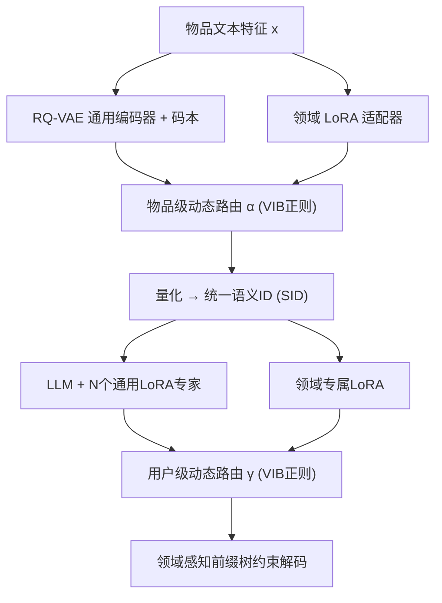

# From IDs to Semantics: A Generative Framework for Cross-Domain Recommendation with Adaptive Semantic Tokenization (从ID到语义：自适应语义分词的生成式跨域推荐框架)

- **会议/期刊**: AAAI 2026
- **作者与机构**: Peiyu Hu, Wayne Lu, Jia Wang（西安交通大学-利物浦大学 / 利物浦大学）
- **推荐链路定位**: 端到端生成式（召回+排序一体化）
- **研究方向**: 跨域与多场景推荐 / 生成式推荐与离散语义ID
- **论文原文**: [https://arxiv.org/abs/2511.08006v2](https://arxiv.org/abs/2511.08006v2)
- **开源代码**: [https://github.com/hupeiyu21/GenCDR](https://github.com/hupeiyu21/GenCDR)

## TL;DR (1分钟核心速览)

跨域推荐长期依赖共享用户/物品ID，而真实场景中ID往往不可对齐；现有LLM方案又受困于物品ID分词导致的词表爆炸与领域个性化建模不足。GenCDR 首次将生成式语义ID范式引入跨域推荐：用RQ-VAE构建通用语义码本，叠加领域LoRA适配器与物品级动态路由生成解耦语义ID，再以对称的用户级路由融合通用/领域兴趣做自回归生成，并用领域感知前缀树约束解码。在3组跨域数据集、Leave-Last-Out全库排序协议下，NDCG@10相对最强基线最高提升约20%。

## Background & Motivation (背景与核心矛盾)

- **主流范式**: 跨域序列推荐（CDSR）主流做法依赖共享用户/物品ID，通过门控、注意力、GNN或对比学习在域间迁移知识；近期LLM方案或作为特征增强器，或直接作为生成式推荐器。
- **前人局限**: 其一，多数真实跨域场景（线上内容平台 vs 线下服务）不存在严格ID对齐，ID桥接直接失效；其二，把物品ID直接喂给LLM会引发词表爆炸，且无法刻画高阶协同知识；其三，现有方法难以解耦"通用兴趣"与"领域特定表达"，静态融合易产生负迁移。
- **核心洞察 (Key Insight)**: 原始语义信息（如文本描述）天然可跨域迁移，而物品ID不可迁移。如图1所示，"Apple Watch"（科技域）与"新鲜苹果"（生活域）共享"Apple"这一通用语义，却各自携带"fitness/smart"与"sweet/vitamins"的领域属性——这正是需要解耦建模的结构。
- **本文切入点**: 用离散语义ID（SID）替代物品ID作为生成目标，并在物品级与用户级对称地引入"通用+领域特定"双通道与动态路由，从分词与兴趣建模两端同时解决分词困境与个性化缺失。

<figure class="paper-figure" markdown="span">
  <figcaption>图1：跨生活与科技领域的“Apple”示例。蓝色：共享语义（如日常使用）；橙色：领域特定属性（如新鲜苹果的甜味、维生素；Apple Watch的健身、智能）。</figcaption>
</figure>

## Method (核心方法设计)

### 1. 整体框架 (Overall Architecture)

GenCDR 是两阶段流水线。**阶段一（分词）**：在全体物品文本特征上预训练RQ-VAE得到通用离散语义码本；随后为每个域挂载LoRA适配器做领域特化微调；物品级动态路由网络按物品自适应融合通用与领域隐表示后再量化，输出统一SID。**阶段二（推荐）**：以Qwen2.5为骨干，先在混合跨域数据上训练N个通用LoRA专家捕捉可迁移兴趣，再为每个域微调领域专属LoRA；推理时用户级动态路由融合两路下一码概率分布，并由领域感知前缀树做掩码约束解码，保证生成合法SID。

### 2. 关键设计拆解 (Key Designs)

1. **领域自适应分词与物品级动态路由**：通用RQ-VAE虽提供跨域语义底座，却丢失领域判别特征（如视频的视觉美学、书籍的叙事风格）。本文为每域引入LoRA低秩增量 $h_{out}=W_0h_{in}+B_dA_dh_{in}$，并以轻量MLP输出门控$\alpha=\sigma(R_\phi(x))$，融合$\boldsymbol{z}_{fused}=(1-\alpha)\boldsymbol{z}_{uni}+\alpha\boldsymbol{z}_{spec}$后再量化。关键在于$\alpha$是**逐物品**计算的，避免静态融合带来的负迁移；并以VIB的KL项$D_{KL}(q(z_r|x)\|p(z_r))$压缩路由输入信息，迫使路由只依赖本质特征、促进解耦。分词预训练损失为$\mathcal{L}_{pretrain}=\mathcal{L}_{REC}+\mu\mathcal{L}_{Q}+\lambda\mathcal{L}_{MTM}$，其中掩码码元建模（MTM）让码本学到上下文"语法"而非仅重建。

2. **对称的跨域自回归推荐与用户级路由**：用户兴趣同样存在通用/领域两面。阶段二先用自回归目标 $\mathcal{L}_{uni}=-\sum_u\sum_k\log P(c_{k+1}^u|c_{\le k}^u;\theta_{LLM},\Theta_{uni})$训练N个通用LoRA专家（MoE式），冻结后再为每域训练专属适配器$\theta_{spec}^d$。推理时用户级门控$\gamma$融合两路分布：$P_{final}=(1-\gamma)P_{uni}+\gamma P_{spec}$，与物品级路由形成结构对称——这是本文"双端解耦"的核心设计哲学。

3. **领域感知前缀树与训练开销**：标准自回归解码既慢又会生成不存在的SID（幻觉推荐）。本文为每域离线构建前缀树 $T_d$，解码第$k$步仅在合法码子集$V_{valid}(s_{k-1})$ 上做掩码softmax，既保证合法性又将候选空间从全词表压缩到树路径。训练侧全部采用LoRA（rank=64, α=32/128, dropout=0.05），仅需微调约25.5M参数，相比7B全量微调训练时间从120h降至4.2h、峰值显存从45G降至15.8G。

## Experimental Setup & Evaluation Protocol (实验设置与评估协议)

- **数据集与预处理**: 三组跨域对，Sports-Clothing（休闲）、Phones-Electronics（科技）来自Amazon评论，Books-Movies（娱乐）来自Douban；按时间排序用户评论作为交互序列。

| 数据集 | #Users | #Items | #Interactions | 稀疏度 | 重叠/场景说明 |
| :--- | :---: | :---: | :---: | :---: | :--- |
| Sports | 35,598 | 18,357 | 296,337 | 99.95% | 重叠1.73%(704)，休闲域 |
| Clothing | 39,387 | 23,033 | 278,677 | 99.97% | 休闲域 |
| Phones | 27,879 | 10,429 | 194,439 | 99.93% | 重叠0.55%(404)，科技域 |
| Electronics | 192,403 | 63,001 | 1,689,188 | 99.99% | 科技域 |
| Books | 1,713 | 8,601 | 104,295 | 99.29% | 重叠7.48%(2,058)，娱乐域 |
| Movies | 2,628 | 20,964 | 1,249,016 | 97.73% | 娱乐域 |

- **数据划分与防穿越 (Splitting Strategy)**: `Leave-Last-Out`——最后一条交互作测试、倒数第二条作验证，严格按时间序，无未来信息泄漏。
- **排名评测协议 (Ranking Protocol)**: 采用 `Full-Ranking` 全库未交互物品排序（非采样排序），指标为 Recall@{5,10} 与 NDCG@{5,10}；以验证集 Recall@10 最优 checkpoint 做最终测试。
- **对比基线与超参设置**: 三类基线——单域序列（BERT4Rec/SASRec/STOSA）、生成式（VQ-Rec/TIGER/HSTU）、跨域（C2DSR/TriCDR/LLM4CDSR）；骨干Qwen2.5-7B，通用专家数N=4，LoRA rank=64，VIB权重 $10^{-3}$，AdamW lr=$5\times10^{-5}$，batch=8，FP16，H200；t检验$p\le0.05$ 显著。

## Key Experimental Results (实验关键数据)

### 1. 主实验对比 (Main Results)

下表摘取 NDCG@10 与 Recall@10（原文表2核心列，加粗为最优）：

| 数据集 | 指标 | SASRec | TIGER | HSTU | TriCDR | LLM4CDSR | **GenCDR** | Improv.% |
| :--- | :---: | :---: | :---: | :---: | :---: | :---: | :---: | :---: |
| Sports | N@10 | 0.0173 | 0.0287 | 0.0277 | 0.0259 | 0.0260 | **0.0262** | +1.9% (vs LLM4CDSR) |
| Clothing | N@10 | 0.0108 | 0.0167 | 0.0174 | 0.0194 | 0.0196 | **0.0203** | +3.6% |
| Phones | N@10 | 0.0287 | 0.0406 | 0.0425 | 0.0505 | 0.0506 | **0.0512** | +1.2% |
| Electronics | N@10 | 0.0154 | 0.0269 | 0.0271 | 0.0280 | 0.0279 | **0.0283** | +1.1% |
| Books | N@10 | 0.0164 | 0.0198 | 0.0206 | 0.0185 | 0.0189 | **0.0212** | +2.9% |
| Movies | N@10 | 0.1265 | 0.1255 | 0.1268 | 0.1217 | 0.1225 | **0.1275** | +0.6% |
| Books | R@10 | 0.0182 | 0.0221 | 0.0230 | 0.0211 | 0.0216 | **0.0237** | +3.0% |
| Movies | R@10 | 0.1825 | 0.1893 | 0.1931 | 0.1865 | 0.1878 | **0.1971** | +2.1% |

### 2. 消融实验 (Ablation Study)

NDCG@10，括号为相对全模型下降幅度（原文表3）：

| 变体 | Phones | Electronics | Sports | Clothing |
| :--- | :---: | :---: | :---: | :---: |
| **GenCDR 全模型** | **0.0512** | **0.0283** | **0.0262** | **0.0203** |
| w/o MTM | 0.0483 (↓5.7%) | 0.0267 (↓5.7%) | 0.0245 (↓6.5%) | 0.0190 (↓6.4%) |
| w/o Item Adapter | 0.0466 (↓9.0%) | 0.0255 (↓9.9%) | 0.0238 (↓9.2%) | 0.0183 (↓9.9%) |
| w/o Specific Expert | 0.0448 (↓12.5%) | 0.0245 (↓13.4%) | 0.0226 (↓13.7%) | 0.0173 (↓14.8%) |
| w/o Universal Experts | 0.0425 (↓17.0%) | 0.0232 (↓18.0%) | 0.0212 (↓19.1%) | 0.0162 (↓20.2%) |
| w/o MoE Gate (Avg.) | 0.0475 (↓7.2%) | 0.0262 (↓7.4%) | 0.0242 (↓7.6%) | 0.0186 (↓8.4%) |
| w/o Prefix Tree | 0.0498 (↓2.7%) | 0.0274 (↓3.2%) | 0.0255 (↓2.7%) | 0.0198 (↓2.5%) |

### 3. 关键实验发现 (Key Findings)

1. **通用专家是跨域迁移的命脉**：移除全部N个通用LoRA专家导致NDCG@10下降17.0%–20.2%，远超其他组件，说明共享跨域知识底座不可替代；而领域专属专家移除也损失12.5%–14.8%，证明"通用+领域"双通道缺一不可，单靠任一侧都无法覆盖用户兴趣的两面性。
2. **动态路由优于静态融合**：将MoE门控替换为简单平均即掉7.2%–8.4%，验证了逐物品/逐用户自适应加权对抑制负迁移的实际价值；t-SNE（图3）进一步显示，仅用通用适配器时跨域物品嵌入混杂，加入领域适配器后形成清晰分离的领域簇，从表征层面佐证了解耦有效性。
3. **前缀树是"低成本高收益"的合法性保障**：移除约束解码仅损失2.5%–3.2%精度，但结合图6可见，前缀树使推理时间与显存随物品池规模（2万→50万）几乎保持恒定，而TIGER/TriCDR的推理开销随池增大显著上升——这是生成式推荐走向工业规模部署的关键工程收益。

## Highlights & Limitations (亮点、对比与审稿批判)

- **与代表作对比 (vs. Prior Work)**: 相比TIGER（单域语义ID，无跨域解耦）与VQ-Rec（VQ分词但无领域适配），GenCDR首次把SID范式扩展到多域并显式解耦通用/领域语义；相比TriCDR（依赖ID对齐的对比学习）与LLM4CDSR（纯文本提示、无离散码本），本文用语义ID绕开ID对齐假设，同时以双端动态路由补足LLM4CDSR缺失的领域个性化。
- **可迁移亮点**: ①"通用码本+领域LoRA+逐样本门控"的分词范式可平移到多模态或多业务线场景；②物品级与用户级路由的**结构对称性**设计简洁优雅，可作为解耦表征的通用模板；③前缀树约束解码在任意SID生成式推荐中都能直接复用。
- **审稿级局限批判**: ①三组数据集的物品重叠率极低（0.55%–7.48%），虽契合"无ID对齐"动机，但缺乏高重叠场景的对照，无法验证语义ID在ID本可对齐时是否仍占优；②两阶段训练（分词预训练→通用专家→领域适配器）流程冗长，超参（N、rank、α、VIB权重）敏感度虽在Cloth上有分析，但跨数据集最优值是否一致未充分讨论；③全库排序下Recall绝对值普遍偏低（多在0.02–0.20），实际线上收益仍需A/B验证。

## Rating (四维评分)

- **方法创新性 (Novelty)**: ⭐⭐⭐⭐ （首次将生成式语义ID引入跨域推荐，物品级/用户级对称动态路由+VIB正则的解耦设计有清晰动机支撑）
- **评估协议与实验扎实度 (Protocol & Experiments)**: ⭐⭐⭐⭐ （三组真实跨域对、Leave-Last-Out全库排序、9个基线、t检验与完整消融齐备，但缺高重叠场景对照）
- **写作与数学规范度 (Clarity & Rigor)**: ⭐⭐⭐⭐ （公式与符号定义清晰，两阶段流程与对称结构表述严谨，复杂度与效率分析到位）
- **工业落地与复现价值 (Industrial & Practical Value)**: ⭐⭐⭐⭐ （代码开源，LoRA使训练成本降约28倍，前缀树保证推理随物品池规模恒定，工程价值突出）

