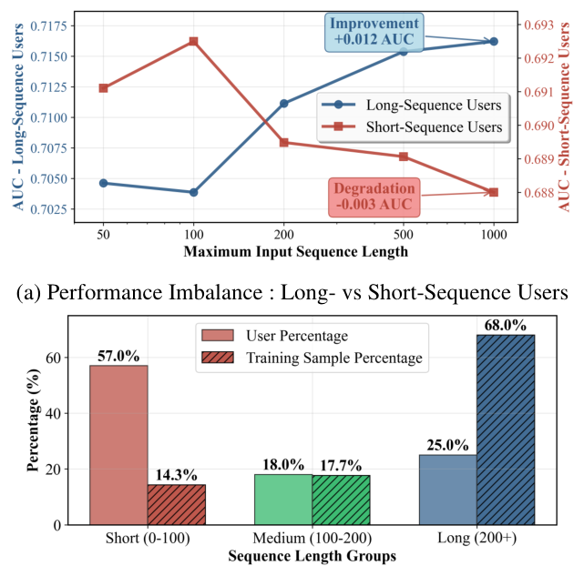
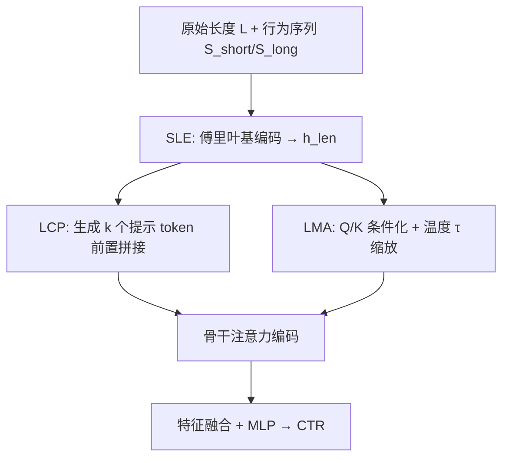
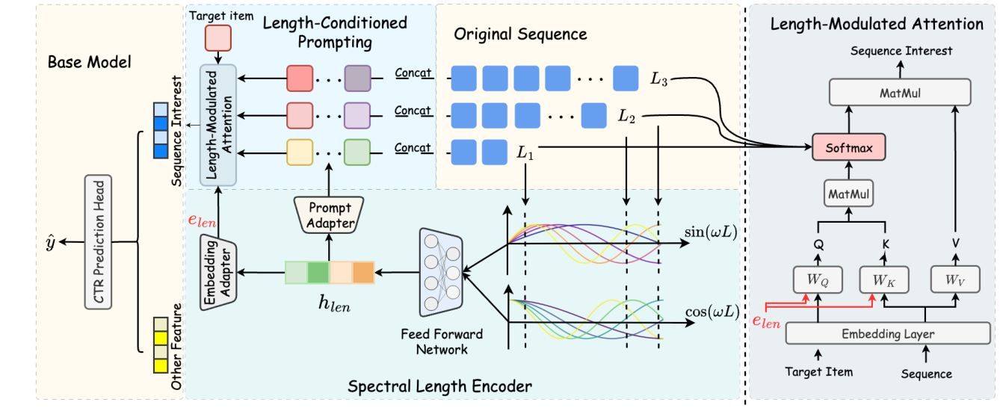

# Length-Adaptive Interest Network for Balancing Long and Short Sequence Modeling in CTR Prediction (长度自适应兴趣网络：平衡CTR预测中的长短期序列建模)

- **会议/期刊**: AAAI 2026
- **作者与机构**: Zhicheng Zhang, Zhaocheng Du, Jieming Zhu, Hai-Tao Zheng 等（清华大学深圳国际研究生院、华为诺亚方舟实验室、南京大学、香港科技大学、中山大学、鹏城实验室）
- **推荐链路定位**: 精排（CTR 预估）
- **研究方向**: CTR预估与特征交叉 / 序列推荐
- **论文原文**: [https://arxiv.org/abs/2601.19142v1](https://arxiv.org/abs/2601.19142v1)
- **开源代码**: [https://github.com/reczoo/FuxiCTR](https://github.com/reczoo/FuxiCTR)（基于 FuxiCTR 框架实现）

## TL;DR (1分钟核心速览)

现代 CTR 模型普遍采用"长序列两阶段 + 短序列分支"架构，但作者发现一个反直觉现象：**增大最大输入序列长度会提升长序列用户 AUC，却持续损害短序列用户**。根因被诊断为两点——softmax 注意力随长度加剧的**注意力极化**（Gini 系数随长度飙升），以及模型完全忽略**长度信号**（长度实为用户生命周期状态的强代理）。本文提出即插即用的 LAIN：用可学习傅里叶基把标量长度编码为连续嵌入，再以该嵌入生成前缀提示 token 并动态缩放注意力温度。在 3 个真实数据集、5 个强骨干上，AUC 最高提升 1.15%、logloss 最多下降 2.25%，且短序列桶（<100）AUC 单独提升 1.08%，长序列不退化。

## Background & Motivation (背景与核心矛盾)

- **主流范式**: SIM/ETA/SDIM/TWIN 等采用 GSU 检索 + ESU 目标感知注意力的两阶段长序列建模，并辅以短序列分支捕捉近期兴趣，融合后送入 CTR 头。
- **前人局限**: ①所有长度共享同一套参数与注意力逻辑，隐含假设"3 次交互用户与 300 次交互用户可用同一归纳偏置建模"；②训练样本被长序列用户主导（25% 用户贡献 68%+ 样本），模型隐式偏向高频长序列群体，而短序列用户占 57% 却仅贡献 14.3% 样本。
- **核心洞察 (Key Insight)**: 短序列下 softmax 会把权重压在 1–2 个物品上，有限信号被浪费、表征脆弱；而长度本身是强先验——短序列用户点击率 8.28%、行为稳定性系数 0.515，长序列用户分别为 9.41% 与 0.268，二者需要**方向相反的梯度**（短序列要平滑、长序列要稀疏），共享参数下内积为负，泛化受损。
- **本文切入点**: 把序列长度显式建模为**条件信号**，通过动态生成的长度相关参数解耦优化空间，使单一模型对不同长度自适应。

<figure class="paper-figure" markdown="span">
  <figcaption>图 1：(a) 在 EBNeRD-small 数据集上，改变最大输入序列长度对五个 CTR 模型平均 AUC 的影响。更长的序列能提升行为历史丰富（&gt; 200）的用户的表现，但对交互较少（&lt; 100）的用户则持续降低性能。(b) 用户行为长度分布呈现偏斜模式：短序列用户占多数，但长序列用户在训练样本中占主导。</figcaption>
</figure>

## Method (核心方法设计)

### 1. 整体框架 (Overall Architecture)

LAIN 不改动骨干网络，只在两处注入长度条件。原始长度 $L$先经谱长度编码器（SLE）得到连续嵌入$\mathbf{h}_{len}$；该嵌入分两路：一路经 MLP 生成$k$个提示 token，前置拼接到短期与长期行为序列（LCP）；另一路同时用于对注意力 Q/K 做条件化拼接，并产生一个长度相关的 softmax 温度$\tau$（LMA）。骨干注意力在"带提示的序列 + 调制后的温度"上计算，输出序列表征与其他特征域 embedding 融合后过 MLP 输出 CTR。训练端到端进行，推理仅增加不足 1.5% 参数与约 2.3% 时延。

<figure class="paper-figure" markdown="span">
  <figcaption>图 3：用于 CTR 预测的长度自适应兴趣网络（LAIN）概览。LAIN 通过谱长度编码器（SLE）以序列长度为条件，从原始长度 L 生成连续嵌入 hlen。该嵌入调制两个组件：长度条件提示（LCP）将长度感知的提示 token 前置到行为序列，长度调制注意力（LMA）通过 query/key 条件化和动态温度缩放调整注意力。所得序列表示与其他特征融合，用于最终 CTR 预测。</figcaption>
</figure>

### 2. 关键设计拆解 (Key Designs)

1. **谱长度编码器 SLE（把离散长度变成连续语义）**：若用 one-hot 或分桶，长度语义被割裂且无法外推。SLE 用可学习频率的傅里叶投影保留连续性与高频细节：$\mathbf{f}_{fourier}=[\sin(L\cdot\boldsymbol{\omega});\cos(L\cdot\boldsymbol{\omega})]\in\mathbb{R}^{2d_f}$，再经 LayerNorm+Linear+MLP 得$\mathbf{h}_{len}\in\mathbb{R}^{d}$。直觉上，多频正弦基让相邻长度在嵌入空间平滑过渡，模型可对未见长度插值。

2. **长度条件提示 LCP（解耦不同长度的梯度冲突）**：将参数拆为 $\theta=\{\theta_{shared},\theta_{prompt}(L)\}$，提示由$\mathbf{P}(L)=\text{reshape}(\text{MLP}_{prompt}(\mathbf{h}_{len}))\in\mathbb{R}^{k\times d}$生成并前置：$\mathbf{S}'_{short}=[\mathbf{P};\mathbf{S}_{short}]$，长期分支同理。由于提示随长度动态变化，短/长序列获得各自的"软前缀"，负内积的梯度冲突被部分隔离，同时提示 token 充当全局用户状态载体。

3. **长度调制注意力 LMA 与训练目标**：Q/K 拼接长度嵌入 $\mathbf{Q}'=W_q([\mathbf{Q};\mathbf{e}_{len}])$、$\mathbf{K}'=W_k([\mathbf{K};\mathbf{e}_{len}])$；温度定义为$\tau=1+\text{sigmoid}(-\beta(L-L_0))\cdot\gamma$，注意力为$\alpha_{ij}=\frac{\exp(\mathbf{Q}'_i\cdot\mathbf{K}'_j/(\sqrt{d}\cdot\tau))}{\sum_j\exp(\mathbf{Q}'_i\cdot\mathbf{K}'_j/(\sqrt{d}\cdot\tau))}$。短序列时$\tau$增大使分布平滑、避免过度极化；长序列时$\tau$收缩强化显著项。总损失即按长度分组的 BCE：$\mathcal{L}=\sum_{L}\sum_{(u,v_t,y)\in\mathcal{D}_L}\ell(f_{\theta_{shared}}([\mathbf{S}_u;\mathbf{P}(L)],v_t),y)$，无额外负采样设计（CTR 天然二分类）。

## Experimental Setup & Evaluation Protocol (实验设置与评估协议)

- **数据集与预处理**: 三个真实序列 CTR 数据集，均具长尾长度分布：

| 数据集 | #Users | #Items | #Interactions | 平均长度 | 场景说明 |
| :--- | :---: | :---: | :---: | :---: | :--- |
| MicroVideo1.7M | 10,951 | 1,704,880 | 4,287,008 | 148 | 短视频 |
| KuaiVideo | 10,000 | 3,239,534 | 4,664,549 | 278 | 短视频 |
| EBNeRD-small | 18,828 | 20,739 | 5,514,689 | 147 | 新闻推荐 |

- **数据划分与防穿越 (Splitting Strategy)**: 遵循 FuxiCTR 标准 CTR 协议，按样本时间顺序划分训练/验证/测试，验证集 AUC 早停。
- **排名评测协议 (Ranking Protocol)**: 点级二分类评估，报告 AUC、GAUC（按用户分组 AUC 后平均，缓解高活用户主导）与 LogLoss（校准质量），非全库排序协议。
- **对比基线与超参设置**: 5 个强骨干 DIN / DIEN / SIM / SDIM / TWIN，统一最大序列长度 1000、embedding 维度 64、Adam lr=0.001、dropout 0.2；SLE 取 $d_f=32$、MLP 隐层 512，提示数$k=4$，$\gamma=0.5$、$\beta=0.01$、$L_0$ 为数据集均值长度。

## Key Experimental Results (实验关键数据)

### 1. 主实验对比 (Main Results)

| 骨干 | EBNeRD AUC↑ | KuaiVideo AUC↑ | MicroVideo AUC↑ | 最大 LogLoss 降幅 |
| :--- | :---: | :---: | :---: | :---: |
| DIN | 0.7080 | 0.6979 | 0.7093 | — |
| DIN + LAIN | **0.7156** (+1.07%) | **0.7043** (+0.93%) | 0.7101 (+0.12%) | -0.65% |
| DIEN | 0.7099 | 0.6977 | 0.7185 | — |
| DIEN + LAIN | 0.7118 (+0.27%) | 0.6991 (+0.20%) | **0.7219** (+0.47%) | **-2.25%** |
| SIM | 0.6992 | 0.6875 | 0.7095 | — |
| SIM + LAIN | 0.7037 (+0.65%) | 0.6896 (+0.31%) | 0.7131 (+0.50%) | -0.50% |
| SDIM | 0.7099 | 0.6924 | 0.7161 | — |
| SDIM + LAIN | 0.7123 (+0.34%) | 0.6949 (+0.35%) | 0.7163 (+0.03%) | -0.56% |
| TWIN | 0.6993 | 0.6918 | 0.7158 | — |
| TWIN + LAIN | 0.7074 (**+1.15%**) | 0.6976 (+0.84%) | 0.7233 (+1.05%) | -1.63% |

### 2. 消融实验 (Ablation Study)

TWIN / MicroVideo1.7M 上的组件消融：

| 变体 | GAUC | AUC | LogLoss |
| :--- | :---: | :---: | :---: |
| LAIN (Full) | **0.7093** | **0.7233** | **0.4097** |
| w/o LCP | 0.7083 | 0.7228 | 0.4107 |
| w/o Query-Key Conditioning | 0.7071 | 0.7195 | 0.4148 |
| w/o Temperature Scaling | 0.7082 | 0.7212 | 0.4111 |
| w/o LMA（整体） | 0.7076 | 0.7189 | 0.4157 |
| w/o Short-term Branch | 0.7077 | 0.7226 | 0.4137 |

### 3. 关键实验发现 (Key Findings)

1. **短序列是最大受益者而非长序列**：TWIN 在 MicroVideo 上按长度分桶，短序列（<100）AUC 提升 +1.08%、logloss 降 -2.17%，长序列（200+）AUC 反升 +1.58%，说明长度条件化并非"牺牲长补短"，而是双向增益。
2. **注意力极化被实质缓解**：LAIN 将不同长度组的 Gini 系数压至 0.318–0.322，相比最差基线（0.347）方差降低 50.6%、极差降低 33.3%，直接对应"短序列注意力不再塌缩"的机制假设。
3. **LMA 是主贡献模块，温度需与 Q/K 条件化协同**：移除 LMA 导致 AUC 掉 0.44%（0.7233→0.7189），为所有消融中最大；单独移除温度缩放仅掉 0.21%，说明温度的价值在于与提示、Q/K 条件化联合形成长度感知的注意力几何。

## Highlights & Limitations (亮点、对比与审稿批判)

- **与代表作对比 (vs. Prior Work)**: 相比 SIM/SDIM/TWIN 只关注"如何把序列做得更长、检索更快"，本文首次把**长度本身当作条件变量**；相比 DARE 用解耦注意力/表征 embedding 缓解干扰，LAIN 不拆网络结构而是注入长度先验，可与任意骨干叠加；相比 PPR 等基于用户画像的软提示，本文提示完全由长度驱动，无需额外元数据。
- **可迁移亮点**: ①用可学习傅里叶基编码标量先验（长度、价格档位、活跃天数）是极低成本的条件化手段；②"按长度分桶报告指标"应成为长序列 CTR 论文的标准评估补充，否则聚合 AUC 会掩盖群体性退化。
- **审稿级局限批判**: ①长度分桶阈值（100/200）为人工设定，未讨论分桶边界敏感性，也未给出按分位数自适应的版本；②增益在 DIN/DIEN 等单阶段骨干上偏小（MicroVideo 上 DIN 仅 +0.12%、GAUC 甚至 -0.05%），说明方法收益依赖骨干本身存在两阶段注意力结构，泛化性论证略弱；③未报告线上 A/B 或推理吞吐的实测数字，2.3% 时延开销仅为离线估算。

## Rating (四维评分)

- **方法创新性 (Novelty)**: ⭐⭐⭐⭐ （把"序列长度"从被动统计量提升为条件信号，SLE+LCP+LMA 三件套设计自洽，但单点技术均为已有组件的巧妙重组）
- **评估协议与实验扎实度 (Protocol & Experiments)**: ⭐⭐⭐⭐ （3 数据集 × 5 骨干的交叉验证充分，含长度分桶与 Gini 量化分析；扣分在于缺少显著性检验与分桶阈值敏感性）
- **写作与数学规范度 (Clarity & Rigor)**: ⭐⭐⭐⭐ （梯度冲突的形式化动机清晰、复杂度分析完整，但部分符号如 $\mathbf{e}_{len}$与$\mathbf{h}_{len}$ 的关系交代略简）
- **工业落地与复现价值 (Industrial & Practical Value)**: ⭐⭐⭐⭐⭐ （即插即用、参数增量 <1.5%、基于开源 FuxiCTR 可直接复现，对短序列新用户群体有明确业务价值）

