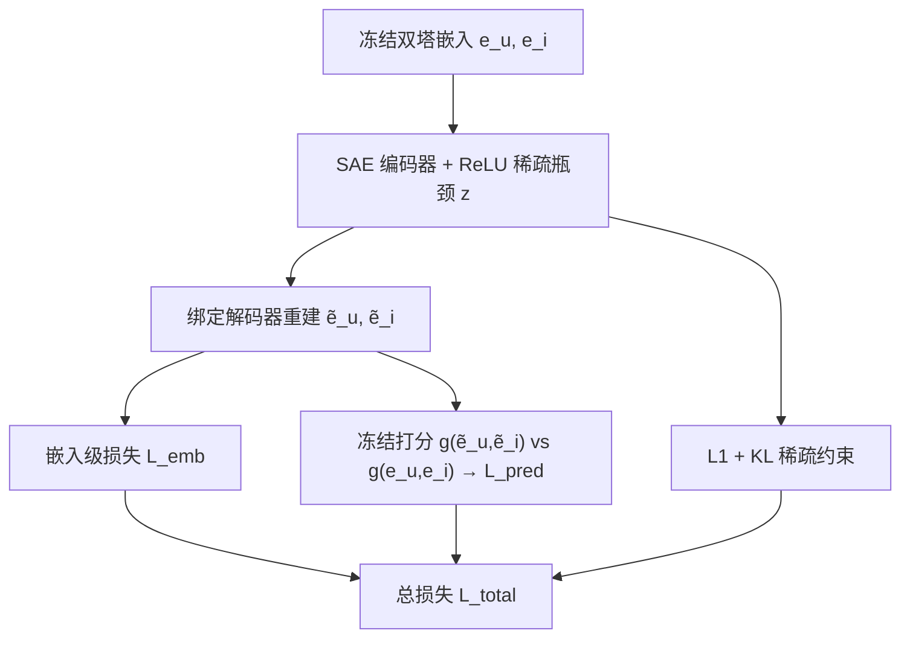
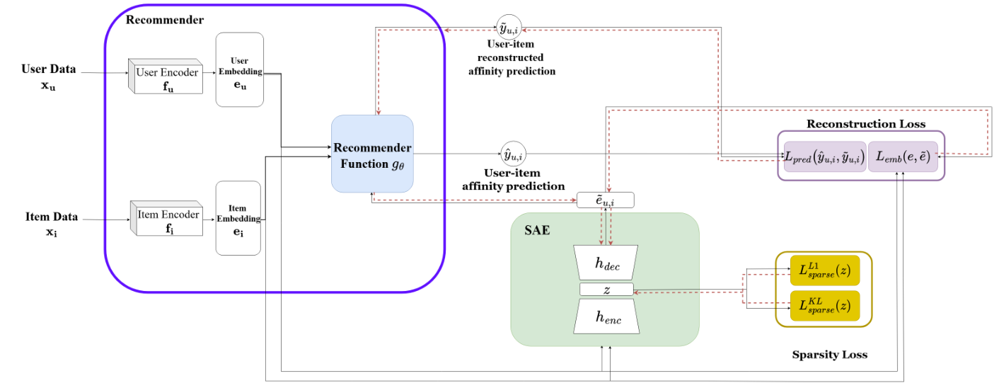

# Extracting Interaction-Aware Monosemantic Concepts in Recommender Systems (面向推荐系统的交互感知单义概念提取)

- **会议/期刊**: AAAI 2026
- **作者与机构**: Dor Arviv, Yehonatan Elisha, Oren Barkan, Noam Koenigstein（Tel Aviv University / The Open University）
- **推荐链路定位**: 重排 / 事后干预（post-hoc，不改动基座模型）
- **研究方向**: 去偏公平、可信隐私与工业架构 / 协同过滤与双塔召回
- **论文原文**: [https://arxiv.org/abs/2511.18024v1](https://arxiv.org/abs/2511.18024v1)
- **开源代码**: [https://github.com/DeltaLabTLV/Monosemanticity4Rec](https://github.com/DeltaLabTLV/Monosemanticity4Rec)

## TL;DR (1分钟核心速览)

双塔推荐器的用户/物品嵌入语义不透明，而 LLM 领域的 SAE 单义性方法只做几何重建、完全忽略"用户-物品交互"这一推荐本质。本文提出**预测感知重建损失**：把 SAE 重建后的嵌入送入**冻结的**推荐器打分函数 $g$，用原始亲和度与重建亲和度的 MSE 反向穿过$g$回传梯度，并用 KL 散度替代 Top-K 稀疏以消除死神经元。在 ML1M/Last.FM 上，MF/NCF 提取的神经元在$K=10$ 时语义纯度普遍达 0.8–1.0，且支持不改模型的事后定向推广与内容抑制。

## Background & Motivation (背景与核心矛盾)

- **主流范式**: 双塔架构（MF 内积、NCF 的 MLP 组合）以独立编码 + 交互函数 $g(e_u,e_i)$ 产生相关性，是工业召回/排序的基石，但嵌入维度本身无人类可读语义。
- **前人局限**: ① LLM 的 SAE 单义性工作（Templeton 2024; Gao 2024）建立在**单一共享表征空间的前向传播**上，直接搬到推荐会丢失用户-物品交互结构；② 推荐侧可解释工作要么设计模型特定的可解释因子/注意力权重，要么做特征归因式事后解释，**潜空间语义依旧黑箱**。
- **核心洞察 (Key Insight)**: 推荐的"意义"不在嵌入几何，而在**亲和度排序行为**。因此 SAE 的重建保真度应以"重建后打分是否复现原打分"来衡量，而非仅 $\|e-\tilde{e}\|_2$。
- **本文切入点**: 在冻结推荐器上做后验 SAE 训练，让预测级损失穿过 $g$ 回传，使潜神经元与交互语义对齐。

## Method (核心方法设计)

### 1. 整体框架 (Overall Architecture)

基座双塔 $e_u=f_u(x_u),e_i=f_i(x_i)$与打分$g$全部冻结；对每个嵌入$e$训练一个线性编码器 + ReLU + 稀疏瓶颈$z\in\mathbb{R}^m$+ 绑定权重线性解码器得到$\tilde{e}$。训练时同时计算嵌入级重建损失与**预测级损失**（采样用户-物品对，比较$g(e_u,e_i)$与$g(\tilde{e}_u,\tilde{e}_i)$），梯度经冻结的$g$回传至 SAE；稀疏性由$\ell_1$+ KL 双重约束。推理阶段仅需一次编码得到$z$，可读神经元标签、也可对$z$ 的单个维度做加减实现事后干预。

<figure class="paper-figure" markdown="span">
  <figcaption>图1：框架架构。黑色实线箭头表示前向传播；红色虚线箭头表示梯度流。我们的创新通过将一种新颖的预测级损失通过冻结的推荐器反向传播，使单义性适配于推荐系统，从而保留用户-物品交互语义。</figcaption>
</figure>

### 2. 关键设计拆解 (Key Designs)

1. **预测感知重建损失（Prediction-Aware Loss）**：痛点在于纯几何重建会让两个嵌入各自"看起来像"，但内积/MLP 交互后的排序被破坏。做法是在随机采样的用户-物品对集合 $\mathcal{S}$ 上对齐亲和度：
$$\mathcal{L}_{pred}=\frac{1}{|\mathcal{S}|}\sum_{(u,i)\in\mathcal{S}}\big(\hat{y}_{u,i}-\tilde{y}_{u,i}\big)^2,\quad \tilde{y}_{u,i}=g(\tilde{e}_u,\tilde{e}_i;\theta_g)$$
总重建损失 $\mathcal{L}_{rec}=\alpha\mathcal{L}_{emb}+\beta\mathcal{L}_{pred}$。直觉：把"保排序"而非"保坐标"作为约束，SAE 被迫把容量分配给真正驱动推荐的语义方向（流派、流行度、年代），而非噪声几何。

2. **KL 散度稀疏替代 Top-K**：LLM 常用的 Top-K 稀疏在推荐嵌入上易引发训练不稳定与死神经元。本文对每个神经元 $j$统计批内经验激活率$p_j=\frac{1}{B}\sum_{i=1}^{B}h_{ij}$，施加
$$\mathrm{KL}(p_j\|\rho)=\rho\log\frac{\rho}{p_j}+(1-\rho)\log\frac{1-\rho}{1-p_j}$$
配合 $\ell_1$正则，使神经元以目标频率$\rho$ 稀疏激活，得到更紧凑、解耦且无死单元的瓶颈。

3. **Matryoshka 嵌套字典与训练/推理开销**：瓶颈按 $m_1<m_2<\cdots<m_n=m$嵌套训练，前段神经元捕获粗粒度（主流受众），后段专精微流派。训练负采样沿用基座推荐器的**按流行度动态采样**（每 epoch 重抽），SAE 本身无需负采样；推理仅一次前向编码，干预只需修改$z$ 的单个坐标，**零重训练成本**。

## Experimental Setup & Evaluation Protocol (实验设置与评估协议)

- **数据集与预处理**: ML1M 将评分二值化为隐式正反馈；Last.FM 将用户-曲目事件聚合到**艺术家级**以便概念标注。

| 数据集 | #Users | #Items | 交互规模 | 说明 |
| :--- | :---: | :---: | :---: | :--- |
| ML1M | ~6.0k | ~3.7k(电影) | ~1M 评分 | 电影，流派/年代标注齐全 |
| Last.FM | ~1.9k | 艺术家级 | 隐式收听事件 | 音乐，标签噪声更大、风格更分散 |

- **数据划分与防穿越 (Splitting Strategy)**: 每用户留出 **5 个正样本**作测试集（hold-out），其余全部训练；从训练集再切验证子集以 MPR 早停与调参。
- **排名评测协议 (Ranking Protocol)**: 本文**不做传统 Top-N 精度对比**，而是以**语义纯度**（top-$K$激活物品中匹配神经元标签的比例，$K=10/20/50$）与**保真度**（原始 vs 重建 top-30 列表的 RBO、Kendall-$\tau$）为主指标；神经元标签由 GPT-4.5 自动流水线生成。
- **对比基线与超参设置**: 基座为 MF（内积）与 NCF（两层 MLP，64/32/16 + sigmoid）；嵌入维度 $d=20$（ML1M）、$d=100$（Last.FM）；SAE 瓶颈$m=22$（ML1M）、$m=70$（Last.FM）；Adam 优化，超参按 Pach 2025 的单义性得分网格搜索。

## Key Experimental Results (实验关键数据)

### 1. 主实验对比 (Main Results)

原文无传统 SOTA 精度对比表，核心定量结果为**语义纯度（%）**（节选代表性概念，$K=10/20/50$）：

| 概念 | MF (K=10/20/50) | NCF (K=10/20/50) |
| :--- | :---: | :---: |
| Comedy (ML1M) | **1.00 / 1.00 / 1.00** | 0.90 / 0.75 / 0.66 |
| Horror (ML1M) | **1.00 / 1.00 / 1.00** | 0.90 / 0.95 / 0.96 |
| Sci-Fi (ML1M) | **1.00 / 1.00 / 1.00** | 0.70 / 0.75 / 0.64 |
| 90's Action (ML1M) | **1.00 / 1.00 / 0.94** | **1.00 / 1.00 / 0.98** |
| Children's (ML1M) | 0.90 / 0.90 / 0.88 | **1.00 / 1.00 / 0.98** |
| Electronic (Last.FM) | **1.00 / 0.90 / 0.82** | **1.00 / 1.00 / 0.76** |
| Metal (Last.FM) | **1.00 / 1.00 / 0.92** | **1.00 / 0.95 / 0.82** |
| Rock (Last.FM) | **1.00 / 0.95 / 0.92** | **1.00 / 0.80 / 0.78** |
| Popularity 神经元（流行度百分位） | 4.35 / 6.30 / 6.34 | 1.04 / 3.20 / 3.73 |

### 2. 消融实验 (Ablation Study)

以预测级损失权重 $\beta$ 为消融轴（ML1M，MF/NCF）：

| 配置 | RBO (top-30) | Kendall-$\tau$ | 单义性得分 |
| :--- | :---: | :---: | :---: |
| $\beta=0$（w/o$\mathcal{L}_{pred}$） | 最低 | 最低 | 偏低 |
| $\beta$ 小→中（推荐工作点） | 上升 | 上升 | **峰值** |
| $\beta$ 过大 | 趋饱和 | 趋饱和 | 下降（稀疏性受损） |

### 3. 关键实验发现 (Key Findings)

1. **$\beta=0$的消融直接证明$\mathcal{L}_{pred}$不可替代**：去掉预测级损失后 top-30 列表的 RBO 与 Kendall-$\tau$显著下滑，说明纯几何重建无法保住交互排序；而单义性得分在**中等$\beta$** 处取峰，揭示"保真度—稀疏性"存在明确权衡，需联合调参而非单调加大$\beta$。
2. **MF 的神经元比 NCF 更"纯"但覆盖更窄**：MF 在 Comedy/Horror/Sci-Fi 上 $K=50$ 仍保持 1.00，而 NCF 在 Sci-Fi 上仅 0.64；反过来 NCF 独有 80's Comedy、Emo 等概念而 MF 缺失（表中以 `–` 标注）。这暗示线性内积结构更利于线性可分的概念方向，MLP 交互则把语义摊薄到非线性组合中。
3. **流行度神经元与流派神经元性质不同**：其 top-$K$物品的流行度百分位在 ML1M 上仅 4.35%–6.34%（即处于长尾头部），跨$K$ 稳定，说明它编码的是**行为热度**而非语义类别，可作为审计流行度偏置的直接探针。

## Highlights & Limitations (亮点、对比与审稿批判)

- **与代表作对比 (vs. Prior Work)**: 相比 Templeton 2024 / Gao 2024 的 LLM SAE，本文的关键差异是**梯度穿过冻结推荐器**，把"重建保真"重新定义为"行为保真"；相比 Ghazimatin 2020 等事后归因方法，本文给出的是**潜空间可编辑的语义坐标**而非输入级解释；相比 Matryoshka SAE（Bussmann 2025），本文验证了其在推荐域呈现"受众规模分层"而非纯语义粒度分层。
- **可迁移亮点**: ① "冻结下游模型 + 重建后过下游打分"的预测感知损失可平移到任何双塔召回/粗排的嵌入诊断；② 用 KL 目标激活率替代 Top-K 可有效规避死神经元，适合小样本嵌入场景。
- **审稿级局限批判**: ① **缺少推荐精度层面的对照**——未报告干预前后 NDCG/HR 变化，也未与任何可解释基线做定量比较，"纯度"指标依赖 GPT-4.5 自动标注，存在标签噪声与主观性；② 干预实验（Bob Dylan 推广、Horror 抑制）仅为个例展示，缺乏规模化量化评估与对**公平性/曝光操纵风险**的讨论，而这恰是该方向最敏感的落地问题。

## Rating (四维评分)

- **方法创新性 (Novelty)**: ⭐⭐⭐⭐ （把 SAE 单义性从"单空间前向"推广到"双塔交互"，预测感知损失是干净且必要的增量）
- **评估协议与实验扎实度 (Protocol & Experiments)**: ⭐⭐⭐ （跨 2 模型 × 2 数据集较全面，但缺精度对照、缺可解释基线、干预仅个例）
- **写作与数学规范度 (Clarity & Rigor)**: ⭐⭐⭐⭐ （损失分解与梯度路径交代清晰，KL 稀疏动机明确；复杂度与超参敏感性分析偏薄）
- **工业落地与复现价值 (Industrial & Practical Value)**: ⭐⭐⭐⭐ （后验训练、零改架构、单坐标干预，代码已开源，适合做嵌入审计与内容治理工具）
