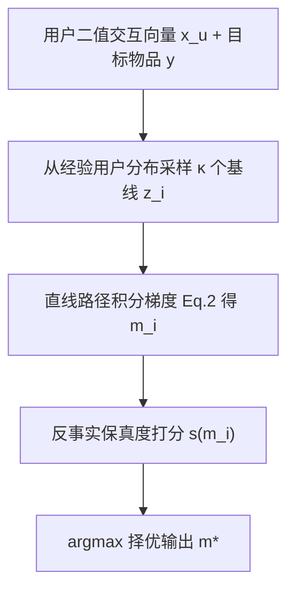
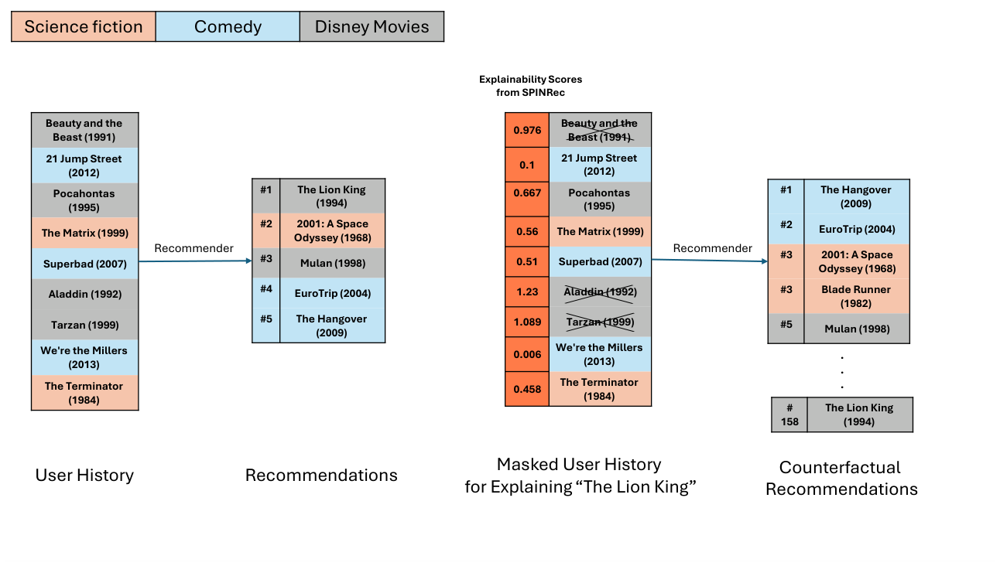

# Fidelity-Aware Recommendation Explanations via Stochastic Path Integration (基于随机路径积分的保真感知推荐解释)

- **会议/期刊**: AAAI 2026
- **作者与机构**: Oren Barkan, Yahlly Schein, Yehonatan Elisha, Veronika Bogina, Mikhail Baklanov, Noam Koenigstein（以色列开放大学、特拉维夫大学）
- **推荐链路定位**: 重排（后置解释层，模型无关）
- **研究方向**: 去偏公平、可信隐私与工业架构 / 协同过滤
- **论文原文**: [https://arxiv.org/abs/2511.18047v1](https://arxiv.org/abs/2511.18047v1)
- **开源代码**: [https://github.com/DeltaLabTLV/SPINRec](https://github.com/DeltaLabTLV/SPINRec)

## TL;DR (1分钟核心速览)

推荐解释研究长期聚焦说服力与用户满意度，却极少检验解释是否真实反映模型决策（保真度）。本文提出 SPINRec，首次把路径积分（Path Integration）归因迁移到推荐场景，并针对稀疏二值交互设计**随机基线采样**：从经验用户分布采样 $\kappa$ 个可行画像作为积分起点，再按保真度指标择优。在 MF/VAE/NCF 三模型、ML1M/Yahoo!/Pinterest 三数据集上，以 POS/DEL/INS/CDCG 全套反事实指标全面超越 SHAP、LIME、FIA、ACCENT、LXR 等基线，例如 ML1M-NCF 上 POS@5 由 LXR 的 0.249 降至 0.185（相对降 25.7%）。

## Background & Motivation (背景与核心矛盾)

- **主流范式**: 推荐解释分两支——模型特定（MF 分解解释、方面级特征归因）与模型无关（LIME-RS、SHAP4Rec、DeepSHAP、FIA/ACCENT 影响函数、LXR 学习式解释器）。后者通用性强，但保真度长期缺乏系统基准。
- **前人局限**: ① 视觉/NLP 中成熟的路径积分若直接从全零"冷用户"基线积分，在推荐场景失效——未交互项在插值路径上恒为零、梯度贡献为零，而归因信号微弱甚至误导；② 现代推荐器恰恰把"未交互"也当作信息（如 VAE/NCF 的隐式负信号），全零基线抹掉了这一半信息。
- **核心洞察 (Key Insight)**: 推荐数据是**高维、稀疏、二值**的，缺失交互语义模糊；基线选择（而非积分算子本身）才是保真度的瓶颈，这与 CV 中黑图基线扭曲暗区归因的问题同构。
- **本文切入点**: 用**数据驱动的非零随机基线**替代固定基线，让"存在"与"缺失"两类信号都能在积分路径上产生有效梯度。

## Method (核心方法设计)

### 1. 整体框架 (Overall Architecture)

给定用户二值交互向量 $\mathbf{x}_u\in\{0,1\}^{|\mathcal{V}|}$、推荐模型$f_\theta$与目标物品$y$，SPINRec 先从经验用户分布采样$\kappa$个基线画像$\mathcal{B}=\{\mathbf{z}_1,\dots,\mathbf{z}_\kappa\}$；对每个基线构造直线路径$\mathbf{r}(t)=t\mathbf{x}+(1-t)\mathbf{z}$，沿路径积分梯度得到归因图$\mathbf{m}_i$；最后用反事实保真度指标$s(\cdot)$在候选集合中择优输出$\mathbf{m}^*$。全流程模型无关、可并行，仅需前向/反向传播，无需训练解释器。

### 2. 关键设计拆解 (Key Designs)

1. **路径积分归因算子（把 Shapley 式完备性搬到推荐）**：痛点是不满足"归因和 = 预测差"的梯度方法易饱和失真。SPINRec 用链式法则把预测差精确分解到各特征：
$$\sum_{i} m_i = f^y_\theta(\mathbf{x}) - f^y_\theta(\mathbf{z}),\quad m_i=\int_0^1 \frac{\partial f^y_\theta(\mathbf{r}(t))}{\partial r_i}\,\frac{dr_i}{dt}\,dt$$
该式保证归因**完备性（completeness）**，且对基线敏感——这直接把矛盾聚焦到"选什么 $\mathbf{z}$"。

2. **随机基线采样与保真度择优（本文真正的增量）**：痛点在于单一全零基线使未交互项梯度恒零。SPINRec 采样 $\kappa$ 个真实用户画像作基线，使缺失项在路径上取非零中间值、产生有效梯度；再以保真度指标择优：
$$\mathbf{m}^*=\arg\max_{\mathbf{m}\in\{\mathbf{m}_1,\dots,\mathbf{m}_\kappa\}} s(\mathbf{m})$$
直觉是"用真实用户分布覆盖行为异质性"，同时隐式实现 Expected Gradients 的推广（取均值图即退化为期望梯度）。图 2 显示 $\kappa\approx10$ 后增益饱和，性价比最优。

<figure class="paper-figure" markdown="span">
  <figcaption>图1：反事实保真度示意图。SPINRec 识别出用户历史中对推荐“The Lion King”影响最大的物品。当这些物品被遮蔽时，推荐排名急剧下降，证明了解释的保真度。</figcaption>
</figure>

3. **训练目标、负采样与推理效率**：无训练损失、无负采样（纯后置归因）。复杂度为 $O(\kappa Q(J+N|\mathcal{V}|))\approx O(\kappa QN|\mathcal{V}|)$，对特征数**线性**；对比 SHAP 的指数级、LIME 的三次采样复杂度优势明显，且各基线路径完全可并行上 GPU。

## Experimental Setup & Evaluation Protocol (实验设置与评估协议)

- **数据集与预处理**: 三数据集全部二值化为隐式反馈，解释目标为每用户 Top-1 推荐物品。

| 数据集 | 领域 | 交互类型 | 划分说明 |
| :--- | :---: | :---: | :--- |
| ML1M | 电影 | 二值化评分 | 80/20 用户级划分 + 10% 验证 |
| Yahoo! Music | 音乐 | 隐式反馈 | 同上 |
| Pinterest | 图像社交 | 隐式反馈 | 同上（结果置于代码库） |

- **数据划分与防穿越 (Splitting Strategy)**: **用户级 80/20 划分**（非时间切分），另留 10% 用户做超参网格搜索，测试集报告全部结果。
- **排名评测协议 (Ranking Protocol)**: 反事实扰动式保真度评估，非传统 Top-N 排序。移除/保留 Top-$K_e$解释特征后观察目标物品排名与置信度变化：POS@$K_r$↓、DEL↓、INS↑、CDCG↓，并含 AUC 式逐步扰动曲线；$K_e\in\{2,3,4\}$、$K_r\in\{5,10,20\}$。
- **对比基线与超参设置**: 基线含 Cosine、SHAP4Rec（$K=10$k-means 采样）、DeepSHAP、LIME-RS、LIRE、FIA、ACCENT、LXR，以及消融版 PI（无采样）。显著性用配对 t 检验（$p\le0.01$）。

## Key Experimental Results (实验关键数据)

### 1. 主实验对比 (Main Results)

ML1M 上 NCF 与 VAE 的代表性结果（POS/DEL/CDCG 越低越好，INS 越高越好）：

| 模型 | 方法 | POS@5↓ | POS@10↓ | DEL↓ | INS↑ | CDCG↓ |
| :--- | :--- | :---: | :---: | :---: | :---: | :---: |
| NCF | SHAP | 0.501 | 0.559 | 0.620 | 0.667 | 0.504 |
| NCF | LIME | 0.291 | 0.345 | 0.484 | 0.774 | 0.334 |
| NCF | FIA | 0.215 | 0.256 | 0.591 | 0.805 | 0.276 |
| NCF | ACCENT | 0.306 | 0.348 | 0.462 | 0.774 | 0.347 |
| NCF | LXR | 0.249 | 0.301 | 0.451 | 0.790 | 0.303 |
| NCF | PI (消融) | 0.211 | 0.248 | 0.389 | 0.807 | 0.273 |
| NCF | **SPINRec** | **0.185** | **0.223** | **0.382** | **0.810** | **0.258** |
| VAE | LXR | 0.348 | 0.430 | 0.006 | 0.022 | 0.394 |
| VAE | PI (消融) | 0.236 | 0.319 | 0.005 | 0.029 | 0.322 |
| VAE | **SPINRec** | **0.189** | **0.252** | **0.005** | **0.031** | **0.293** |

相对最强基线 LXR：NCF 上 POS@5 降 **25.7%**、CDCG 降 **14.9%**；VAE 上 POS@5 降 **45.7%**、CDCG 降 **25.6%**。Yahoo! 上同趋势（NCF POS@5：LXR 0.267 → SPINRec 0.238）。

### 2. 消融实验 (Ablation Study)

| 配置 | ML1M-NCF POS@5↓ | ML1M-VAE POS@5↓ | Yahoo!-NCF POS@5↓ | 说明 |
| :--- | :---: | :---: | :---: | :--- |
| 纯 PI（固定全零基线） | 0.211 | 0.236 | 0.250 | 无随机采样 |
| **SPINRec（$\kappa$ 采样+择优）** | **0.185** | **0.189** | **0.238** | 完整模型 |
| 相对增益 | 12.3% | 19.9% | 4.8% | — |

### 3. 关键实验发现 (Key Findings)

1. **路径积分本身已是强基线**：纯 PI 在多数指标上已逼近甚至超过 LXR（如 ML1M-NCF POS@5 0.211 vs 0.249），说明完备性归因算子比"学习式解释器"更可靠；随机采样再叠加 12%–20% 增益。
2. **增益在表达力强的模型上更大**：VAE/NCF 上采样带来的 POS@5 相对降幅（19.9%/12.3%）显著高于 MF（约 2%），印证"未交互项作为信息"在深度模型中权重更高，随机基线恰好释放这部分梯度。
3. **$\kappa$存在明显饱和点**：图 2 显示$\kappa\approx10$ 后 INS 增益趋平，说明少量真实画像即可覆盖行为异质性，避免线性膨胀的算力代价。

## Highlights & Limitations (亮点、对比与审稿批判)

- **与代表作对比 (vs. Prior Work)**: 相比 LXR（需预训练解释器网络、泛化受限于训练分布），SPINRec 免训练、模型无关且保真度更高；相比 SHAP4Rec（指数级采样、Jaccard 聚类近似），其线性复杂度且归因满足完备性公理；相比 FIA/ACCENT（影响函数近似、二阶项不稳定），路径积分给出精确的预测差分解。
- **可迁移亮点**: ① "随机真实基线 + 指标择优"可迁移到任何稀疏二值特征归因场景（CTR 特征归因、冷启动画像解释）；② 反事实保真度指标族（POS/DEL/INS/CDCG）可直接作为解释模块的离线评测标准。
- **审稿级局限批判**: ① 择优依赖保真度指标 $s(\cdot)$本身，存在"用评测指标选解释"的循环论证风险，且每候选需$N$次扰动评估，$\kappa$与$N$ 叠加使在线解释延迟偏高；② 划分采用用户级 80/20 而非时间切分，未验证时序漂移下的稳定性；Pinterest 主结果置于代码库、正文缺失，削弱结论完整性。

## Rating (四维评分)

- **方法创新性 (Novelty)**: ⭐⭐⭐⭐ （首次将路径积分完备性归因引入推荐，随机基线采样是针对稀疏二值数据的精准适配，但积分算子本身为已有理论迁移）
- **评估协议与实验扎实度 (Protocol & Experiments)**: ⭐⭐⭐⭐ （三模型三数据集、双套反事实指标族、$p\le0.01$ 显著性检验齐全，但缺时间切分与正文 Pinterest 结果）
- **写作与数学规范度 (Clarity & Rigor)**: ⭐⭐⭐⭐ （完备性分解与复杂度推导清晰，算法伪代码完整；保真度择优的目标函数与评测指标耦合关系未充分讨论）
- **工业落地与复现价值 (Industrial & Practical Value)**: ⭐⭐⭐⭐ （代码与评测工具全开源、模型无关易插拔、线性复杂度可 GPU 并行；但逐用户 $\kappa\times N$ 扰动评估的在线时延需工程优化）
