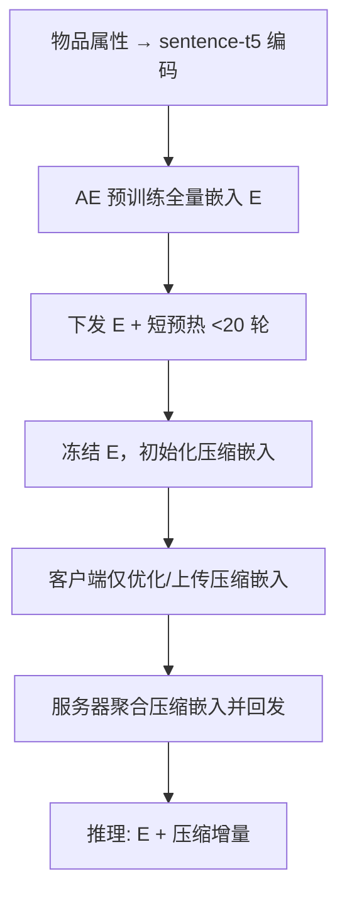
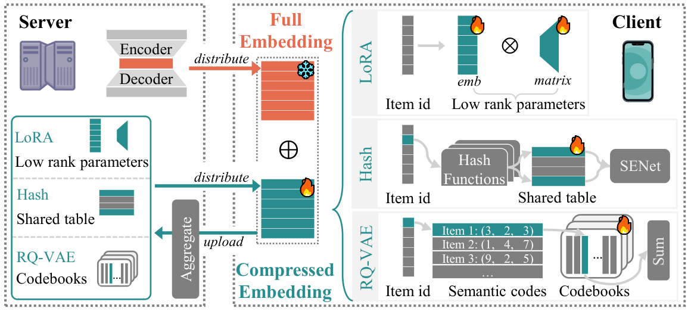

# Plug-and-Play Parameter-Efficient Tuning of Embeddings for Federated Recommendation (联邦推荐中即插即用的嵌入参数高效微调)

- **会议/期刊**: AAAI 2026
- **作者与机构**: Haochen Yuan, Yang Zhang, Xiang He, Quan Z. Sheng, Zhongjie Wang（哈尔滨工业大学、北德克萨斯大学、麦考瑞大学）
- **推荐链路定位**: 召回（联邦物品嵌入训练与传输）
- **研究方向**: 去偏公平、可信隐私与工业架构 / 生成式推荐与离散语义 ID
- **论文原文**: [https://arxiv.org/abs/2512.13734v1](https://arxiv.org/abs/2512.13734v1)
- **开源代码**: [https://github.com/young1010/FedPEFT](https://github.com/young1010/FedPEFT)

## TL;DR (1分钟核心速览)

联邦推荐（FR）每轮需上传全量物品嵌入 $E\in\mathbb{R}^{n\times k}$，通信量随物品数线性膨胀，而现有压缩嵌入方案（低秩/哈希/量化）单独使用时精度普遍掉点、跨骨干鲁棒性差。本文提出即插即用的 PEFT 框架：服务器用物品属性预训练全量嵌入并下发，客户端**冻结全量嵌入**、仅优化并上传压缩嵌入（LoRA / Hash / RQ-VAE），全量嵌入只做不足 20 轮的短预热。在 4 个 FR 骨干 × 3 个数据集上，PEFT 嵌入在多数设置下同时降低通信并超过全量嵌入基线（如 FedMF-ML1M 的 N@10 由 33.98 升至 37.98）。

## Background & Motivation (背景与核心矛盾)

- **主流范式**: FR 让客户端本地训练、仅上传模型参数，服务器聚合并回发；但物品嵌入 $E$的参数量随$n$ 线性增长，往往超过神经网络主体，成为通信瓶颈。
- **前人局限**: ① 纯压缩嵌入（低秩分解、Hash、量化）虽降通信，却在多数骨干上精度明显下滑（如 C-Hash 在 FedMF-ML1M 的 N@10 仅 5.54 vs. 全量 33.98）；② 为补精度引入元学习、SENet 等复杂结构后，跨骨干/跨数据集的鲁棒性反而变差。
- **核心洞察 (Key Insight)**: 全量嵌入承载了物品语义先验，真正需要"学"的只是用户侧偏好带来的增量；因此可把全量嵌入当作**冻结的语义底座**，只让轻量压缩嵌入承担个性化微调——这正是 PEFT 的思路，此前未被用于 FR 嵌入。
- **本文切入点**: 用"预训练全量嵌入 + 短预热 + 冻结 + 仅传压缩嵌入"的插件式流程，把通信对象从 $O(nk)$ 降到压缩参数量，同时借全量嵌入保住表达力。

## Method (核心方法设计)

### 1. 整体框架 (Overall Architecture)

服务器先用公开编码器（sentence-t5，$k_p=768$）编码物品属性，经无监督 AE 预训练得到全量物品嵌入$E=\{e_i\in\mathbb{R}^k\}$并下发；客户端进行不足 20 轮（共 1000 轮）的短预热以稳定早期优化；随后服务器初始化并下发压缩嵌入，客户端**冻结$E$**，每轮只本地优化并上传压缩嵌入参数，服务器仅聚合压缩嵌入并回发。推理时客户端用$E+\text{压缩增量}$ 作为最终物品表示。整个流程与骨干无关，可直接套在 FedMF/FedNCF/FedPerGNN/PFedRec 上。

<figure class="paper-figure" markdown="span">
  <figcaption>图2：采用多种压缩嵌入策略实现PEFT的即插即用FR框架。</figcaption>
</figure>

### 2. 关键设计拆解 (Key Designs)

1. **LoRA 式低秩增量（可学习、无碰撞）**：痛点是无碰撞但参数量随 $n$线性。引入低维表$A=\{a_i\in\mathbb{R}^{k_L}\}$与低秩矩阵$B\in\mathbb{R}^{k\times k_L}$（$k_L\ll k$），最终嵌入为$E=\{e_i+B(a_i)\}$，$B$初始化为零矩阵保证起点等价于全量嵌入。通信量降为$O(k_L(n+k))$，且因直接使用可学习嵌入而天然规避表示碰撞。
2. **RQ-VAE 多级码本量化（本文新引入的 PEFT 策略）**：痛点是想让嵌入尺寸与物品数解耦。服务器预训练语义码 $c_i=(c_0,\dots,c_{l-1})$并冻结，客户端只微调码本$C_j$，最终嵌入为$E=\{e_i+\sum_{j=0}^{l-1}C_j(c_j)\}$；残差量化$\hat{z}=\sum_j C_j(c_j)$使$l$级码本以$O(d_R\cdot l)$的通信量获得$(d_R)^l$ 级表达空间，码本用首批残差的 K-means 质心初始化以缓解碰撞。
3. **Hash + SENet 动态重加权（最省通信的备选）**：用 $h$个通用哈希$H_j(i)=[((a\cdot \mathrm{ID}+b)\boldsymbol{o}d p)\boldsymbol{o}d d_H]$把物品映射到共享表$H$，均值池化得$e_i=\frac{1}{h}\sum_j v^{H_j(i)}$；SENet 版本用 squeeze-excitation 学权重$w_i=\sigma_2(W_2\sigma_1(W_1 s_i))$后加权求和$e_i=\sum_j w_i^j v^{H_j(i)}$，通信量仅$O(d_H)$，代价是碰撞风险与额外小矩阵上传。
4. **训练目标与开销**：总损失沿用各骨干原有目标（如 BPR/BCE），本文不改损失，只改"传什么"；负采样沿用骨干默认策略。通信对比见表 3：全量 $O(kn)$，LoRA$O(k_L(n+k))$，RQ-VAE$O(d_R l)$，Hash$O(d_H)$；RQ-VAE 额外存储$O(d_R l+n)$，Hash(S) 额外计算$O(h^2)$。

## Experimental Setup & Evaluation Protocol (实验设置与评估协议)

- **数据集与预处理**:

| 数据集 | #Users | #Items | #Interactions | 稀疏度 | 特征/场景说明 |
| :--- | :---: | :---: | :---: | :---: | :--- |
| ML1M | 6,040 | 3,706 | 1,000,209 | 95.53% | 电影，含电影属性 |
| Software | 1,826 | 802 | 12,805 | 99.13% | Amazon 软件类，含描述 |
| Industrial | 11,041 | 5,334 | 77,071 | 99.87% | Amazon 工业类，极稀疏 |

- **数据划分与防穿越**: 采用 FR 标准设定，每客户端保留本地用户嵌入不上传；客户端采样率 $S=10\%$，每轮 2 个本地 epoch，全局 1000 轮。原文未显式声明 LOO/时间戳切分细节，属评估描述上的薄弱点。
- **排名评测协议**: 报告 top-K 的 H@K 与 N@K（K=10/20），未明确 Full-Ranking 或采样负例比例，需读者注意可比性。
- **对比基线与超参**: 4 个骨干（FedMF、FedNCF、FedPerGNN、PFedRec）× 3 类嵌入（Full / 纯压缩 C- / PEFT P-）× 4 种策略（LoRA、RQ-VAE、Hash、Hash(S)）；$k_p=768$，AE 结构 [768,512,256,128,32]，$k_L\in\{2..6\}$，RQ-VAE 的$\beta=0.25$、$l\in\{2..6\}$、$d_R\in\{32..512\}$，Hash 的$p=4096$、$h\in\{1..4\}$；结果为 5 次运行均值。

## Key Experimental Results (实验关键数据)

### 1. 主实验对比 (Main Results)

选取 FedMF 与 FedNCF 两个骨干的代表性结果（N@10 / H@10）：

| 骨干-数据集 | Full | C-LoRA | C-RQ-VAE | C-Hash | P-LoRA | P-RQ-VAE | P-Hash(S) |
| :--- | :---: | :---: | :---: | :---: | :---: | :---: | :---: |
| FedMF-ML1M | 33.98 / 58.44 | 36.66 / 58.08 | 8.62 / 16.56 | 5.54 / 12.19 | **37.98 / 59.79** | 33.59 / 58.96 | 16.69 / 33.79 |
| FedMF-Industrial | 9.13 / 16.48 | 8.00 / 14.10 | 9.82 / 18.08 | 5.25 / 11.09 | 9.86 / 17.32 | **10.82 / 18.10** | 5.28 / 10.98 |
| FedNCF-ML1M | 38.80 / 61.29 | 35.03 / 51.94 | 14.76 / 25.40 | 6.44 / 13.28 | 39.52 / 60.72 | **39.75 / 60.91** | 37.94 / 58.99 |
| FedNCF-Industrial | 8.99 / 15.62 | 6.47 / 12.67 | 7.45 / 12.90 | 6.20 / 11.77 | 9.61 / 16.99 | 9.51 / 16.75 | **9.88 / 17.30** |
| FedPerGNN-Industrial | 8.65 / 14.81 | 7.39 / 13.53 | **13.15 / 24.54** | 6.63 / 12.81 | 7.36 / 13.51 | 12.08 / 22.08 | 8.42 / 14.77 |
| PFedRec-ML1M | 38.63 / 60.48 | 28.02 / 48.96 | 12.88 / 28.48 | 5.59 / 13.96 | **39.48 / 61.35** | 38.89 / 59.40 | 37.09 / 56.90 |

（加粗为该行最优；P- 系列在 FedMF/FedNCF/PFedRec 上普遍超过 Full，纯 C- 系列多数掉点。）

### 2. 消融实验 (Ablation Study)

以 PFedRec-ML1M 的 LoRA 潜维 $k_L$ 与通信量为例（表 4）：

| 配置 | N@10 | H@10 | 通信 (KB) |
| :--- | :---: | :---: | :---: |
| $k_L=2$ | 38.16 | 59.19 | 30.1 |
| $k_L=4$ | **39.48** | **61.35** | 60.3 |
| $k_L=6$ | 37.88 | 58.19 | 90.5 |
| Full | 38.63 | 60.48 | 482.4 |

### 3. 关键实验发现 (Key Findings)

1. **"冻结全量 + 微调压缩"是精度不掉点的关键**：同为 LoRA，纯压缩 C-LoRA 在 PFedRec-ML1M 掉到 28.02，而 P-LoRA 达 39.48（超 Full 的 38.63），说明全量嵌入提供的语义底座不可替代，压缩嵌入只承担增量。
2. **策略优劣强依赖骨干与数据分布**：P-RQ-VAE 在 FedPerGNN-Industrial 达 13.15/24.54（远超 Full 的 8.65/14.81），P-Hash(S) 在 FedNCF-Industrial 最优（9.88/17.30），而 P-Hash 在 FedMF 上崩至 5.28——Hash 的随机碰撞在无 MLP 的骨干上无法被吸收。
3. **超参存在"甜点"而非单调增益**：LoRA 的 $k_L=4$最优、$k_L=5/6$反降；RQ-VAE 的$d_R=512$与$l=6$均出现性能回落，说明过大码本/过多量化级引入冗余、削弱语义相近物品的关联；Hash 的$h$从 1 增至 2 收益最大，$h\ge3$ 边际递减。

## Highlights & Limitations (亮点、对比与审稿批判)

- **与代表作对比 (vs. Prior Work)**: 相比纯压缩嵌入（低秩/量化/哈希）只压不保精度、以及元学习/SENet 增强方案牺牲鲁棒性，本文不改骨干、不改损失，仅改"传什么"，是真正的插件式方案；相比 TIGER 等把 RQ-VAE 用于生成式检索，本文首次把 RQ-VAE 用作 FR 的 PEFT 压缩器。
- **可迁移亮点**: ① "预训练全量 + 冻结 + 只传增量"的通信解耦范式可迁移到任何大嵌入表的分布式训练；② RQ-VAE 码本冻结语义码、只微调码本的做法，可复用到端侧存储受限的召回索引。
- **审稿级局限批判**: ① 未明确数据划分与 Full-Ranking/采样排序协议，H@K/N@K 的可比性与显著性检验缺失；② 无单一策略通吃，需按骨干/数据集选策略，且 RQ-VAE 依赖服务器预训练质量、Hash 依赖碰撞参数，实际部署调参成本高；③ 未报告端到端时延与收敛轮数对比，DP 下 RQ-VAE 在 CDP 场景显著退化。

## Rating (四维评分)

- **方法创新性 (Novelty)**: ⭐⭐⭐⭐ （把 PEFT 思想系统引入 FR 嵌入并首次用 RQ-VAE 做压缩器，思路清晰但单点算子创新有限）
- **评估协议与实验扎实度 (Protocol & Experiments)**: ⭐⭐⭐ （4 骨干 × 3 数据集 × 4 策略覆盖广、5 次均值，但划分/打分协议与显著性检验缺失）
- **写作与数学规范度 (Clarity & Rigor)**: ⭐⭐⭐⭐ （三类压缩策略公式完整、通信/存储/计算复杂度表清晰，符号统一）
- **工业落地与复现价值 (Industrial & Practical Value)**: ⭐⭐⭐⭐ （插件式零侵入、代码开源、通信降幅显著，但策略选择与超参调优仍需工程经验）

