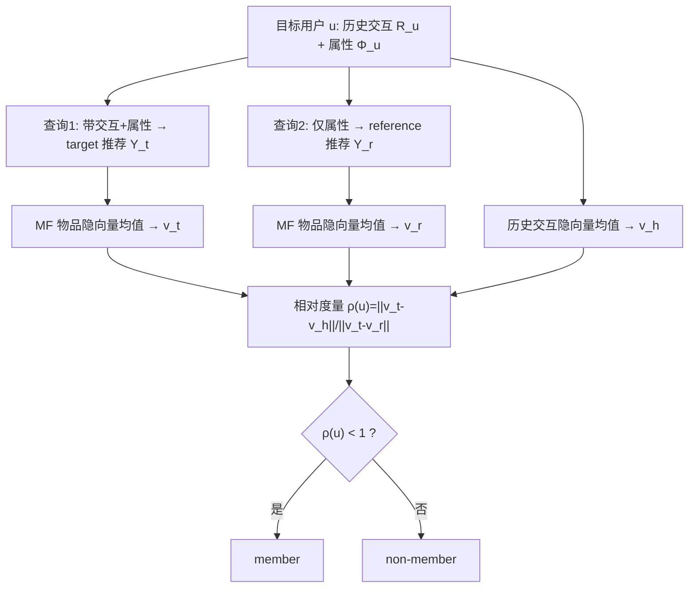

# Reference Recommendation based Membership Inference Attack against Hybrid-based Recommender Systems (面向混合推荐系统的参考推荐成员推理攻击)

- **会议/期刊**: AAAI 2026
- **作者与机构**: Xiaoxiao Chi, Xuyun Zhang, Yan Wang, Hongsheng Hu, Wanchun Dou（Macquarie University / The University of Newcastle / Nanjing University）
- **推荐链路定位**: 服务端黑盒查询（推荐输出接口的隐私审计）
- **研究方向**: 去偏公平、可信隐私与工业架构 / 冷启动与长尾推荐（混合推荐属性建模）
- **论文原文**: [论文原文链接](https://arxiv.org/abs/2512.09442v1)
- **开源代码**: 暂未开源（正文称代码置于附录）

## TL;DR (1分钟核心速览)

现有推荐系统成员推理攻击（MIA）依赖“成员=有交互老用户、非成员=无交互新用户”的混合双算法假设，在**单一算法同时服务新老用户的混合推荐系统（Hybrid RS，如 DropoutNet/Heater）**上退化为随机猜测（ASR≈0.50）。本文提出**参考推荐相对成员度量**：对目标用户做两次黑盒查询（带交互的 target 推荐 + 仅属性的 reference 推荐），用 $\rho(u)=\|v_t-v_h\|_2/\|v_t-v_r\|_2$ 与阈值 1 比较判定成员身份。在 ML-1M/ML-100K 上 ASR 达 0.9340，TPR@1%FPR 达 99.84%，耗时仅 10.4 秒（比 ST-MIA 快 93.6 倍、比 DL-MIA 快 3706 倍）。

## Background & Motivation (背景与核心矛盾)

- **主流范式**: 推荐系统 MIA 主流采用影子训练（shadow training）范式——训练影子模型模仿目标模型，采集成员/非成员元数据训练二分类攻击器（ST-MIA、DL-MIA）。
- **前人局限**: ① 现有攻击隐含假设“所有有交互的老用户都是成员、非成员必为无交互新用户”，而现实中老用户可能因隐私退出或采集窗口外而成为非成员；② 其有效性本质上依赖“成员走协同过滤、非成员走流行度推荐”的**双算法混合结构**，一旦目标系统用同一算法服务所有用户，$d(v_t,v_h)$ 的成员/非成员区分度即崩塌。
- **核心洞察 (Key Insight)**: 混合推荐系统为无交互新用户也能基于属性生成**个性化**推荐，因此“仅用属性查询”得到的参考推荐 $v_r$ 是随用户而变的个性化锚点，而非全局流行度常量——这恰好提供了重标定成员距离的天然参照系。
- **本文切入点**: 用参考推荐把绝对距离 $d(v_t,v_h)$重标定为相对比值$\rho(u)$，放大成员与非成员的分布间隙。

## Method (核心方法设计)

### 1. 整体框架 (Overall Architecture)

攻击者先用爬取的用户-物品矩阵做矩阵分解得到物品隐向量，再对目标用户发起两次黑盒查询：查询 1 输入历史交互 $R_u$与属性$\Phi_u$得到 target 推荐$Y_u^{target}$；查询 2 仅输入属性$\Phi_u$得到 reference 推荐$Y_u^{ref}$。三组物品列表分别取隐向量均值得到$v_h, v_t, v_r$，计算相对成员度量$\rho(u)$并与 1 比较输出成员/非成员判定。全过程无需训练影子模型与攻击分类器，复杂度仅$O(l)$。

<figure class="paper-figure" markdown="span">
  <figcaption>图1：展示我们提出的基于参考推荐的MIA工作流程的示例。</figcaption>
</figure>

### 2. 关键设计拆解 (Key Designs)

1. **参考推荐查询（Reference Recommendation Query）**：痛点在于混合推荐对所有人个性化，绝对距离失去判别力 $\to$本文追加一次**仅属性**查询，迫使系统在无交互条件下暴露其“属性先验偏好”$Y_u^{ref}$ $\to$ 该结果与 target 推荐共享同一用户属性编码，构成同分布对照，从而把“交互是否参与训练”的差异从属性个性化噪声中剥离出来。

2. **相对成员度量（Relative Membership Metric）**：核心公式
$$\rho(u)=\frac{\|v_t-v_h\|_2}{\|v_t-v_r\|_2},\qquad \hat{y}(u)=\mathbb{I}\left[\rho(u)<1\right]$$
其中 $v_h=\frac{1}{m}\sum_i w_{h_i}$、$v_t=\frac{1}{n}\sum_i w_{y_i^{t}}$、$v_r=\frac{1}{n}\sum_i w_{y_i^{r}}$。直觉：若交互参与训练，target 推荐应更贴近历史交互而非属性参考，比值小于 1；反之贴近参考推荐，比值大于 1。**理论增量**：令$x=d(v_t,v_h)/M$，该度量等价于$f(x)=x/(1-x)$，其$f'(x)=1/(1-x)^2>0$、$f''(x)=2/(1-x)^3>0$，是**单调且凸**的非线性函数；而传统线性度量$g(x)=cx$导数恒定，在边界两侧变化率相同。凸性使成员侧（$x<1/2$）压缩、非成员侧（$x\to1$）急剧放大，等价于对两类分布做非线性拉伸，判别间隙显著扩大。此外阈值固定为 1，无需领域相关的人工阈值调参。

3. **训练目标、负采样与推理效率**：攻击侧唯一“训练”是矩阵分解 $\min_{H,W}\|C_{p\times q}-HW^{\top}\|_2^2$，无负采样、无攻击分类器训练。推理仅两次前向查询 + 三次均值池化 + 一次欧氏距离比，复杂度$O(l)$，实测 10.4 秒完成全量攻击。值得注意的是，Chi et al. (2024) 的 shadow-free 方法可视为本文度量在$v_r$ 取全局流行度常量时的**特例**，本文是其个性化推广。

## Experimental Setup & Evaluation Protocol (实验设置与评估协议)

- **数据集与预处理**: 目标数据集 ML-1M / ML-100K，影子数据集 RecSys 2017（分布刻意不同以模拟真实攻击者无分布知识）；交互二值化为 0/1，类别属性做 1-of-n 编码。

| 数据集 | 角色 | 交互/属性说明 |
| :--- | :---: | :--- |
| MovieLens-1M | 目标集 | 用户属性 age/gender/occupation/zipcode；物品 title/genres |
| MovieLens-100K | 目标集 | 同上，规模更小、更稀疏 |
| RecSys 2017 | 影子集 | 用户 education/location/work experience/position；物品 title/location/career level |

- **数据划分与防穿越 (Splitting Strategy)**: 采用成员/非成员划分——成员为参与目标模型训练的用户，非成员为**有交互但被排除训练**的老用户（关键设定，规避了“非成员=新用户”的不现实假设）。
- **排名评测协议 (Ranking Protocol)**: 非排名类评估，采用攻击侧指标 ASR（整体判定准确率）与 TPR@1%FPR（低假阳率下的真阳率，遵循 Carlini et al. 2022 的可靠性建议）；效率指标为端到端攻击耗时。
- **对比基线与超参设置**: 基线为 ST-MIA（首个推荐 MIA，影子训练+二分类器）与 DL-MIA（VAE 解耦编码去偏）；目标模型为 DropoutNet 与 Heater，交叉组合成 4 个攻击场景；隐向量维度 $l$与推荐数$n$ 在 10–100 间扫描；每实验重复 5 次取均值。

## Key Experimental Results (实验关键数据)

### 1. 主实验对比 (Main Results)

| 目标模型 / 数据集 | 指标 | Ours | ST-MIA | DL-MIA | Improv. |
| :--- | :---: | :---: | :---: | :---: | :---: |
| DropoutNet / ML-1M | ASR | **0.9340** | 0.4995 | 0.5139 | +81.8% |
| DropoutNet / ML-100K | ASR | **0.9098** | 0.5079 | 0.5011 | +79.1% |
| Heater / ML-1M | ASR | **0.8376** | 0.5536 | 0.4995 | +51.3% |
| Heater / ML-100K | ASR | **0.7519** | 0.4920 | 0.5000 | +52.8% |
| DropoutNet / ML-1M | TPR@1%FPR | **99.84%** | 24.61% | 21.15% | +75.2pp |
| DropoutNet / ML-100K | TPR@1%FPR | **68.88%** | 21.26% | 11.82% | +47.6pp |
| Heater / ML-1M | TPR@1%FPR | **97.83%** | 25.05% | 24.02% | +72.8pp |
| Heater / ML-100K | TPR@1%FPR | **56.05%** | 3.18% | 1.32% | +52.9pp |

**效率对比**：Ours 10.4 s；ST-MIA 973.3 s（≈93.6×）；DL-MIA 38,550 s（≈3706.7×）。

### 2. 消融与敏感性分析 (Ablation & Sensitivity)

| 移除/变动组件 | 设置 | 结果 | 说明 |
| :--- | :--- | :---: | :--- |
| 去掉参考推荐（退化为绝对距离） | Dro./1M | ASR≈0.50 | 等价于基线，验证 $v_r$ 是增益来源 |
| 参考推荐退化为全局流行度常量 | 全部 | 退化为 Chi et al. 2024 | 本文为其个性化推广 |
| 推荐数 $n$: 10 → 100 | Dro./100K | ASR <0.9 → >0.9 | 单调微升，鲁棒 |
| 隐向量维度 $l$: 10 → 100 | 全部 | ASR 极缓下降 | 对$l$ 不敏感 |
| DP 加噪 $\epsilon=0.1/0.5/1.0$ | Dro./100K | 0.5101 / 0.7837 / 0.7996（无 DP 0.9098） | DP 有效但攻击仍强 |

### 3. 关键实验发现 (Key Findings)

1. **双算法假设是旧攻击的唯一命门**：在单一混合算法下 ST-MIA/DL-MIA 的 ASR 全部落在 0.49–0.55 区间，几乎等同抛硬币，说明影子训练范式捕捉的“成员信号”实为算法切换伪影而非过拟合信号。
2. **相对度量的判别增益主要来自非成员侧**：图 3 分布可视化显示 (Dro.,1M) 下几乎所有非成员 $\rho>1$、几乎所有成员$\rho<1$，凸函数$f(x)$ 把非成员侧距离急剧放大，这正是 TPR@1%FPR 从 ~24% 跃升至 ~99% 的直接原因。
3. **DP 提供的是“降级”而非“免疫”**：$\epsilon=0.1$时 ASR 降至 0.5101（接近随机），但$\epsilon=1.0$ 时仍达 0.7996，说明工业界常用的中等隐私预算不足以抵御该攻击，需结合输出扰动或推荐列表截断等额外防护。

## Highlights & Limitations (亮点、对比与审稿批判)

- **与代表作对比 (vs. Prior Work)**: 相比 ST-MIA（需影子模型+分类器，依赖双算法结构）与 DL-MIA（额外 VAE 去偏，成本 3700 倍），本文以**零训练、两次查询**实现更强攻击；相比 Chi et al. (2024) 的 shadow-free 方法，本文把全局流行度参照升级为**属性个性化参照**，从而覆盖混合推荐这一更现实场景。
- **可迁移亮点**: ① “同输入不同信息子集的双查询对照”思路可迁移到冷启动场景下的隐私审计与模型行为归因；② 用比值型非线性度量替代绝对距离阈值，可推广到其他需要免调阈值的成员/分布偏移检测任务。
- **审稿级局限批判**: ① 实验仅覆盖两个 MovieLens 数据集与两个混合模型，未涉及深度混合架构（如 Wide&Deep、属性图混合模型）与大规模工业场景，泛化性证据偏弱；② 攻击依赖攻击者能获取覆盖全物品集的爬取数据以做矩阵分解，且假设目标系统对“仅属性查询”返回个性化结果，若系统对无交互查询回退到热门兜底，度量将失效；③ 阈值固定为 1 虽免调参，但在类别极不平衡时可能非最优。

## Rating (四维评分)

- **方法创新性 (Novelty)**: ⭐⭐⭐⭐ （参考推荐+相对度量的组合简洁且切中混合推荐的结构性盲点，凸性分析给出了可验证的理论解释，但本质仍是距离比值的巧妙重标定）
- **评估协议与实验扎实度 (Protocol & Experiments)**: ⭐⭐⭐ （ASR 与 TPR@1%FPR 双指标规范、含效率与 DP 防御分析，但数据集与目标模型覆盖偏窄，缺少大规模与深度混合模型验证）
- **写作与数学规范度 (Clarity & Rigor)**: ⭐⭐⭐⭐ （度量等价函数与一二阶导数推导清晰，特例归约关系交代明确，符号统一）
- **工业落地与复现价值 (Industrial & Practical Value)**: ⭐⭐⭐⭐ （10 秒级、零训练、仅黑盒查询，非常适合作为推荐平台上线前的隐私红队工具；但依赖全物品爬取数据，代码未正式开源）

