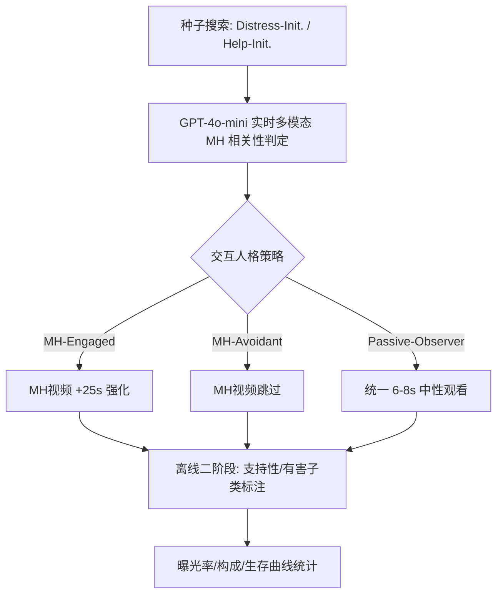

# Seeking Help, Facing Harm: Auditing TikTok's Mental Health Recommendations (求助却遭伤害：TikTok心理健康推荐审计)

- **会议/期刊**: ICWSM 2026 (AAAI International Conference on Web and Social Media)
- **作者与机构**: Pooriya Jamie, Amir Ghasemian, Homa Hosseinmardi (UCLA OASIS Lab)
- **推荐链路定位**: 重排 / 推荐流内容分发审计
- **研究方向**: 去偏公平与可信隐私与工业架构 / 对话推荐与智能体仿真
- **论文原文**: [https://arxiv.org/abs/2604.14832v1](https://arxiv.org/abs/2604.14832v1)
- **开源代码**: 暂未开源（出于防滥用考虑，作者明确不公开自动化脚本）

## TL;DR (1分钟核心速览)

本文针对"推荐系统能否区分用户'求助'与'痛苦表达'"这一安全盲区，用 30 个全新账号 + GPT-4o-mini 驱动的 LLM 智能体，在 TikTok "For You" 页开展 2×3 因子（搜索框架 × 交互策略）的 7 天控制审计，共采集 8,727 条推荐视频。核心发现：交互行为而非搜索意图主导曝光——MH-Engaged 组心理健康内容饱和至约 45%，而 MH-Avoidant 组仅 11–13%；求助式搜索只改变内容构成（支持性内容更多），却无法阻断潜在有害内容（含自杀/自伤类）的持续出现。

## Background & Motivation (背景与核心矛盾)

- **主流范式**: 社交平台推荐以隐式交互（尤其观看时长）为核心优化目标，TikTok 的留存/观看时长权重已可比拟点赞关注等显式信号，个性化在会话前 200 条视频内即可形成过滤气泡。
- **前人局限**: ①既有审计多聚焦年龄门控与流行度偏置，未检验系统对"用户意图"的敏感度；②平台解释工具常无法真实反映推荐行为动因，用户无法据此规避风险。
- **核心洞察 (Key Insight)**: 心理健康语境下，"表达痛苦"与"寻求帮助"在语义嵌入空间中高度邻近，算法很可能将二者折叠为同一"心理健康兴趣簇"，从而把支持性与有害内容捆绑分发。
- **本文切入点**: 用 LLM 智能体将"声明意图（搜索框架）"与"显露行为（交互策略）"解耦，在匹配条件下直接比较曝光轨迹的放大与衰减不对称性。

## Method (核心方法设计)

### 1. 整体框架 (Overall Architecture)

审计采用 2×3 因子设计：搜索框架（Distress-Init. vs. Help-Init.）× 交互策略（MH-Engaged / MH-Avoidant / Passive-Observer），共 6 种人格、每种 5 个账号，全部为无历史的全新账号并隔离设备指纹与美国 IP。第 1 天执行种子查询并观看 14 条视频建立基线兴趣，第 2–7 天直接从 FYP 滚动，每日 40 条。每条视频先由 GPT-4o-mini 实时多模态分类（截图 + 字幕 + 话题标签 + 屏上文字 + 视觉描述）判定是否 MH 相关，再据人格策略动态决定延长观看（+25s）或跳过；离线第二阶段对 MH 视频做立场与危害子类标注。

### 2. 关键设计拆解 (Key Designs)

1. **意图—行为解耦的因子审计设计**：痛点在于真实用户意图是潜变量，无法从表层措辞直接观测。本文用搜索查询固定"声明意图"、用观看时长分配固定"显露行为"，使二者正交可比。基线观看时长 $t_{base}\approx 7$s 作为"决定是否继续"的代理，强化信号为额外$+25$s，即人格$p$对视频$v$的观看时长可写为$t(v)=t_{base}+\mathbb{I}[\text{policy}(p,v)=\text{engage}]\cdot 25$。这样做的直觉是：在 TikTok 上观看时长是推荐算法的主导输入，控制它即等价于控制反馈回路的"油门"。

2. **两阶段 LLM 标注与危害分类体系**：实时阶段只做二分类相关性判定以驱动智能体行为（延迟中位数 5.2s，落在 $t_{base}$ 窗口内）；离线阶段将 MH 视频标为 Potentially Supportive（专业建议、循证应对、危机资源）或 Potentially Harmful，后者再细分 Suicide/Self-Harm、Toxic Positivity、Self-Diagnosis、Misinformation 四类。人工复核 100 条样本得 MH 相关性 F1=77.42%、有害 F1=64.52%、支持性 F1=64.00%；作者论证因各条件共用同一标注管线，条件间差异对中等标注噪声相对稳健。

3. **评估指标与统计口径**：核心指标为 MH 饱和度（每日 40 条中 MH 相关占比）与 FYP 有害率（仅 FYP 视频中有害占比），辅以"首次有害曝光生存曲线" $P(\text{no harm yet}\mid \text{video index})$。所有比较附 95% 置信区间，样本为 208 个账号-日会话、平均每会话 41.9 条视频。

## Experimental Setup & Evaluation Protocol (实验设置与评估协议)

- **数据集与预处理**: 无传统推荐数据集，为自采审计语料：

| 数据集 | #Accounts | #Videos | #Sessions | 时间窗 | 场景说明 |
| :--- | :---: | :---: | :---: | :---: | :--- |
| TikTok FYP Audit | 30 | 8,727 | 208 | 2026-01-01 至 01-07 | 6 人格 × 5 账号，隔离设备/IP |

- **数据划分与防穿越 (Splitting Strategy)**: 非训练型研究，采用**时间轨迹切分**（Day 1 搜索初始化 vs. Day 2–7 纯 FYP 观察），以隔离搜索足迹的持续效应。
- **排名评测协议 (Ranking Protocol)**: 非排序指标，采用**曝光比例统计**（MH 饱和度、有害率）与**生存分析**（首次有害曝光的视频序号分布），属生态效度优先的观察性协议。
- **对比基线与超参设置**: 基线为 6 种人格间的交叉对比（以 Passive-Observer 为参照计算话题份额差 $\Delta$pp）；关键超参为$t_{base}\approx7$s、强化$+25$s、每日 40 条、7 天窗口；未做显著性检验，改用 95% CI 与描述统计（均值 ± SD）。

## Key Experimental Results (实验关键数据)

### 1. 主实验对比 (Main Results)

按人格 × 框架的会话级曝光统计（Table S6，均值，括号内为标准差）：

| 人格 | 框架 | MH Rate | 潜在有害率 | FYP 有害率 |
| :--- | :--- | :---: | :---: | :---: |
| MH-Engaged | Distress-Init. | .453 (.162) | **.272 (.089)** | **.419 (.213)** |
| MH-Engaged | Help-Init. | **.454 (.178)** | .178 (.093) | .429 (.231) |
| Passive-Observer | Distress-Init. | .202 (.102) | .189 (.084) | .163 (.106) |
| Passive-Observer | Help-Init. | .163 (.079) | .130 (.067) | .136 (.098) |
| MH-Avoidant | Distress-Init. | .126 (.064) | .117 (.065) | .093 (.046) |
| MH-Avoidant | Help-Init. | .109 (.053) | **.088 (.047)** | **.077 (.043)** |
| Overall | — | .252 | .163 (.096) | .224 |

关键对比：MH-Engaged 的 FYP 有害率（42.4%）约为 MH-Avoidant（8.5%）的 **5 倍**，Passive-Observer 居中（15.0%）；而搜索框架对 MH 总量的影响远小于交互策略（45% vs. 11–13%）。

### 2. 消融实验 (Ablation Study)

实时分类器的模态消融（Table S4，二分类 MH 相关性检测）：

| 配置 | F1 | Precision | Recall |
| :--- | :---: | :---: | :---: |
| 全多模态（截图+视觉描述+屏上文字+字幕+标签） | **77.42%** | 63.16% | **100%** |
| 去视觉描述 | 73.7% | 84.8% | 65.1% |
| 去屏上文字 | 70.1% | 79.4% | 62.8% |
| 去视觉（纯文本） | 61.8% | 48.8% | 84% |
| 仅字幕+标签 | 35.7% | 23.3% | 76.9% |

### 3. 关键实验发现 (Key Findings)

1. **行为信号压倒意图信号**：两种搜索框架下 MH-Engaged 均饱和至约 45%，而 MH-Avoidant 降至 11–13%，组间差距（约 32pp）远大于框架间差距（<5pp），说明推荐系统主要响应观看时长而非搜索语义。
2. **求助悖论（Help-Seeking Paradox）**：Help-Init. 确实提升支持性内容占比（MH-Engaged 下有害率从 .272 降至 .178），但有害内容从未归零；即便在"求助+高参与"这一最理想条件下，FYP 有害率仍高达 42.9%，且包含 Suicide/Self-Harm 子类。
3. **规避只降量不降险**：MH-Avoidant 将 MH 曝光压至约 11%，但有害内容在残余 MH 流中的比例与其它人格相当；生存曲线显示到第 40 条视频时 98.5–100% 的会话至少遭遇一条潜在有害视频，且单次搜索足迹在 Day 2 后仍持续存在。

## Highlights & Limitations (亮点、对比与审稿批判)

- **与代表作对比 (vs. Prior Work)**: 相较 Xue et al. (2025) 的年龄门控审计与 Vombatkere et al. (2024) 的探索-利用分析，本文首次将"求助 vs. 痛苦表达"作为正交因子引入控制实验；相较 Mosnar et al. (2025) 对审计可复现性的批评，本文以 208 个会话、100% 完成率与完整 trace 日志回应了可复现性关切。
- **可迁移亮点**: ①"声明意图 × 显露行为"的正交因子设计可直接迁移到电商/短视频的冷启动安全审计；②用 $t_{base}$ 窗口内完成的实时 LLM 分类驱动智能体决策，是低延迟仿真审计的实用范式。
- **审稿级局限批判**: ①分类器 F1 仅 64–77%，早期阶段误差会沿管线传播，且有害子类因验证样本过小未单独报告指标；②仅 4 条种子查询、7 天窗口与全新账号，难以外推到成熟画像与长期动态，且 $t_{base}=7$s 是控制实验的人为产物，与真实滚动行为存在偏差。

## Rating (四维评分)

- **方法创新性 (Novelty)**: ⭐⭐⭐⭐ （意图-行为解耦的因子审计设计在推荐安全审计中较新颖，但本质是测量框架而非算法创新）
- **评估协议与实验扎实度 (Protocol & Experiments)**: ⭐⭐⭐ （208 会话、8,727 视频规模可观且附 CI，但缺显著性检验、标注噪声中等、种子查询覆盖有限）
- **写作与数学规范度 (Clarity & Rigor)**: ⭐⭐⭐⭐ （研究问题、因子设计与统计口径交代清晰，公式极简但足够，附录操作可靠性详实）
- **工业落地与复现价值 (Industrial & Practical Value)**: ⭐⭐⭐ （对平台安全策略有直接政策启示，但代码因伦理考量未开源，复现需自建采集管线）
