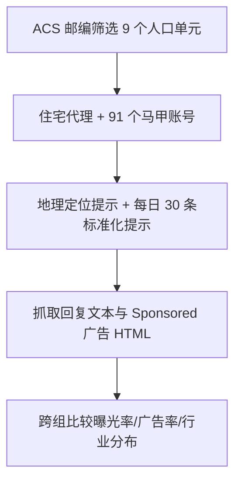
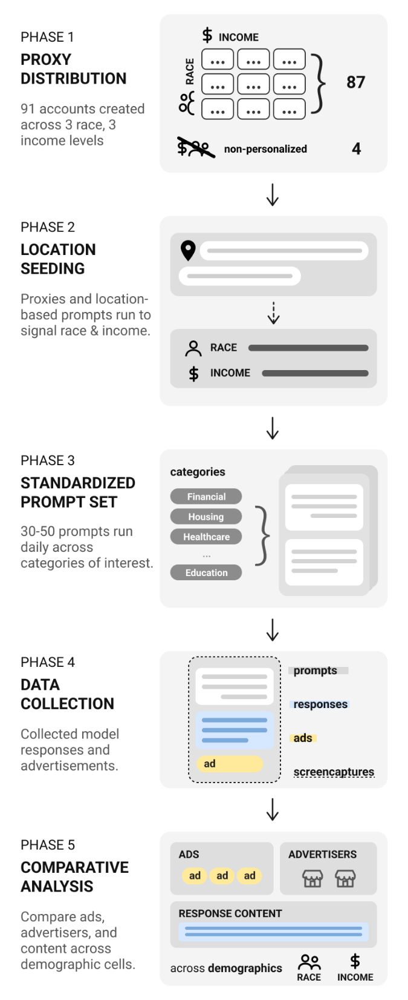

# The Beginning of ChatGPT Ads (ChatGPT 广告的开端)

- **会议/期刊**: AAAI/ACM AIES 2026
- **作者与机构**: Emma Lurie, Ro Encarnación, Sorelle A. Friedler, Danaë Metaxa（宾夕法尼亚大学 / 哈弗福德学院）
- **推荐链路定位**: 广告投放（Ad Delivery）与受众定向审计
- **研究方向**: 去偏公平、可信隐私与工业架构
- **论文原文**: [https://arxiv.org/abs/2608.05008v1](https://arxiv.org/abs/2608.05008v1)
- **开源代码**: 暂未开源（但公开了可检索广告库 [ChatGPT Ad Library](https://emmalurie.github.io/chatgpt-ads-library/)）

## TL;DR (1分钟核心速览)

本文是首个针对 LLM 聊天界面广告投放的实证审计研究。作者构建 91 个"马甲账号"（sock puppet），以 3×3 因子设计（Black/Hispanic/White × 低/中/高收入）通过住宅代理 IP 与地理位置提示模拟美国用户，在 2026 年 2–5 月采集 3,602 条广告（191 个广告主）。核心发现：广告曝光概率随 ZIP 收入中位数上升而显著下降（每 $1,000 收入 OR=0.98, p=0.044），而种族无显著关联；广告集中于零售与软件（57%），且 OpenAI 声明的健康/心理/政治内容排除基本生效（广告率≈0%）。

## Background & Motivation (背景与核心矛盾)

- **主流范式**: 在线广告长期依赖定向投放，但平台算法本身会放大人口统计偏差（如 Sweeney 2013 发现黑人姓名搜索更易触发逮捕记录广告；Ali et al. 2019 发现 Facebook 在无显式定向时仍产生种族/性别偏斜投放）。
- **前人局限**: ① LLM 聊天机器人具备对话说服力与长期"记忆"用户隐私的能力，广告风险被放大，但此前**无任何针对生成式 AI 聊天界面的广告审计**；② 封闭平台无公开 API，研究者无法直接观测用户收到什么广告。
- **核心洞察 (Key Insight)**: 广告投放偏差往往在系统早期"固化"，因此在 ChatGPT 广告上线首月进行独立监测具有基线价值；住宅代理 IP + 地理位置提示可有效模拟真实人口统计画像。
- **本文切入点**: 用可复现的马甲账号审计方法，在广告系统成熟前建立首个经验基线。

## Method (核心方法设计)

### 1. 整体框架 (Overall Architecture)

审计流程分五阶段：先按美国人口普查 ACS 数据选取 9 个人口统计单元（3 种族 × 3 收入三分位）对应的 ZIP code，收入阈值约 $57,800 与$77,800；再通过支持邮编定向的住宅代理服务为每个 ZIP 创建 1 个 ChatGPT 免费账号（共 91 个）；每日先发 2–3 条地理位置提示强化定位信号，随后所有账号接收同一随机抽取的 30 条提示（另加最多 20 条曾触发广告的提示，导致广告提示被过采样），记录模型回复与页面 HTML 中的 "Sponsored" 广告；最后跨人口统计组比较曝光率与广告率。

<figure class="paper-figure" markdown="span">
  <figcaption>图3：五阶段审计流程概览：(1) 按人口统计分层的账户分布于住宅代理上，(2) 以确立位置的提示进行初始化，(3) 接受标准化每日提示集，并捕获由此产生的模型回复与 (4) 广告，(5) 在各人口统计组之间进行比较。</figcaption>
</figure>

### 2. 关键设计拆解 (Key Designs)

1. **人口统计分层马甲设计（Demographically Stratified Sock Puppets）**：痛点是无 API 无法观测个体广告 $\to$用 ZIP code 中位收入与种族构成作为代理变量，配合住宅代理 IP 与地理提示双重信号$\to$ 使每个账号近似"真实"的特定人群用户，从而可做组间对照。
2. **标准化提示语料（335 条提示）**：来源为 OpenAI 使用报告（95 条）、Reddit 高赞帖（146 条）与研究者自建社会议题提示（89 条）+ 5 条定位提示；每日同抽 30 条保证组间可比，同时用自然语言提示提升生态效度。
3. **统计检验与稳健性**：对曝光概率做逻辑回归（含二次项检验线性、Cook 距离剔除高杠杆点），对广告率做 Spearman 相关与 LOWESS 平滑；另用提示文本嵌入的 k-means 聚类复现主题效应，排除人工标签偏差。

## Experimental Setup & Evaluation Protocol (实验设置与评估协议)

- **审计对象与规模**: ChatGPT 免费账号广告系统；91 个账号、9 个人口单元（每单元 ≥9 个账号）；2026-02-06 至 2026-05-20 共 127,801 次对话，其中广告期（3/8–3/31）63,657 次交互产生 3,573 条广告（5.61%），最终共 3,602 条广告、191 个广告主、102 条触发提示。
- **数据划分与防穿越**: 非机器学习训练场景；以 3/31 广告骤降（疑账号被判定为非真实行为）为界，主分析限定 3/8–3/31 窗口，避免截断偏差污染结论。
- **评估协议**: 曝光率（是否至少收到 1 条广告）与广告率（首次广告后触发广告的提示占比）双指标；显著性采用逻辑回归 OR 与 95% CI、Spearman $\rho$、Wilson 置信区间。
- **对比基线**: 无模型基线，本质为组间对照审计；对照组为 4 个关闭"广告个性化"开关的账号（曝光率与广告率均无显著差异，故合并分析）。

## Key Experimental Results (实验关键数据)

### 1. 主实验对比 (Main Results)

| 分析维度 | 分组/变量 | 关键指标 | 数值 | 显著性 |
| :--- | :--- | :--- | :---: | :---: |
| 收入-曝光 | ZIP 中位收入每 +$1,000 | 曝光 OR | **0.98** [0.96,1.00] | p=0.044 |
| 收入-曝光（稳健） | 剔除 3 个高杠杆账号 | 曝光 OR | **0.975** [0.957,0.992] | p=0.005 |
| 收入-曝光（非线性检验） | 加入二次项 | 二次项 OR | ≈0.99 | p=0.51（不显著） |
| 收入-广告率 | 低/中/高收入组 | 平均广告率 | 27.4% / 16.9% / 19.6% | 组内方差大 |
| 种族-广告率 | White / Hispanic / Black | Spearman $\rho$ | −0.551 / −0.408 / −0.257 | p=0.08/0.08/0.30 |
| 首次广告时延 | 53 个曝光账号 | 中位天数 | **14.0 天**（IQR 13–16） | 62.1% 在 14 天内 |
| 广告率分布 | 48 个广告期曝光账号 | 中位广告率 | **24.0%**（均值 21.9%） | 最高 37.1% |
| 行业集中度 | Retail + Information | 曝光占比 | **57%**（1,057 + 843） | 16 行业共 3,303 次 |

### 2. 消融/分组实验 (Stratified Analysis)

| 分析 | 设置 | 结果 |
| :--- | :--- | :---: |
| 提示主题效应 | Purchasable / Health / Cooking | 广告率 10–14% |
| 提示主题效应 | Argument/Summary、Relationships | 广告率 <3% |
| OpenAI 排除类 | 健康、心理、政治 | 广告率 ≈0% |
| 嵌入聚类复现 | 消费品牌词簇（Nike/Adidas） | 广告率 ≈16% |
| 嵌入聚类复现 | 心理健康/政治簇 | 广告率 ≈0% |
| 个性化开关 | 4 个关闭个性化账号 | 无显著差异 |

### 3. 关键实验发现 (Key Findings)

1. **收入梯度而非种族梯度**：曝光概率随收入显著下降（OR=0.98/千美元，剔除高杠杆点后 p=0.005），曝光账号收入众数约 $60k、未曝光账号约$80k；但种族对曝光与广告率均无显著影响——作者明确承认每组仅 16–19 个曝光账号，统计功效不足以排除小效应。
2. **广告投放"持续而非偶发"**：曝光账号中位广告率 24%，最低四分位仍约 10%，说明一旦进入投放池，广告会稳定出现；且首次广告中位时延 14 天、7 天内零广告，暗示存在账号"冷启动"门槛。
3. **上下文匹配是主要驱动，护栏基本生效**：零售+信息业占 57%，Target 以 130 次会话居首；"可购买产品/健康健身/烹饪"类提示广告率 10–14%，而 OpenAI 声明的健康/心理/政治排除类接近 0%，但"工作生活平衡"等边缘提示仍触发智能手表广告，护栏边界模糊。

## Highlights & Limitations (亮点、对比与审稿批判)

- **与代表作对比 (vs. Prior Work)**: 相较 Sweeney (2013) 与 Ali et al. (2019) 对搜索/社交广告的审计，本文首次将马甲审计迁移到生成式对话界面，且发现偏差方向不同——不是种族而是收入；相较 Asplund et al. (2020) 的住房广告审计，本文增加了提示主题与嵌入聚类双重归因。
- **可迁移亮点**: ① "ZIP 代理 + 地理提示"的双重人口统计信号设计可直接复用于其他封闭 LLM 平台的公平性审计；② 用提示嵌入聚类交叉验证人工主题标签，是低成本排除标注偏差的通用技巧。
- **审稿级局限批判**: ① 样本量小（91 账号、48 个广告期曝光账号），种族零结果统计功效不足，且 3/29 起广告骤降疑被平台识别，样本被非计划截断；② 合成账号查询节奏固定、无长期历史，若定向依赖行为信号则结论可能无法外推到真实用户；③ 仅覆盖美国、单一平台、三周窗口。

## Rating (四维评分)

- **方法创新性 (Novelty)**: ⭐⭐⭐⭐ （首个 LLM 聊天广告审计，马甲+代理+提示三重设计在方法学上有开创性，但非算法创新）
- **评估协议与实验扎实度 (Protocol & Experiments)**: ⭐⭐⭐ （逻辑回归+稳健性检验+嵌入聚类复现较严谨，但样本量与截断问题削弱统计效力）
- **写作与数学规范度 (Clarity & Rigor)**: ⭐⭐⭐⭐ （统计报告规范、置信区间与 p 值齐全，局限讨论坦诚）
- **工业落地与复现价值 (Industrial & Practical Value)**: ⭐⭐⭐⭐ （公开可检索广告库与完整提示集，为后续监测提供可复现模板；但代理成本数百美元/月构成门槛）
