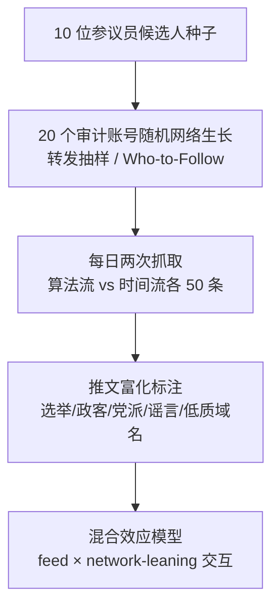

# The Role of Follow Networks and Twitter's Content Recommender on Partisan Skew and Rumor Exposure during the 2022 U.S. Midterm Election (关注网络与 Twitter 内容推荐算法对 2022 美国中期选举党派倾斜与谣言曝光的作用)

- **会议/期刊**: AAAI ICWSM 2026
- **作者与机构**: Kayla Duskin, Joseph S. Schafer, Alexandros Efstratiou, Jevin D. West, Emma S. Spiro（University of Washington）
- **推荐链路定位**: 重排（Home Timeline 内容排序/信息流分发）
- **研究方向**: 去偏公平、可信隐私与工业架构 / 社交与群组推荐
- **论文原文**: [https://arxiv.org/abs/2509.09826v1](https://arxiv.org/abs/2509.09826v1)
- **开源代码**: [https://github.com/twitter/the-algorithm](https://github.com/twitter/the-algorithm)（平台推荐算法源码，非本文实验代码）

## TL;DR (1分钟核心速览)

本文针对"推荐算法是否制造信息茧房/放大谣言"这一争议，采用 18 个自动化审计账号（sock puppet）在 2022 美国中期选举期间同步抓取算法流（Home）与时间流（Following），以账号自身为对照做混合效应回归。核心结论：**关注网络的党派构成对信息曝光的解释力远大于算法本身**；算法流对左倾账号减少选举内容（30.5%→24.9%）、对全体账号小幅右移作者党派（$\beta=0.12$）、并使右倾账号遭遇选举谣言的会话比例从 14.2% 翻倍至 28.3%。这是"算法先验（algorithmic priors）"的基线测量，而非因果放大效应。

## Background & Motivation (背景与核心矛盾)

- **主流范式**: 平台推荐系统黑盒化，学界主要依赖两类手段——基于开源代码的离线仿真，或基于浏览器插件/众包的人类被试随机实验。
- **前人局限**: ① 源码公开≠真实影响，推荐结果高度依赖平台底层社交图与实时事件（Rahwan et al. 2019）；② 人类被试实验难以控制网络结构变量，且无法在选举敏感期做伦理上可接受的干预。
- **核心洞察 (Key Insight)**: 若审计账号只"关注"不"互动"，则算法流与时间流的差异可被干净地归因为**推荐算法在给定社交网络下的先验偏好**，剥离用户反馈回路（rabbit hole）的混淆。
- **本文切入点**: 用随机网络生长构造党派构成可控的审计账号，把"网络党派构成"作为调节变量显式建模，检验算法效应是否随网络倾斜而变。

## Method (核心方法设计)

### 1. 整体框架 (Overall Architecture)

研究不训练模型，而是一套**受控审计协议**：以 5 场胶着参议院选战的 10 位两党候选人为种子，创建 20 个账号（每候选人 2 个），随后以两种方式随机扩张关注网络——一半账号每日两次从现有好友的最近 200 条转发中随机抽 6 人关注（社交背书式），另一半从 Twitter "Who to Follow" 推荐中抽 6 人关注（算法推荐式）。2022 年 9–11 月完成网络生长，11 月 2–25 日每日两次（早晚各一）抓取每个账号算法流与时间流各前 50 条推文，共 18 个有效账号 × 48 会话 × 2 流 = 1728 条观测、90,544 条推文。

### 2. 关键设计拆解 (Key Designs)

1. **网络倾斜三分组（Network-leaning）**：痛点在于连续党派均值在 0 附近不可解释（中立网络看到的选举内容反而更少）。作者先按"转发行为"给每个被关注账号打党派分（-1 至 1，基于是否转发左右翼影响者），再取均值 $\bar{p}$并分段：$l=\text{Left}$若$\bar{p}\le -0.5$，$l=\text{Neutral}$若$-0.5<\bar{p}<0.5$，否则$\text{Right}$。最终 5 左（均值 -0.65）、8 中立（-0.04）、5 右（0.72）。用转发而非关注关系推断党派，是因为全量关注图在 API 限流下不可行，且转发更能反映"当期实际政治表态"。

2. **双通道信息质量标注**：内容级用 ElectionRumors2022 数据集（135 条高精度选举谣言、约 180 万推文）判定推文是否涉及虚假/未证实叙事；来源级用 Iffy Index 标注外链域名是否低质，并用 MBFC 偏倚分（-10 至 10）量化外链党派倾斜。关键方法学创新是**同时报告"低质链接占全部推文比"与"占全部外链比"**——因为算法流本身大幅压制外链（$\beta=-3.02$），只看前者会把"压制外链"误读为"压制低质内容"。

3. **统计模型与推断**：对连续结果（作者党派、MBFC 分）用线性混合效应模型，对二值结果（是否选举内容、是否政客作者、是否谣言、是否低质链接）用 logit 链接的广义线性混合效应模型。固定效应为 feed（算法/时间）、network-leaning（三水平）及其交互，随机效应吸收账号与会话方差，并控制网络生长方式。交互显著后用 Z 检验做事后两两比较，Holm 序贯 Bonferroni 校正多重比较。

## Experimental Setup & Evaluation Protocol (实验设置与评估协议)

- **数据集与预处理**: 自建审计数据集，非标准推荐 benchmark。

| 数据集 | #Accounts | #Sessions | #Observations | #Tweets | 说明 |
| :--- | :---: | :---: | :---: | :---: | :--- |
| 2022 Midterm Audit | 18 | 48 | 1,728 | 90,544 | 每会话每流前 50 条；剔除 2 个被平台限制的账号 |

- **数据划分与防穿越 (Splitting Strategy)**: 非训练/测试划分，而是**被试内配对设计**——同一账号同一会话的算法流与时间流构成配对观测，账号自身即对照，天然消除账号固定差异。
- **排名评测协议 (Ranking Protocol)**: 非排序指标评测，而是**曝光比例统计**（会话内某类内容占比）与**会话触达率**（至少出现一次的会话比例），属"曝光级"而非"排序级"审计。
- **对比基线与超参设置**: 基线为同一账号的**逆时序时间流**（reverse chronological），这是平台提供的唯一"无算法"参照。显著性阈值 $p<0.05$，交互项与事后检验均报告 95% CI。

## Key Experimental Results (实验关键数据)

### 1. 主实验对比 (Main Results)

下表汇总算法流相对时间流的关键效应（混合效应模型系数与分组均值，$\beta$ 为算法流主效应）：

| 结果变量 | 左倾网络 | 中立网络 | 右倾网络 | 算法流主效应 $\beta$ |
| :--- | :---: | :---: | :---: | :---: |
| 选举内容占比（时间→算法） | 30.5%→**24.9%** | 无显著变化 | 无显著变化 | $-0.304^{***}$ |
| 政客作者占比（时间→算法） | 显著↑ | 显著↑ | 显著↑（最大） | $+0.288^{***}$ |
| 作者党派均值（时间→算法） | 右移（回归网络均值） | 右移 | 右移 | $+0.120^{***}$ |
| 外链 MBFC 分（时间→算法） | — | $-0.44\to+2.16$|$4.63\to5.49$|$+0.543$ (n.s.) |
| 谣言会话触达率 | 2.5%→0.4% | 2.6%→6.0% | 14.2%→**28.3%** | $-1.890^{*}$ |
| 低质链接会话触达率 | 28.8%→5.8% | 43.8%→32.3% | 92.5%→27.1% | $+1.048^{***}$ |

### 2. 消融实验 (Ablation Study)

本文无模型组件消融，但做了**方法学层面的"归一化消融"**——将低质链接占比从"占全部推文"切换为"占全部外链"，结论发生反转：

| 度量口径 | 左倾 | 中立 | 右倾 | 结论方向 |
| :--- | :---: | :---: | :---: | :--- |
| 低质链接 / 全部推文（算法 vs 时间） | 0.1% vs 0.7% | 1.3% vs 2.5% | 0.7% vs 5.8% | 算法流"更干净" |
| 低质链接 / 全部外链（算法 vs 时间） | 9.0% vs 3.8% | 20.0% vs 11.0% | 29.3% vs 31.5% | 左/中立**显著变差**（$Z=3.36$/$Z=6.11$） |

### 3. 关键实验发现 (Key Findings)

1. **网络主导、算法次要**：作者党派与谣言曝光的组间差异（右倾 vs 左倾 $\beta=1.54$、谣言$\beta=2.21$）比算法流主效应（$\beta=0.12$、$\beta=-1.89$ 但交互主导）大一个量级，直接反驳"过滤气泡"假说——用户自选网络才是曝光结构的主因。
2. **算法效应高度异质**：算法流对左倾账号减少选举内容（$Z=-10.64$）却对右倾账号把谣言触达率翻倍（14.2%→28.3%，$Z=4.21$），说明"平均效应"叙事会掩盖方向相反的群体级伤害，公平性评估必须做分组交互。
3. **口径决定结论**：算法流压制外链（$\beta=-3.02$）会机械性压低"低质链接绝对量"，但归一化到外链后左倾与中立账号的低质比例反而上升——提示工业界做内容质量监控时，必须以"链接内条件比例"而非"全量占比"作为护栏指标。

## Highlights & Limitations (亮点、对比与审稿批判)

- **与代表作对比 (vs. Prior Work)**: 相较 Huszár et al. (2022) 的平台内部随机实验，本文是外部独立审计且显式建模网络倾斜交互，结论一致（右翼获更多算法放大）但提供了分组异质性证据；相较 Wang et al. (2024) 的浏览器插件实验（认为算法流新闻更可信），本文指出其仅用来源级标注且未按外链频率归一化，因而可能被"压制外链"机制混淆；相较 Ye et al. (2025) 的 2024 大选审计（聚焦用户级放大、账号仅关注媒体与政治实体），本文聚焦内容级质量且网络生长不受账号类型限制。
- **可迁移亮点**: ① "只关注不互动"的被动审计设计可干净剥离推荐先验与反馈回路，适用于任何有双流（算法/时序）的平台；② "条件比例归一化"是评估推荐系统内容质量护栏的通用技巧，可迁移到短视频低质内容占比、电商假货曝光率等指标设计。
- **审稿级局限批判**: ① 样本仅 18 个账号、单一平台单一时段，统计功效有限，且账号为自动化脚本，与真实用户的行为指纹（如停留时长）不同，可能触发不同的推荐路径；② 党派被压缩为一维左右轴，无法刻画多党制或议题维度；③ 研究期恰在平台易主前后，算法可能已变更，结论只能作为历史基线而非当前系统描述。

## Rating (四维评分)

- **方法创新性 (Novelty)**: ⭐⭐⭐⭐ （"被动审计 + 网络倾斜交互建模 + 双口径归一化"组合在算法审计文献中属扎实增量，但非算法层面的新方法）
- **评估协议与实验扎实度 (Protocol & Experiments)**: ⭐⭐⭐⭐ （被试内配对设计、1728 条观测、Holm 校正与完整回归附表规范；扣分在样本量与单平台单时段）
- **写作与数学规范度 (Clarity & Rigor)**: ⭐⭐⭐⭐ （三分组阈值有分布依据、附录给出 Kappa 验证与全部回归表；但主文未给效应量置信区间的统一呈现）
- **工业落地与复现价值 (Industrial & Practical Value)**: ⭐⭐⭐⭐ （审计协议可直接复用于平台公平性年审与内容质量护栏设计；但依赖平台双流可访问性，复现门槛高）

