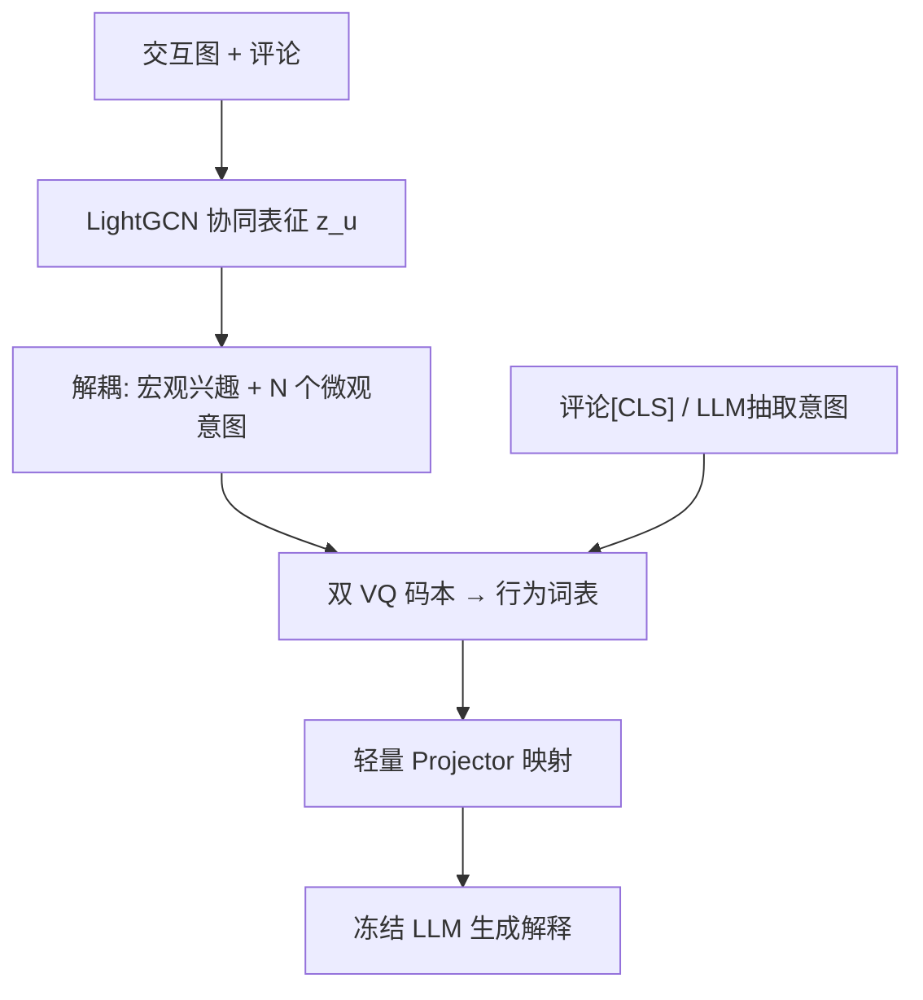
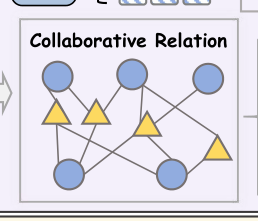

# Behavior Tokens Speak Louder: Disentangled Explainable Recommendation with Behavior Vocabulary (行为Token更响亮：基于行为词表的解耦可解释推荐)

- **会议/期刊**: AAAI 2026
- **作者与机构**: Xinshun Feng, Mingzhe Liu, Yi Qiao, Tongyu Zhu, Leilei Sun, Shuai Wang（北京航空航天大学杭州国际创新研究院 / 软件环境全国重点实验室）
- **推荐链路定位**: 端到端生成式（可解释推荐生成）
- **研究方向**: 生成式推荐与离散语义ID / 大语言模型推荐
- **论文原文**: [https://arxiv.org/abs/2512.15614v1](https://arxiv.org/abs/2512.15614v1)
- **开源代码**: [https://github.com/fxsxjtu/BEAT](https://github.com/fxsxjtu/BEAT)

## TL;DR (1分钟核心速览)

现有可解释推荐依赖 ID 表征或冗长用户画像 prompt，前者无法泛化到冷启动、后者推理开销大且需微调 LLM。BEAT 提出轻量行为分词器：用 VQ-VAE 将图协同表征解耦为「宏观兴趣 + 微观意图」两级离散行为词表，并以多级文本语义监督（评论 [CLS] 对比 + LLM 抽取意图的掩码重构）桥接协同与语言空间，再用语义对齐正则把行为 token 直接嵌入**冻结** LLM 的输入空间。在 Amazon/Google/Yelp 三个数据集上，零样本（无评论文本）设定下 BLEU/BARTScore/BERTScore 全面领先，Amazon BLEU 达 0.4195（较最强基线 TEA-GLM 0.3971 提升约 5.6%）。

## Background & Motivation (背景与核心矛盾)

- **主流范式**: 可解释推荐从 Att2Seq/NRT/PETER 的 ID 嵌入 + 评论生成，演进到 XRec/GraphGPT/TEA-GLM 等将协同图信号对齐进 LLM 语义空间。
- **前人局限一**: ID 级表征对无评论的冷启动用户/物品直接失效；图方法虽缓解但存在过平滑，抹平个性化（图 1 中 user 7267 与 18640 交互史相似却动机迥异）。
- **前人局限二**: LLM 类方法要么把大量画像文本塞进 prompt，要么需微调 LLM 或改动其结构，计算昂贵且绑定特定骨干，难以迁移。
- **核心洞察 (Key Insight)**: 用户行为可类比为「由多个词组成的句子」——相似用户/物品共享重叠语义 token，独特 token 组合对应特定潜在语义模式；离散词表天然规避 OOV 且可被 LLM 当作"外语词"理解。
- **本文切入点**: 把协同信号压缩成少量可解释行为 token，仅训练一个轻量 projector 接入冻结 LLM，实现"免微调、可迁移、可解释"。

## Method (核心方法设计)

### 1. 整体框架 (Overall Architecture)

BEAT 分两阶段。**阶段一（行为分词器）**: 在用户-物品交互图上做轻量 LightGCN 传播并做层平均，得到协同增强表征 $z_u$；将其分解为 1 个宏观兴趣向量与$N$ 个微观意图向量，分别经两套 VQ 码本量化，构成统一**行为词表**；同时施加宏观（评论 [CLS] 的 InfoNCE）与微观（LLM 抽取意图的掩码重构）两级文本监督，使码本兼具协同与语言语义。**阶段二（LLM 对齐）**: 用两层 MLP projector 把行为 token 映射进冻结 LLaMA3-7B 的嵌入空间替换占位符，以语义对齐正则 + 解释生成 NLL 联合训练 projector，最终由 LLM 直接生成推荐理由。

<figure class="paper-figure" markdown="span">
  <figcaption>图2：BEAT框架按两个连续阶段运行。它采用协作语言分词器，在多级语言语义监督下，将多样交互编码为有意义的行为token。随后引入语义对齐正则化，利用LLM原生词表的token级相关性来优化模型。</figcaption>
</figure>

### 2. 关键设计拆解 (Key Designs)

1. **解耦式双码本行为词表**：痛点是用单一 ID 或单一码本无法同时表达"群体共性"与"个体差异"。做法是把 $z_u=[z_u^{macro}\|z_u^{micro(1)}\|\cdots\|z_u^{micro(N)}]$分别对宏观/微观两套码本做最近邻量化$c_j=\arg\min_k\|z_u^{micro(i)}-c_k\|_2^2$，用户被表示为"1 个宏观词 + N 个微观词"的句子。直觉：宏观词刻画稳定大类偏好（如"历史爱好者"），微观词刻画跨用户共享的细粒度意图（如"耐用""易用"），组合即个性化。
2. **多级文本语义监督**：纯协同码本存在行为歧义、纯文本码本受评论稀疏所困。宏观层用评论 [CLS] 与量化表征的融合做 InfoNCE：$\mathcal{L}_{macro}=-\sum_{i\in\mathcal{B}}\log\frac{\exp(s(e_i^{CLS},c_i^{macro}))}{\sum_{j\in\mathcal{B}}\exp(s(e_i^{CLS},c_j^{macro}))}$；微观层因意图无序且无一一对应，改用**掩码重构**——随机遮蔽$t$个意图嵌入，用交叉注意力从行为 token 与未遮蔽意图中还原被遮蔽语义$\mathcal{L}_{micro}=-\mathbb{E}\,\phi(e^{msk},f_\theta^c(c^{micro},S^{msk}))$。直觉：让码本"学会说人话"，同时保留协同结构。
3. **语义对齐正则 (SAR) + 训练目标**：冻结 LLM 与行为 token 间存在分布鸿沟。SAR 先把解释文本中每个词嵌入 $\epsilon_{w_i}$映射到最近的行为 token$\hat{c}_i$，再约束两组相似度一致：$\mathcal{L}_{SAR}=\sum_{(w_i,w_j)\in\mathcal{T}}\big(s(\hat{c}_i,\hat{c}_j)-s(\epsilon_{w_i},\epsilon_{w_j})\big)^2$，即把 LLM 原生词表的内在语义关系"蒸馏"给行为 token。总损失$\mathcal{L}_{tokenizer}=\alpha\mathcal{L}_{macro}+\beta\mathcal{L}_{micro}+\mathcal{L}_{behave}$（$\alpha=0.2,\beta=1$），阶段二为$\mathcal{L}_{SAR}+\mathcal{L}_{NLL}$。**负采样**：宏观对比用 in-batch 负样本，微观用掩码自监督，无需显式难负采样；**推理开销**：仅 6 个 token/实体（1 宏观 + 5 微观），远低于画像文本 prompt，且 LLM 全程冻结。

## Experimental Setup & Evaluation Protocol (实验设置与评估协议)

- **数据集与预处理**（源自 XRec 划分，**零样本设定**：用户/物品有交互但无评论文本）：

| 数据集 | #Users | #Items | #Reviews | #Interactions | 场景说明 |
| :--- | :---: | :---: | :---: | :---: | :--- |
| Amazon | 15,349 | 15,247 | 31,849 | 360,839 | 图书，窄域同质 |
| Yelp | 15,942 | 14,085 | 52,085 | 393,680 | 本地生活，多品类 |
| Google | 22,582 | 16,557 | 31,939 | 411,840 | 本地商户，多品类 |

- **数据划分与防穿越**: 沿用 XRec 的划分；评测时**剥离评论文本**构造零样本用户/物品，属冷启动式划分。
- **排名评测协议**: 本文任务为**解释文本生成**而非 Top-N 排序，故采用生成质量指标 **BLEU-1 / BARTScore / BERTScore**（语义相似度为主、n-gram 精度为辅），非 Full-Ranking 或 Sampled Ranking。
- **对比基线与超参**: ID 类 Att2Seq/NRT/PETER；LLM 类 PLETER/XRec/XRec-Profile/GraphGPT/TEA-GLM/Time-LLM。码本大小 512，嵌入维度 768，微观 token 数 $N=5$，骨干 LLaMA3-7B，projector 为两层 MLP，DeepSpeed ZeRO-2 + 8-bit 量化，解释长度上限 50 词。

## Key Experimental Results (实验关键数据)

### 1. 主实验对比 (Main Results)

| 模型 | Amazon BLEU | Amazon BERT | Yelp BLEU | Yelp BERT | Google BLEU | Google BERT |
| :--- | :---: | :---: | :---: | :---: | :---: | :---: |
| PETER (ID) | 0.3682 | 0.1488 | 0.3329 | 0.1675 | 0.3533 | 0.3283 |
| PLETER | 0.3120 | 0.2816 | 0.3470 | 0.3252 | 0.3850 | 0.3631 |
| XRec | 0.2999 | 0.3598 | 0.3565 | 0.2871 | 0.2785 | 0.2628 |
| GraphGPT | 0.3596 | 0.3494 | 0.3399 | 0.2958 | 0.3702 | 0.3650 |
| TEA-GLM | 0.3971 | 0.3406 | 0.3844 | 0.3067 | 0.3689 | 0.3521 |
| Time-LLM | 0.3936 | 0.3470 | 0.3368 | 0.3135 | 0.2727 | 0.2983 |
| **BEAT** | **0.4195** | **0.3821** | 0.3771 | **0.3302** | 0.3866 | **0.3781** |
| Improv.% (vs 最强基线) | +5.6% | +6.2% | −1.9% | +5.3% | +0.4% | +3.6% |

### 2. 消融实验 (Ablation Study)

| 变体 | Amazon BLEU | Amazon BERT | Yelp BLEU | Yelp BERT | Google BLEU | Google BERT |
| :--- | :---: | :---: | :---: | :---: | :---: | :---: |
| w/o Micro | 0.3781 | 0.3447 | 0.3136 | 0.2793 | 0.3027 | 0.3397 |
| w/o Macro | 0.3795 | 0.3415 | 0.3852 | 0.3272 | 0.3834 | 0.3580 |
| w/o SAR | 0.3720 | 0.3531 | 0.2967 | 0.3124 | 0.3922 | 0.3776 |
| **BEAT (full)** | **0.4195** | **0.3821** | 0.3771 | **0.3302** | 0.3866 | **0.3781** |

### 3. 关键实验发现 (Key Findings)

1. **微观 token 是性能主引擎**：移除后 Amazon BLEU 从 0.4195 跌至 0.3781（−9.9%）、Yelp 从 0.3771 跌至 0.3136（−16.8%），说明细粒度共享意图是解释生成的核心信息源。
2. **宏观 token 作用数据集相关**：移除后在 Google 上 BLEU 由 0.3866 降至 0.3834、BERT 由 0.3781 降至 0.3580，但在 Amazon/Yelp 反而略升——高层摘要词在窄域场景可能"稀释"细节偏好，提示宏观/微观权重应场景自适应。
3. **SAR 对复杂域不可或缺**：去掉 SAR 后 Yelp BLEU 从 0.3771 崩至 0.2967（−21.3%），而 Amazon 仅小幅下降，印证多品类复杂域更依赖 LLM 原生语义关系的迁移；此外跨骨干实验（LLaMA3.1-8B/3.2-3B/DeepSeek-8B/Skywork-8B）显示 3B 小模型仍具竞争力，验证分词器的可迁移性。

## Highlights & Limitations (亮点、对比与审稿批判)

- **与代表作对比**: 相较 XRec（注入协同信号但需改 LLM 结构）与 GraphGPT/TEA-GLM（图-语言对齐但面向排序任务），BEAT 不改 LLM、不微调、仅 6 token/实体，且显式解耦宏观/微观语义；相较 Review-LLM/EXP3RT 依赖画像检索，BEAT 在无评论零样本下仍可用。
- **可迁移亮点**: ①"双码本 + 多级文本监督"的离散化范式可直接迁移到多模态/跨域推荐的语义 ID 构建；②SAR 用 LLM 原生词表相似度蒸馏对齐新 token，是低成本接入冻结 LLM 的通用技巧。
- **审稿级局限批判**: ①评测仅用生成指标（BLEU/BART/BERT），未报告 Top-N 排序指标（HR/NDCG），"推荐"有效性证据偏弱；②宏观 token 在部分数据集反而有害、SAR 权重 $\gamma$与$\alpha/\beta$ 敏感度未系统分析，且依赖外部 LLM（Chat-GLM-Flash）抽取意图，引入额外成本与噪声。

## Rating (四维评分)

- **方法创新性 (Novelty)**: ⭐⭐⭐⭐ （解耦双码本 + 多级文本监督 + SAR 三件套组合新颖，但 VQ 离散化与 LLM 对齐各自并非首创）
- **评估协议与实验扎实度 (Protocol & Experiments)**: ⭐⭐⭐ （三数据集 + 跨骨干 + 消融较完整，但缺排序指标、无显著性检验、零样本定义偏窄）
- **写作与数学规范度 (Clarity & Rigor)**: ⭐⭐⭐⭐ （公式与符号清晰、动机图直观，部分符号如 $q$与$c$ 的维度记号略混）
- **工业落地与复现价值 (Industrial & Practical Value)**: ⭐⭐⭐⭐ （代码开源、LLM 冻结 + 6 token 推理开销低，但依赖外部 LLM 抽取意图增加流水线复杂度）

