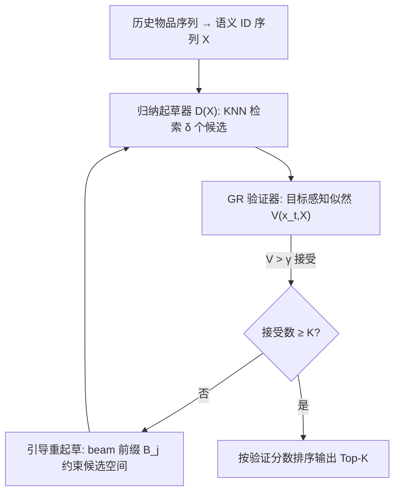
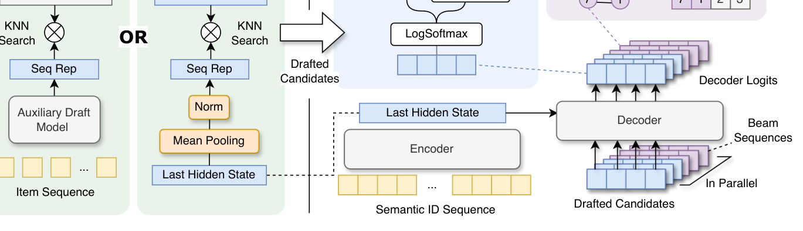

# Inductive Generative Recommendation via Retrieval-based Speculation (基于检索式投机的归纳生成式推荐)

- **会议/期刊**: AAAI 2026 (Oral)
- **作者与机构**: Yijie Ding, Jiacheng Li, Julian McAuley, Yupeng Hou (UC San Diego)
- **推荐链路定位**: 召回（端到端生成式检索 + 归纳式候选起草）
- **研究方向**: 生成式推荐与离散语义 ID / 冷启动与长尾推荐
- **论文原文**: [https://arxiv.org/abs/2410.02939v2](https://arxiv.org/abs/2410.02939v2)
- **开源代码**: [https://github.com/Jamesding000/SpecGR](https://github.com/Jamesding000/SpecGR)

## TL;DR (1分钟核心速览)

生成式推荐（GR）把物品编码为语义 ID 并自回归生成，理论上可凭语义泛化到新物品，但作者实证发现 GR 几乎只生成训练期见过的语义 ID 序列，新物品推荐性能近乎为零。本文提出 SpecGR：借用投机解码的「草稿-验证」结构，让具备归纳能力的检索器（辅助模型或 GR 自身编码器）起草候选，再由 GR 以目标感知似然做接受/拒绝与重排，并辅以引导重起草。在 Amazon 三个类目、按时间戳切分的归纳评测下，Recall@50 最高相对提升 20.64%，NDCG@50 提升 14.80%，同时推理反而加速约 1.7 倍。

## Background & Motivation (背景与核心矛盾)

- **主流范式**: TIGER 类 GR 模型用 RQ-VAE 将物品量化成多层语义 ID，以自回归 next-token 生成做下一物品预测，凭 scaling law 与统一检索-排序能力超越 SASRec 等 ID 式序列模型。
- **前人局限**: 其一，GR 对训练期语义 ID 模式过拟合，输出分布几乎不覆盖未见语义 ID 组合，归纳场景下新物品召回接近零；其二，TIGER_C 的启发式混入与 LIGER 的稠密检索结果拼接只是「混合输出」，未利用 GR 的排序建模能力，引入大量无关物品，整体指标被拖累。
- **核心洞察 (Key Insight)**: 新物品的语义 ID 虽未被生成过，但其**前缀**（纯语义位）落在模型已学分布内；真正越界的是末位 item identification token。因此只要绕开「生成完整 ID」这一步，改由外部起草候选、GR 只对候选打分，就能既保留 GR 的强排序力又获得归纳性。
- **本文切入点**: 把投机解码的 drafter-verifier 从「同源小模型加速」重解释为「异质能力互补」——归纳检索器负责"提出"，GR 负责"裁决"。

## Method (核心方法设计)

### 1. 整体框架 (Overall Architecture)

输入用户历史物品序列，先经语义 ID 分词得到 $X=[\langle bos\rangle, ID_1,\dots,ID_w,\langle eos\rangle]$。归纳起草器$D(\cdot)$基于序列表示做 KNN 检索，产出$\delta$个候选$Q=D(X)$（可含新物品）；GR 验证器对每个候选计算目标感知对数似然$V(x_t,X)$，超过阈值$\gamma$则接受；若接受数不足$K$，GR 用 beam search 产生语义 ID 前缀集合$B_j$引导下一轮重起草；凑满$K$即自适应退出，最终按验证分数排序输出。全流程迭代次数不超过语义 ID 长度$l$，最坏情况不慢于原始 beam search 解码。

<figure class="paper-figure" markdown="span">
  <figcaption>图 2：所提出的 SpecGR 方法示意图，这是一个起草与验证框架，迭代执行起草和验证，直到接受足够多的物品。(a) 归纳起草。归纳起草器首先检索一组包含新物品的候选。我们提出两种起草方法：使用辅助模型或 GR 的编码器输出（即自起草）进行物品检索。(b) 目标感知验证。GR 模型根据成为目标的似然度接受或拒绝候选。(c) 引导重起草。如果接受的物品不够，GR 会过滤</figcaption>
</figure>

### 2. 关键设计拆解 (Key Designs)

1. **目标感知验证与识别位剔除（Target-aware Verifying）**：直接对未见物品套用 QLM 似然会因末位识别 token 落在分布外而系统性偏低。本文对已见物品按全部 $l$位求均值，对未见物品**剔除末位识别 token** 只对前$l-1$ 位语义位求均值：
$$V(x_t,X)=\begin{cases}\frac{1}{l}\sum_{i=1}^{l}\log P(c^t_i\mid c^t_{<i},X), & x_t\in\mathcal{I}\\ \frac{1}{l-1}\sum_{i=1}^{l-1}\log P(c^t_i\mid c^t_{<i},X), & x_t\in\mathcal{I}^*\setminus\mathcal{I}\end{cases}$$
按位数归一化消除长度偏差，使新旧物品的验证分数可比——这是"公平裁决"的关键。

2. **引导重起草（Guided Re-drafting）**：首批候选被拒后，后续批次在起草器排序中位置靠后、接受率骤降。本文让 GR 在验证的同时用 beam search 产出 $j$位语义 ID 前缀集$B_j$，下一轮只允许前缀命中的候选进入：
$$Q_j=\{x_i\mid x_i\in D(X),\ (c^i_1,\dots,c^i_j)\in B_j\}$$
即用生成模型的解码轨迹反向约束检索空间，把"广撒网"变成"定向补捞"。附录实测：$\gamma=-1.4$ 时第 2–4 步接受率由 5.93/4.25/2.63% 提升至 6.62/5.51/5.75%。

3. **两种起草策略与训练目标**：SpecGR_Aux 用 UniSRec 做外部起草器（灵活但需维护双模型）；SpecGR++ 复用 GR 编码器自起草——对单物品 $[\langle bos\rangle,ID_i,\langle eos\rangle]$与历史序列取末层隐状态均值池化，先以对比损失$\mathcal{L}_{CL}$联合生成损失$\mathcal{L}_{Gen}$多任务预训练（$\lambda_1=6.0$，嵌入批$B_{emb}=2048 \gg B_{gen}=256$以扩充 in-batch 负样本），再用大负样本交叉熵$\mathcal{L}_{CE}$做 learning-to-rank 微调（$\lambda_2=6.0$）。推理为免负采样检索，起草延迟仅 0.0003s。

## Experimental Setup & Evaluation Protocol (实验设置与评估协议)

- **数据集与预处理**: Amazon Reviews 2023 三个类目，官方 `5-core` 过滤基准：

| 数据集 | #Items (K) | #Train Inter. (K) | #Test Inter. (K) | 测试集新物品交互占比 | 场景说明 |
| :--- | :---: | :---: | :---: | :---: | :--- |
| Games | 25.6 | 645.3 | 41.5 | 60.3% | 视频游戏 |
| Office | 77.6 | 1230.2 | 211.3 | 59.4% | 办公用品 |
| Phones | 111.5 | 1841.5 | 297.4 | 68.3% | 手机配件 |

- **数据划分与防穿越**: **全局时间戳切分**（预定义 timestamp cut-off），验证/测试集天然含训练期未见物品，比 leave-last-out 更贴近真实上新场景。
- **排名评测协议**: 全库 `Full-Ranking`，指标 Recall@{10,50} 与 NDCG@{10,50}；额外按目标是否为已见物品拆为 **In-Sample / Unseen** 两个子集分别汇报。
- **对比基线与超参**: ID 式 SASRec_ID；特征+ID 式 FDSA、S³-Rec；模态式 UniSRec、RecFormer；生成式 TIGER、TIGER_C、LIGER。序列截断 20，语义 ID 分词与 TIGER 一致，$\gamma$、beam 大小$\beta$、起草规模$\delta$ 在验证集调优。

## Key Experimental Results (实验关键数据)

### 1. 主实验对比 (Main Results)

| 数据集 | 指标 | SASRec_ID | UniSRec | RecFormer | TIGER | LIGER | SpecGR_Aux | SpecGR++ | Improv. |
| :--- | :--- | :---: | :---: | :---: | :---: | :---: | :---: | :---: | :---: |
| Games | R@50 | 0.0477 | 0.0621 | 0.0740 | 0.0584 | 0.0635 | **0.0778** | 0.0717 | +5.13% |
| Games | N@50 | 0.0162 | 0.0200 | 0.0218 | 0.0193 | 0.0172 | **0.0239** | 0.0225 | +9.72% |
| Office | R@50 | 0.0217 | 0.0322 | 0.0340 | 0.0308 | 0.0268 | **0.0360** | 0.0332 | +5.93% |
| Office | N@50 | 0.0074 | 0.0105 | 0.0106 | 0.0109 | 0.0072 | **0.0119** | 0.0113 | +8.76% |
| Phones | R@50 | 0.0143 | 0.0233 | 0.0236 | 0.0232 | 0.0226 | **0.0285** | 0.0275 | +20.64% |
| Phones | N@50 | 0.0047 | 0.0077 | 0.0070 | 0.0078 | 0.0059 | **0.0090** | **0.0090** | +14.80% |

子集拆解（Games，Unseen 占 60.3%）：TIGER 在 Unseen 上 R@50 为 0（无法生成新 ID），LIGER 靠稠密检索拿到 0.0765 但 In-Sample 仅 0.0438；SpecGR_Aux 取得 Unseen 0.0312 / In-Sample 0.1485 的更优折中。

### 2. 消融实验 (Ablation Study)

| 变体 (Games / Phones, R@50) | Games R@50 | Games N@50 | Phones R@50 | Phones N@50 |
| :--- | :---: | :---: | :---: | :---: |
| w/o 归纳起草 (1.1) | 0.0609 | 0.0202 | 0.0233 | 0.0080 |
| w/o 似然分数校正 (1.2) | 0.0712 | 0.0221 | 0.0236 | 0.0081 |
| w/o 引导重起草 (1.3) | 0.0611 | 0.0202 | 0.0264 | 0.0086 |
| w/o 验证重排 (1.4) | 0.0703 | 0.0219 | 0.0264 | 0.0083 |
| w/o 自适应退出 (1.5) | 0.0694 | 0.0200 | 0.0265 | 0.0086 |
| 直接用 TIGER 编码器 (2.1) | 0.0582 | 0.0192 | 0.0232 | 0.0078 |
| w/o 对比预训练 (2.2) | 0.0581 | 0.0193 | 0.0234 | 0.0077 |
| w/o 排序微调 (2.3) | 0.0692 | 0.0225 | 0.0259 | 0.0087 |
| **SpecGR++ 完整版** | **0.0717** | **0.0225** | **0.0275** | **0.0090** |

### 3. 关键实验发现 (Key Findings)

1. **归纳能力几乎全部来自起草环节**：去掉归纳起草后 Games R@50 从 0.0717 跌至 0.0609（−15%），是消融中最大跌幅；而识别位剔除（1.2）在 Phones 上把 R@50 从 0.0236 拉回 0.0275，证明"末位 token 噪声"确实是压制新物品分数的元凶。
2. **引导重起草是效率而非仅效果模块**：去掉后 Games R@50 掉 15%，且附录显示后续解码步接受率提升近一倍，说明前缀约束同时改善候选质量与验证轮数。
3. **自起草可替代外部模型且更省**：SpecGR++ 仅 13.28M 参数（SpecGR_Aux 16.16M、RecFormer 233.73M），性能与 Aux 相当；去掉对比预训练后 Games R@50 从 0.0717 崩至 0.0581，验证"生成模型隐状态不能直接当表示用"。

## Highlights & Limitations (亮点、对比与审稿批判)

- **与代表作对比 (vs. Prior Work)**: 与 TIGER_C 的固定比例混入、LIGER 的稠密检索拼接相比，SpecGR 的本质差异是**所有最终结果都由 GR 验证器打分排序**，而非分数/名次的事后融合；附录 A5 显示三种 ensemble 的 Unseen 性能均被两个基模型上界锁死，而 SpecGR 的 Unseen R@50 达 0.0312，远超两者。
- **可迁移亮点**: (1) "剔除识别位再算似然"这一技巧可直接迁移到任何带冲突消解位的语义 ID 体系（如 RQ-VAE 末位、ActionPiece）；(2) 用生成模型 beam 前缀反向约束检索空间，可复用于 RAG 式推荐的候选裁剪。
- **审稿级局限批判**: 其一，归纳能力上限受起草器制约，SemanticKNN 起草时加速比仅 1.11、接受率 0.20，弱起草器下收益明显缩水；其二，评测仅限 Amazon 三品类且新物品语义 ID 由离线分词器预先分配，未验证在线增量分配语义 ID 时的分布漂移；此外 $\gamma$、$\delta$、$\beta$ 三参需逐数据集调优，对工业部署的鲁棒性尚待检验。

## Rating (四维评分)

- **方法创新性 (Novelty)**: ⭐⭐⭐⭐ （把投机解码从"加速"重构为"能力互补"，视角新颖，但各组件本身均为已有技术的巧妙重组）
- **评估协议与实验扎实度 (Protocol & Experiments)**: ⭐⭐⭐⭐ （时间戳切分 + In-Sample/Unseen 子集拆解非常到位，消融覆盖推理与训练两层面，唯数据集限于 Amazon 单源）
- **写作与数学规范度 (Clarity & Rigor)**: ⭐⭐⭐⭐ （验证分数分段定义与复杂度分析清晰，$T\leq l$ 的迭代上界论证严谨，部分符号在正文与附录间略有重复）
- **工业落地与复现价值 (Industrial & Practical Value)**: ⭐⭐⭐⭐⭐ （即插即用、代码开源、4 位语义 ID 下 1.7× 加速且最坏不慢于基线，可控归纳强度对上新运营极具吸引力）
