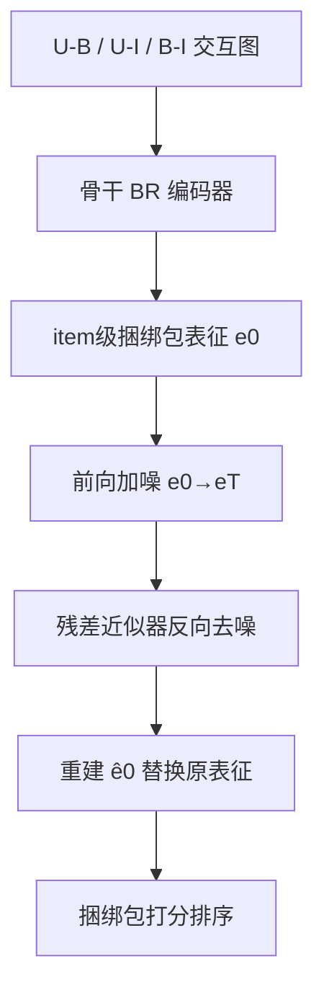
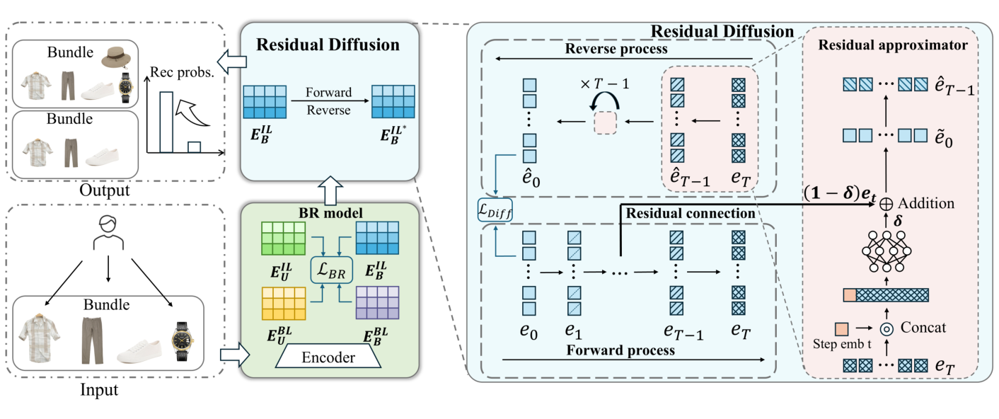

# Modeling Item-Level Dynamic Variability with Residual Diffusion for Bundle Recommendation (面向捆绑包推荐的item级动态变化残差扩散建模)

- **会议/期刊**: AAAI 2026 (Extended version)
- **作者与机构**: Dong Zhang, Lin Li, Ming Li, Amran Bhuiyan, Meng Sun, Xiaohui Tao, Jimmy Xiangji Huang (武汉理工大学 / 约克大学 / 南昆士兰大学)
- **推荐链路定位**: 召回（捆绑包推荐打分）
- **研究方向**: 生成式推荐与离散语义ID / 图神经网络推荐
- **论文原文**: [https://arxiv.org/abs/2507.03280v5](https://arxiv.org/abs/2507.03280v5)
- **开源代码**: [https://github.com/WUT-IDEA/RDiffBR](https://github.com/WUT-IDEA/RDiffBR)

## TL;DR (1分钟核心速览)

真实场景中捆绑包-商品（B-I）归属会随季节、库存、偏好动态增删，而捆绑包主题相对稳定；现有 BR 模型在 item 级变化下 Recall 可跌 19%。本文提出模型无关的生成式框架 RDiffBR：在潜空间对 BR 模型产出的 item 级捆绑包表征做前向加噪-反向残差去噪，推理时以变化后的表征为起点反向生成"主题对齐"表征。在 4 个数据集、6 个骨干模型上，Recall/NDCG 最高提升 23%（如 iFashion 上 MIDGN 提升 24.83%），训练时间仅增约 4%。

## Background & Motivation (背景与核心矛盾)

- **主流范式**: BR 依赖 U-B 交互、U-I 交互与 B-I 归属三类信号，主流为图模型（BGCN、HyperMBR、MIDGN、CrossCBR、MultiCBR、BundleGT），分统一学习/分离学习/协同学习三派。
- **前人局限**: ① 所有模型默认 B-I 归属在训练与测试间静态不变，一旦测试期增删 item，item 级捆绑包表征 $E^{IL}_b$ 即偏离训练分布；② 直接套用扩散模型不可行——扩散的重建损失与 BR 的排序损失目标不一致，且通用近似器未针对 item 级变化设计。
- **核心洞察 (Key Insight)**: 实证发现 B-I 变化后 $E^{IL}_b$分布虽更分散，但整体形状与$\rho=0$ 时相似（图5/图6），即**主题分布近似不变**，故无需按 OOD 或冷启动处理，只需把偏移表征"拉回"主题流形。
- **本文切入点**: 复用原捆绑包身份信息，用残差扩散在潜空间做表征级生成式校正，且不改动骨干架构、不引入外部 side info。

## Method (核心方法设计)

### 1. 整体框架 (Overall Architecture)

骨干 BR 模型编码得到 bundle 级与 item 级用户/捆绑包表征；取 item 级捆绑包表征 $e^{IL}_b$作为$e_0$送入残差扩散模块：前向按线性噪声调度注入高斯噪声至$e_T$，反向由残差近似器逐步去噪重建$\hat{e}_0$，与 BR 损失联合训练。推理时，将 B-I 变化场景下骨干产出的$e^{*}_0$先前向加噪$T'$步、再反向生成$\hat{e}_0$ 替换原表征，最后按骨干原方式打分排序。

<figure class="paper-figure" markdown="span">
  <figcaption>图2：所提出的RDiffBR框架概览。</figcaption>
</figure>

### 2. 关键设计拆解 (Key Designs)

1. **潜空间残差扩散的前向-反向过程**：痛点在于 B-I 变化使 $e^{IL}_b$偏移，而直接生成纯噪声起点会丢失主题信息。前向用线性方差调度$1-\bar{\alpha}_t = s\cdot[\alpha_{\min}+\frac{t-1}{T-1}(\alpha_{\max}-\alpha_{\min})]$控制噪声尺度；反向由式(6)的均值$\mu_\theta(\hat{e}_t,t)=\frac{\sqrt{\alpha_t}(1-\bar{\alpha}_{t-1})}{1-\bar{\alpha}_t}\hat{e}_t+\frac{\sqrt{\bar{\alpha}_{t-1}}(1-\alpha_t)}{1-\bar{\alpha}_t}\tilde{e}_0$ 迭代去噪。直觉：以"带噪的偏移表征"而非纯噪声为起点，等价于在主题流形附近做受控生成，天然保留 bundle 主题。
2. **残差近似器 (Residual Approximator)**：通用 MLP 直接回归 $e_0$易过拟合训练期 B-I 归属。本文改为$\tilde{e}_0=\delta f_\theta(\hat{e}_t,t)+(1-\delta)e_{t'}$，把前向第$t'$步的带噪表征作为残差基座、$\delta$ 控制生成增量权重。直觉：残差项锚定原始主题信息，MLP 只学"偏移修正量"，从而在 B-I 变化下输出更紧凑、主题对齐的分布（图6 可视化佐证）。
3. **训练目标与推理效率**：总损失 $\mathcal{L}=\mathcal{L}_{\text{BRmodel}}+\lambda\mathcal{L}_{\text{diff}}$，其中$\mathcal{L}_{\text{diff}}=\mathbb{E}_{t\sim U(1,T)}\mathbb{E}_q[\|e_0-\hat{e}_\theta(e_t,e_{t'},t)\|_2^2]$，无需负采样（BR 骨干自带 BPR/对比损失）。复杂度上扩散项为$O(|B|d)+O(|B|d)d'n$，因$|B|\ll|E|$（如 iFashion$|E|=1{,}679{,}708\gg|B|=27{,}694$），实测单 epoch 训练仅增 1.76%–4.87%。

## Experimental Setup & Evaluation Protocol (实验设置与评估协议)

- **数据集与预处理**: 四个跨域公开数据集，沿用原作者划分：

| 数据集 | #Users | #Items | #Bundles | #U-B | #B-I | Avg. I/B | 场景 |
| :--- | :---: | :---: | :---: | :---: | :---: | :---: | :--- |
| Youshu | 8,039 | 32,770 | 4,771 | 51,377 | 176,667 | 37.03 | 书单 |
| NetEase | 18,528 | 123,628 | 22,864 | 302,303 | 1,778,838 | 77.8 | 歌单 |
| iFashion | 53,897 | 42,563 | 27,694 | 1,679,708 | 106,916 | 3.86 | 穿搭 |
| MealRec+ | 1,575 | 7,280 | 3,817 | 46,767 | 11,451 | 3 | 套餐 |

- **数据划分与防穿越 (Splitting Strategy)**: U-B 交互按比例随机划分 train/val/test；B-I 归属 $Z$均分十份，前 5 份为$Z_{train\&val}$，测试期按$\rho\in\{-4,\dots,5\}$增删第 6–10 份构造$Z_{test}$（式11），$\rho<0$删 item、$\rho>0$加 item、$\rho=0$ 不变，从而可控模拟 B-I 动态变化。
- **排名评测协议 (Ranking Protocol)**: 全库未交互捆绑包排序（Full-Ranking），指标 Recall@K 与 NDCG@K，$K\in\{10,20,40,80\}$，正文以 K=20 为主、K=40 曲线佐证一致性。
- **对比基线与超参设置**: 6 个骨干（BGCN、HyperMBR、MIDGN、CrossCBR、MultiCBR、BundleGT）均用官方代码，Adam 学习率 0.001，$T,T'\in[1,200]$，$\lambda\in(0,5)$，$\delta\in(0,1)$，MLP 层数$\{1,2,4,8\}$、隐层$[8,4096]$，双 GTX 4090。

## Key Experimental Results (实验关键数据)

### 1. 主实验对比 (Main Results)

以最具代表性的 iFashion 与 MealRec+ 为例（R@20 / N@20，$\rho=-4$ 为最严苛删减场景）：

| 数据集 | 骨干 | 原模型 | +RDiffBR | Improv.% |
| :--- | :--- | :---: | :---: | :---: |
| iFashion ($\rho=-4$) | BGCN | .0473/.0331 | **.0488/.0341** | 3.09/2.91 |
| iFashion ($\rho=-4$) | MIDGN | .0372/.0257 | **.0426/.0290** | 14.55/12.83 |
| iFashion ($\rho=-4$) | CrossCBR | .0624/.0491 | **.0720/.0554** | 15.36/12.87 |
| iFashion ($\rho=-4$) | BundleGT | .0444/.0352 | **.0456/.0361** | 2.68/2.58 |
| MealRec+ ($\rho=-4$) | BGCN | .1068/.1888 | **.1180/.2078** | 10.07/10.55 |
| MealRec+ ($\rho=-4$) | CrossCBR | .0612/.1048 | **.0681/.1203** | 14.80/11.40 |
| MealRec+ ($\rho=-4$) | BundleGT | .0732/.1281 | **.0863/.1512** | 18.03/17.88 |
| Youshu ($\rho=-4$) | HyperMBR | .1464/.0953 | **.1789/.1109** | 22.20/16.42 |
| NetEase ($\rho=-4$) | CrossCBR | .0715/.0386 | **.0772/.0419** | 7.99/8.50 |

全局最优提升出现在 iFashion $\rho=2$的 MIDGN（R@20 +24.66%、N@20 +24.83%）；$\rho>0$加 item 场景最高提升 24.83%，$\rho<0$ 删 item 场景最高 22.15%。

### 2. 消融实验 (Ablation Study)

$\rho=-3$ 下移除残差连接（`w/o R`）对比：

| 骨干 | 数据集 | 原模型 R@20 | +RDiffBR | w/o R |
| :--- | :--- | :---: | :---: | :---: |
| BGCN | Youshu | .2214 | **.2366** | .2158 |
| CrossCBR | NetEase | .0767 | **.0810** | .0782 |
| BundleGT | Youshu | .2836 | **.2908** | .2519 |
| BundleGT | MealRec+ | .1398 | **.1616** | .2313* |

（*MealRec+ 上 BundleGT 的 w/o R 数值异常偏高，原文未解释，疑为个例波动。）

### 3. 关键实验发现 (Key Findings)

1. **残差连接是性能命门**：去掉残差后多数配置反而不如原骨干（如 BundleGT 在 Youshu 从 .2908 跌至 .2519，低于原模型 .2836），说明"纯扩散"无法生成主题对齐表征，残差基座才是保留 bundle 主题的关键。
2. **对比学习骨干更抗变化、但增益更小**：MIDGN/CrossCBR/MultiCBR 在 $\rho<0$ 下本身较稳（CrossCBR 仅降约 1%），故 RDiffBR 增益 1%–3%；而 HyperMBR 因双曲空间对距离误差敏感、跌幅最大，RDiffBR 反而带来 22.20% 的最大修复增益——**基线越脆弱，生成式校正收益越大**。
3. **$\rho=0$亦有正收益且可超越无变化基线**：部分配置下 +RDiffBR 在$\rho\neq0$时甚至超过原模型$\rho=0$ 的表现，说明生成过程起到了正则化与主题泛化的双重作用，而非单纯"纠偏"。

## Highlights & Limitations (亮点、对比与审稿批判)

- **与代表作对比 (vs. Prior Work)**: 相比 DCBR 等将扩散用于 BR 的协同学习方案，本文首次把扩散定位为**推理期表征校正器**而非训练期增强器；相比 CrossCBR/MultiCBR 的对比学习多视图融合，本文不依赖多视图、不改骨干、不需 side info，属即插即用后处理；相比冷启动 BR 工作，本文论证了 B-I 变化不构成 OOD，无需重建 bundle 身份。
- **可迁移亮点**: ① "以带噪偏移表征为扩散起点 + 残差基座"的范式可迁移到任何表征漂移场景（如跨域迁移、时序漂移召回）；② 用 $\rho$ 参数化增删比例构造可控变化测试集的方法，可作为 BR 鲁棒性评测的标准协议。
- **审稿级局限批判**: ① 推理需额外 $T'$ 步前向-反向迭代，虽训练开销仅 4%，但**在线打分延迟未报告**，高 QPS 场景存疑；② 评测仅在合成式 B-I 增删（均匀十等分）下进行，缺乏真实平台 B-I 演化日志与线上 A/B，且 MealRec+ 消融出现反常数值未加解释，削弱结论稳健性。

## Rating (四维评分)

- **方法创新性 (Novelty)**: ⭐⭐⭐⭐ （首次定义 item 级 B-I 动态变化问题，残差扩散作为推理期校正器的定位新颖，但扩散算子本身为标准 DDPM 变体）
- **评估协议与实验扎实度 (Protocol & Experiments)**: ⭐⭐⭐⭐ （4 数据集 × 6 骨干 × 5 档 $\rho$ 覆盖充分，Full-Ranking 协议规范；扣分于合成变化构造与个别异常数值缺解释）
- **写作与数学规范度 (Clarity & Rigor)**: ⭐⭐⭐⭐ （前向/反向推导完整、算法伪代码清晰，但式(7)中 $e_{t'}$与$t'$ 的取值规则表述略含糊）
- **工业落地与复现价值 (Industrial & Practical Value)**: ⭐⭐⭐⭐ （模型无关、即插即用、训练仅增 4%、代码开源，落地门槛低；推理延迟未评估为主要保留项）

