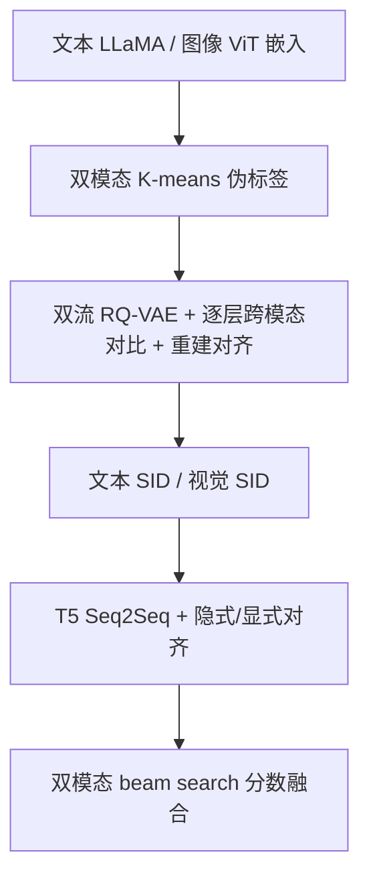
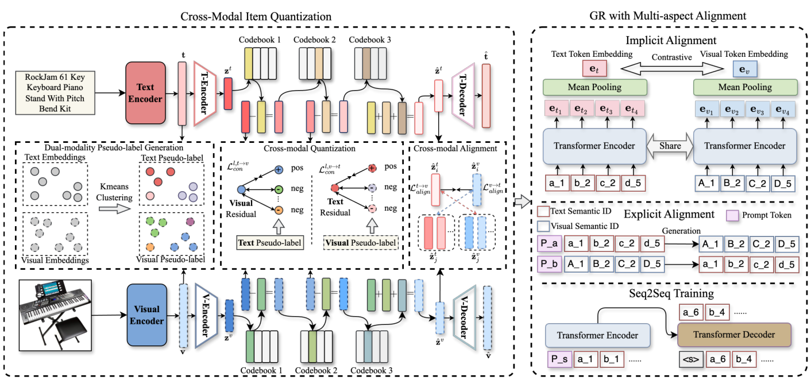

# Multi-Aspect Cross-modal Quantization for Generative Recommendation (多方位跨模态量化生成式推荐)

- **会议/期刊**: AAAI 2026 (Oral)
- **作者与机构**: Fuwei Zhang, Xiaoyu Liu, Fuzhen Zhuang, Zhao Zhang 等（北航人工智能学院、美团、北航软件学院）
- **推荐链路定位**: 端到端生成式（语义 ID 构建 + Seq2Seq 生成检索）
- **研究方向**: 生成式推荐 / 多模态推荐
- **论文原文**: [https://arxiv.org/abs/2511.15122v2](https://arxiv.org/abs/2511.15122v2)
- **开源代码**: [https://github.com/zhangfw123/MACRec](https://github.com/zhangfw123/MACRec)

## TL;DR (1分钟核心速览)

生成式推荐（GR）依赖 RQ-VAE 把物品离散化为层次语义 ID，但现有方法只用单模态文本嵌入，且各模态独立量化、深层码本语义漂移严重。MACRec 在残差量化的每一层注入跨模态对比学习与重建对齐，并在 GR 训练阶段加入隐式（潜空间对比）与显式（跨模态生成任务）对齐。在三个 Amazon 数据集、Leave-One-Out + Full-Ranking 协议下，HR@10 相对最强基线 MQL4GRec 提升 3.0%–9.4%，物品 ID 冲突率最高下降 17.1%。

## Background & Motivation (背景与核心矛盾)

- **主流范式**: TIGER 开创"RQ-VAE 量化物品嵌入 → 语义 ID 序列 → Transformer 下一 token 预测"的 GR 范式；LETTER、MQL4GRec 等在其上引入协同嵌入或多模态/跨域信息。
- **前人局限**: 其一，语义 ID 几乎全部由文本嵌入量化而来，同品牌不同功能商品（如某品牌各类乐器）在文本空间距离过近，判别性不足；其二，多模态 GR（如 MQL4GRec）对每个模态**独立**量化，量化过程无跨模态交互，RQ 深层码本语义损失大、码本坍缩与 ID 冲突频发。
- **核心洞察 (Key Insight)**: 图 1 的可视化显示文本嵌入擅长按品牌聚类、图像嵌入擅长区分乐器类型——两模态捕捉的是**互补**的语义侧面，因此跨模态信号应当进入量化过程本身，而非仅在量化后拼接。
- **本文切入点**: 把跨模态对比学习下沉到 RQ-VAE 的每一层残差量化与重建中，再在 GR 训练端补上隐式/显式两类对齐，形成"ID 学习 + 模型训练"双阶段的跨模态融合。

## Method (核心方法设计)

### 1. 整体框架 (Overall Architecture)

模型分左右两段。左段为跨模态物品量化：先用 LLaMA 与 ViT-L/14 分别编码文本与图像，各自 K-means 聚类生成双模态伪标签；随后双流 RQ-VAE 逐层量化，每层用对侧模态伪标签构造正样本做跨模态 InfoNCE，并对量化后重建表示做双向对齐；冲突 ID 按物品-码本距离重分配。右段为 GR 训练：将文本 SID 与视觉 SID 分别构造成序列，用 T5 编码器-解码器做 Seq2Seq 下一物品预测，同时施加潜空间隐式对齐与物品级/序列级显式跨模态生成任务。推理时两模态各自约束 beam search，分数平均融合。

<figure class="paper-figure" markdown="span">
  <figcaption>图 2：MACRec 的整体架构。左侧：跨模态物品量化，包括双模态伪标签生成、跨模态量化和跨模态重建对齐，旨在生成跨不同模态的高质量语义 ID。右侧：多方位对齐的生成式推荐，通过隐式对齐、显式对齐对齐来自不同模态的特征，并以 Seq2Seq 任务训练 GR 模型。</figcaption>
</figure>

### 2. 关键设计拆解 (Key Designs)

1. **逐层跨模态量化对比（Cross-modal Quantization）**：独立量化导致码本坍缩与互补信息浪费。在第 $l$层，用视觉伪标签$C^{vision}$定义文本残差的正样本、反之亦然，损失为$\mathcal{L}^{l}_{con}=\mathcal{L}^{l,v\to t}_{con}+\mathcal{L}^{l,t\to v}_{con}$，其中单向项形如$-\frac{1}{B}\sum_i \log\frac{\exp(\langle r^t_i,r^t_{i,pos}\rangle/\tau)}{\sum_j \exp(\langle r^t_i,r^t_j\rangle/\tau)}$。直觉是让"同视觉类"的文本残差互相靠近，从而在码本分配时把图像判别性注入文本 ID，降低冲突。
2. **跨模态重建对齐（Reconstruction Alignment）**：量化表示 $\hat{z}^t=\sum_l e^t_{l,c^t_l}$、$\hat{z}^v=\sum_l e^v_{l,c^v_l}$之间做双向 InfoNCE$\mathcal{L}_{align}$，迫使两模态码本在语义上互相校准，平衡码本利用率。总 ID 损失为$\mathcal{L}_{ID}=\mathcal{L}_{RQ\text{-}VAE}+\lambda_{con}\sum_l \mathcal{L}^l_{con}+\lambda_{align}\mathcal{L}_{align}$。
3. **GR 端多方位对齐与训练目标**：隐式对齐对 T5 编码后的 SID 表示做对比（$\mathcal{L}_{implicit}$）；显式对齐构造"文本 SID→视觉 SID""视觉 SID→文本 SID"的物品级与序列级生成任务。最终$\mathcal{L}_{rec}=-\sum_t \log P_\theta(y_t|y_{<t},x)+\lambda_{implicit}\mathcal{L}_{implicit}$。训练为常规 teacher-forcing 交叉熵，无额外负采样；推理用约束 beam search，开销与 TIGER 同级（两模态各一次解码）。

## Experimental Setup & Evaluation Protocol (实验设置与评估协议)

- **数据集与预处理**: 取自 Amazon Product Reviews，三个类目，未注明 k-core 过滤细节：

| 数据集 | #Users | #Items | #Interactions | 稀疏度 | 特征/场景说明 |
| :--- | :---: | :---: | :---: | :---: | :--- |
| Instruments | 17,112 | 6,250 | 136,226 | 99.87% | 平均序列长 7.96 |
| Arts | 22,171 | 9,416 | 174,079 | 99.92% | 平均序列长 7.85 |
| Games | 42,259 | 13,839 | 373,514 | 99.94% | 平均序列长 8.84 |

- **数据划分与防穿越 (Splitting Strategy)**: `Leave-One-Out`（沿用 P5/MQL4GRec 设定）。
- **排名评测协议 (Ranking Protocol)**: 无偏 `Full-Ranking`，对全物品库排序，非采样排序。
- **对比基线与超参设置**: 基线含 BERT4Rec、SASRec、FDSA、S³-Rec、MISSRec、P5-CID、VIP5、TIGER、MQL4GRec；码本大小 $M=256$、4 层 RQ、聚类数$K=512$、T5 编解码各 4 层 6 头（$d=64$）、AdamW（batch 1024, lr 0.001）、$\tau=0.1$、$\lambda_{align}=0.001$、$\lambda_{implicit}=0.01$，$\lambda^l_{con}$从第 3 层起取 0.1；5 个随机种子平均，$p<0.05$ 显著性检验。

## Key Experimental Results (实验关键数据)

### 1. 主实验对比 (Main Results)

| 数据集 | 指标 | TIGER | MQL4GRec | MISSRec | MACRec | Improv. (vs 最优基线) |
| :--- | :--- | :---: | :---: | :---: | :---: | :---: |
| Instruments | HR@10 | 0.1221 | 0.1291 | 0.1361 | **0.1363** | +0.1% |
| Instruments | NDCG@10 | 0.0950 | 0.0997 | 0.0880 | **0.1046** | +4.9% |
| Arts | HR@10 | 0.1167 | 0.1254 | 0.1321 | **0.1329** | +0.6% |
| Arts | NDCG@10 | 0.0806 | 0.0898 | 0.0815 | **0.0953** | +6.1% |
| Games | HR@10 | 0.0857 | 0.1007 | 0.1048 | **0.1078** | +2.9% |
| Games | NDCG@10 | 0.0453 | 0.0538 | 0.0499 | **0.0565** | +5.0% |
| Arts | HR@1 | 0.0532 | 0.0626 | 0.0479 | **0.0685** | +9.4% |

（MACRec 全部指标带 * 显著性标记；相对 MQL4GRec 的 HR@10 提升为 3.0%–9.4%，NDCG@10 提升 4.9%–6.1%。）

### 2. 消融实验 (Ablation Study)

| 变体 (HR@10) | Instruments | Arts | Games |
| :--- | :---: | :---: | :---: |
| MACRec 完整 | **0.1363** | **0.1329** | **0.1078** |
| w/o $\mathcal{L}^l_{con}$ | 0.1289 | 0.1283 | 0.1018 |
| w/o $\mathcal{L}_{align}$ | 0.1310 | 0.1301 | 0.1026 |
| w/o $\mathcal{L}_{implicit}$ | 0.1312 | 0.1296 | 0.1042 |
| w/o 显式对齐 | 0.1296 | 0.1299 | 0.1037 |

### 3. 关键实验发现 (Key Findings)

1. **逐层跨模态对比是最大贡献项**：移除 $\mathcal{L}^l_{con}$ 后 Games 上 HR@10 从 0.1078 掉到 0.1018（-5.6%），降幅超过其他任一模块，说明把跨模态信号放进量化过程本身比事后对齐更关键。
2. **冲突率与码本利用率同步改善**：Instruments 文本 ID 冲突率 2.76%→2.38%、图像 3.71%→3.23%，Games 文本 3.51%→2.91%；图 4 显示第 2 层码本分配更均匀，验证"降低冲突 → 提升码本可用性"的因果链。
3. **对比损失不宜从第 1 层施加**：超参分析表明从第 1 层开始会抹除模态特有信息，从第 3 层起效果最佳——深层 VQ 恰是语义损失最严重处，跨模态信号在此处补偿收益最大。

## Highlights & Limitations (亮点、对比与审稿批判)

- **与代表作对比 (vs. Prior Work)**: 相比 TIGER 的单模态文本量化，MACRec 引入视觉互补语义；相比 MQL4GRec 的"各模态独立量化 + 跨域统一码本"，本文的核心差异是把跨模态交互**前移到量化层内部**，而非仅在训练目标上做融合；相比 MISSRec 等对比式多模态序列模型，本文走的是生成式检索路线，NDCG 优势更明显。
- **可迁移亮点**: ①"用对侧模态伪标签构造逐层对比正样本"可低成本迁移到任何 RQ-VAE 类语义 ID 构建（如音频、视频模态）；②显式对齐中"物品级 + 序列级双向生成任务"是一种免额外标注的多任务增广范式。
- **审稿级局限批判**: ①推理需两模态各跑一次 beam search 再融合，端到端延迟约为单模态 GR 的两倍，论文未给出线上时延数据；②仅在 Amazon 三个中等规模类目验证，且未报告 k-core 过滤细节，跨域/大规模工业场景的泛化性与冷启动物品上的表现仍待检验。

## Rating (四维评分)

- **方法创新性 (Novelty)**: ⭐⭐⭐⭐ （首次将跨模态对比下沉到 RQ 每一层，思路清晰且有可视化动机支撑，但整体仍是 RQ-VAE + InfoNCE 的组合式改良）
- **评估协议与实验扎实度 (Protocol & Experiments)**: ⭐⭐⭐⭐ （Leave-One-Out + Full-Ranking 无偏协议、9 个基线、5 种子与显著性检验齐全，消融与冲突率分析完整；缺线上实验与冷启动分桶）
- **写作与数学规范度 (Clarity & Rigor)**: ⭐⭐⭐⭐ （公式与符号定义规范、模块边界清楚，但部分损失权重与层选择缺乏理论解释，仅靠超参曲线佐证）
- **工业落地与复现价值 (Industrial & Practical Value)**: ⭐⭐⭐⭐ （代码已开源、基于 T5 与标准 RQ-VAE 易复现，主要代价是双模态推理延迟与多阶段训练管线复杂度）

